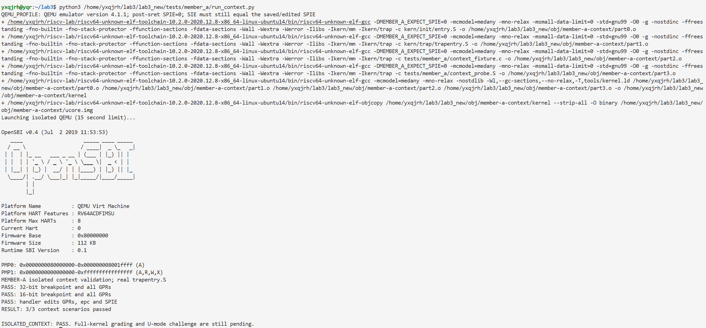
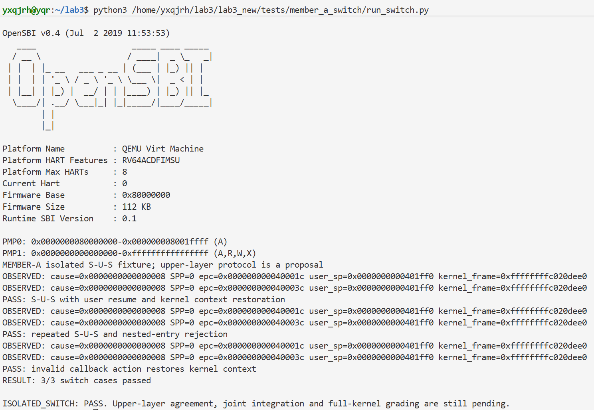

# 操作系统实验报告

> 本轮为 A 侧接口与交接文字定稿：实现和两组通过日志均不变；上层按本文接口对接，不以事先确认作为继续开发的条件。原有阶段表述保留在 Git 历史中。

## 实验基本信息

| 项目 | 内容 |
| --- | --- |
| **实验名称** | Lab3：断，都可以断——中断与异常 |
| **报告范围** | 杨茜茹已完成的 Trap 基础模块、S→U→S 底层实现与独立验证，可并入小组总报告 |
| **负责人** | 2412790-杨茜茹 |
| **阶段记录日期** | 2026-10-27 |
| **当前代码记录** | 本地 `lab3_yang` 分支，基础实现 `1e62511`、上下文验证 `0cf26be`、扩展及个人材料 `3dc7c68` |

### 小组分工

本人负责功能模块一的汇编入口、上下文恢复及相关验证，并参与后续 S→U→S 扩展的底层部分。本稿只填写本人已完成内容；其他成员的姓名、工具、实现和个人操作过程由本人确认后另行汇总。

实验报告中，本人承担整体逻辑分析、功能模块一、相关原理与 AI 协作记录。下文第五章提供本模块的测试材料，供负责测试汇总的同学整合。S→U→S 底层实现已通过独立验证，上层共同接入和完整内核联调尚未完成。

---

## 一、实验目的

1. 理解 RISC-V 进入 Trap 时硬件完成的动作，以及必须由软件保存的通用寄存器状态。
2. 理解 Trap frame 与 C 调用约定之间的关系，使汇编入口能够将上下文交给 C 处理。
3. 实现与 SAVE_ALL 对应的恢复过程，正确使用处理后的寄存器、返回位置和状态执行 sret。
4. 通过可复现的运行测试检查 AI 生成的汇编，并在测试预期与运行环境不一致时查明原因。

---

## 二、实验环境

| 成员 | AI 编程工具 | 底层模型 | 备注 |
| --- | --- | --- | --- |
| 2412790-杨茜茹 | Codex 桌面应用 | 未记录精确版本 | AI 生成实现、测试和文档；本人在 VS Code 的 WSL 终端执行、核对并提交 |

| 环境项目 | 本次实际信息 |
| --- | --- |
| 开发环境 | Windows、VS Code 连接 Ubuntu WSL |
| 工程位置 | `/home/yxqjrh/lab3/lab3_new` |
| 编译器 | `riscv64-unknown-elf-gcc`；实际工具链目录含 `10.2.0-2020.12.8` |
| 模拟器 | `QEMU emulator version 4.1.1` |
| 固件 | OpenSBI v0.4，来自实际启动输出 |
| 被测环境 | RV64、Sv39 内核高地址映射、单核独立测试镜像 |

编译、QEMU 运行和 Git 提交均由本人在 WSL 终端执行。AI 不能直接操作本次 WSL 工程，因此通过检查脚本将文件应用到工程，再由本人返回真实输出；未执行的项目不填通过。

---

## 三、实验整体逻辑分析

### 3.1 本章节的逻辑主线

Lab2 让内核具备物理内存管理和基本页表映射。Lab3 进一步处理执行过程中发生的中断与异常：处理器暂停当前执行，进入指定入口，内核处理事件后恢复被打断的程序。

本实验的主线是：

```text
发生 Trap → 硬件记录原因与位置 → 汇编保存上下文
         → C 分类处理 → 汇编恢复有效上下文 → sret 返回
```

硬件记录的 sepc、scause 和状态位只构成上下文的一部分。C 函数会使用通用寄存器，因此进入 C 之前必须把原程序的寄存器值保存下来。处理函数也可能修改返回位置或寄存器槽，恢复阶段要使用修改后的帧，不能只还原一份不再有效的旧状态。

### 3.2 功能的逐步实现

1. **补齐内存管理依赖。** 正式启动流程会初始化物理内存管理，Lab2 缺口需要完成后才能运行完整内核。这部分由对应成员负责。本人的独立测试不调用该流程。
2. **形成 Trap 入口与恢复闭环。** 根据已有 SAVE_ALL 和 trapframe 布局补全 RESTORE_ALL，建立 __alltraps 与 trap(tf) 的调用关系。这是本人本阶段完成的正式代码。
3. **完成具体中断和异常处理。** 中断路径负责时钟重设、计数等工作；同步异常路径根据原因决定如何处理及调整 epc。两者由对应成员完成，本次未引入她们的新实现。
4. **分别验证底层恢复与完整处理流程。** 先用独立测试检查真实汇编的上下文行为；待正式 handler 和 PMM 完成后，再运行原有 Context、Illegal、Timer 评分并联调。
5. **扩展到 S→U→S。** 该扩展还涉及用户页权限、用户栈、内核栈和进入内核时的栈交换。本阶段已用独立夹具验证底层实现，上层共同接入与正式内核验收仍待完成。

以上是全实验的逻辑关系，不表示所有步骤均已完成。

---

## 四、实验内容与实现

### 功能模块一：Trap 上下文恢复与 Trap 入口

**负责人：** 2412790-杨茜茹。

#### 模块功能描述

**需要实现/修改的函数：**

本模块的修改对象是汇编宏和入口调用段，不能按普通 C 函数理解。

```asm
# kern/trap/trapentry.S
.macro RESTORE_ALL
    # 实现当前 Trap frame 的恢复
.endm

__alltraps:
    # 保留已有 SAVE_ALL，补全向 C 层传参和正常调用的部分

__trapret:
    # 原有 RESTORE_ALL / sret 保留，不新增另一套返回路径
```

其调用的 C 接口保持不变：

```c
void trap(struct trapframe *tf);
```

实际修改只位于 `kern/trap/trapentry.S` 的两处 `lab3 function1` 标记内，署名为 `2412790`。SAVE_ALL、trap.h、trap.c、PMM 和原有测试均未修改。

**功能说明：**

SAVE_ALL 已在当前内核栈上建立 Trap frame。本模块把当前帧地址放入 a0，再调用 trap(tf)。原程序 a0 和 ra 已分别保存在第 10 槽和第 1 槽，所以传参和函数调用不会使它们的原值丢失。正常 C 调用返回后，sp 仍指向该 Trap frame，随后进入 __trapret。

恢复阶段先从帧中取得 status 和 epc，并写入 sstatus、sepc；再恢复通用寄存器。原始 sp 必须最后恢复，否则后续加载会使用错误的帧基址。读取 CSR 时借用的 s0、s1，也要从各自槽中恢复，不能把临时值带回原程序。

关键布局如下：

| 内容 | 槽号 | 字节偏移 |
| --- | --- | --- |
| xN | N | `N × 8` |
| 原始 sp（x2） | 2 | 16 |
| 原始 a0 | 10 | 80 |
| status | 32 | 256 |
| epc | 33 | 264 |
| badvaddr | 34 | 272 |
| cause | 35 | 280 |

完整帧为 288 字节，是 16 的倍数；原栈按 ABI 对齐时，保存帧不会破坏 C 调用要求的对齐。x0 恒为零，不需要恢复；badvaddr 和 cause 用于判断、诊断 Trap，不作为返回地址写回。

本模块不自行给 epc 加固定偏移。断点可能是两字节或四字节，处理函数确定返回位置后，汇编采用 tf->epc 的最终值。异步中断通常需要返回被打断的位置，同样不能在恢复宏里统一跳过一条指令。

#### 最终提示词

以下为按本次实现约束整理的最终修订版。初版可从提交 `1e62511` 追溯；提示词格式完善没有对应一次新的汇编算法修改。

````markdown
[PROMPT]

**任务：**

在当前 Lab3 工程 `kern/trap/trapentry.S` 的两个 `#lab3 function1 YOUR CODE` 标记处，实现基础 Trap 入口调用和上下文恢复；若标记已署名为 `2412790`，审查已有实现并仅作必要修正。

Trap 发生时，硬件记录异常位置和部分控制状态，但不会自动保存全部通用寄存器。框架的 `SAVE_ALL` 已将原程序寄存器和 Trap CSR 保存为栈上的 `struct trapframe`。本任务应让 C 处理函数收到该帧，并在处理函数返回后恢复帧中的有效状态，由原有 `sret` 继续执行。C 可以合法修改返回位置、通用寄存器和返回状态，汇编必须尊重这些修改。

**操作要求：**

1. 必须修改工程中的真实文件，不能只展示代码或补丁；若已有实现满足规格，不为制造修改而重写。
2. 实施前查看 Git 状态，阅读目标文件、`trap.h`、`riscv.h`、`trap.c` 及原有 Context 测试，核对实际接口。
3. 正式源码只允许修改 `RESTORE_ALL` 宏体和 `__alltraps` 中保存完上下文后的调用缺口。保留两处 `lab3 function1` 标记，将对应 `YOUR CODE` 替换为 `2412790`。
4. 不修改 `SAVE_ALL`、`trap.h` 布局、`trap()` 签名、真实 `trap.c`、PMM、启动汇编、链接脚本、共享 Makefile、原有测试或评分脚本。
5. 可新增本人提示词与设计、交接说明。不在本任务实现用户态切栈、时钟中断分派或其他成员负责的异常处理。
6. 保留用户已有改动。不自动提交、推送、回滚或覆盖其他成员代码。

**输出与验证要求：**

说明实际修改位置、帧布局、参数传递和返回状态的处理依据。执行当前条件允许的差异检查及单文件编译，报告真实命令、结果和未执行内容。完整内核受 PMM 或 handler 缺失阻塞时明确记录；单文件通过不能写成 QEMU、Context 评分或全实验通过。独立运行测试与正式内核评分分别记录。

[RELY]

## 最小工程依赖

- `kern/trap/trapentry.S`：已有 `SAVE_ALL`、`RESTORE_ALL`、`__alltraps`、`__trapret`。`__trapret` 已调用 `RESTORE_ALL` 并执行 `sret`。
- `kern/trap/trap.h`：`struct pushregs` 按 x0 至 x31 的顺序记录 32 个通用寄存器；`struct trapframe` 随后包含 `status`、`epc`、`badvaddr`、`cause`。
- `libs/riscv.h`：RV64 下 `REGBYTES=8`，`LOAD=ld`，`STORE=sd`。类型来自真实 `libs/defs.h`，不能另造一套布局。
- `kern/trap/trap.c` 的 C 接口：

```c
void trap(struct trapframe *tf);
```

- RISC-V 调用约定：第一个参数在 `a0`；调用可能破坏 `ra`、参数寄存器和临时寄存器。正常 C 调用返回时应恢复自己的栈帧，调用者仍可定位原 Trap 帧。

## 当前帧布局

| 内容 | 相对当前帧基址的字节偏移 |
| --- | --- |
| xN | `N * REGBYTES` |
| 原始 x2 / sp | 16 |
| status | 256 |
| epc | 264 |
| badvaddr | 272 |
| cause | 280 |

总大小为 288 字节，满足原栈对齐时的 16 字节 C 调用对齐要求。`SAVE_ALL` 保存通用寄存器原值后借用 s0～s4 读取 CSR；它将原始 sp 放入 x2 槽，并清零 sscratch。不能把借用后的 s0～s4 当作被中断程序的原值。

基础框架使用当前内核栈，未实现完整 U 态进入内核时的栈交换。本任务只对当前 S 态入口前提负责。`sret` 对 SIE、SPIE、SPP 的后续变换属于处理器行为，不能要求返回后 sstatus 与保存值逐位相等。

[GUARANTEE]

**必须交付的接口与连接：**

```asm
.macro RESTORE_ALL
    # 恢复当前有效 trapframe 所规定的返回状态
.endm

__alltraps:
    # 保留已有 SAVE_ALL
    # 将当前帧地址传给 trap，并正常调用后返回

__trapret:
    # 保留已有 RESTORE_ALL 和 sret
```

宏和符号名称保持不变，不新增跨文件的正式接口。允许在两处标记范围内选择必要的汇编临时寄存器；这些寄存器最终也必须从对应槽恢复。

**系统约束：**

- 原程序通用寄存器状态来自处理后的帧，不以 C 调用后寄存器的瞬时内容替代。
- 使用帧基址时不能先把它覆盖为原始 sp；恢复 sp 之后不得继续依赖原基址加载其他槽。
- 不写回只用于诊断的 scause、sbadaddr，不将其错作返回地址。
- 不在汇编中固定给 epc 加 2 或加 4；异常指令长度与跳转策略由处理函数决定。
- 不强制设置 SPP、SPIE，不改变处理函数合法决定的返回意图。

[SPECIFICATION]

## RESTORE_ALL 宏

**Pre-Condition：** sp 指向完整、有效且经 C 处理后的 trapframe；本轮采用框架支持的内核栈入口。

**Post-Condition：** x1、x3～x31 与各自槽值一致，x2 使用保存的 sp 槽；sstatus、sepc 在执行 sret 前采用处理后的 status、epc。x0 保持零。帧存储不被破坏。

**Case 1：处理函数不改变帧。** 恢复被中断程序的 GPR 和返回位置，即使 C 实际使用过 ra、a0、临时寄存器，也不能丢失原值。

**Case 2：处理函数修改返回位置。** 采用新的 epc；两字节和四字节断点均不由恢复宏重复调整。

**Case 3：处理函数修改寄存器槽。** 对 t0、a0 或 s2 等槽的合法修改应体现在返回后的寄存器中，其他槽保持各自值。

**Case 4：处理函数修改返回状态。** 将修改后的 status 交给 sret，不用硬编码常量覆盖它；最终位变化按实际处理器或模拟器语义解释。

**Requirements：** 恢复 CSR 时借用的 GPR 也须正确恢复；不能因提前恢复 sp 丢失帧地址。不要通过增加整段新保存逻辑重复或改变 SAVE_ALL 的既定语义。

## __alltraps 调用部分

**Pre-Condition：** 硬件已进入入口，原有 SAVE_ALL 已完整构造帧；栈可用于正常 C 调用。

**Post-Condition：** trap 收到该帧的地址；调用返回后能够继续使用同一帧进入 __trapret。

**Case 1：同步异常。** C 根据异常类型处理并可更新 epc；返回流程尊重处理结果。

**Case 2：异步中断。** C 完成中断处理后可返回原执行位置；本任务不负责重设时钟或累计 ticks。

**Requirements：** a0 必须是当前帧地址，不是原始 sp、原始 a0 或 sepc。调用必须能够返回，不能使用 tail 取代正常调用，也不能只靠 caller-saved 寄存器跨调用保留唯一帧地址。

## 验证与边界

**Pre-Condition：** RISC-V 工具链可用，原始测试未被修改。

**Post-Condition：** 真实记录验证范围、结果和依赖。

**Case 1：仅能编译汇编单元。** 记录单文件通过，完整运行仍待验证。

**Case 2：独立测试可运行。** 使用单独测试镜像验证真实汇编，明确测试 C handler 为夹具，不把其行为当作正式异常处理已完成。

**Case 3：其他模块齐备。** 再运行原有 Context 和整机检查，分别记录分数及持续中断返回表现。

**Requirements：** 没执行的项目不能填通过；发现失败应保留输出，先定位实现、测试与运行环境的差异，不修改原始评分预期来迁就结果。
````

#### 实现迭代过程

正式汇编完成了一轮实现与单文件编译。之后进行了独立运行验证，并修正测试的环境假设；正式汇编未因这次测试问题再次修改。

##### 第一次迭代：完成基础汇编与单文件编译

**最终结果：**

- ✅ 实现 RESTORE_ALL 及 __alltraps 中的参数传递和调用。
- ✅ 两处实验标记保留，署名为 2412790。
- ✅ `make obj/kern/trap/trapentry.o` 编译通过，日志退出码为 0。
- ✅ 检查生成对象为 64 位、小端 RISC-V ELF。
- ✅ 在随后独立 QEMU 运行中，三个上下文场景均通过。

首次保存实现的提交为 `1e62511`。单文件编译时尚未获得动态结论，运行结果在独立测试完成后才补入记录。没有观察到需要修改正式汇编的缺陷，不补写虚构的“先写错再修好”过程。

**关键改进点总结：**

1. 将帧布局、调用约定和返回状态作为同一模块的约束，避免只生成一组孤立的 load 指令。
2. 明确原始 sp 的特殊槽及最后恢复要求，防止丢失帧基址。
3. 明确汇编采用处理后的 epc、status 和 GPR 槽，不替具体 handler 决定异常恢复策略。
4. 后续将提示词补成完整四段模板，逐项写明可验证场景和修改边界；该整理过程与实际代码迭代分开记录。

---

### 补充验证任务：Trap 上下文独立 QEMU 测试

**负责人：** 2412790-杨茜茹。

这项测试用于验证功能模块一，是本人补充的验证任务，不是将指导书额外编号成一个新的必做功能模块。

#### 模块功能描述

**需要实现/修改的函数：**

```c
// tests/member_a/context_fixture.c：只进入独立测试镜像
void kern_init(void);
void trap(struct trapframe *tf);
static void sbi(unsigned long id, unsigned long ch);
static void puts_test(const char *s);
static void hex(uintptr_t v);
static void stop(void);  // 不返回
static void require(int ok, const char *what, uintptr_t got);
static uintptr_t expected(unsigned i, int edited);
static void check_regs(const uintptr_t *regs, int edited);

// tests/member_a/context_probe.S：供测试入口调用的汇编探针
void member_a_probe_word(void);
void member_a_probe_half(void);
void member_a_probe_edit(void);
```

```python
# tests/member_a/run_context.py：隔离构建、启动和判定
# main 内部另有构建命令执行辅助函数 run(cmd)。
def main():
    ...
```

**功能说明：**

测试直接编译当前工程中的真实 trapentry.S，沿用真实 entry.S 和 tools/kernel.ld；在独立镜像中提供最小 kern_init、trap 和输出适配，不链接尚未完成的 PMM 和正式 handler。测试文件位于 tests/member_a，不加入正式 Makefile 扫描目录。

探针先保存自己的 C 调用者状态，再设置不同的寄存器模式值，触发明确编码的异常。handler 检查入口帧，返回后再检查寄存器快照，最后恢复调用者状态。这样既检查“保存正确”，也检查“恢复正确”，还能覆盖只看 C handler 中的帧值时容易遗漏的问题。

三个场景分别为：

1. **四字节断点。** 使用 `0x00100073`，检查帧地址、cause、epc、SPP、SIE、sscratch 和全部 GPR，返回后再次核对。
2. **两字节断点。** 使用 `0x9002`，由测试 handler 指定两字节指令后的返回标签，验证控制流和 GPR。
3. **处理后帧生效。** handler 将 t0、a0、s2 改为 `0x5505`、`0x660a`、`0x7712`，修改 epc 跳过一条会改变 t0 的指令，并将保存的 SPIE 置 1。返回后检查指定修改、其他寄存器及 SIE。

所有场景都检查 sp、ra、gp、tp 和 a0。测试 C 代码禁用 small-data 与相应链接松弛，避免设置 gp 模式值后因夹具本身依赖原 gp 而出错。sie 始终为零，测试 SPIE 时不会引入新的中断源。

驱动同时检查输出标记与退出码。夹具断言失败后仍会请求固件关机，所以 QEMU 退出码为零不等于验证通过。首次失败时，这一规则成功阻止了误判。

#### 最终提示词

以下为补充实际 QEMU 版本差异后的最终修订版。初版和第一次失败记录已保留。

````markdown
[PROMPT]

**任务：**

为真实 `kern/trap/trapentry.S` 建立独立的 QEMU 运行测试。新增或修改以下真实文件：

- `tests/member_a/context_fixture.c`：测试专用入口、trap 处理夹具及结果检查。
- `tests/member_a/context_probe.S`：寄存器模式值、异常指令和返回快照。
- `tests/member_a/run_context.py`：隔离构建、环境记录、运行及自动判定。
- `docs/member_a_context_validation.md`：规格、实际迭代和验证范围。

测试目标是检查汇编入口是否正确传参、恢复上下文并尊重 C 对帧的合法修改。它不依赖其他成员尚未完成的 PMM 和异常分派；被测汇编必须直接取自真实工程，不能在测试中复制一份简化实现。

**操作要求：**

1. 必须修改或新增工程中的真实文件，不能只展示代码。
2. 先读取实际 trapentry.S、trap.h、riscv.h、entry.S、链接脚本和原有 Context 测试，保留用户修改。
3. 只允许修改上述独立测试、本提示词和对应说明。不得修改正式 trapentry.S、SAVE_ALL、trap.c、trap.h、PMM、启动汇编、链接脚本、Makefile、原有测试和评分脚本。
4. 测试夹具可以提供 kern_init 和 trap 符号，但只能进入独立镜像，不能接入正式内核构建。
5. 测试发现失败时保留输入、环境、预期和实际值。不能读取实际输出后将它自动改成预期，也不能删除关键检查来得到 PASS。
6. 不自动提交、推送或回滚 Git。

**输出与验证要求：**

提供 `python3 tests/member_a/run_context.py` 一条完整运行命令。正常完成时逐场景输出 PASS，最后输出 `RESULT: 3/3 context scenarios passed`。编译失败、超时、缺少标记、出现 FAIL 或 QEMU 非零退出都应使驱动失败；仅 QEMU 退出码为零不能判通过。

构建产物放在 obj/member-a-context，日志放 logs。保存 QEMU 版本、被测源码哈希、SPIE 预期依据、构建日志和运行日志。未实际执行或修订后未复跑时，状态必须写明等待验证。

[RELY]

## 真实接口与数据

```c
void trap(struct trapframe *tf);
```

`trap.h` 的前 32 槽为 x0～x31；随后为 status、epc、badvaddr、cause。RV64 总大小 288 字节，原始 sp 位于第 2 槽，status、epc 的偏移分别为 256、264。测试应包含编译期布局检查，不另造结构体。

`kern/init/entry.S` 提供启动栈、Sv39 启动映射与 kern_entry，`tools/kernel.ld` 定义高地址链接布局；两者只读，直接用于测试链接。`libs/riscv.h` 提供真实 CSR 宏与 SIE、SPIE、SPP 常量。测试编译所需类型来自 `libs/defs.h`。

## 执行环境与版本差异

RISC-V GCC、objcopy、QEMU 应可在 WSL 的 PATH 中找到。测试使用 OpenSBI 的旧式 console_putchar 和 shutdown 服务输出及退出，不引入 PMM 依赖。

现代 RISC-V xRET 语义包含将 xPIE 置 1；但上游 QEMU 4.1.1 的 `target/riscv/op_helper.c` 中 `helper_sret` 将保存的 SPIE 复制给 SIE，随后明确将 SPIE 清零，并清除 SPP。参考：
https://github.com/qemu/qemu/blob/v4.1.1/target/riscv/op_helper.c#L68-L93

因此，不能把该旧版模拟器的 SPIE=0 直接判断为 RESTORE_ALL 错误。运行器应先记录 `qemu-system-riscv64 --version`；明确识别为 4.1.1 时使用经源码核对的 SPIE=0 预期，其余版本使用标准 SPIE=1 预期。无法识别版本则失败；其他版本若出现不符，保留结果继续核对，不能自动学习实际位值来放宽预期。版本号不能证明任意私改构建与上游完全一致，这一限制需记录。

[GUARANTEE]

**必须交付的测试入口：**

```c
/* 仅测试镜像使用，不替换正式工程中的同名处理函数。 */
void kern_init(void);
void trap(struct trapframe *tf);

/* 汇编探针遵守调用约定，返回到测试 C 调用者。 */
void member_a_probe_word(void);
void member_a_probe_half(void);
void member_a_probe_edit(void);
```

汇编提供每项场景的异常指令与返回标签，以及独立快照数组。内部辅助函数名可自行选择；全部 GPR 值必须可检查，包括 ra、sp、gp、tp、a0 及 callee-saved 寄存器。

**运行器：** 提供 Python main 入口，支持明确的工程根目录；通过前需核对所有成功标记和退出码。运行超时有界，只终止自己启动的 QEMU。结果文件在开始时标为失败或未完成，全部通过后才改为通过。

**系统约束：**

- 探针必须在设置模式值前保存调用者状态，验证后完整恢复，不能让测试本身破坏 C ABI。
- 设置任意 gp 时，测试 C 代码不能隐含依赖原 gp。构建应禁用 small-data 与相应链接松弛，不修改全局框架解决这一问题。
- sie 保持为零，避免测试 SPIE 时引入外部中断源。
- 调用前后的 sp 均应正确，C handler 必须收到真正的 trapframe 基址。
- 单独检查 SIE 是否采用保存或编辑后的 SPIE；不能因为兼容旧版本而略去这一关键关系。
- SBI 关机可能给出零退出码，驱动仍必须识别夹具输出的 FAIL。

[SPECIFICATION]

## 场景一：四字节断点与完整上下文

**Pre-Condition：** 独立镜像已初始化栈、stvec、sscratch，SIE 关闭，sie=0。探针具有可恢复的 C 调用者状态。

**Post-Condition：** 保存帧和返回快照均与已知模式值一致，正确恢复原始 sp、ra，并能正常回到测试 C 调用者。

**Case：** 显式编码 `0x00100073`。进入 handler 后检查 cause=3、SPP=1、SIE=0、epc 指向该指令、sscratch=0、帧基址加帧大小等于原始 sp。检查全部 32 槽；handler 将 epc 指向下一条指令，返回后再次检查全部 GPR。

**Requirements：** 不用对帧内值的检查替代返回后快照，不只检查 s0～s11。固定指令长度通过明确编码保证。

## 场景二：两字节断点

**Pre-Condition：** 支持压缩指令的实际实验环境，SIE 关闭；使用新的场景状态。

**Post-Condition：** 不丢失寄存器，准确从两字节断点后继续执行，不跳过其他指令。

**Case：** 显式编码 `0x9002`，检查同样的帧与返回寄存器。handler 根据该场景的明确返回标签设置 epc。

**Requirements：** 不能用汇编器可能自动选择长度的裸 ebreak 代替长度明确的测试。

## 场景三：handler 修改有效帧

**Pre-Condition：** 输入 GPR 为已知模式值，handler 已确认入口保存正确。

**Post-Condition：** 指定寄存器反映修改，其他寄存器保持原值；控制流使用新 epc；返回后的 SIE=1，SPP 清零，SPIE 符合预先选择的环境预期。

**Case：** handler 修改 t0、a0、s2 槽，将 SPIE 置 1，并将 epc 指向跳过一条会改变 t0 的指令之后。返回快照必须检查这些修改，若执行了应跳过的指令则失败。

**Requirements：** 场景一、二的 SIE 预期为零，场景三为一；这一差异必须实测。SPIE 后值按环境规格检查，不在生产汇编中强行置位掩盖模拟器行为。

## 运行驱动与失败处理

**Pre-Condition：** 真实源码和工具可访问，正式工程未被本测试修改。

**Post-Condition：** 获得环境、构建、输出与明确结论；独立测试结果不被当作 Context 评分、完整整机、时钟中断或用户态切换结果。

**Case 1：全部通过。** QEMU 正常退出，三个 PASS 与汇总齐全，未出现 FAIL；结果记录为通过。

**Case 2：夹具检查失败。** 保存 phase、检查项及实际值，即使 QEMU 零退出仍判失败。

**Case 3：构建失败、工具缺失或超时。** 非零返回，保存已有日志，不输出总体成功。

**Case 4：版本差异。** 先依据可核对的源码解释差异，再修订环境预期；保留原始失败与修订依据，等待重新运行，不提前填写成功。

**Requirements：** 首次失败和修订后输出分开保存；禁止修改原始评分测试或队友的正式代码。记录哪些是测试问题、实现问题或尚未定位的问题。
````

#### 实现迭代过程

独立测试经历了两轮实际运行。第一轮编译、链接成功，运行时因 SPIE 预期不适用于当前 QEMU 而失败；第二轮修正规格后通过。

##### 第一次迭代：测试能启动，但 SPIE 预期不符合实际环境

**遇到的问题：**

四个编译单元、链接和镜像生成成功，QEMU 启动后在第一个场景输出：

```text
FAIL member-A phase=0x0000000000000000 sret SPIE mismatch got=0x8000000000006000
ERROR: QEMU failed/incomplete (exit=0)
```

原测试默认 sret 后 SPIE 必须为 1。返回的状态值中，该位为 0，因此检查失败。此时只能确定测试没有通过，不能直接判断 RESTORE_ALL 恢复错误，也不能把已完成构建写成动态通过。

**问题解决策略：**

核对 QEMU 4.1.1 的 `helper_sret` 后发现，该实现会将保存的 SPIE 复制给 SIE，随后把 SPIE 清零。这与测试采用的现代语义预期不同。[QEMU 4.1.1 源码](https://github.com/qemu/qemu/blob/v4.1.1/target/riscv/op_helper.c#L68-L93)

因此在 `[RELY]` 中补充版本差异，在 `[SPECIFICATION]` 中把后值检查与运行版本关联；同时保留“保存的 SPIE 必须决定返回后的 SIE”这一检查。预期来自已核对源码，不能读到什么结果就把它设为预期。正式 trapentry.S 没有因此修改。

##### 第二次迭代：记录环境并重新运行

**提示词调整：**

- 要求驱动实际读取 QEMU 版本，并保存版本及预期依据。
- 识别为 4.1.1 时采用 SPIE=0 的预期；其他可识别版本按标准 SPIE=1 检查，不符时继续报告失败并核对。
- 前两个场景仍要求返回 SIE=0，第三个场景要求 SIE=1；三个场景均检查 SPP 清零。
- 保留首次失败日志及旧版提示词、夹具源码；修订后结果与历史失败分别记录。

**最终结果：**

实际版本输出为 `QEMU emulator version 4.1.1`，修订后得到：

```text
PASS: 32-bit breakpoint and all GPRs
PASS: 16-bit breakpoint and all GPRs
PASS: handler edits GPRs, epc and SPIE
RESULT: 3/3 context scenarios passed
```

- ✅ 四个编译单元、链接和镜像生成通过。
- ✅ 三个独立 QEMU 场景全部通过，QEMU 退出码为 0。
- ✅ 保存、恢复和处理后帧生效的已列场景符合预期。
- ✅ 修订没有改动正式汇编、PMM、handler 或原有评分测试。

**关键改进点总结：**

1. 将处理器规范、模拟器版本和实测结果分开核对，避免把环境差异误判为模块缺陷。
2. 对失败保留可复查输出，不以 QEMU 零退出或已完成编译替代测试结论。
3. 同时检查入口帧与返回快照，覆盖原始 sp、ra、a0 等关键寄存器。
4. 将成功结果限定在已执行的三个场景，不扩展为正式内核评分或用户态切换通过。

---

### Challenge：S→U→S 的底层入口、切栈与返回

**负责人：** 2412790-杨茜茹。

#### 模块功能描述

**需要实现/修改的函数：**

```c
long member_a_enter_user(uintptr_t entry, uintptr_t user_sp,
                         uintptr_t kernel_trap_stack_top);
void member_a_user_trap_entry(void);
// 上层提供，A 的独立验证中使用测试回调：
long member_a_user_trap(struct trapframe *tf);
```

**功能说明：**

本模块在独立目录提供 A 负责的底层能力。普通内核函数保存自身 ABI 状态后进入 U；U 态发生 Trap 时，通过 sscratch 交换到专用内核栈再调用上层回调。上层决定恢复用户执行还是结束实验，结束时回到原 S 态调用点并恢复保存的 CSR。基础 trapentry.S 和 SAVE_ALL 不修改。

本阶段附带的用户代码、页表和 callback 只用于验证该既定接口。接口由 A 先行定义，不能将这些夹具记为另一位同学的工作成果，也不能据此宣布共同 Challenge 完成。

#### 最终提示词

以下为本轮实现和隔离验证所用提示词，已在本人 WSL 独立测试中完成验证；接口由 A 先行定稿，不代表其他成员已经接入。

````markdown
[PROMPT]

**任务：** 必须在真实工程中新增独立扩展文件，完成从 S 态函数调用进入 U 态、从用户 Trap 切至专用内核栈、根据上层回调决定继续 U 态或回到原 S 态调用者的底层能力。正式模块放 extensions/member_a_switch，隔离测试放 tests/member_a_switch；不得修改基础 trapentry.S。

**原理与功能：** 进入用户态必须同时提供有效用户映射、用户栈和特权返回状态。用户 Trap 不能直接在用户栈上执行内核 C 函数。底层负责内核调用上下文、专用入口、sscratch 栈约定及 CSR 恢复；上层负责用户代码、映射和具体 ecall 语义。本轮夹具只验证底层约定，不提前替上层完成整合。

**操作要求：** 阅读真实 trap.h、riscv.h、entry.S、链接脚本和既有基础实现。只新增上述独立目录、本提示词和对应设计交接文档；不修改共享 Makefile、正式 init.c/trap.c、PMM、SAVE_ALL、结构体、原测试与评分。保留已有改动，不自动提交或推送。

**输出与验证要求：** 提供接口头文件、汇编实现、逐阶段 sscratch/栈/CSR 协议、三种场景的有界 QEMU 驱动和原始日志。没有执行前只写待验证；完整扩展与正式内核评分仍须等上层接入及共同验收。阶段输出应有 cause、SPP、帧地址、用户 sp 等实测依据，不能只打印预设特权级标签。

[RELY]

- RV64 的 trapframe 为 36 个八字节槽：前 32 槽为 x0～x31，随后为 status、epc、badvaddr、cause。入口 C 参数按 ABI 使用 a0。
- 基础 entry.S 已创建高地址内核映射，其 U 位为零。它不能直接用作用户可执行页。
- sret 根据 SPP 选择返回特权级；从 U 进入 S 的保存状态应有 SPP=0。sscratch 可用于入口处交换栈指针。以工程真实 CSR 宏为准，参考 https://docs.riscv.org/reference/isa/priv/supervisor.html 。
- QEMU 4.1.1 的 sret 会把 SPIE 清零；不能将其后值按现代标准写成无条件为一。本轮保存原内核状态，并在回到调用者前恢复，不依赖该差异制造成功。
- 测试工具链使用 WSL 中真实 RISC-V GCC、objcopy、QEMU；运行器沿用原 entry.S 和 kernel.ld。当前没有完整正式 PMM/handler 的前提下，只运行独立镜像。

[GUARANTEE]

**必须实现的底层接口：**

```c
long member_a_enter_user(uintptr_t entry, uintptr_t user_sp,
                         uintptr_t kernel_trap_stack_top);
void member_a_user_trap_entry(void); // stvec 指向的汇编入口
```

**由上层提供的接口：**

```c
long member_a_user_trap(struct trapframe *tf);
```

回调返回 0 表示使用修改后的帧恢复用户执行，1 表示结束实验并回到原 S 态调用者。其他值视为协议错误，底层恢复内核上下文后返回 -1。重复进入时直接返回 -2，不改变正在使用的上下文。正常完成返回 0。

**边界约定：** 单核、单实例、非嵌套、扩展窗口屏蔽中断；不构成多进程调度。调用者提供正确用户映射、合法入口和 16 字节对齐的独立栈；底层不分配页、不修改 satp，上层负责安装和恢复页表。底层保存 ra、sp、gp、tp、s0～s11 和 stvec、sscratch、sstatus、sepc、sie；正常 C ABI 中 caller-saved 寄存器不承诺保留。上层不得把内核地址写进用户返回帧，须保留 U 态返回权限约束。

[SPECIFICATION]

## member_a_enter_user

**Pre-Condition：** 调用者处于 S 态、非嵌套且输入映射与栈有效；内核代码和上下文仍具有 S 态映射。用户代码应遵守最小测试协议，无浮点或向量状态需求。

**Post-Condition：** 正常退出或协议错误时回到原调用者，保存的 ABI 寄存器及原 stvec、sscratch、sstatus、sepc、sie 恢复；satp 不由底层修改。

**Case 1：正常调用。** 能进入用户代码，并在完成请求后回到原内核调用点。
**Case 2：活动期间再次调用。** 返回 -2，原活动实例不被覆盖。
**Case 3：回调返回非法动作。** 恢复原内核上下文，返回 -1，后续可重新调用。

**Requirements：** 用户初始通用寄存器不携带内核保存上下文地址；SPP 指向 U，扩展窗口 SIE/SPIE 和 sie 均关闭，返回后恢复原值。原始内核栈与专用 Trap 栈分离。

## member_a_user_trap_entry

**Pre-Condition：** 用户执行时 sscratch 保存专用内核 Trap 栈顶，当前 sp 为用户 sp；Trap 已由硬件进入 S。

**Post-Condition：** C 回调在内核栈上收到符合真实布局的帧；原用户 sp 留在 x2 槽。继续 U 态时保留修改后的 GPR、epc 和状态；结束时恢复原内核调用上下文。

**Case 1：回调要求继续 U。** 正确恢复帧并 sret；为下一次用户 Trap 重新建立 sscratch 栈约定。
**Case 2：回调要求结束。** 不从用户栈 ret，不使用用户 ra 作为内核返回地址。
**Case 3：出现意外 S 态 Trap。** 不把零指针当可写栈；上层必须识别 SPP 并报告失败。本轮不声称支持递归异常恢复。

**Requirements：** 调用上层 C 前恢复内核 gp/tp；保存期间用到的临时寄存器不能覆盖尚未保存的用户值；共享基础 SAVE_ALL/RESTORE_ALL 不改。

## 独立测试夹具与驱动

**Pre-Condition：** 工具链可用，仅新增的测试代码参与隔离链接。

**Post-Condition：** 三次运行分别检验正常完成、正常重复使用和错误动作后的安全恢复；每次均有真实 U 态 ecall 原因、SPP=0、用户 sp、内核栈帧和返回后的状态证据。

**Case 1、2：** 用户通过读写用户栈得到已知值，第一次 ecall 要求继续用户执行；回调改写 a0、epc，用户核对返回值后第二次 ecall 要求结束。第二次整轮重跑确保活动标记和返回状态清理。
**Case 3：** 第二次 ecall 的回调故意返回非法动作，底层必须返回 -1 并恢复调用状态。

**Requirements：** 单独映射用户代码 R/X/U 和用户栈 R/W/U，内核映射 U 位保持零。测试对内核 callee-saved 寄存器设置模式值，核对原 CSR 恢复；回调中追加一次重入尝试，要求 -2。不得把夹具当作上层成员已完成的用户代码、页表或 handler；不以截图代替状态检查。任意 FAIL、超时、缺失汇总或非零退出均判失败。
````

#### 实现迭代过程

##### 第一次迭代：完成底层实现与独立运行

**最终结果：**

- ✅ 独立汇编、接口头文件、夹具和运行器完成，五个编译单元、链接和镜像生成通过。
- ✅ 正常 S→U→S、重复往返及重入拒绝、错误回调动作后的恢复三个场景全部通过。
- ✅ 用户 Trap 的 cause=8、SPP=0，原用户 sp 正确保存，C 回调在专用内核栈运行。
- ✅ 用户在第一次 ecall 返回后核对了修改后的 a0，再执行第二次 ecall；底层可恢复修改后的用户帧。
- ✅ 返回后内核 ABI 寄存器与原 CSR 恢复，底层不修改 satp。
- ✅ 基础 trapentry.S、SAVE_ALL、PMM、正式 handler、Makefile 和原评分未修改。

本轮只进行一轮生成与本人 WSL 实际运行，未出现需要修改底层代码的失败。接口已由 A 先行定义并用于独立验证；测试专用用户程序、页表和回调没有被记作她的正式实现，也不把三个独立场景通过写成共同扩展或完整评分通过。

**关键改进点总结：**

1. 将原内核调用栈、用户栈和内核 Trap 栈分开管理，明确 sscratch 在各阶段保存的值。
2. 使用真实 cause、SPP、用户 sp 和内核帧地址证明路径，不只打印“S 态/U 态”标签。
3. 以重复运行、活动期间再次调用和非法动作测试恢复边界，避免只检查一次正常返回。
4. 普通函数返回恢复原内核 ABI 与 CSR，恢复用户执行使用处理后的 Trap frame；两条返回路径各有明确职责。

---

## 五、测试与验证

### 5.1 Trap 汇编单文件编译

在工程根目录执行：

```bash
make obj/kern/trap/trapentry.o
```

实际输出含 `+ cc kern/trap/trapentry.S`，退出码为 0；对象头检查为 RV64、小端 RISC-V ELF。证据保存在 `logs/member-a-trapentry-build.log`。这项检查只说明该编译单元成立。

### 5.2 Trap 上下文独立 QEMU 验证

复现命令：

```bash
python3 tests/member_a/run_context.py
```

| 检查项目 | 实际结果 |
| --- | --- |
| 四字节断点与全部 GPR | PASS |
| 两字节断点与全部 GPR | PASS |
| C 修改 GPR、epc、SPIE | PASS |
| 第一个、第二个场景返回后 SIE | 均为 0，检查通过 |
| 第三个场景返回后 SIE | 为 1，检查通过 |
| 返回后 SPIE、SPP | SPIE 符合本次 QEMU 4.1.1 的零值预期；SPP 清零，检查通过 |
| 总结果 | 3/3 通过；QEMU 正常退出，退出码为 0 |

| 证据文件 | 内容 |
| --- | --- |
| `logs/member-a-context-build.log` | 实际编译与链接命令、输出 |
| `logs/member-a-context-environment.log` | QEMU 版本及 SPIE 环境预期 |
| `logs/member-a-context-qemu.log` | 固件启动和三个 PASS 的输出 |
| `logs/member-a-context-result.json` | 源码哈希、环境依据、退出码与判定 |
| `logs/member-a-context-before-spie-fix-*` | 首轮失败的构建、运行和结果记录 |
| `logs/member-a-before-spie-fix-source/` | 修订前的提示词、测试与说明快照 |

基础实现与上下文验证材料已提交至本地 `lab3_yang` 的 `0cf26be`；扩展及个人材料已在 `3dc7c68` 保存；本轮仅对交接和文档作定稿整理。本节保留原始日志，并附本人实际运行的两张截图。



图：本人 WSL 真实运行，四字节断点、两字节断点及处理后帧验证均通过。

### 5.3 S→U→S 底层实现独立验证

复现命令：

```bash
python3 tests/member_a_switch/run_switch.py
```

实际 QEMU 4.1.1 环境中，五个编译单元、链接与镜像生成通过，正常往返、重复往返与拒绝重入、错误动作后的恢复三个场景全部通过。每轮有两次实际 U 态 ecall，共六次观测，cause=8、SPP=0；用户 sp=0x401ff0，两处 epc 为 0x40001c、0x40003c。本次内核帧地址为 0xffffffffc020dee0，属于该镜像的观测值。

测试自动检查内核栈范围、用户恢复后的 a0、内核 ABI 寄存器和 stvec/sscratch/sstatus/sepc/sie 的恢复。正常返回值为 0，活动期间重入为 -2，错误动作返回为 -1。底层不修改 satp，测试夹具在结束后恢复原页表。

证据：`logs/member-a-switch-build.log`、`logs/member-a-switch-environment.log`、`logs/member-a-switch-qemu.log`、`logs/member-a-switch-result.json`。该扩展测试首次实际运行即通过，没有虚构的失败记录。A 的底层代码与夹具已由本人实际运行，具体提交号以仓库记录为准。



图：本人 WSL 真实运行，U 态来源、内核栈帧及三个扩展场景的检查结果。

### 5.4 当前验证范围

这些结果证明真实 trapentry.S 在上述独立场景中能够保存、传递并恢复有效上下文。测试 handler 是夹具，两字节和四字节异常的正式分类、指令长度识别仍需对应成员完成；本测试不构成对正式 exception_handler 的验证。

原有 Context、Illegal、Timer 评分和完整内核持续中断返回尚待联调。本阶段没有原评分分数；S→U→S 的结论限定为底层实现在独立夹具中的三个场景通过，上层共同验收尚未完成。

---

## 六、实验总结与收获

### 对操作系统的理解

**1. Trap 上下文与函数调用约定。**

OS 原理中的上下文是恢复执行所需的状态。本实验把它具体落实为栈上的 trapframe。普通 C 函数只需按 ABI 保留约定的寄存器，但 Trap 可能发生在任意指令处，被打断程序并没有主动接受一次函数调用。因此进入 C 前必须保存它可能被破坏的状态，不能只依赖 callee-saved 规则。a0 用于传帧、ra 被 call 改写，都不影响从帧恢复其原值。

**2. Trap 返回与普通函数返回。**

普通 ret 主要根据 ra 继续执行；sret 则使用 sepc 和特权状态完成返回。handler 修改 tf->epc 后，恢复代码应采用新位置；status 的部分位还会在 sret 时发生体系结构规定的变化。实验中的 CSR、返回帧和指令使原理课上的“保存现场、恢复现场”有了可检查的对应物。旧版 QEMU 的 SPIE 行为还说明，分析实际运行必须注明模拟器版本。

**3. 上下文恢复与进程调度的区别。**

这次验证是在同一内核执行环境中保存并恢复 Trap 上下文，没有选择另一个进程，也没有更换进程地址空间。完整进程调度涉及就绪队列、任务选择及进程级状态切换，是重要 OS 知识，但本阶段没有对应实现。不能因为恢复了寄存器，就声称已经完成进程调度。

### AI 协作开发的经验

本次先给出真实帧布局、允许修改范围和可验证行为，再让 AI 生成汇编。这样能够审查生成结果是否符合当前工程，而不只看代码能否编译。提示词保持模块粒度：一份负责基础实现，一份负责独立验证；各自都有明确交付和边界。

首次独立运行失败后，实际措施是查明状态位的预期依据。QEMU 已完成构建且正常退出，并不能说明断言通过；同样，一次断言失败也不能立即说明正式汇编有错。保留失败日志、核对对应版本源码，再修订测试，是这次可确认的迭代过程。

基础模块的提示词、日志和代码已保存在 Git 中，扩展材料已在 `3dc7c68` 保存；本轮仅整理交接说明。初版、整理修订版和实际运行结论分别记录，不把后整理的完整提示词写成首次输入，也不补写没有发生过的算法错误。后续仍需在完整内核中验证，与负责异常、中断的成员核对接口，并完成分工中约定的扩展共同接入与验收。
