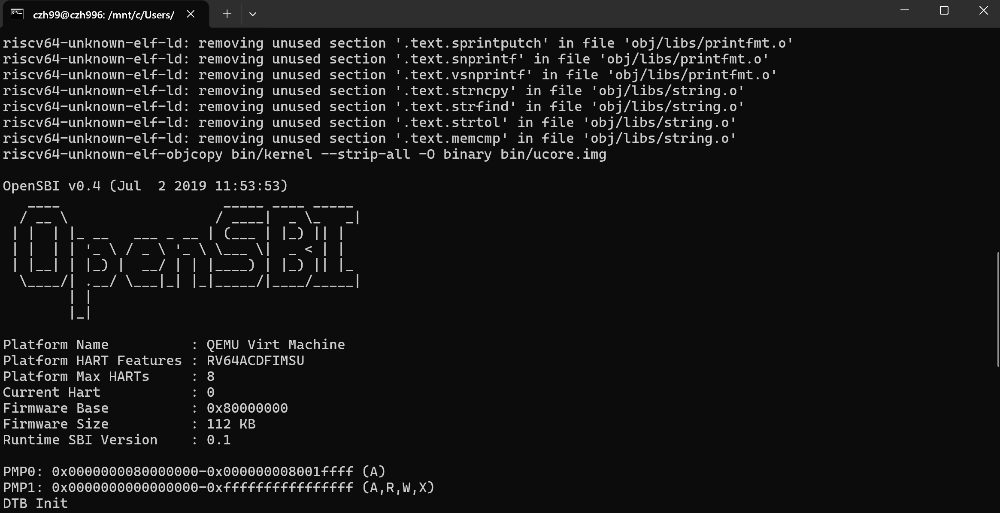
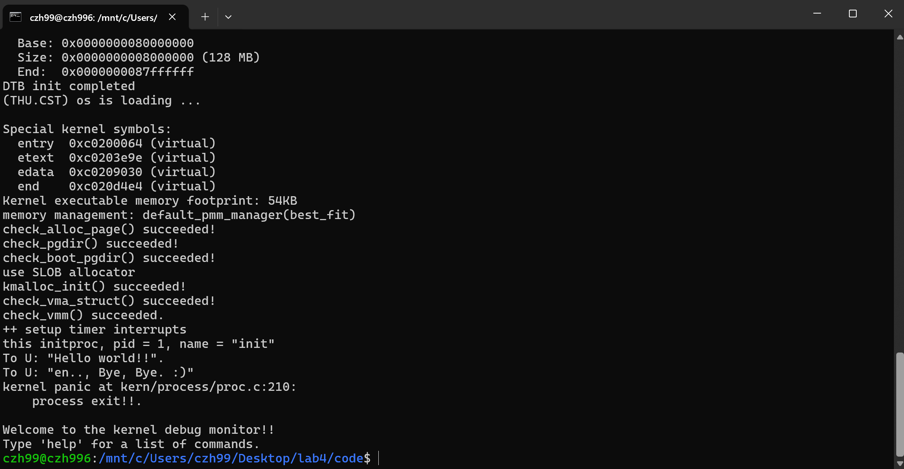
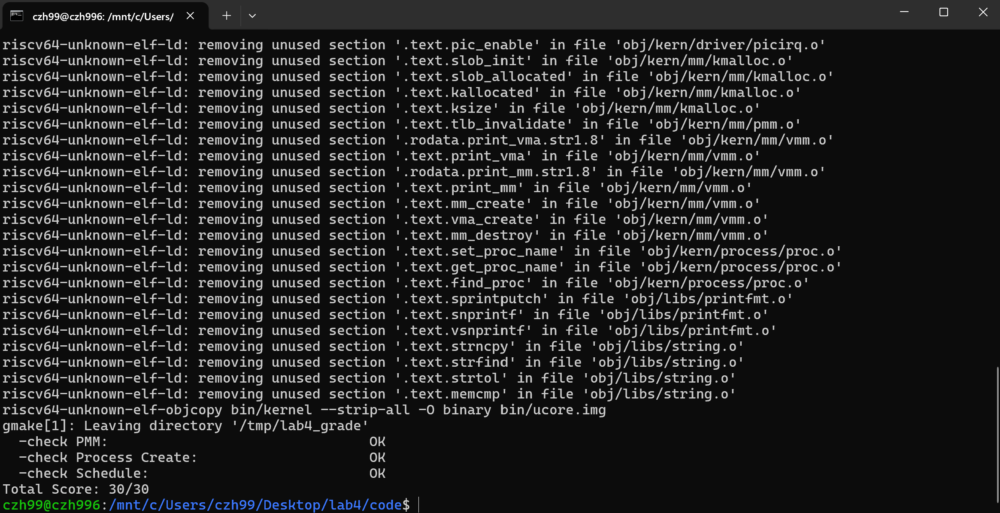
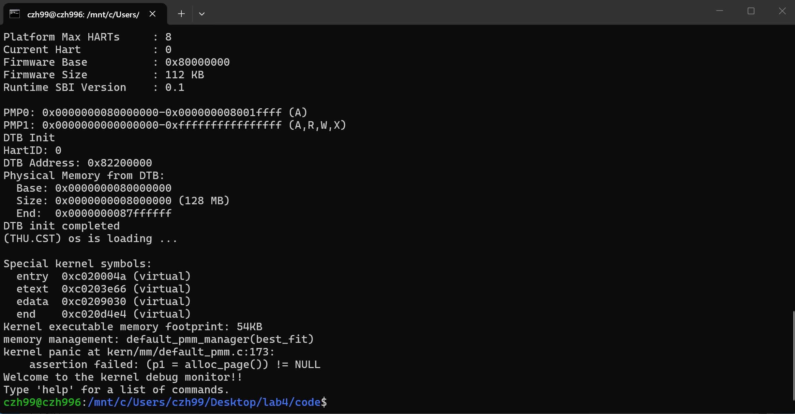

# 操作系统实验报告

## 实验基本信息

| 项目 | 内容 |
|------|------|
| **实验名称** | Lab 4：进程管理 |
| **小组成员** | 2412790 杨茜茹、2413921 程子涵、2411824 于蕾 |
| **完成日期** | 2026-11-13 |

### 小组分工

| 成员 | 负责的练习/模块 |
|------|----------------|
| 2412790 杨茜茹（成员 A） | 功能模块一：补齐前置代码，完成虚拟内存页操作及分页拓展 |
| 2413921 程子涵（成员 B） | 功能模块二：PCB 初始化、内核线程创建、首次运行现场及 PID 课堂拓展 |
| 2411824 于蕾（成员 C） | 功能模块三：进程调度、上下文切换、中断拓展和联合调试 |

各成员撰写负责模块的实现、提示词、验证记录和拓展答案，由成员 C 汇总小组报告。

---

## 一、实验目的

1. 理解 uCore 从内核内存初始化到创建和调度第一个内核线程的过程。
2. 掌握 PCB、内核栈和首次执行现场的组织方式，说明创建、登记与失败回收的顺序。
3. 根据源码解释 PID 回绕与旧引用误认，学习用明确的规格、提示词和测试用例辅助实现。

---

## 二、实验环境

代码面向 uCore、RISC-V RV64 和 Sv39 页表。整机验证在 Windows 的 WSL 终端中完成，使用 RISC-V 交叉工具链和 QEMU virt。

| 成员 | AI 编程工具 | 底层模型 | 备注 |
|------|------------|---------|------|
| 2413921 程子涵（成员 B） | ChatGPT Codex（Work 模式） | GPT-6 系列 | 审查现有代码、整理实现规格与测试用例 |

---

## 三、实验整体逻辑分析

### 3.1 本章节的逻辑主线

本实验在 Lab 2 的物理内存管理和 Lab 3 的异常处理基础上建立内核线程管理。模块一先准备内核页表及页映射接口；模块二使用分配器为新线程建立 PCB、独立内核栈和首次运行现场，并向调度器登记可运行线程；模块三从就绪线程中选出下一执行流，经页表及上下文切换使它真正运行。

### 3.2 功能的逐步实现

成员 B 的实现按 `alloc_proc → copy_mm/copy_thread → do_fork → kernel_thread → proc_init` 组织。先约定单个 PCB 和寄存器现场的布局，再处理创建过程的资源所有权和错误回收，最后用统一的创建接口生成启动线程。

1. 先用 `alloc_proc()` 建立可安全填写或回收的 PCB 初态。
2. 用 `copy_mm()` 和 `copy_thread()` 准备共享内核映射及独立的执行现场。
3. 用 `do_fork()` 串起资源申请、失败回收、PID 分配、登记和就绪转换。
4. 用 `kernel_thread()` 构造入口模板，再由 `proc_init()` 建立 idle 与 init。

---

## 四、实验内容与实现

### 功能模块：进程创建及初始化

**负责人：** 2413921 程子涵

#### 模块功能描述

**需要实现/修改的函数：**

```c
static struct proc_struct *alloc_proc(void);
static int copy_mm(uint32_t clone_flags, struct proc_struct *proc);
static void copy_thread(struct proc_struct *proc, uintptr_t esp, struct trapframe *tf);
int do_fork(uint32_t clone_flags, uintptr_t stack, struct trapframe *tf);
int kernel_thread(int (*fn)(void *), void *arg, uint32_t clone_flags);
void proc_init(void);
char *set_proc_name(struct proc_struct *proc, const char *name);
```

**功能说明：**

六个实现函数位于 `../code/kern/process/proc.c` 的 `LAB4 function2 2413921` 区域。已有的 `set_proc_name()` 为启动线程命名，本次修正了短字符串读取的边界。模块调用 PMM 申请内核栈，将就绪线程登记给调度器，并通过 `context` 和 `trapframe` 提供首次运行所需的寄存器状态。

| 函数 | 规格与实现 |
| --- | --- |
| `alloc_proc` | 申请 PCB，失败返回 `NULL`。初始状态为 `PROC_UNINIT`，PID 为 `-1`，`pgdir = boot_pgdir_pa`。其余普通字段清零，两个侵入式链表节点用 `list_init` 初始化为自环。 |
| `copy_mm` | 保留 `clone_flags` 接口，断言 `current->mm == NULL`，子线程的 `mm` 仍为 `NULL`，返回 0。内核线程通过 PCB 中的 `pgdir` 共享内核根页表。 |
| `copy_thread` | 在子线程内核栈高地址端放置一份独立的 `trapframe`。复制模板后令 `gpr.a0 = 0`，`gpr.sp` 使用传入栈地址，传入 0 时使用帧基址。将 `context.ra` 设为 `forkret`，`context.sp` 设为帧基址。 |
| `do_fork` | 检查数量上限，申请 PCB 和两页内核栈，记录父线程，处理 `mm` 并构造现场。进入关中断临界区后复查数量上限，再分配 PID、挂入哈希和进程链表、递增计数并唤醒。成功返回 PID。 |
| `kernel_thread` | 清零临时帧，`s0` 保存函数地址，`s1` 保存参数，`epc` 指向 `kernel_thread_entry`。置 `SPP`、`SPIE` 并清 `SIE`，然后用 `clone_flags \| CLONE_VM` 调用 `do_fork`。 |
| `proc_init` | 初始化进程链表和哈希桶。以启动栈和当前执行流建立 PID 0 的 `idle`，设置 `need_resched = 1`，计入进程数并令 `current = idleproc`。创建 PID 1 的子线程，按 PID 查回 PCB、校验后命名为 `init`。idle 由调度器直接保底，普通 PID 查询范围为 `1…8191`。 |

##### PCB 从分配到登记

`alloc_proc()` 将 PCB 建成一个可安全填写、可直接释放的对象。分配器可能交回曾用过的内存，所以必须给名字、计数、标志、指针和寄存器上下文明确赋初值。两个链表字段还需单独处理。空链表节点是前后指针均指向自己的自环，仅把指针置为零会违反 `list_empty()` 等操作依赖的约定。

普通进程用了两个侵入式节点。调度器通过 `list_link` 遍历进程集合，`find_proc(pid)` 则通过 `hash_link` 遍历对应的哈希桶。`le2proc` 根据成员偏移从节点还原 PCB。两个索引都指向同一块 PCB，这样查找和调度读到的是同一个状态和同一份执行现场。

##### 地址空间与启动身份

`copy_mm()` 断言父线程的 `mm` 为空并令子线程的 `mm` 为空。`mm` 用来描述将来的用户地址空间，`pgdir` 则给调度代码提供实际的根页表物理地址。即使 `mm` 为空，内核指令和线程栈仍通过共享的 Sv39 内核映射访问。线程各有执行现场和栈，因此切换执行流无需复制内核映射。

`kern_init()` 在启动栈上执行到 `proc_init()`。此时为现有执行流补一个 PCB 就能得到 idle，它的栈来自引导代码，第一次被切走前也没有需要恢复的 `trapframe`。init 走完整的 `kernel_thread()` 创建路径。先设置 `current = idleproc`，`do_fork()` 才能记录正确的父线程。启动时总链表为空，首次分配的正 PID 为 1。

idle 只由 `idleproc` 指针直接引用，两个链表节点保持自环，既不在 `proc_list` 也不在 PID 哈希桶中。因此 `find_proc(0)` 返回 `NULL`，`get_pid()` 的扫描范围也不包含编号 0，编号从 1 开始发放。调度器靠 `current == idleproc` 的比较识别它，不依赖链表位置。

| 初始化完成后的检查项 | idleproc | initproc |
| --- | --- | --- |
| PID 与名称 | 0，`idle` | 1，`init` |
| 状态与运行次数 | `PROC_RUNNABLE`，0 次 | `PROC_RUNNABLE`，0 次 |
| 父线程与用户地址空间 | `parent=NULL`，`mm=NULL` | `parent=idleproc`，`mm=NULL` |
| 内核栈 | `bootstack` | 由 `alloc_pages(KSTACKPAGE)` 分配的两页 |
| 初始现场 | `tf=NULL`，`context` 初始清零 | `tf` 位于栈高地址端，`context.ra=forkret` |
| 全局登记 | 计数并由 `idleproc` 直接引用 | 计数并登记到总链表和 PID 哈希 |
| 当前线程 | `current == idleproc` | 等待调度 |

##### 资源回收和发布顺序

| 失败位置 | 返回值 | 回收与登记状态 |
| --- | --- | --- |
| 初检已达进程上限 | `-E_NO_FREE_PROC` | 直接返回 |
| PCB 分配失败 | `-E_NO_MEM` | 无已申请的资源 |
| 内核栈分配失败 | `setup_kstack` 的错误码 | 回收 PCB |
| `copy_mm` 返回错误，或登记前复查达到上限 | 原错误码，或 `-E_NO_FREE_PROC` | 先释放内核栈，再释放 PCB。PID、哈希桶、进程链表和进程计数均尚未更新 |

当前 `copy_mm` 在内核线程契约下返回 0，其错误处理路径为后续扩展保留。所有可能返回错误的操作发生在登记之前。这里的中断保护面向本实验的单核执行模型。

把 `wakeup_proc()` 放到登记末尾，是因为它会把状态改为 `PROC_RUNNABLE`。这个状态一旦被调度器看见，PID、父进程、栈和执行现场就必须已经齐备。初次检查可以在明显达到上限时省去内存分配，第二次检查则把容量判断与登记放在同一临界区内。关中断前先记住原来的 `SIE`，提交或拒绝都按原状态恢复。

##### 首次运行与模块交接

RV64 下 `trapframe` 为 36 个 8 字节槽，共 288 字节。内核栈为两页，栈顶向下留出这 288 字节作为中断帧。以帧基址作为新线程的初始 `context.sp` 可以让 `forkret` 使用帧以下的栈空间，随后汇编恢复入口以帧基址读取保存的寄存器。

| 首次现场字段 | 创建时的值 | 读取位置 |
| --- | --- | --- |
| `proc->kstack` | 栈低地址，回收时换算回页描述符 | `copy_thread()`、`put_kstack()` |
| `context.ra`、`context.sp` | `forkret`、`proc->tf` | `switch_to` |
| `tf->gpr.sp` | 内核线程取帧基址，接口有非零栈参数时取该参数 | `__trapret` |
| `tf->status`、`tf->epc` | 保存其他状态位，设 `SPP`、`SPIE`，清 `SIE`，入口为 `kernel_thread_entry` | `__trapret` 与 `sret` |
| `tf->gpr.s0`、`tf->gpr.s1` | `init_main` 的地址与字符串实参的地址 | `kernel_thread_entry` |

1. `switch_to` 恢复新线程的 `context`，以 `ret` 进入 `forkret`。
2. `forkret` 把 `current->tf` 交给 `forkrets`。后者令 `sp` 指向该帧，并跳转到 `__trapret`。
3. `__trapret` 恢复 `sstatus`、`sepc` 和通用寄存器，再执行 `sret`。`SPP=1` 选择 S 态，`SPIE=1` 使返回后的 `SIE=1`。帧中的 `SIE=0` 约束的是恢复现场阶段。
4. `kernel_thread_entry` 执行 `a0 = s1`，然后通过 `jalr s0` 调用 `init_main`。子线程初始 `a0=0` 是 fork 返回现场的约定，入口汇编随后按 ABI 把它改成函数实参。

交给成员 C 的接口约定是 `proc->pgdir` 保存根页表**物理字节地址**，由 `lsatp` 转成 PPN 并编码为 RV64 Sv39 的 `satp` 值。切换到新线程前，`current` 必须指向它，因为 `forkret` 通过 `current->tf` 取帧。

#### 最终提示词

下面按六项代码任务列出最终提示词。含课堂拓展在内的九条独立提示词见 [prompt.md](member-b-prompts.md)。

````markdown
## 01　初始化进程控制块

[PROMPT]:

**任务**: 在 `kern/process/proc.c` 的 `//LAB4 function2 2413921` 区域完善 `alloc_proc()`。PCB 由内核堆分配，随后可能被用作启动线程，也可能在普通线程创建失败时直接回收。需要为每个字段建立明确初值，并给两个侵入式链表节点建立尚未挂接时的自环状态。

**操作要求**: 必须修改项目中的真实文件。允许修改 `alloc_proc()` 函数体并补全该模块的学号标记。保留原有注释、头文件包含与函数签名。禁止改动 `proc.h`、分配器、链表库、其他进程函数及官方评分文件。

**输出要求**: 写入完整实现后，说明修改位置，逐组列出 PCB 初值，并给出分配成功与失败各自的验证结果或复测方法。

[RELY]

- `kern/process/proc.h` 的 `struct proc_struct` 含 `state`、`pid`、`runs`、`kstack`、`need_resched`、`parent`、`mm`、`context`、`tf`、`pgdir`、`flags`、`name[PROC_NAME_LEN + 1]`、`list_link` 和 `hash_link`。`PROC_NAME_LEN = 15`。
- `kern/mm/kmalloc.h` 提供 `void *kmalloc(size_t n)`，返回的存储必须由调用方初始化。`libs/string.h` 提供 `memset()`。`libs/list.h` 的 `list_init()` 将节点的前后指针指向节点本身。
- `kern/mm/pmm.h` 声明 `extern uintptr_t boot_pgdir_pa`，保存内核根页表物理字节地址。

[GUARANTEE]

~~~c
static struct proc_struct *alloc_proc(void);
~~~

成功返回 PCB 指针，失败返回 `NULL`。本函数只分配 PCB，内核栈、PID 和全局登记由后续步骤处理。

[SPECIFICATION]

- **Case 1：内存分配失败。** `kmalloc(sizeof(struct proc_struct))` 返回 `NULL` 时直接返回，进程链表、哈希和进程计数保持原值。
- **Case 2：从非零内存分配。** 设 `state=PROC_UNINIT`、`pid=-1`、`pgdir=boot_pgdir_pa`。将 `runs`、`kstack`、`need_resched`、`flags`、整个 `context` 和 `name` 清零，`parent`、`mm`、`tf` 设为 `NULL`。
- **Case 3：登记前检查节点。** 两个节点各自初始化为自环。此时对节点调用 `list_empty()` 应为真，总进程链表与哈希桶未新增成员。

## 02　保留内核线程的地址空间接口

[PROMPT]:

**任务**: 在 `kern/process/proc.c` 的 `LAB4 function2` 区域完善 `copy_mm()`。本阶段的父子线程都在内核态运行并共享内核映射，PCB 中的 `mm` 字段预留给后续的用户地址空间。该函数保留统一创建接口，明确当前阶段的前提。

**操作要求**: 必须修改项目中的真实文件。允许修改 `copy_mm()` 函数体。保留函数签名和原有注释。禁止修改 `do_fork()`、`kernel_thread()`、虚拟内存子系统、页表接口和官方测试。

**输出要求**: 写入实现后，说明 `mm` 与 `pgdir` 各自表示什么，指出内核线程调用成功的条件，并说明接口如何反馈前提被破坏。

[RELY]

- `kern/process/proc.h` 中 `current` 指向当前线程，`proc_struct.mm` 是 `struct mm_struct *`，`proc_struct.pgdir` 是 `uintptr_t`。
- `alloc_proc()` 已将子 PCB 的 `pgdir` 设为 `boot_pgdir_pa`。本模块的 `kernel_thread()` 通过 `do_fork()` 传入带 `CLONE_VM` 的标志。
- `CLONE_VM` 定义于 `kern/mm/pmm.h`。内核断言接口在 `kern/debug/assert.h`。

[GUARANTEE]

~~~c
static int copy_mm(uint32_t clone_flags, struct proc_struct *proc);
~~~

在当前内核线程契约下返回 0，保留 `clone_flags` 形参以及子线程的内核页表基址。

[SPECIFICATION]

- **Case 1：当前线程 `mm == NULL`。** 用断言明确前提，将 `proc->mm` 置为 `NULL`，返回 0。该步骤不申请页表或用户内存。
- **Case 2：传入带 `CLONE_VM` 或其他标志。** 当前实验的内核线程行为一致，保持子线程已有的 `pgdir`。
- **Case 3：当前线程的 `mm` 非空。** 按本实验契约触发断言。用户页表复制、引用计数、写时复制留给后续实验。

## 03　构造新线程的栈和首次恢复现场

[PROMPT]:

**任务**: 在 `kern/process/proc.c` 的 `LAB4 function2` 区域完善 `copy_thread()`。子线程此前没有被调度过，需要先在自己的内核栈中放好完整的中断返回帧，再用较小的 `context` 把第一次内核切换接到 `forkret()`。

**操作要求**: 必须修改项目中的真实文件。允许修改 `copy_thread()` 函数体。保留函数签名及注释。禁止修改 `struct context`、`struct trapframe`、`switch.S`、`trapentry.S`、已有 `forkret()` 和评分文件。

**输出要求**: 写入实现后，输出 `kstack`、帧基址、`context.sp` 和 `gpr.sp` 的对应关系，分别说明参数为 0 和非 0 时可观察到的字段值。

[RELY]

- `kern/mm/memlayout.h` 定义 `KSTACKPAGE = 2` 和 `KSTACKSIZE = KSTACKPAGE * PGSIZE`。`proc->kstack` 由 `setup_kstack()` 设为子线程栈的内核虚拟低地址。
- `kern/trap/trap.h` 的 `struct trapframe` 包含 `gpr`、`status`、`epc`、`badvaddr`、`cause`，`gpr` 中有 `a0` 与 `sp`。本包 RV64 布局对应 36 个 8 字节槽。
- `kern/process/proc.h` 的 `struct context` 包含 `ra`、`sp` 和 `s0–s11`。现有 `forkret()` 调 `forkrets(current->tf)`，恢复宏读取帧保存的寄存器。

[GUARANTEE]

~~~c
static void copy_thread(struct proc_struct *proc, uintptr_t esp, struct trapframe *tf);
~~~

调用方已分配有效内核栈并传入有效模板帧。子线程独立持有帧副本，初始 `context.ra` 指向 `forkret`，`context.sp` 指向帧基址。

[SPECIFICATION]

- **Case 1：`esp == 0`。** 从 `kstack + KSTACKSIZE` 向下预留 `sizeof(struct trapframe)`，复制模板。设置子帧 `a0=0`、`sp=帧基址`。
- **Case 2：`esp != 0`。** 子帧 `gpr.sp` 取 `esp`，`context.sp` 仍指向帧基址，`context.ra` 和子帧 `a0` 与 Case 1 相同。此 Case 验证接口字段约定，当前实验的内核线程入口实际传 0。
- **Case 3：检查帧独立性和对齐。** 源模板不被改写，模板离开调用者栈后子帧仍有效。帧落在已分配的栈区内，RV64 初始栈保持 16 字节对齐。除明确覆盖的 `a0` 和 `sp` 外，保留模板寄存器与控制字段。

## 04　实现创建、登记与失败回收

[PROMPT]:

**任务**: 在 `kern/process/proc.c` 的 `LAB4 function2` 区域完善 `do_fork()`。按依赖顺序申请 PCB、内核栈并构造现场。只有资源准备完毕后才允许新线程进入全局管理结构，确保调度器读到的线程已经具备运行所需字段。

**操作要求**: 必须修改项目中的真实文件。只允许修改 `do_fork()` 函数体。保留签名、已有注释和工具注入锚点。禁止重写 `get_pid()`、`hash_proc()`、`wakeup_proc()`、分配器、调度器、结构体及评分规则。临时失败注入仅用于隔离测试副本。

**输出要求**: 写入实现后，列出资源获取顺序、临界区覆盖的步骤、每条错误路径的返回值和回收内容。注明实测覆盖范围。

[RELY]

~~~c
static struct proc_struct *alloc_proc(void);
static int setup_kstack(struct proc_struct *proc);
static void put_kstack(struct proc_struct *proc);
static int copy_mm(uint32_t clone_flags, struct proc_struct *proc);
static void copy_thread(struct proc_struct *proc, uintptr_t esp, struct trapframe *tf);
static int get_pid(void);
static void hash_proc(struct proc_struct *proc);
void wakeup_proc(struct proc_struct *proc);
void kfree(void *objp);
~~~

- 前七个静态函数均在 `kern/process/proc.c`。`wakeup_proc()` 位于 `kern/schedule/sched.c`，要求进程尚未处于 RUNNABLE 或 ZOMBIE，成功后置 `PROC_RUNNABLE`。`kfree()` 声明在 `kern/mm/kmalloc.h`。
- `nr_process` 是本文件静态计数，包含 idle。上限 `MAX_PROCESS=4096` 定义于 `proc.h`。`-E_NO_MEM` 和 `-E_NO_FREE_PROC` 对应 `libs/error.h` 中的错误码。
- `libs/list.h` 的 `list_add()` 将节点插到给定节点之后。`kern/sync/sync.h` 提供 `local_intr_save(flag)` 与 `local_intr_restore(flag)`，用于本实验的单核中断保护。

[GUARANTEE]

~~~c
int do_fork(uint32_t clone_flags, uintptr_t stack, struct trapframe *tf);
~~~

成功返回正 PID。失败返回负错误码，调用所取得的资源按相反顺序回收。PID、哈希、进程链表、计数和就绪状态在同一临界区内完成发布。

[SPECIFICATION]

- **Case 1：正常创建。** 设置 `parent=current`，分配两页内核栈，完成 `copy_mm()` 和 `copy_thread()`。保存原中断状态、复查上限、分配 PID、插入哈希和进程链表、计数加一、调用 `wakeup_proc()`，最后恢复原中断状态并返回 PID。返回后 `find_proc(pid)` 应指向新 PCB。
- **Case 2：初检已满。** 返回 `-E_NO_FREE_PROC`，不调用分配器。
- **Case 3：PCB 分配失败。** 返回 `-E_NO_MEM`，无资源需要回收。
- **Case 4：栈分配失败。** 保留 `setup_kstack()` 的错误码，仅 `kfree(proc)`。
- **Case 5：`copy_mm()` 返回错误。** 保留其错误码，先 `put_kstack(proc)` 再 `kfree(proc)`。本实验正常的 `copy_mm()` 返回 0，此 Case 可在测试副本模拟。
- **Case 6：登记前复查达到上限。** 恢复原中断状态，先释放栈再释放 PCB，返回 `-E_NO_FREE_PROC`。所有失败 Case 都不产生新 PID、链表项、哈希项或计数增长。
- **Case 7：验证中断恢复。** 入口开中断则退出临界区后恢复为开，入口关中断则仍为关。

## 05　将普通 C 函数包装为内核线程

[PROMPT]:

**任务**: 在 `kern/process/proc.c` 的 `LAB4 function2` 区域完善 `kernel_thread()`。按照启动汇编的寄存器约定，把普通 C 函数和实参编码到临时 `trapframe`，再交给 `do_fork()` 生成可调度的内核线程。

**操作要求**: 必须修改项目中的真实文件。只允许修改 `kernel_thread()` 函数体。保留签名和原有注释。禁止修改 `do_fork()`、汇编入口、CSR 定义、结构体和评分脚本。

**输出要求**: 写入实现后，列出模板帧各字段、传给 `do_fork()` 的三个参数及返回值规则，解释帧内 `SIE` 与当前硬件 `sstatus.SIE` 的区别。

[RELY]

- `kern/process/entry.S` 的 `kernel_thread_entry` 执行 `move a0, s1`、`jalr s0`，线程函数返回后调用已有 `do_exit`。
- `kern/trap/trap.h` 定义 `struct trapframe`。恢复汇编在 `kern/trap/trapentry.S`，把帧中的 `status`、`epc` 写入 CSR，再执行 `sret`。
- `libs/riscv.h` 定义 `read_csr(sstatus)`、`SSTATUS_SPP=0x100`、`SSTATUS_SPIE=0x20`、`SSTATUS_SIE=0x2`。`kern/mm/pmm.h` 定义 `CLONE_VM`。
- `proc.h` 声明 `int do_fork(uint32_t clone_flags, uintptr_t stack, struct trapframe *tf)`。

[GUARANTEE]

~~~c
int kernel_thread(int (*fn)(void *), void *arg, uint32_t clone_flags);
~~~

将 `fn` 与 `arg` 放入启动约定的寄存器，保留调用方传入的标志，并原样返回 `do_fork()` 的结果。

[SPECIFICATION]

- **Case 1：传入有效线程函数。** 清零整个局部帧，将 `s0` 设为 `(uintptr_t)fn`、`s1` 设为 `(uintptr_t)arg`、`epc` 设为 `(uintptr_t)kernel_thread_entry`。`arg == NULL` 时应能原样传递。
- **Case 2：当前 SIE 开或关。** 都令模板帧的 `SPP=1`、`SPIE=1`、`SIE=0`，其余 `status` 位取自当前 CSR。构造模板时只读当前 CSR。首次恢复后 `sret` 返回 S 态并恢复 SIE。
- **Case 3：向 `do_fork()` 传递请求。** 调用 `do_fork(clone_flags | CLONE_VM, 0, &tf)`。正常返回子 PID，失败原样传回负错误码。模板帧由创建过程同步复制。

## 06　初始化 idleproc 与 initproc

[PROMPT]:

**任务**: 在 `kern/process/proc.c` 的 `LAB4 function2` 区域完善 `proc_init()`。启动期间已经有一条执行流与启动栈，先把它登记为调度器使用的 idle，再通过普通创建路径得到可查询的 init。同步检查本文件的 `set_proc_name()`，保证对短名字的读写有界。

**操作要求**: 必须修改项目中的真实文件。允许修改 `proc_init()` 和同文件内与命名边界直接相关的 `set_proc_name()`。保留函数签名、文件注释、`init_main()` 及评分注入入口。禁止改动 `find_proc()`、`get_pid()`、其他成员的代码、启动汇编及官方测试。

**输出要求**: 写入实现后，列出 idle 与 init 的 PID、名称、父线程、栈、状态和登记方式，说明命名函数的长度边界。给出 `make qemu`、`make grade` 和 GDB 的复测命令。

[RELY]

- `proc.c` 提供 `proc_list`、`hash_list[HASH_LIST_SIZE]`、`nr_process`、`alloc_proc()`、`init_main(void *arg)`、`find_proc(int pid)`。哈希桶数为 `1 << HASH_SHIFT`，本包 `HASH_SHIFT=10`。`find_proc()` 只接受 `0 < pid < MAX_PID`。
- `proc.h` 声明 `idleproc`、`initproc`、`current` 和 `kernel_thread()`。`pmm.h` 声明 `extern char bootstack[], bootstacktop[]`。
- `libs/string.h` 提供 `strnlen()`、`memmove()` 和 `memset()`。`proc_struct.name` 容量为 `PROC_NAME_LEN + 1`，最多存 15 个名字字节。
- `kern/init/init.c` 在 PMM、陷入入口与 VMM 初始化后调用 `proc_init()`，随后才初始化时钟、开中断并进入 `cpu_idle()`。评分器在 `proc_init()` 末尾注入 `test_lab4_process_create()`。

[GUARANTEE]

~~~c
void proc_init(void);
char *set_proc_name(struct proc_struct *proc, const char *name);
~~~

启动时完成一次初始化。命名函数返回 `proc->name`，保证以空字符终止。

[SPECIFICATION]

- **Case 1：建立全局结构和 idle。** 对总链表及每个哈希桶调用 `list_init()`。分配 idle PCB，设置 PID 0、`PROC_RUNNABLE`、`kstack=(uintptr_t)bootstack`、`need_resched=1` 和名称 `idle`。把 idle 计入总数并令 `current=idleproc`。idle 由调度器直接引用，两个节点保持自环。
- **Case 2：创建 init。** 调用 `kernel_thread(init_main, "Hello world!!", 0)`。以返回 PID 查找 PCB，验证指针和 PID 后命名为 `init`。完成时 `current` 仍为 idle，init 的 `parent` 指向 idle，init 在普通链表和哈希中可见且为 RUNNABLE。
- **Case 3：启动失败。** idle 分配失败、创建 init 得到非正 PID 或查不到合法的 PID 1 PCB 时立即报错或断言。对 init 命名前必须先通过查找结果检查。此处对 PID 1 的断言依赖「init 是本次启动创建的第一个普通线程」，若将来在 init 之前再创建线程，应改为比较查回的 PCB 与 `initproc`。（对应实现中 `assert(initproc != NULL && initproc->pid == 1)` 的写法。）
- **Case 4：命名边界。** 短字符串只复制有效字节，超长名字最多复制 15 字节，尾部始终有终止符。以短名字覆盖长名字时清除旧尾巴，输入与 PCB 名称缓冲区重叠时使用支持重叠的复制接口。
````

#### 实现迭代过程

本模块基于已有代码完成两轮工作。第一轮审查并修正实现，第二轮补充各函数的验收 Case 并整理验证证据。

##### 第一次迭代

**遇到的问题与修复**

| 问题 | 原因与修复 |
| --- | --- |
| PCB 中 `list_link`、`hash_link` 未初始化 | `kmalloc` 不保证内存已清零。普通线程登记时会写入节点指针，但尚未登记的 PCB（包括 idle）没有有效的节点初态。分配后对两个节点分别调用 `list_init`。 |
| `set_proc_name(proc, "idle")` 和 `set_proc_name(proc, "init")` 存在越界读取 | 公共命名函数原先固定读 15 字节，短字符串对象只有 5 字节。先用 `strnlen` 确定有界长度，再拷贝并清零末尾。将 `initproc` 的查询断言移到设置名称之前。 |
| `do_fork` 的错误码和就绪发布可更明确 | 原实现统一保留 `-E_NO_MEM`，在恢复中断后再置就绪。现传回栈和地址空间处理各自的错误码，并把 PID、哈希、链表、计数和就绪转换放入同一临界区。 |
| 注释将清除帧内 `SIE` 解释为构造期间关中断 | 修改内存里的模板帧不会改变当前 CPU 的 CSR。已改正注释，区分构造现场、恢复现场与 `sret` 返回三个阶段。 |

**问题解决策略**

这几个问题需要用不同的检查方法。链表节点初态不能只看线程能否成功登记，因为插入操作会覆盖旧指针。命名问题也不能只看输出里是否出现了 `init`，原代码已经可能读过字符串对象的末尾，但第一个空字符会让打印结果仍然正常。因此我在提示词里分别加了「从非零内存分配」「短名字覆盖长名字」「登记前已满」等 Case，并写明每种情况要观察的具体字段或副作用。

##### 第二次迭代

**最终结果**

整机在 WSL 中 `make` 编译链接通过，`make qemu` 运行到 `init_main()` 并输出 PID、名称与实参，`make grade` 三组检查全部 `OK`，总分 **30/30**。模块层面另做了 C 语法核对与原版评分注入器验证，结果与整机一致。

**关键改进点**

1. 在 `[RELY]` 中写明真实的头文件、字段和汇编入口，使 C 代码与首次恢复现场的约定一致。
2. 在 `[SPECIFICATION]` 中为各失败路径分别列出返回值、释放动作和全局登记状态。

---

### 练习：检查 idle、init 与创建路径

**负责人：** 2413921 程子涵

初始化完成时，`current` 指向 idle，普通链表和 PID 1 对应的哈希桶均应能找到 init。可按第五节的 GDB 命令检查这些字段，再在 `kernel_thread_entry` 检查 `s0`、`s1` 和栈指针。创建失败的检查沿资源获取顺序逆向进行，并核对失败分支是否在登记前退出。

---

### Challenge：PID 分配与复用（课堂拓展）

**负责人：** 2413921 程子涵

#### 1. uCore 如何在回绕时避开现存 PID

`last_pid` 是候选号的游标，通常在上次返回值基础上递增，到达 `MAX_PID = 8192` 时回到 1。扫描过程中，`next_safe` 记录候选号之后已遇到的最小占用 PID，若没有则使用 `MAX_PID`。下一次分配若还在这个边界之前，可直接返回候选值。回绕或到达该边界时会重扫 `proc_list`；遇到相同 PID 就递增。递增若到达已知边界，重扫可以重新检查此前已越过的节点。新 PID 的分配和登记在同一临界区完成。

两个静态变量初值都是 `MAX_PID`，首次调用会进入回绕分支。此时普通链表为空，故得到 PID 1。分配返回时，当前候选之后到 `next_safe` 之前的区间已知没有现存编号。后续分配可逐个消费这段区间，到达边界再更新。假设将来加入退出回收，边界所指的占用项有可能先消失，这只会使缓存变保守，重扫时会看到更新后的链表。

假定上次分配 8191，当前链表从头依次为 2、1、5。

| 执行位置 | `last_pid` 候选 | `next_safe` | 判断 |
| --- | ---: | ---: | --- |
| 递增后回绕 | 1 | 8192 | 从链表头扫描 |
| 第一次遇到 PID 2 | 1 | 2 | 记住比候选大的最近占用编号 |
| 第一次遇到 PID 1 | 2 | 8192 | 候选递增到已知边界，重置边界并重扫 |
| 第二次遇到 PID 2 | 3 | 8192 | 2 已占用，继续看 3 |
| 第二次遇到 PID 1、5 | 3 | 5 | 跳过较小的 1，更新上界，返回 3 |

若占用情况保持不变，下一次可以直接返回 4，再下一次遇到边界 5 时重扫。分配器从总链表判断占用，哈希查询用来取得已登记的 PCB。后者不会改变前者的分配次序。

#### 2. 现存唯一性与跨时间身份

现存唯一性解决同一时刻的编号冲突。假设模块保存了线程 A 的 PID 42，A 退出并被回收后，分配器回绕把 42 发给 B。此时全局表中的 42 仍然唯一，但持有旧整数的模块再次查找会得到 B。这是编号跨时间的 ABA 问题。可通过带代次的标识或带引用计数的进程句柄把“编号槽位”与“某次创建得到的进程实例”区分开。本实验的 `do_exit` 还是占位函数，因此这个复用过程属于机制推演。

| 时刻 | PID 42 的登记 | 旧引用再次使用时会发生什么 |
| --- | --- | --- |
| A 存活 | `42 → A` | 只按编号查找能得到 A |
| A 已回收，42 暂时空闲 | 无 | 只按编号查找会失败 |
| B 复用 42 | `42 → B` | 按旧整数查找会得到 B。带代次标识可检测旧代次，稳定句柄仍引用 A 对应的对象 |

带代次的方案可以在每次重用槽位时递增代次，查询时同时比较编号和代次。代次位宽和回绕条件影响它能提供多长时间的区分。稳定句柄可以借对象引用计数维护身份，即使进程已退出，持有者也能识别原对象已经失效。对象的生命期与可执行线程的生命期因此可以分开管理。

#### 3. 课堂源码核对：RISC-V uCore 的 PID 分配与回收

在 2026 年 11 月 10 日 Lab4 录制约 25:24 处，自动字幕把项目名识别为 `newcall`，共享画面展示的是 `get_pid(void)`，其中可见 `MAX_PID > MAX_PROCESS`、`last_pid`、`next_safe`，以及达到 `MAX_PID` 时回到 1 的代码。对照清华课程仓库 `oscourse-tsinghua/ucore-rv` 的固定提交 `79726a60baab6b66864f7f2e5e2c808b875c9634`，其中 Lab4 的 `get_pid()` 与本实验包的函数仅有格式差异。据此用 RISC-V uCore 的这份源码回答课堂题。该提交用于复核代码，录制画面没有给出课堂演示的精确提交。 [RISC-V uCore 项目说明](https://github.com/oscourse-tsinghua/ucore-rv/blob/79726a60baab6b66864f7f2e5e2c808b875c9634/README.md#bbl-ucore-ucore-os-labs-on-berkeley-boot-loader) · [Lab4 的 get_pid()](https://github.com/oscourse-tsinghua/ucore-rv/blob/79726a60baab6b66864f7f2e5e2c808b875c9634/labcodes/lab4/kern/process/proc.c#L136-L169)

| 阶段 | 源码行为 |
| --- | --- |
| 分配 | `MAX_PID = 2 × MAX_PROCESS = 8192`，普通 PID 范围为 1 至 8191。游标从上次发出的号码向后找，达到上界时回到 1。回绕或达到 `next_safe` 时扫描 `proc_list`，跳过所有已登记的冲突编号。释放操作不会重置游标，旧编号要等到游标再次到达时才可能分配，实际间隔取决于当时的占用情况。 [编号上限](https://github.com/oscourse-tsinghua/ucore-rv/blob/79726a60baab6b66864f7f2e5e2c808b875c9634/labcodes/lab4/kern/process/proc.h#L35-L39) · [本组分配与登记](../../code/kern/process/proc.c#L379-L401) |
| 退出和回收 | 同一仓库的 Lab5 参考实现中，`do_exit()` 先将进程标为 `PROC_ZOMBIE`，其 PCB 仍留在进程表中。父进程调用 `do_wait()` 回收时，先由 `unhash_proc()` 和 `remove_links()` 从哈希及进程链表移除，再释放栈和 PCB。移除后，分配器再次扫到该编号便可使用它。 [标记退出](https://github.com/oscourse-tsinghua/ucore-rv/blob/79726a60baab6b66864f7f2e5e2c808b875c9634/labcodes_answer/lab5_result/kern/process/proc.c#L462-L489) · [移除与回收](https://github.com/oscourse-tsinghua/ucore-rv/blob/79726a60baab6b66864f7f2e5e2c808b875c9634/labcodes_answer/lab5_result/kern/process/proc.c#L752-L767) |
| 按 PID 查询 | `find_proc(pid)` 在哈希桶中按整数 PID 匹配。编号释放后，旧整数在空档期查不到对象。回绕并把该编号发给新进程后，同一个整数可查到新对象。 [Lab5 的 find_proc()](https://github.com/oscourse-tsinghua/ucore-rv/blob/79726a60baab6b66864f7f2e2c808b875c9634/labcodes_answer/lab5_result/kern/process/proc.c#L247-L266) |

因此，课堂代码采用的是顺序分配、回绕查重和回收前保留编号。它保证已登记进程的 PID 唯一，也允许已回收编号再次使用。跨越回收和再次分配的旧引用需要额外的身份机制。本组 Lab4 的 `do_exit()` 仍是骨架占位，完整回收路径的结论来自上述 Lab5 参考源码。课堂题要求源码分析，现有 Lab4 分配器已具备所讨论的机制。

#### 4. 对照案例：Linux v6.12 的 pidfd

| 文件与函数 | 源码依据 |
| --- | --- |
| `include/linux/pid.h`，`struct pid`、`get_pid` | 注释明确说明数值 PID 复用时会分配新 `struct pid`，旧对象由引用计数维护。 [Linux v6.12 源码](https://github.com/torvalds/linux/blob/v6.12/include/linux/pid.h#L13-L85) |
| `kernel/pid.c`，`alloc_pid`、`free_pid`、`pidfd_open` | 普通自动编号由命名空间的 `idr_alloc_cyclic` 分配，回收时 `idr_remove` 移除编号映射。`pidfd_open` 查得对象后创建 pidfd。 [分配与回收](https://github.com/torvalds/linux/blob/v6.12/kernel/pid.c#L112-L250) · [打开 pidfd](https://github.com/torvalds/linux/blob/v6.12/kernel/pid.c#L603-L659) |
| `fs/pidfs.c`，`pidfs_alloc_file`、`pidfd_pid` | 创建文件时通过 `get_pid` 保持对该对象的引用，`pidfd_pid` 从文件取回对象。 [创建文件](https://github.com/torvalds/linux/blob/v6.12/fs/pidfs.c#L396-L414) · [取回对象](https://github.com/torvalds/linux/blob/v6.12/fs/pidfs.c#L232-L240) |
| `kernel/signal.c`，`pidfd_send_signal`、`kill_pid_info_type` | 信号系统调用通过文件取回 `struct pid`，普通进程或线程发送路径据此查找目标。如果目标已退出并回收，返回 `ESRCH`。 [系统调用](https://github.com/torvalds/linux/blob/v6.12/kernel/signal.c#L3908-L3985) · [目标查找](https://github.com/torvalds/linux/blob/v6.12/kernel/signal.c#L1480-L1500) · [接口手册](https://man7.org/linux/man-pages/man2/pidfd_send_signal.2.html) |

因此，A 的数值 PID 可以在移除映射后重新发给 B，A 的旧 pidfd 仍引用 A 原来的 `struct pid`，不会把操作转给 B。句柄从获取时起提供这一保证；只持有一个过期整数、在编号复用之后才调用 `pidfd_open`，仍可能打开 B。创建时通过 `CLONE_PIDFD` 同步拿到句柄可避免这段查找窗口。

上表链接指向 v6.12 中对应函数所在位置，行号会随分支更新变化，引用时以函数名与文件路径为准。

从源码路径来看，`free_pid()` 撤销的是命名空间里由数字到对象的映射，而 pidfd 持有的是已解析出的对象引用。这解释了为什么两个行为可以同时成立：新的 `find_vpid(42)` 能指向 B，旧 pidfd 解析出的仍是 A 的 `struct pid`。当 A 已被回收，`kill_pid_info_type()` 在旧对象上找不到相应任务，从而返回 `-ESRCH`。uCore 本包的哈希表只做数字到当前 PCB 的查找，若后续要提供异步操作所需的稳定身份，还要补对象生命周期管理。

---

## 五、测试与验证

### lab4_cheng 联调复测

WSL Ubuntu 上实际执行了 `make clean`、`make`、`make qemu` 及 `make grade DEFS=-Wno-error=incompatible-pointer-types`。PMM、Process Create 和 Schedule 均通过，合计 30/30。普通启动输出 PID 1、进程名 `init` 及 `Hello world!!`。本次结果见[构建与评分记录](../results/cheng-grade.txt)及[启动串口记录](../results/cheng-qemu.txt)。

### 本地初版的检查

整机验证在 WSL 中完成：在 `code` 目录执行 `make`、`make qemu` 和 `make grade`。`make qemu` 输出了 init 的 PID、名称和实参，`make grade` 得分为 **30/30**（见图 1、图 2）。图 3 记录的 Best-Fit 自检故障发生在成员 A 负责的物理内存模块，由联合调试定位并修复。

模块层面的补充检查：

- 用 C 语法解析器检查 `proc.c`，识别到六个模块函数定义。该检查使用必要的类型别名，只做语法核对，编译与链接结论以整机 `make` 为准。
- 在临时副本执行原版 `tools/inject.py`，确认 `proc_init` 和 `init_main` 分别只插入一个对应评分调用，原代码中没有插入评分钩子。
- 用 Python 按 `get_pid` 源码逻辑建模，与逐号找空闲 PID 的基准比较。50,000 次分配结果一致，覆盖 7 次回绕；释放编号由模型模拟。

| 验证点 | 操作与判据 | 本次证据 |
| --- | --- | --- |
| 六个接口与注入入口 | 解析 `proc.c`，在临时副本执行原版注入器，分别检查 `proc_init`、`init_main` 的注入次数 | 语法与注入检查通过 |
| 进程创建与初始上下文 | `make grade` 检查 idle 与 init 的 PID、状态、父线程、启动栈和初始上下文 | `check Process Create: OK` |
| 跨模块首次运行 | `make qemu` 观察 PID、名称和实参输出 | PID 为 1，名称为 `init`，输出了 `Hello world!!` |
| 失败回收 | 分别检查上限、PCB 申请失败、栈申请失败和 `copy_mm` 错误路径。若做故障注入，需在临时副本中检查资源释放调用和全局表是否更新 | 已逐路径审查，未执行故障注入 |
| PID 回绕与查重 | 模型按本包扫描顺序分配，对照逐号查找空闲编号的基准 | 50,000 次分配、7 次回绕结果一致 |

### 复测中的故障与修复

第一次整机评分编译和链接成功，三组串口标记均缺失，得到 `0/30`。检查发现，启动页表原先只有内核高地址映射，开启分页时低地址的下一条指令可能无法取出。启动入口现在通过临时恒等映射进入高地址，随后撤掉临时映射。QEMU 启动使用 `-kernel` 将镜像入口交给 OpenSBI。评分脚本直接运行 QEMU，并在失败时打印串口末尾。

第二次在 WSL 运行，日志确认 OpenSBI 已将控制权交给内核，设备树也已读出 128 MB 内存。第一处失败发生在 `default_pmm.c` 的 `basic_check()`。该检查先释放三页，再逐页重新申请，第二次申请得到 `NULL`。原因是空闲链表尾插后循环继续，把同一个节点再次插入，导致回收页链表损坏。已改为寻找插入位置后只挂接一次，再检查前后相邻的空闲块以完成合并。修复前的断言失败见图 3。

同时复查了之后会执行的页表自检。启动直映区由 Sv39 根表的 1 GiB 叶子项覆盖，按根表叶子项验证物理基址与页内偏移。普通 4 KiB 映射的中间项改用 `ptd_create()`，并把自检调整为验证中间项的保留位清零以及叶子项的用户权限。 [RISC-V 特权架构手册](https://docs.riscv.org/reference/isa/_attachments/riscv-privileged.pdf)

链表模型已验证三页逐次释放再分配、插到较高地址的块之前、双向合并，并将 20,000 次分配和释放与独立页位图对照。按串口日志的 128 MiB 内存范围检查了 32,768 个页地址的启动大页换算。

**测试截图：**

### 图 1：编译和启动结果

在 WSL 终端中进入项目的 `code` 目录并执行以下命令。

```bash
cd code
make qemu
```



*图 1(a) 生成 `bin/ucore.img` 后，QEMU 启动 OpenSBI。*



*图 1(b) 内存自检通过，`init` 以 PID 1 运行并打印 `Hello world!!`。线程输出完成后，实验包现有的 `do_exit()` 占位实现打印 `process exit!!` 并进入调试监控器。*

### 图 2：自动评分结果

退出 QEMU 后，在同一个 `code` 目录执行：

```bash
make grade
```

评分失败时，临时目录会保留。可用 `tail -n 60 /tmp/lab4_grade/.qemu.out` 查看启动输出及第一个内核错误。



*图 2 三组检查均为 `OK`，总分 `30/30`。*

其中 `check Process Create: OK` 对应串口输出中的 `[Test Process Create] PASS`。该组断言覆盖 `current == idleproc`、idle 的状态与启动栈、init 的 PID、状态、父线程、`mm` 和初始上下文。

本包的 `test_lab4_thread` 返回 `void`，而 `kernel_thread()` 的入口形参要求函数返回 `int`。首次用 GCC 14 复测时，评分命令额外传入了 `DEFS=-Wno-error=incompatible-pointer-types`。当前构建仅在评分副本编译注入的 `test_lab4.c` 时将这项诊断保留为警告，直接执行 `make grade` 即可复现。 [GCC 14 移植说明](https://gcc.gnu.org/gcc-14/porting_to.html)

### 图 3：修复前的 Best-Fit 自检故障



*图 3 修复前，`default_pmm.c:173` 的断言记录了申请单页返回 `NULL`。该故障属成员 A 的物理内存模块，由联合调试定位后修复。*

### 可选：进程字段与首次现场

终端 A 在 `code` 执行 `make debug`；终端 B 同目录执行 `make gdb`，再在 GDB 输入：

```text
hbreak *proc_init
continue
finish
p current == idleproc
p idleproc->pid
p idleproc->state
p idleproc->kstack == (uintptr_t)&bootstack[0]
p initproc->pid
p initproc->name
p initproc->state
p initproc->parent == idleproc
p initproc->mm == 0
p nr_process
p proc_list.next == &initproc->list_link
set $bucket = ((unsigned int)(initproc->pid * 0x9e370001UL)) >> 22
p hash_list[$bucket].next == &initproc->hash_link
p initproc->pgdir == boot_pgdir_pa
p initproc->context.ra == (uintptr_t)forkret
p initproc->context.sp == (uintptr_t)initproc->tf
p/x (initproc->tf->status & 0x122)
p initproc->tf->gpr.a0
hbreak *kernel_thread_entry
continue
info registers pc sp s0 s1 a0
x/s $s1
```

截图可截两段。初始化后应看到 PID 0、1 和两个 `PROC_RUNNABLE`，init 的名称为 `init`，进程计数为 2，链表及哈希比较为真。哈希桶编号按 `libs/hash.c` 的 `hash32` 算法计算，即 32 位乘积的高 10 位。状态位掩码应为 `0x120`，帧中 `a0=0`。停在 `kernel_thread_entry` 第一条指令时，`s0` 指向线程函数，`s1` 指向 `Hello world!!`。普通评分未覆盖分配失败注入，失败回收在本次通过逐路径审查确认。

---

## 六、实验总结与收获

### 对操作系统的理解

| OS 原理 | 本实验中的体现 |
| --- | --- |
| PCB 与生命周期 | PCB 关联身份、资源和执行现场；创建时由 `PROC_UNINIT` 进入 `PROC_RUNNABLE`，后者同时表示就绪和可能正在运行。 |
| 线程与地址空间 | idle 和 init 各有独立的执行现场，init 有新分配的内核栈。二者共享内核映射，`mm` 都为空。 |
| ABI 与上下文切换 | `context` 保存内核调用切换所需的寄存器。`trapframe` 对应更完整的陷入与返回现场，初始化时也可用于启动一个从未运行过的线程。 |
| 临界区与对象发布 | 先准备完整资源，再将 PCB 同时公开给链表、哈希和调度逻辑。错误路径在公开之前按逆序回收。 |

本模块尚未覆盖用户态 `fork/exec`、写时复制、僵尸进程回收、SMP 锁和按需分页。

### AI 协作开发的经验

对我来说，最容易混淆的是 `context.sp`、帧中的 `gpr.sp` 和 PCB 的 `kstack`。本实验中前两者对新内核线程恰好相等，但它们分别被 `switch_to` 和 `__trapret` 读取，`kstack` 则记录整块内核栈的低地址。先按汇编逐项确定谁读哪个字段，再让 AI 检查 C 代码，能发现单看函数注释时容易漏掉的约定。

---
