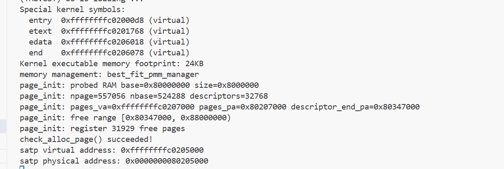
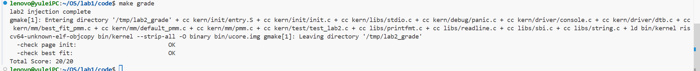
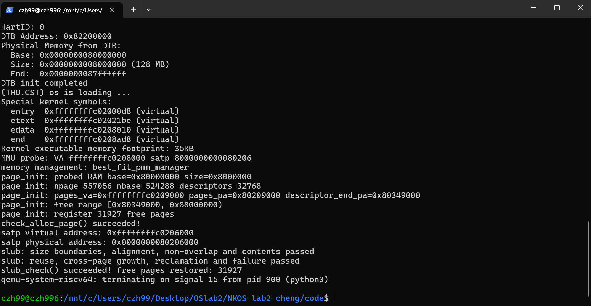
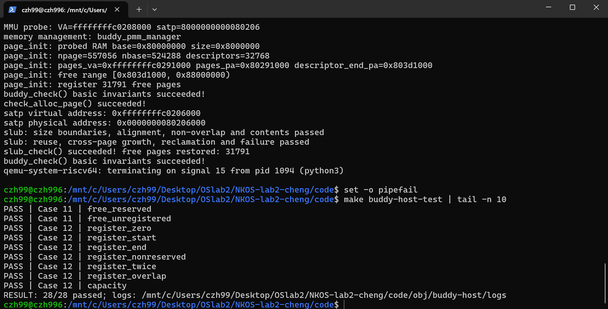
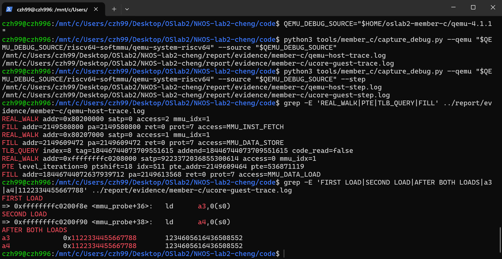
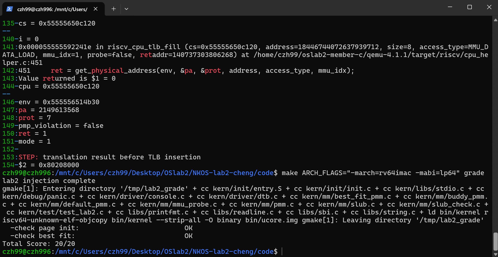

# 操作系统实验报告：Lab2 物理内存和页表

## 实验基本信息

| 项目 | 内容 |
| --- | --- |
| 实验名称 | Lab2：物理内存和页表 |
| 小组成员 | 2411824 于蕾、2412790 杨茜茹、2413921 程子涵 |
| 总报告整合 | 2412790 杨茜茹（B），借助 Codex 整理 |
| 实现与运行记录 | 各成员开发记录及 2026-10-18 联调记录 |
| 本次文档整理日期 | 2026-10-20 |

### 小组分工

| 成员 | 实验任务 | 交付与公共职责 |
| --- | --- | --- |
| A：2411824 于蕾 | page_init、内存探测思考题、First-Fit 分析、Best-Fit | 对应实现、提示词、报告、两张测试图 |
| B：2412790 杨茜茹 | Buddy 实现、独立测试 | 两份实际提示词、Buddy 报告、分支接入和回归、总文档整合 |
| C：2413921 程子涵 | SLUB 实现与测试、QEMU 地址翻译与 TLB 六项调试 | 八项提示词整理稿、调试脚本、报告和十一张证据图 |


## 一、实验目的

1. 理解 RAM 发现、物理地址、虚拟地址、物理页号与 Page 描述符的关系。
2. 实现物理内存初始化，排除启动保留区和内核管理开销。
3. 理解 First-Fit，借助 AI 实现 Best-Fit、Buddy，并设计可检验的规格和独立测试。
4. 用简化 SLUB 理解页级分配与任意大小对象分配的分层。
5. 借助双 GDB 观察 Sv39 页表翻译及 QEMU SoftTLB，把实际访存、源码和手算结果对应起来。

## 二、实验环境

### 2.1 AI 工具与人员操作

| 成员 | AI 工具 | 模型版本及操作记录 |
| --- | --- | --- |
| A | 交付材料未明确记录具体工具名称 | 未记录精确模型；依据 A 的提示词、反馈、报告与截图保留结果 |
| B | Codex 桌面应用辅助，VS Code 打开 Ubuntu WSL 工程 | 未记录精确模型；本人在 WSL 终端执行编译、测试和 Git 操作并反馈输出 |
| C | Codex 桌面应用 | 未记录精确模型；依据 C 的代码、报告与调试截图保留记录 |

不将工具名称当作模型版本，也不推测未记录的型号。原提示词中的允许修改范围和阶段依赖按实际使用版本保留。

### 2.2 编译和调试环境

| 项目 | 已记录环境 |
| --- | --- |
| A | Best-Fit 完成阶段报告记录 RISC-V GCC 10.2.0；page_init 早期反馈曾仅具备 riscv64-linux-gnu-gcc，属于不同阶段 |
| B | Windows、Ubuntu WSL、VS Code；RISC-V GCC 10.2.0；QEMU 启动显示 OpenSBI v0.4；原生 GCC 与 Python 3 执行 Buddy 测试 |
| C | 报告记录 Windows+WSL2、Ubuntu 26.04.1 LTS、RISC-V GCC 14.2.0、调试版 QEMU 4.1.1、gdb/gdb-multiarch 17.1、ASan/UBSan |
| 客体 | RISC-V 64 位、Sv39、4 KiB 基本页；默认 RAM 为 [0x80000000,0x88000000) |
| 当前开关 | 默认 Best-Fit；BUDDY=1、SLUB_CHECK=1、MMU_PROBE=1 分别控制对应功能 |

本人的旧工具链不接受显式 zicsr/zifencei 扩展设置，因此 B 的集成验证使用命令行 ARCH_FLAGS= 恢复其可用默认设置；不修改 C 的 Makefile 默认值。C 的最终评分截图另显示显式 ARCH_FLAGS="-march=rv64imac -mabi=lp64"，各次运行参数应分别看待。

## 三、实验整体逻辑分析

### 3.1 从启动映射到页面和对象分配

OpenSBI 向入口传入 hartid 和 DTB 地址。entry.S 保存参数，建立静态根页表、写 satp 并刷新 TLB，再进入高地址 kern_init。框架已经完成分页开启；本次 page_init 管理的是映射背后的物理页资源，不重复开启分页。

dtb_init 提取 RAM 起点和长度。pmm_init 先选择并初始化 pmm_manager，再由 page_init 放置和初始化 Page 描述符、排除固件与内核占用，最后注册空闲完整页并执行管理器检查：

```text
entry.S：启动页表与 Sv39
  → kern_init：清 BSS、解析 DTB
  → 可选 MMU 探针（在 PMM 初始化之前）
  → pmm_init
      → init_pmm_manager → 管理器.init
      → page_init → 管理器.init_memmap
      → check_alloc_page → 管理器.check
  → 可选 SLUB 检查（在 PMM 初始化之后）
      → alloc_pages/free_pages → 当前页管理器
      → 回收后再次检查当前 PMM
```

### 3.2 为什么按这个顺序实现

先确定真实可用物理页，分配器才有合法资源；再理解 First-Fit 的状态约定，完成 Best-Fit 和 Buddy 的页级策略。SLUB 依赖已经可用的公共页接口，因此安排在上层；MMU 调试则针对启动映射，可在页分配前观察。公共接口让成员可以独立开发，集成时重点核对所有权、申请/释放长度和构建开关。

Best-Fit 成功时精确分配 n 页，Buddy 则向上取整到二次幂、按实际占用扣页，但释放必须传原始 n。SLUB 保存原始请求页数，避免把这两个契约混用。内核代码、静态 Buddy 元数据和 C 的探针/数组都会改变 end，因此空闲页基线由每次实际构建确定，不能写死。

## 四、实验内容与实现

### 功能模块一：物理内存初始化功能

**负责人：** 2411824 于蕾

#### 模块功能描述

**需要实现/修改的函数：**

```c
// code/kern/mm/pmm.c
static void page_init(void);
```

**功能说明：**

本模块根据设备树提供的物理内存信息，建立物理页描述符数组，并将排除 OpenSBI、内核镜像、描述符数组及对齐占用后的完整空闲页面交给当前物理内存管理器，为后续页面分配提供初始状态。

`page_init()` 不接收参数、不返回结果，由 `pmm_init()` 在管理器初始化后调用。执行时，框架已在 `entry.S` 中开启 Sv39 分页，`dtb_init()` 也已解析设备树。因此，本函数负责物理页管理信息的初始化，不负责重新建立启动页表。

本次仅修改 `code/kern/mm/pmm.c`，在 `//lab2 function1 2411824` 处实现 `page_init()`，未新增辅助函数，未修改头文件、设备树解析、管理器选择、测试或 Makefile。

核心实现分为以下几个步骤：

1. **验证设备树提供的物理内存信息。**

   通过 `get_memory_base()` 和 `get_memory_size()` 获取 RAM 起点与大小。起点或大小为零、起点与大小相加溢出、RAM 起点不符合当前固定基址模型，或者 RAM 无法覆盖内核镜像时，调用 `panic()` 终止初始化。

   计算 RAM 末端前，使用以下条件检查加法溢出：

   ```c
   if (mem_base > ~(uint64_t)0 - mem_size) {
       panic("page_init: memory base + size overflows");
   }
   ```

2. **设置地址偏移与可管理物理页号上界。**

   ```c
   va_pa_offset = PHYSICAL_MEMORY_OFFSET;
   ```

   当前偏移为 `0xFFFFFFFF40000000`，与启动映射一致。不能使用 `KERNBASE - DRAM_BASE` 计算偏移，因为 `KERNBASE` 对应内核物理起点 `0x80200000`，而 DRAM 起点为 `0x80000000`。

   可管理末端及页号上界的计算关系为：

   ```text
   ram_end     = mem_base + mem_size
   managed_end = ROUNDDOWN(min(ram_end, PHYSICAL_MEMORY_END), PGSIZE)
   npage       = PPN(managed_end)
   ```

   默认 128 MiB 配置下，理论值为：

   ```text
   RAM 范围：[0x80000000, 0x88000000)
   nbase = 0x80000
   npage = 0x88000
   描述符数量 = npage - nbase = 32768
   ```

   `npage` 表示可管理物理页号的上界，不是 RAM 页面总数。上述数值在后续默认配置 QEMU 输出中得到确认；早期初始化单独实现阶段尚未完成整机验证。

3. **在内核镜像之后安排描述符数组。**

   ```c
   pages = (struct Page *)ROUNDUP((uintptr_t)end, PGSIZE);
   uintptr_t pages_pa = PADDR((uintptr_t)pages);
   ```

   `end` 是链接脚本提供的内核末端虚拟地址。将其向上按页对齐，得到描述符数组的虚拟起点，再通过 `PADDR()` 转换成物理地址进行范围检查。

   ```text
   descriptor_count  = npage - nbase
   descriptor_bytes  = descriptor_count × sizeof(struct Page)
   descriptor_end_pa = pages_pa + descriptor_bytes
   ```

   按当前 RV64 结构体布局，`sizeof(struct Page)` 为 40 字节，默认配置下描述符数组占用 `1310720` 字节，即 1.25 MiB。

   实现先检查描述符字节数乘法是否溢出，再验证数组起点和长度是否位于可管理范围内：

   ```c
   if (pages_pa > managed_end) {
       panic("page_init: descriptor array starts beyond managed memory");
   }
   if (descriptor_bytes > managed_end - pages_pa) {
       panic("page_init: descriptor array does not fit in RAM");
   }
   ```

   通过检查后才写入描述符，避免数组越界后再发现空间不足。

4. **初始化全部描述符，并先标记为保留。**

   ```c
   for (size_t i = 0; i < descriptor_count; i++) {
       pages[i].ref = 0;
       pages[i].flags = 0;
       pages[i].property = 0;
       list_init(&pages[i].page_link);
       SetPageReserved(&pages[i]);
   }
   ```

   描述符数组位于内核 `end` 之后，不能假设已经随 BSS 清零，因此需要显式初始化。

   先保留全部页面，再登记可用区，可以使 OpenSBI、内核镜像、内核尾页和描述符存储页保持保留状态，避免被错误分配。

5. **注册剩余完整空闲页面。**

   ```c
   uintptr_t free_begin = ROUNDUP(descriptor_end_pa, PGSIZE);
   uintptr_t free_end = managed_end;

   if (free_begin < free_end) {
       size_t free_pages_count = (free_end - free_begin) / PGSIZE;
       init_memmap(pa2page(free_begin), free_pages_count);
   }
   ```

   空闲起点向上对齐，避开描述符占用的页面；末端向下对齐，排除不完整尾页。不存在完整空闲页时，不调用 `init_memmap()`，避免传入 `n == 0`。

   各区域按物理地址排列如下：

   ```text
   DRAM_BASE
     │ OpenSBI 等保留区域
   KERNEL_BEGIN_PADDR
     │ 内核镜像、启动栈、启动页表等
   PADDR(end)
     │ 对齐间隙
   pages_pa
     │ Page 描述符数组
   descriptor_end_pa
     │ 对齐间隙
   free_begin
     │ 可分配的完整物理页
   managed_end
   ```

   本函数通过公共 `init_memmap()` 接口登记空闲区，不依赖 First-Fit 或 Best-Fit 的私有数据结构，后续切换管理器时可以复用。

#### 最终提示词

本任务实际使用的完整提示词保存在同目录的 [prompt1.md](./prompt1.md)。

提示词通过 `[RELY]` 列出真实工程接口和地址约定，通过 `[GUARANTEE]` 限定修改范围，通过 `[SPECIFICATION]` 描述正常初始化、无效设备树信息、范围裁剪、页面对齐、描述符空间不足及无完整空闲页等 Case。

其中明确要求修改真实文件，仅在 `pmm.c` 指定标记处实现函数，不修改其他模块或测试，并如实报告编译与运行验证结果。完整提示词以附件原文为准。

#### 实现迭代过程

本模块记录了一次实现迭代。原 prompt1.md 末尾反馈显示：pmm.c 单独编译通过，早期整项目曾被尚未实现的 Best-Fit 所阻塞；没有跨分工补写。后续 Best-Fit 完成后，默认启动及评分通过，结果见第五章。

---

### Challenge：硬件的可用物理内存范围的获取方法

**负责人：** 2411824 于蕾

**问题：如果 OS 无法提前知道当前硬件的可用物理内存范围，有什么办法让 OS 获取？**

操作系统可以从固件、引导程序或平台描述中取得物理内存布局，再排除保留区域和启动占用，得到可以交给分配器的页面集合。

**1. 从设备树获取。**

在采用设备树的平台上，引导环境将 DTB 地址传给内核。内核解析内存节点的 `reg` 属性，取得 RAM 起点和长度。通用实现还需要根据 `#address-cells`、`#size-cells` 解码，并支持多个内存范围。

除了 RAM 信息，还要读取内存保留块和 `/reserved-memory` 等保留信息，避免将固件或其他组件使用的区域交给普通分配器。[参考：Devicetree 设备节点规范](https://devicetree-specification.readthedocs.io/en/latest/chapter3-devicenodes.html)、[DTB 内存保留块](https://devicetree-specification.readthedocs.io/en/v0.2/flattened-format.html)。

**2. 从固件或引导程序获取。**

在 UEFI 平台上，OS Loader 可以通过 `GetMemoryMap()` 取得带类型的内存映射，再传递给内核；传统 BIOS 平台可由引导程序使用 E820 接口获得地址映射。

内核需要根据内存类型和使用阶段判断是否可以回收，保留固件运行时仍需使用的区域，不能把所有报告范围立即作为空闲 RAM。[参考：ACPI 系统地址映射接口](https://uefi.org/specs/ACPI/6.6/15_System_Address_Map_Interfaces.html)。

对布局固定的开发板，也可以采用平台文档或板级配置，但这种方式绑定具体硬件，平台变化后必须同步更新。

**3. 区分 RAM、保留区域和设备地址空间。**

获得 RAM 范围后，还应扣除固件、内核、启动栈、页表、仍需保留的 DTB 和管理元数据等占用。

内存映射设备寄存器虽然也具有物理地址，但不是普通 RAM，不能参与页面分配。最终可用区还要按页对齐，并限制在内核当前能够访问和管理的范围内。

**4. 本实验设备树方案的作用与限制。**

本实验由 `entry.S` 保存 DTB 地址，`dtb_init()` 解析 RAM 信息，`page_init()` 建立描述符和初始空闲区。这使初始化能够依据设备树提供的大小工作，而不必直接写死默认 RAM 容量。

但当前实现仍是简化模型：解析器只提取首个匹配内存节点中的一组起点和大小，没有完整支持通用 cells 编码、多段 RAM 和额外保留区；初始化还要求 RAM 从 `DRAM_BASE` 开始，并将管理末端限制在 `PHYSICAL_MEMORY_END`。

因此，本实验体现了物理内存发现与初始化的基本流程，尚不能处理任意平台的完整内存布局。

**5. 信息缺失或不可靠时的处理。**

应先检查启动协议、固件接口和平台文档，寻找可靠信息来源，并对取得的范围检查溢出、重叠、类型和保留区。无法获得可信信息时，可以采用明确的平台配置，或者停止初始化。

不能简单通过逐地址写入再读回来扫描全部物理地址，因为未知地址可能对应设备、未映射区域或已有数据，访问可能引起副作用、异常或破坏。只有平台明确支持且能保护已有内容时，才考虑受控探测。

本次实现选择在设备树信息无效时调用 `panic()`，避免使用未经验证的默认容量继续初始化。

---
### 功能模块二：物理内存分配功能

### 任务一：理解first-fit 连续物理内存分配算法（思考题）

First-Fit（首次适应）算法使用按物理地址递增排列的双向链表管理空闲页块。链表只记录各空闲块的首页，首页描述符中的 `property` 表示该块包含的连续空闲页数，`nr_free` 记录空闲页面总数。申请页面时，算法从链表头开始查找，选择第一个足够大的空闲块。

**1. 初始化管理状态：`default_init()`**

该函数通过 `list_init()` 将空闲链表初始化为空，并将 `nr_free` 置为 0。此时仅建立管理器的初始状态，还没有登记可分配页面。

**2. 登记空闲页面：`default_init_memmap()`**

该函数接收一段连续页面的起始描述符 `base` 和页数 `n`。它检查这些页面原本处于保留状态，随后清除其标志和 `property`，将引用计数设为 0。

接着，将首页的 `property` 设为 `n`，设置首页的 `PageProperty` 标志，并将该空闲块按地址顺序插入链表，同时使 `nr_free` 增加 `n`。这样，初始化阶段确定的可用页面就交给了分配器。

**3. 分配连续页面：`default_alloc_pages()`**

申请 `n` 页时，函数首先检查空闲页总数是否足够。若不足，直接返回 `NULL`；否则从链表头开始遍历，选择第一个满足 `property >= n` 的空闲块。

找到后，将该块从链表移除。如果块大小恰好为 `n`，就分配整个块；如果大于 `n`，则分配前面的 `n` 页，并将剩余部分作为新的空闲块放回原位置。最后减少 `nr_free`，清除已分配块首页的 `PageProperty` 标志，并返回首页描述符。若没有足够大的连续块，即使空闲页总数足够，也会返回 `NULL`。

**4. 回收与合并页面：`default_free_pages()`**

释放页面时，函数检查页面状态，重置标志和引用计数，将释放区间登记为空闲块，并按地址顺序插回链表，同时增加 `nr_free`。

随后检查前后两个空闲块：若前块末端等于当前块起点，就与前块合并；若合并后的块末端等于后块起点，就继续与后块合并。合并时更新块长度，删除多余的链表节点并清除其首页标志，最终只保留合并后块首页的记录。

**5. 分配与释放示例**

假设最初有一个连续的 10 页空闲块：

```text
初始：        [空闲 10 页]
申请 3 页：   [已分配 3 页][空闲 7 页]
再申请 2 页： [已分配 3 页][已分配 2 页][空闲 5 页]
释放前 3 页： [空闲 3 页][已分配 2 页][空闲 5 页]
释放中间2页：[空闲 10 页]
```

最后一次释放的 2 页与前后空闲块都相邻，因此可以通过两次合并恢复为一个连续的 10 页空闲块。

### 练习：原有 First-Fit 算法是否有进一步的改进空间？

有。当前实现使用链表顺序查找，分配时最坏需要遍历所有空闲块；释放时为了按地址插入，也可能需要遍历链表。空闲块较多时，这些操作的开销会增加。

可以引入按大小分类的索引或平衡树，加快合适空闲块的查找，同时保留地址关系以支持相邻合并，但会增加元数据和维护成本。也可以采用 Next-Fit，从上次查找位置继续搜索，减少反复扫描链表前部的情况，不过其性能与碎片情况仍取决于请求序列。

此外，First-Fit 只选择第一个足够大的块，可能拆分较大的空闲块而留下小碎片。可以考虑 Best-Fit 等选择策略，但 Best-Fit 也可能产生难以利用的小块，不能保证始终减少碎片。当前实现已经支持相邻空闲块合并，后续改进应结合实际请求特点，在查找效率、碎片和实现复杂度之间权衡。

### 任务二：实现 Best-Fit 连续物理内存分配算法（设计提示词借助 AI 完成）

**负责人：** 2411824-于蕾

#### 模块功能描述

**需要实现/修改的函数：**

```c
// code/kern/mm/best_fit_pmm.c：实现的管理器接口
static void best_init(void);
static void best_init_memmap(struct Page *base, size_t n);
static struct Page *best_alloc_pages(size_t n);
static void best_free_pages(struct Page *base, size_t n);
static size_t best_nr_free_pages(void);

// 内部静态辅助函数：best_insert_free_block
static void best_insert_free_block(struct Page *base, size_t n);

// 原有检查函数：保留定义，仅在注册结构之前补充前向声明
static void best_fit_check(void);

// code/kern/mm/pmm.c：仅修改管理器选择
static void init_pmm_manager(void);
```

此外，定义并注册管理器对象 `const struct pmm_manager best_fit_pmm_manager`，将其初始化、空闲区登记、分配、释放、空闲页数查询和检查接口分别绑定至对应函数。`basic_check()`、`best_fit_check()` 的原有测试内容均保持不变。

**功能说明：**

本模块负责 ucore 内核中的连续物理页面分配与回收。内核通过统一的 `pmm_manager` 接口使用物理内存管理器；本任务将默认管理器切换为 Best-Fit，使实际分配和自检均经过本次实现。

模块采用按物理地址递增排列的双向循环空闲链表，仅将空闲块头页的 `page_link` 加入链表。头页的 `PageProperty` 标志表示该页是空闲块头，`property` 记录连续空闲页数；块内其他页面以及已分配页面不设置该标志。`nr_free` 记录空闲页面总数，正常管理状态下等于所有空闲块长度之和。

主要处理以下场景：

1. **初始化与空闲区登记。** `best_init()` 初始化空链表并清零计数；`best_init_memmap()` 将合法的保留页区间转为空闲页面，初始化页面状态，并按地址插入及合并相邻空闲块。
2. **最优适配分配。** 对请求的 `n` 页，遍历空闲链表，选择所有长度不小于 `n` 的空闲块中最小的一块；长度相同时选择物理地址最低的块。从选中块的低地址端分配恰好 `n` 页，存在剩余时将余块留在原地址顺序位置。
3. **释放与合并。** 将释放区间按地址插入链表，依据描述符连续性判断能否与前后块合并。例如，`previous + previous->property == base` 表示前块与当前块连续。合并时清除被吞并块头的标志并删除相应节点，空闲计数仅增加本次释放的 `n` 页。
4. **失败与边界处理。** 空链表、总空闲页数不足或不存在足够大的连续块时返回 `NULL`，不改变空闲状态；对零页请求以及参考实现明确检查的非法页面状态使用断言。页面标志检查不构成对所有重复释放和错误指针的完整检测。

模块与 `page_init()` 配合完成初始可用物理内存登记，与 `alloc_pages()`、`free_pages()`、`nr_free_pages()` 等公共包装函数配合向内核提供服务，并通过原有 `best_fit_check()` 完成检查。管理器内部直接操作自己的状态，避免调用公共包装函数导致递归。为兼容原有测试对 `free_list`、`nr_free` 的临时隔离与恢复，不引入额外空闲索引、缓存计数或分配大小表。

实际修改范围如下：

| 文件                          | 修改内容                                                     |
| ----------------------------- | ------------------------------------------------------------ |
| `code/kern/mm/best_fit_pmm.c` | 在 `//lab2 function2-2 2411824` 标记处实现管理器状态、辅助函数、各管理接口和注册结构。 |
| `code/kern/mm/pmm.c`          | 在 `init_pmm_manager()` 中将管理器选择改为 `pmm_manager = &best_fit_pmm_manager;`，保留名称打印及初始化调用。 |

#### 最终提示词

本次实现使用的最终提示词文件较长，已在 [prompt.md 的 A·Best-Fit 部分](prompt.md#a-best-fit)完整保留，正文不重复长篇粘贴。

完整提示词原文已集中复制到 [提示词汇总](prompt.md#a-best-fit)。
#### 实现迭代过程

---

##### 第一次迭代：初始提示词约束不足

**初始提示词：**

```markdown
请参考 default_pmm.c，在 best_fit_pmm.c 中实现 Best-Fit
连续物理内存分配算法，包括初始化、空闲内存登记、页面分配、
页面释放以及空闲页数查询。

分配时选择能够满足请求的最小空闲块，释放时合并相邻空闲块，
并将 pmm.c 中的物理内存管理器切换为 Best-Fit。
```

**遇到的问题：**

- **问题1：空闲链表组织方式不明确。** 初始提示词仅要求选择最小适配块，没有明确链表的排列顺序。如果按块大小排列，释放时定位物理相邻块需要额外处理，容易增加合并逻辑的复杂度。
- **问题2：页面状态与计数约束不完整。** 未明确拆分、释放和合并时 `PageProperty`、`property` 与 `nr_free` 的更新规则，存在被吞并块头标志残留或空闲页数重复累计的实现风险。
- **问题3：原有测试兼容要求不足。** 未说明测试直接使用 `free_list` 和 `nr_free`，也未覆盖测试临时隔离状态下链表为空、计数尚未同步的情况。
- **问题4：边界条件与修改范围不明确。** 未规定同大小候选块的选择规则、分配失败时的状态要求，也未明确要求保留原有测试、上一任务代码及 Makefile。

**问题解决策略：**

- 针对问题1：明确采用按物理地址递增排列的空闲链表；分配时遍历链表比较块大小，实现 Best-Fit；同大小时选择地址最低的块。
- 针对问题2：补充页面状态不变量，要求仅空闲块头页具有 `PageProperty` 标志，分配和释放分别按实际页数更新 `nr_free`，合并时不重复记账。
- 针对问题3：补充原有测试的状态保存与恢复方式，要求保留同名状态，不引入额外索引，并安全处理空链表。
- 针对问题4：逐函数列出前置条件、后置条件和边界场景，明确允许修改的文件与位置，禁止修改已有测试和评分脚本。

---

##### 第二次迭代：完善提示词并完成验证

**提示词调整：**

通过以下四个部分细化任务要求：详细全文见[prompt.md](./prompt.md)。
```

1. `[PROMPT]`：明确任务目标、操作要求及结果输出要求。
2. `[RELY]`：提供真实文件路径、结构体、链表接口、公共包装函数及测试约定。
3. `[GUARANTEE]`：明确必须实现的接口、管理器注册方式以及允许修改的范围。
4. `[SPECIFICATION]`：逐函数规定状态变化、选块规则、拆分合并逻辑及边界处理方式。
```


**最终结果：**

根据实际执行结果报告及测试截图，该模块最终：

- ✅ 编译链接通过。
- ✅ 内核输出 `memory management: best_fit_pmm_manager`，确认管理器切换生效。
- ✅ 输出 `check_alloc_page() succeeded!`。
- ✅ `make test` 得到 `grading: 6 / 6 points`。
- ✅ `make grade` 中 `check page init` 和 `check best fit` 均为 `OK`，总分为 `20/20`。
- ✅ 在现有测试覆盖范围内，功能符合预期。

**关键改进点总结：**

1. 将笼统的算法要求细化为逐函数的接口契约，减少实现歧义。
2. 明确空闲链表顺序、页面标志和空闲页数的维护规则。
3. 补充原有测试的兼容要求，避免额外状态破坏测试隔离流程。
4. 明确管理器注册与内核接入位置，确保实际运行本次实现。
5. 保持修改范围可控，使用原有检查和评分结果验证实现。


---


#### Best-Fit 的进一步改进空间

当前选块需要遍历全部空闲块，最坏查找成本与空闲块数量成正比；地址有序链表便于相邻合并，但也需要扫描插入位置。可以在精确匹配时提前结束扫描，或增加按大小索引、分级空闲表以加快选块，同时保留地址关系。不过额外状态必须与测试的临时隔离/恢复约定一致，不能直接加入测试无法保存的隐藏索引。

Best-Fit 可能留下难以利用的小余块，并不保证比 First-Fit 始终减少碎片。可通过独立请求序列比较分配成功率、剩余块分布和扫描成本，再决定是否优化。本次没有性能实测，不宣称已有速度或碎片率提升。参考页面状态断言也不等同于完整的非法释放检测。

### 功能模块二·任务三：Buddy System 实现与独立测试

**负责人：2412790 杨茜茹。** 两份提示词分别对应实现、独立测试，完整原文已复制到 [汇总第一份](prompt.md#b-buddy-implementation)和[第二份](prompt.md#b-buddy-tests)。以下技术内容取自 B 的个人报告，历史 Git 过程与每轮完整输出保留在[个人原稿](buddy/lab2_B_Buddy实验报告.md)。

#### 二 Buddy 算法与设计选择

##### 2.1 基本原理

Buddy 以包含 `2^order` 个连续物理页的块组织空闲空间，分别维护各阶空闲链表。申请时优先选择能够满足请求的最小可用阶；没有目标阶空闲块时，从更高阶取得块并逐级拆分。释放时只合并同阶、空闲且互为伙伴的块，合并出的块可以继续寻找更高阶伙伴。

本实现采用二进制伙伴规则。若块首绝对物理页号为 ppn，块大小为 k 页，则：

```text
k = 2^order
块首对齐条件：ppn % k == 0
伙伴页号：buddy_ppn = ppn XOR k
```

同阶和相邻并不足以成为伙伴。例如 nbase 为 8 的倍数时，下标 `[2,4)` 与 `[4,6)` 虽然相邻且均为 2 页，但不能合成一个按 4 页对齐的块。物理页号还必须满足伙伴关系。这是测试中专门检查的情况。

##### 2.2 分配与释放契约

| 项目 | 约定 |
| --- | --- |
| 请求大小 | n 必须大于 0，实际占用能够容纳 n 的最小二次幂 k |
| 非二次幂请求 | 请求 3、5、9 页，分别实际占用 4、8、16 页 |
| 空闲计数 | 分配减 k，释放加 k，不按原始请求 n 记账 |
| 释放参数 | 必须传本次存活分配的首描述符和原始申请长度 n |
| 申请失败 | 资源不足、无合适块或请求过大时返回 NULL，不改变已有有效状态 |
| 非法调用 | 零页申请、错误长度、部分释放、非首地址及重复释放等触发断言 |
| 初始区间 | 允许不规整起点、长度和多次不重叠登记，完整管理输入页 |
| 块选择 | 优先最小可用阶；同阶不规定地址优先 |
| 使用场景 | 单核串行调用，不提供多核同步 |

请求 3 页时，调用者虽然只要求 3 页，但分配器为该请求保留完整 4 页，第四页不能再次分配。释放时仍传 3，内部根据申请记录核对并释放 4 页。该约定符合框架“分配至少 n 页”的接口说明，但不能沿用其他分配器可能支持的任意子区间释放方式。

##### 2.3 地址与页面状态

`pages` 是描述符数组起点；`npage` 是可管理物理页号上界，不是数组长度。数组长度为 `npage - nbase`，下标 index 对应物理页号 `nbase + index`。因此伙伴定位必须使用物理页号，而不是直接对描述符下标异或。

空闲块首带 `PageProperty`，其 `property` 为实际块页数；块内其他页以及已分配页不带该标志。新登记页面清除保留位并将引用计数置零。未登记页面不进入本管理器的链表。

本实现不修改 `struct Page`、`struct pmm_manager` 或公共地址转换接口。输入指针先转为整数地址，验证范围及描述符对齐，再进行数组访问，避免先解引用非法输入。伙伴页号同样先检查上下界，不能依赖现有 `pa2page()` 只检查上界的行为完成完整验证。

#### 三 Spec 的组织方式

实现规格先明确全局不变量，再为每个接口写前置条件、成功后状态、失败 Case 和约束。重点描述可检验的结果，不把提示词写成逐行代码或固定实现步骤。

全局不变量包括：已登记页恰好属于空闲块或存活分配；各块不重叠；空闲块大小和对齐合法；同一块只在对应链表出现一次；可合并伙伴不遗漏；空闲计数等于空闲块页数之和；保留区和空洞不能被分配。

| 接口 | 前置条件与核心行为 | 成功后状态及异常约束 |
| --- | --- | --- |
| `buddy_init()` | 在登记前调用，不要求 pages/npage 已建立 | 内部链表为空、计数为零，不调用页分配接口申请自身元数据 |
| `buddy_init_memmap(base,n)` | 描述符范围有效，输入为未登记的保留页 | 全部 n 页登记且计数增加 n；越界、重叠、容量不足等先检查后拒绝 |
| `buddy_alloc_pages(n)` | 已初始化且状态合法 | 成功取得对齐的 k 页块、计数减 k；普通失败返回 NULL，n 为零断言 |
| `buddy_free_pages(base,n)` | 首地址和原始请求匹配存活分配 | 释放实际 k 页，递归合并合法伙伴；非法释放在变更状态前拒绝 |
| `buddy_nr_free_pages()` | 已初始化 | 返回实际空闲页数，不修改状态 |
| `buddy_check()` | 已建立描述符且管理器状态可检查 | 核对结构不变量；成功后清除暂存标记，不改变分配状态 |

测试 spec 则将上述规格转换成 12 类可执行行为要求：10 类正常和边界场景，以及非法申请释放、非法登记容量两大类隔离测试。后一部分展开为 18 个独立异常进程。

#### 四 核心实现与模块理解

##### 4.1 私有数据结构

`order_lists` 保存各阶空闲块链表头，`free_count` 保存实际空闲页数。模块私有 `records` 数组保存每页的管理状态，包括未管理、空闲首、空闲尾、分配首和分配尾。块首记录阶数，分配首另记录原始请求长度。`check_seen` 只供检查函数识别重复节点及核对链表和描述符。

元数据放在静态 BSS，避免管理器初始化时又调用自己分配元数据的循环依赖。当前容量由 `(PHYSICAL_MEMORY_END - DRAM_BASE) / PGSIZE` 推导，为 32768 页；在 RV64 的字段布局下，记录数组约 512 KiB、检查暂存约 32 KiB，另有约 1 KiB 链表头。运行时检查描述符数量不超过该容量。

这种设计便于实现和验证，但有静态空间成本。新增 BSS 属于内核占用，A 的初始化必须使用实际链接后的 `end` 计算空闲区，不能继续使用旧内核尾地址。

##### 4.2 初始化与空闲区登记

`buddy_init()` 清空链表、元数据和计数，计算容量所支持的最大阶。由于它发生在 `page_init()` 之前，不能在这里要求 `pages` 已可用。

`buddy_init_memmap()` 先验证整个输入区间的边界、容量、未登记状态和保留状态。验证完成后，将区间拆成当前起点允许的最大对齐块，再登记其余部分。例如在当前 nbase 对齐条件下，`[3,16)` 可以分解为 `[3,4)`、`[4,8)` 和 `[8,16)`，共 13 页，没有丢弃不规整的开头。

登记通过内部 `return_block()` 尝试伙伴合并，因此多次登记的不同区间也可以在满足条件时形成大块；未登记空洞不会被合并进去。

##### 4.3 分配

`buddy_alloc_pages()` 先拒绝零页请求，检查总量与最大块能力，避免对极大请求进行危险的移位或无限取整。随后确定目标阶，并查找最小的非空可用阶。若没有候选，直接返回 NULL。

找到候选后将其从链表摘除；需要拆分时，保留低半块继续分裂，把高半块登记到相应阶链表。最终通过 `mark_block()` 设置分配首、尾状态，记录原始请求，清除空闲块首标志，并按实际块大小扣减计数。

##### 4.4 释放与合并

`buddy_free_pages()` 先验证首地址、申请记录、长度、实际区间和页面状态，再调用 `return_block()`。后者根据绝对物理页号寻找伙伴，只有伙伴是同阶空闲首时才摘除伙伴节点并向高阶合并，直到没有合适伙伴或达到最大阶。最后统一标记合并结果并放回链表。

合并只是改变空闲块的组织形式，不额外增加空闲页。因此一次合法释放只增加原分配实际占用的 k 页，不能按最终合并块大小重复计数。

##### 4.5 基础检查与复杂度

`buddy_check()` 检查链表连接、节点重复、阶数与对齐、空闲计数、块首与尾状态，以及遗漏的可合并伙伴。检查时不分配或释放页面，结束后清空暂存标记。

本实现除了链表操作，还会遍历块中的描述符更新状态，因此不能简单宣称所有分配和释放都是对数复杂度。一次分配的成本与取出的原块大小有关，一次释放与最终合并块大小有关；基础检查会遍历描述符与空闲节点。实验未要求优化时空复杂度，本轮优先保证语义明确和可验证性。

当前检查还要求被管理页面引用计数为零，适用于本次物理分配实验。如果后续引入引用计数使用者，需要重新明确该检查的适用阶段，不能把现有断言直接用于所有内存管理生命周期。

#### 五 AI 提示词设计与使用记录

##### 5.1 第一份提示词

完整原文见 [Buddy实现提示词.md](buddy/Buddy实现提示词.md)。使用四段结构：

- `[PROMPT]` 明确目标模块、真实文件修改、算法含义、允许和禁止范围及验证输出。
- `[RELY]` 只列实际工程所需的接口、描述符、页号关系和宏，纠正示例路径及签名差异。
- `[GUARANTEE]` 列出六个管理函数、管理器注册、头文件与可选构建接入。
- `[SPECIFICATION]` 写清全局不变量和各接口的成功、失败及非法输入行为。

其中最关键的设计决定是“向上取整分配、按实际页数记账、用原始请求释放”，其次是绝对物理页号伙伴判断、对不规整初始区间的完整管理，以及初始化尚未完成时不越过分工补写其他模块。

##### 5.2 第二份提示词

完整原文见 [Buddy测试提示词.md](buddy/Buddy测试提示词.md)。第二份是在已有实现和契约确定之后编写的，要求编译链接真实 Buddy 源码，通过公开回调测试，不读取内部静态数组、不复制分配算法、不修改实现以迁就测试。

预期值采用小规模手算地址、独立占用位图和预期计数；同阶选择没有约定时不强行断言最低地址。异常测试要求独立进程隔离，并精确匹配预期断言，不能把任何非零退出都当作通过。

两份提示词均由 Codex 协助拟定，并在本次会话中交给 Codex 执行；WSL 编译、测试输出由本人在 VS Code 终端运行并反馈。没有把本次过程记成使用另一工具执行。

##### 5.3 需求核对

| 检查点 | 本次落实方式 |
| --- | --- |
| 目标文件与模块明确 | 实现和测试分别列出目标文件 |
| 必须修改真实文件 | 两份均明确要求实际写入工程 |
| 接口完整 | 列出六个回调、注册结构和构建入口 |
| 依赖符合真实工程 | 使用 `libs/list.h`、真实地址类型、宏及 nbase/npage 语义 |
| 修改边界明确 | 不改公共结构、既有测试和另一成员的初始化 |
| Case 可验证 | 每项写明输入、预期结果、计数和状态要求 |
| 系统约束明确 | 无循环分配依赖、无非法解引用、按物理页号对齐、单核串行及验证边界 |

#### 六 测试设计与有效性

##### 6.1 测试组织

`tools/buddy_host/cases.c` 建立模拟描述符、登记位图、占用位图和预期空闲数，并调用真实管理器回调。`platform.c` 单独使用宿主标准库实现输出和 `__panic`，避免内核自定义类型与 libc 头文件冲突。`run.py` 逐个启动场景、限制运行时间、保存日志并汇总结果。

测试与被测源码分成独立编译单元，不使用 `#include` 被测 C 文件访问 static 变量。宿主对象放在 `obj/buddy-host/`，不会与 RISC-V 对象混用。Makefile 的宿主目标跳过内核依赖文件重建，使测试不需要 `page_init()`、QEMU 或交叉编译器。

##### 6.2 正常与边界场景

| 用例 | 核心覆盖 | 为什么有效 |
| --- | --- | --- |
| `empty` | 未登记时申请失败 | 检查空初始化及失败状态 |
| `orders` | 1 至 32768 页的所有阶 | 检查各阶大小、物理对齐及计数恢复 |
| `rounding` | 3、5、9 页取整 | 检查原始请求与实际占用的区分 |
| `split` | 32 次单页分配到耗尽后乱序释放 | 检查连续分裂、不重复分配及整块恢复 |
| `merge` | 逐级恢复 2、4、8 页块 | 防止“总数正确但不能合并”被漏检 |
| `nonpartners` | 相邻中间块不能合并 | 区分真正伙伴和普通相邻块 |
| `irregular` | `[3,16)`、`[5,19)` | 检查不丢页、不越界及不规整尾端 |
| `registration` | 逆序登记与区间空洞 | 检查跨登记合并及禁止跨洞合并 |
| `failure` | 超总量和极大请求 | 对比公开状态，并检查失败后仍能正常操作 |
| `interleave` | 4 轮各 256 步混合请求 | 独立记录存活区间、计数和重复恢复能力 |

其中精确下标案例都核对 nbase 的必要对齐，不把下标对齐直接当成物理页号对齐。`interleave` 使用固定种子 `0x2badd00d`，请求为 1 至 17 页，便于重复复现。

##### 6.3 手算反例

在一个 8 页区间中分配四个 2 页块，保留 `[0,2)` 和 `[6,8)`，只释放 `[2,4)` 和 `[4,6)`。这时空闲总量为 4，但没有合法的 4 页伙伴块，申请 4 页必须失败。最后释放外侧块后，整个 8 页块应恢复。

此例同时检查“相邻不是伙伴”“总空闲量足够不保证大块可用”和“伙伴释放后能递归恢复”。测试通过返回地址识别块，不依赖分配顺序。

##### 6.4 异常隔离

18 个异常场景覆盖：零页申请；零长度、NULL、越界、未对齐、非首地址、错误长度、用取整长度释放、重复释放、释放保留页和未登记页；零页登记、登记起点越界、末端越界、含非保留页、重复、重叠以及容量超限。

每个场景在独立进程中运行，非法操作前输出并刷新 `EXPECTED_OPERATION`。`__panic` 输出真实来源文件、行号和断言表达式，返回码为 86。驱动同时核对标记、来源、精确表达式和退出码，且禁止非法操作正常返回。段错误、超时、启动失败和测试自身的无关断言都会判失败。

例如请求 3 页后错误传 4 释放，真实日志为：

```text
exit_code=86
EXPECTED_OPERATION
BUDDY_PANIC|kern/mm/buddy_pmm.c|194|assertion failed: records[index].requested == n
```

这表示分配器按契约拒绝非法释放，不是算法运行中出现的未处理 bug。断言所在行号对应当前实现版本，后续代码变化可能使行号改变。

##### 6.5 验证的边界

公开描述符快照、独立计数和结构检查能够检验分配失败后的可观察状态，但没有对所有私有字节逐一证明不变。异常进程终止后的状态也不能替代代码审查，因此“先验证再修改”的要求还需阅读验证顺序。

交错测试中的内容模式写在独立宿主字节数组，按已验证下标映射，只说明模拟模型中的区间隔离。真实分配器不会访问该内容数组，不能据此声称真实物理页读写、MMU 或页表机制已经验证。固定多轮序列也不是所有调用序列的穷举。


#### 实际问题与 AI 协作记录


##### 8.1 环境访问受限

AI 助手尝试直接调用 WSL 命令时得到 `Wsl/E_ACCESSDENIED`。文件共享路径在授予项目范围权限后可以读写，但不能据此假定终端也可执行。

处理方式是由助手修改真实文件并先做 Windows 宿主检查，本人在 WSL 终端执行目标编译和 Linux 测试，再将完整输出反馈给助手核对。最终 WSL 结果与日志均已确认。没有通过补写虚假的 `page_init()` 绕过完整启动依赖。

##### 8.2 规格歧义的提前处理

在生成实现前，首先明确非二次幂请求的分配、计数和释放语义，避免同样是“申请 3 页”，实现和测试分别按 3 页或 4 页释放的歧义。对齐基准、非法释放范围、初始化时机和修改边界也在提示词中明确。这些是前期设计决定，不应描述成已经发生又修复的代码 bug。

##### 8.3 需要防范的测试误判

本次测试没有假定同阶块返回最低地址；异常场景也没有仅凭非零返回值判断通过。平台适配与工程头文件分开编译，避免自定义类型冲突。这些要求在测试生成前就写进提示词，属于设计预防措施，并没有记录到实际发生的相应编译故障。

##### 8.4 算法 bug 与迭代记录

在目前实际执行的独立编译、冒烟检查和 28 项宿主测试范围内，没有发现需要修改 Buddy 分配算法的 bug。异常用例故意触发断言，不算修复记录；也不能据此断言整个实现没有任何缺陷。

实际推进顺序为：核对工程与需求、保存原始 Git 基线、明确 Buddy 契约、生成并执行第一份提示词、完成模块编译与提交、根据实际实现生成第二份提示词、完成测试、反馈 WSL 结果并提交。本轮主要迭代发生在规格和验证安排上，没有为满足报告要求编造失败版本或补丁。后续集成若出现问题，应补充真实的输入、报错、提示词调整、修复提交和重跑结果。


### 功能模块二拓展：任意大小内存单元 SLUB 分配

#### 任务一：模块设计、实现与内核接入

**负责人：** 2413921 程子涵。

##### 模块功能描述

需要实现的接口位于 `code/kern/mm/slub.c` 和 `code/kern/mm/slub.h`：

```c
void slub_init(void);
void *slub_alloc(size_t size);
int slub_free(void *ptr);
size_t slub_object_size(const void *ptr);
size_t slub_owned_pages(void);
```

`slub_check()` 由任务二实现，本任务保留声明和条件接入。共享文件为 `code/kern/init/init.c` 的 SLUB 条件调用和 Makefile 的显式开关；A/B 的 PMM 实现、Page 布局和原有测试不改变。

完整实现规格和独立测试要求见[综合提示词](prompt.md)的任务一、任务二。本实现保留简化 SLUB 的两层思想，不包含 Linux 的 per-CPU slab、NUMA、并发同步或调试红区。

`slub_alloc(size)` 首先拒绝 0，按最小适配类别选择对象大小。在对应链表中寻找未满 slab，通过 bitmap 找到空槽后置位、增加 used 并返回 16 字节对齐的槽地址。未满 slab 不存在时，`new_slab` 向公共 PMM 取一页并在页首建立元数据。RV64 下头部 sizeof=72，对齐后占 80 字节，例如 16 字节类别能放 251 个对象。

超过 2048 字节的请求由单独的连续多页块承载，页数为 `ceil((size+header)/PGSIZE)`；记录原始 page、npages 和对象长度。请求 4096 字节时头部也占空间，因此需要两页，不能只取一页。计算前检查加法溢出；PMM 返回 NULL 时不登记任何新 slab。

`slub_free(ptr)` 先遍历可信的活动 slab 元数据，找到范围后验证是否正好位于槽起始处以及该槽是否占用，避免先把任意地址当作 slab 头解引用。释放槽后若 used 归零，则先保存页描述符、请求页数和后继，摘链，再调用 free_pages。归还后不再访问该页。NULL 成功返回，内部指针、未重分配前的重复释放和未知地址返回 -1。

`slub_init` 是幂等初始化，重复调用不会清空正在使用的对象。`slub_owned_pages` 给出本模块尚未交还 PMM 的请求页数，`slub_object_size` 用于查询有效对象类别/请求长度。实现不改变 struct Page，不占用 First-Fit/Best-Fit/Buddy 的私有标志位。

与 B 的 Buddy 契约核对后，3 页请求实际占 4 页，但必须仍以 `free_pages(page, 3)` 释放。SLUB 的 `npages` 保存原始请求数，符合该契约。`slub_owned_pages()` 统计的是请求页数，不包含 Buddy 额外舍入占用；测试以释放后 `nr_free_pages()` 恢复和 Buddy 不变量检查共同验证无泄漏。8193 字节大对象加头部后请求 3 页，最终 Buddy＋SLUB 实跑覆盖了这一非二次幂路径。

当前遍历链表和 bitmap 的复杂度不要求常数；释放也会扫描活动 slab。可通过 partial/full 链表、页归属索引或 per-CPU cache 改善，但需要额外元数据和同步。即时回收空页减少长期占页，也会在频繁分配释放时增加页级操作。

##### 实现规格

全文见 [综合提示词任务一](prompt.md#task-1)，采用 `[PROMPT]`、`[RELY]`、`[GUARANTEE]`、`[SPECIFICATION]`。RELY 按真实 `pmm.h` 的 uintptr_t 签名和已注释的 KADDR 核对；GUARANTEE 列出五个实现接口、白名单和禁止改动项；SPECIFICATION 逐个规定初始化、分类、大对象、溢出、失败、非法释放、回收与查询的前后条件。明确要求修改真实文件，不仅展示代码。

##### 实现迭代过程

早期验证使用与原页接口兼容的隔离 First-Fit；用户提供 A/B 分支后，改为最终初始化和管理器联调。核对 B 的原始请求页数释放契约，保留 SLUB 的原始 npages；此处是集成约束核对，不声称发现并修复了不存在的 Buddy 算法错误。最终结果和可观察边界见第五章。

#### 任务二：独立测试与运行证据

**负责人：** 2413921 程子涵。

##### 模块功能描述

内核接口为 `void slub_check(void)`，实现位于 `code/kern/mm/slub_check.c`。宿主 `code/tools/member_c/host_test.c` 提供 main、PMM 模型、cprintf 和 __panic 的适配定义，直接链接真实 SLUB；这些定义不进入内核链接。run_host.sh 开启 ASan/UBSan，run_qemu.py 检查真实管理器与 PMM/SLUB 标记。


图 1：10 月 18 日在当前成员 C 工作树运行 `make member-c-host` 的宿主测试结果。类别边界、复用、回收、PMM 失败与碎片化测试通过，空闲页恢复到 256。该测试使用宿主 PMM 模型，QEMU 集成结果见第五章。

##### 实现规格

全文见 [综合提示词任务二](prompt.md#task-2)。按公开 API 独立验证类别、16 字节对齐、不重叠、逐字节内容、幂等初始化、槽复用、320 对象跨页、四轮回收、异常输入、底层失败和碎片化；分别规定内核和宿主 Case。禁止读取私有 bitmap 或改算法/原测试凑通过。

##### 实现迭代过程

分类判断从“容量大于请求”收紧为精确类别契约；保留 anchor 后复用 hole，排除底层 PMM 恰好重用同一页的干扰。最终分别切换 Best-Fit/Buddy，并在 SLUB 回收后再检查底层不变量。当前独立提示词属于规范化整理稿，实际结果来自本次执行观察。

### 调试模块：QEMU 地址翻译与 TLB

#### 调试任务一：关键调用路径、分支与真实访存

**负责人：** 2413921 程子涵。

##### 模块功能描述与涉及接口

`void mmu_probe(void)`、探针数据和两个汇编标签；capture_debug.py / record_environment.py 的 CLI。QEMU 的 get_physical_address、riscv_cpu_tlb_fill 等均为只读观察目标，不修改接口。

本次确认的数据读取慢路径为：

```text
客体 ld → TCG 生成的 x86 代码
       → helper_le_ldq_mmu
       → load_helper
       → [主 SoftTLB 不命中，victim 也未命中]
       → tlb_fill → riscv_cpu_tlb_fill
       → get_physical_address
       → 权限/PMP 检查 → tlb_set_page
       → 对实际宿主内存完成读取
```

双 GDB 调试观察到的调用栈显示：`load_helper` 在 `accel/tcg/cputlb.c:1248` 附近计算 mmu_idx、索引和按访问类型选择的 tag，1271 行附近判断主表是否命中，失败后检查 victim 表，再调用 tlb_fill。不能把所有读取都画成必然调用 C helper：正常 TCG 快路径直接执行生成的宿主指令，参见下文“调试任务三”。


图 2：10 月 17 日早期调试画面显示目标数据读取首次进入 `tlb_fill`，索引为 8，目标 tag 尚无效。它记录的是当时的隔离运行过程。

`target/riscv/cpu_helper.c:155` 附近的 `get_physical_address` 依次处理以下分支：

1. M 模式数据访问可能因 MPRV 使用 MPP 指定的有效特权级；M 模式或没有 MMU 特性时走恒等映射。
2. 通过 satp.MODE 选择 Bare、Sv32、Sv39 等。Bare 返回同地址，Sv39 设置 levels=3、ptidxbits=9、ptesize=8。
3. 检查地址的高位是否符合 Sv39 符号扩展；不规范地址翻译失败。
4. 逐层取 PTE，V=0 失败，R/W/X 全 0 则将 PPN 当作下级页表基址；遇到叶子则进行非法权限组合、U/S、SUM/MXR、超级页对齐及访问权限检查。
5. 必要时更新 A/D。成功后计算物理页基址和权限，再由调用者检查 PMP 并安装 SoftTLB；失败则返回 probe 失败或注入访问/页异常。

这里描述的是 QEMU 4.1.1 的代码，不能直接套用更新版本的函数名或新特权规范分支。


##### 实现规格

完整提示词见 [综合提示词任务三](prompt.md#task-3)。先校验源码与二进制，再用客体 ld 触发宿主条件断点。Case 区分真实数据读、取指、调试器旁路、环境失败和重新链接；禁止修改 QEMU 或生成替代 PMM。

##### 实现迭代过程

上述结论按源码分析与实际观察分别标注。最终内核重新链接后的 PC 从符号自动取得；历史调试观察与最终集成结果分开陈述，不把旧地址说成最终内核地址。没有实际触发的分支或故障不写成已经动态验证；相关问题处理汇总于任务六。

#### 调试任务二：单步页表翻译与手工核算

**负责人：** 2413921 程子涵。

##### 模块功能描述与涉及接口

capture_debug.py 的 --step 入口。观察 get_physical_address 的 env、physical、prot、addr、access_type、mmu_idx，不修改 QEMU C 接口。

10 月 17 日调试记录中的第一条指令为 `0xffffffffc02010f4: ld a3,0(a5)`，下一条为 `0xffffffffc02010f6: ld a4,0(a5)`。原稿另记录了重新链接后的 PC；本次可复核的最终截图 images/11-final-gdb-trace.png 显示两条 PC 为 `0xffffffffc0200f8e`、`0xffffffffc0200f90`，均通过 s0 指向 `mmu_probe_word`。早期截图通过 a5 寻址。它们属于不同构建的现场，VA、satp、PTE 与下面手算值一致，不能混作同一组 PC/寄存器。自动脚本从当前内核符号取地址，不硬编码旧记录中的 PC。两条指令的访问类型均是 `MMU_DATA_LOAD=0`，有效特权模式为 S，mmu_idx=1。

| 变量 | 实测值 |
| --- | --- |
| VA | `0xffffffffc0208000` |
| satp | `0x8000000000080206` |
| MODE / ASID / 根 PPN | 8（Sv39）/ 0 / `0x80206` |
| 根页表 PA | `0x80206000` |
| VPN[2] / VPN[1] / VPN[0] / 页内偏移 | 511 / 1 / 8 / 0 |
| 实际 PTE 读取地址 | `0x80206ff8` |
| PTE | `0x200000cf` |
| PPN / ptshift / i | `0x80000` / 18 / 0 |
| 输出物理页基址 | `0x80208000` |
| prot / 返回状态 | 7（R/W/X）/ 0（成功） |
| 两次实际读取结果 | 均为 `0x1122334455667788` |

核算过程如下：

```text
root = (satp & ((1<<44)-1)) << 12 = 0x80206000
idx  = (VA >> 30) & 0x1ff = 511
PTE 地址 = root + 511*8 = 0x80206ff8
PTE PPN  = 0x200000cf >> 10 = 0x80000
PTE flags = 0xcf = V | R | W | X | A | D
```


图 3：早期单步画面中 `levels=3`、`i=0`、`ptshift=18`，根索引为 `0x1ff`，PTE 地址为 `0x80206ff8`。

根级 PTE 已含 R/X，是 1 GiB 超级页叶子，不是下级页表指针。PPN 的低 18 位为 0，满足超级页对齐；因此循环在 i=0 就成功返回，虽然 levels=3，也不会再取 VPN[1]、VPN[0] 对应的页表项。

QEMU 对超级页构造 4 KiB 粒度的结果：

```text
vpn = VA >> 12
physical_page = (PPN | (vpn & ((1<<18)-1))) << 12
              = (0x80000 | 0x208) << 12
              = 0x80208000
PA = physical_page | (VA & 0xfff) = 0x80208000
```

也可用映射起点交叉检查：该根项把 `0xffffffffc0000000` 起的 1 GiB 映射到 `0x80000000`，故 VA 的 `0x208000` 偏移得到同样结果。`get_physical_address` 在分页成功路径返回物理页基址；本次偏移恰为 0，不能据此声称该函数在所有输入下都会直接返回完整字节地址。

宿主 GDB 单步观察到局部变量、PTE 读取后的分支和函数返回值。刚停在 `ppn = ...` 这一行时赋值尚未执行，ppn 显示的是未初始化值；next 后才成为 524288。finish 返回至调用表达式时 `ret` 的赋值同样可能尚未完成，应看返回值 0 和已写入的 pa/prot，或再单步至下一行。因此不能把赋值执行前的旧值当作算法结果。


levels=3，实际 i=0、ptshift=18，根索引为 `0x1ff`，PTE 地址为 `0x80206ff8`。尚未将“支持三级”误写为“实际遍历三级”。


单步后 PPN=`0x80000`，函数成功返回，下一行可见 PA=`0x80208000`、prot=7。上述 PTE 与 PA 数值和手工计算结果一致。


图 4：早期单步结果显示 PTE=`0x200000cf`、PPN=`0x80000`，函数返回状态为 0、PA=`0x80208000`、prot=7，与手算一致。

##### 实现规格

完整提示词见 [综合提示词任务四](prompt.md#task-4)。Case 覆盖根表、真实 PTE、根级超级页、PA 组合、赋值时机和与预期不同的映射；单步与公式必须互相核对，不预设每次走满三级。

##### 实现迭代过程

上述结论按源码分析与实际观察分别标注。最终内核重新链接后的 PC 从符号自动取得；历史调试观察与最终集成结果分开陈述，不把旧地址说成最终内核地址。没有实际触发的分支或故障不写成已经动态验证；相关问题处理汇总于任务六。

#### 调试任务三：TLB 查询、未命中、填充与命中

**负责人：** 2413921 程子涵。

##### 模块功能描述与涉及接口

capture_debug.py 中 Query.stop、Fill.stop、DebugStop.stop 和 trace CLI；只读 load_helper、tlb_hit、victim_tlb_hit、tlb_set_page、tcg_out_tlb_load。

QEMU 4.1.1 中可以找到 C 代码：`cputlb.c` 的 `load_helper` 计算索引并用 `tlb_hit` 比较 tag，`victim_tlb_hit` 检查被替换表项，`riscv_cpu_tlb_fill` 调用页表翻译，`tlb_set_page` 安装结果。表项按访问类型有 addr_read、addr_write、addr_code，以及宿主地址换算 addend。

本次 SoftTLB 的 fast.mask=2016，即 `63*32`，表项大小 32，故共有 64 个直接索引槽，当前访问的索引为 `(VA>>12)&63=8`。这是本次运行快照，不是 QEMU 所有配置固定为 64 项。

| 观察时刻 | 读 tag | 说明 |
| --- | --- | --- |
| 第一条 ld 前 | `0xffffffffffffffff` | 无效表项 |
| 第一次 C 查询 | 同上，code_read=false | 数据读取，主表未命中 |
| 第一次 ld 完成 | `0xffffffffc0208000` | 已填充，权限为 R/W/X |
| 第二次 ld 完成 | 同上 | 两次均读取正确值，未再次进入目标地址的 refill/walk |

第一次 ld 的真实调用栈包含 victim 检查后的 tlb_fill，说明本次 victim 也没有提供匹配项。日志只出现一次目标地址的真实数据页表遍历，而客体日志确认两条 ld 都执行结束。

第二次访问不一定再次进入 load_helper，所以只在 C helper 上打断点，不能观察每次命中。x86_64 的 `tcg/i386/tcg-target.inc.c:1699` 中 `tcg_out_tlb_load` 会生成取索引、比较 tag、`jne slow_path` 和加 addend 的宿主机器码。匹配时直接访问 `guest_VA + addend` 对应的宿主 RAM 地址。它缓存的不仅是客体 VA→PA 关系，还包含把访存快速导向宿主内存的资料。两次读取均得到相同数据，目标慢路径只发生一次；该结果与 TCG 快路径源码相符。本次没有测量真实硬件命中耗时。


图 5：早期调试快照中第二条 `ld` 执行后，目标 tag 仍在槽 8，两个寄存器值均为 `0x1122334455667788`，慢路径计数为 1。


图 6：客体 GDB 显示两条 `ld` 依次完成，a3、a4 读取结果相同。该画面与宿主 TLB 观察相互印证。

自动脚本只把调用者为 `riscv_cpu_tlb_fill` 的 get_physical_address 记为 REAL_WALK，避免把客体 GDB 的 `x`、断点设置或源码读取造成的 `riscv_cpu_get_phys_page_debug` 路径混入。取指使用 addr_code / MMU_INST_FETCH，不能和数据 load 的 addr_read 混淆。


填充后 addr_read/write/code 均为目标虚拟页，addend 用于换算宿主地址，目标数据慢路径计数为 1。addend 不能解释为客体物理页号。


PC 前进到 `0xffffffffc02010f8`，gpr[13]/gpr[14] 都为 `0x1122334455667788`，目标慢路径计数仍为 1，说明第二次没有重新遍历页表。


##### 实现规格

完整提示词见 [综合提示词任务五](prompt.md#task-5)。三次快照、两条指令和一次目标慢路径共同验证；Case 明确 miss/fill/hit、容量解释及证据缺失。禁止写表项制造命中，禁止把 addend 当客体 PA。

##### 实现迭代过程

上述结论按源码分析与实际观察分别标注。最终内核重新链接后的 PC 从符号自动取得；历史调试观察与最终集成结果分开陈述，不把旧地址说成最终内核地址。没有实际触发的分支或故障不写成已经动态验证；相关问题处理汇总于任务六。

#### 调试任务四：Bare 模式与真实 CPU TLB 的逻辑区别

**负责人：** 2413921 程子涵。

##### 模块功能描述与涉及接口

capture_debug.py 的真实 Bare store 观察分支；entry.S 的 sd、store_helper 与翻译函数均只读，不新增 C API。

客体在 `0x80200008` 执行 `sd a0,0(t0)`，保存 hartid。此时 satp=0，t0=`0x80207000`。日志记录：

```text
REAL_WALK addr=0x80207000 satp=0 access=1 mmu_idx=1
WALK_RETURN result=0 physical_page=2149609472 prot=7
FILL addr=2149609472 pa=2149609472 ret=0 prot=7 access=MMU_DATA_STORE
```

即 Bare 数据存储仍通过软件慢路径完成恒等翻译并填入 QEMU SoftTLB，没有访问页表。另有 satp=0 时对 `0x80200000` 的真实取指记录，但数据存储更便于与 Sv39 数据加载比较。


图 7：早期双 GDB 画面显示 satp=0、数据存储 access_type=1，慢路径返回的 PA 与输入地址相同。

真实 RISC-V 在 Bare 模式下对这些访问不做分页地址翻译，但仍受特权、PMP 等物理访问规则约束；硬件是否复用某种内部缓存结构属于微架构选择。QEMU SoftTLB 则是模拟器加速全部被模拟内存访问的软件缓存，即使客体关闭分页，也需要把客体地址导向宿主 RAM、MMIO 或其他 MemoryRegion。因此不能把“QEMU Bare 仍查询 SoftTLB”解释为“硬件 Bare 也必须走分页 TLB”，也不能把软件直接索引、victim 策略或当前容量当成真实 CPU 的结构。


satp=0、access_type=1，调用栈为 store_helper 的慢路径，返回 PA=`0x80207000` 与输入相同；支持“未启用分页时仍有 QEMU 软件地址缓存”这一比较。

##### 实现规格

完整提示词见 [综合提示词任务六](prompt.md#task-6)。Case 明确 Bare sd、恒等地址结果、Sv39 对照、保护约束和软件/硬件区别；不以入口取指替代数据存储，不手动改 satp 制造结果。

##### 实现迭代过程

上述结论按源码分析与实际观察分别标注。最终内核重新链接后的 PC 从符号自动取得；历史调试观察与最终集成结果分开陈述，不把旧地址说成最终内核地址。没有实际触发的分支或故障不写成已经动态验证；相关问题处理汇总于任务六。

#### 调试任务五：实际观察与理解变化

**负责人：** 2413921 程子涵。

##### 模块功能描述与涉及接口

报告对应小节，无需新增 C/Python 接口。

首先，Sv39 有三个地址索引不意味着每次都读三个 PTE。本内核的汇编注释说“三级页表”，但实际只布置了根页表的第 511 项，一个叶子就覆盖 1 GiB。必须看叶子条件与实际循环次数。

其次，断在某个 C 赋值行不等于该行已经执行。单步日志中的 ppn 和 ret 一度显示旧值或垃圾值，结合当前源码行与 next 后结果，才能判断何时变量有效。

再次，第二条 ld 没有再次触发 load_helper 断点并不意味着没有访存；寄存器结果、SoftTLB 表项和 TCG 生成器共同解释了命中快路径。此前如果只跟踪 MMU 翻译函数，就只能看到未命中。

最后，客体暂停和 QEMU 进程暂停是不同状态。宿主 GDB 持有 QEMU 时，客体 GDB 等待 stub 应答属于预期配合。自动脚本用两个独立调试器复现这一关系，而不是把两个目标混在一个 GDB 架构里。

##### 实现规格

完整提示词见 [综合提示词任务七](prompt.md#task-7)。每个现象按观察、原理解、证据、修正展开；Case 包含三级与叶子、局部变量赋值、TCG 快路径、双 GDB 等待和地址版本，不编造趣事。

##### 实现迭代过程

上述结论按源码分析与实际观察分别标注。最终内核重新链接后的 PC 从符号自动取得；历史调试观察与最终集成结果分开陈述，不把旧地址说成最终内核地址。没有实际触发的分支或故障不写成已经动态验证；相关问题处理汇总于任务六。

#### 调试任务六：问题定位与记录

**负责人：** 2413921 程子涵。

##### 模块功能描述

本任务不新增代码接口，修改报告中的真实问题记录。用户先要求结合指定 A/B 分支完成成员 C 的功能、选图和清理，再要求按照仓库标准格式和七项检查逐任务重写提示词。以下记录问题和处理意图，不伪装成历史逐字聊天。

| 问题情景 | 思路与提问意图 | 实际处理 | 验证依据 |
| --- | --- | --- | --- |
| 集成基线选择 | 对照 A 的 `lab2` 与 B 的 `lab2-yang` | 以包含 A 成果的 `lab2-yang` 为底座，接入 C 的 SLUB 与探针 | 最终源码与三种配置的运行结果 |
| 单看翻译函数不足以证明第二次 hit | 需要同时看到指令完成、TLB 状态与慢路径次数 | 使用三次快照、两条 ld 的值及 TCG 源码交叉核对 | host/guest trace 结果与指令观察 |
| Bare 对照仅靠取指不充分 | 找启动阶段确定会执行的数据存储 | 观察保存 hartid 的真实 sd，过滤地址与访问类型 | satp=0、access=1 的 REAL_WALK/FILL |
| 切换宏可能复用旧对象 | 必须确认实际构建配置而非只看命令 | 各配置先 make clean，检查运行管理器名称 | 各配置的构建与启动结果 |
| Buddy 请求 3 页实际占 4 页 | 核对释放应传实际占用还是原请求 | 按 B 契约保留原始 3 页，执行大对象及回收后的不变量检查 | Buddy＋SLUB 恢复 31792 页 |
| 首次 make grade 被 CRLF 阻断 | 区分 shell 解析错误和分配器错误 | 统一 LF 后重跑，保留评分规则 | 评分结果 20/20 |
| 提示词需要细化 | 逐任务核对接口、范围和 Case | 按仓库格式整理八项任务并合并到单份提示词 | 本报告与 `prompt.md` |

##### 实现规格

全文见 [综合提示词任务八](prompt.md#task-8)。Case 明确历史与当前状态、提问意图和逐字原话、源码分析与实跑、代码 bug 与环境问题、没有实际 bug 时的表述，以及未知模型版本的处理。禁止编造 A/B 或本人经历。

##### 实现迭代过程

最初的短提示词按功能概述给出约束；本次对照标准文件补为八份独立任务。每份写明目标文件、必须修改真实文件、全部适用接口、真实 RELY、白名单/禁区、明确前后条件与 Case、系统限制。此次只调整文档，原有测试结果按实际执行记录整理；文档引用检查不被称为重新运行 QEMU。

没有将未出现的分配器越界、泄漏或重复发放写成“实际修复过的 bug”。B 的原稿已包含 A+B 联调，本次新增的是 C 的对象层与最终调试集成，不把 B 原稿误述为始终只有宿主测试。

---


#### 本次整合时对调试证据和工具的补充说明

C 的最终 trace 图可见 Bare 的 access=1 数据存储、目标 VA 的一次 REAL_WALK/PTE/FILL，以及客体两次 load 的正确寄存器值。早期三次快照和慢路径计数图另行保留；原始完整 trace 日志未随仓库提交，本报告不声称可以在交付目录直接找到这些历史日志。

现有 capture_debug.py 负责采集两种 GDB 的输出，不能只凭脚本退出成功判断全部语义通过；run_qemu.py 主要检查管理器/PMM/SLUB 标记和 panic，也不能作为所有提前异常退出的完整判据。本次采用已有图文与人工核对，没有在文档整合阶段擅自修改调试工具或评分器。提示词描述的是要求，实际实现和验证边界应分别陈述。


## 五、测试与验证

### 5.1 A 的初始化、Best-Fit 证据

A 报告记录构建通过、make test 得到 grading: 6 / 6 points，以及 make grade 为 20/20。其中 make test 没有单独截图，作为 A 的文字执行记录保留。下列两张原图分别支持默认管理器运行及评分结果，不将 20/20 扩展为 Buddy/SLUB 的分数。



A 图 1：默认 Best-Fit，描述符 32768 个，空闲页 31929，check_alloc_page 成功。该图的静态页表 PA 为 0x80205000，属于该构建，不能替代 C 探针构建的 0x80206000。



A 图 2：Page Init、Best-Fit 均为 OK，20/20。

### 5.2 B 在 A+B+C 工作区执行的回归

以下结果由 B 在 VS Code WSL 终端执行并反馈，已写入个人报告第十二节：

| 配置/测试 | 实际结果 |
| --- | --- |
| make -C code member-c-host | SLUB 两轮宿主检查通过，每轮恢复 256 页；失败注入与碎片化通过 |
| make -C code buddy-host-test | 28/28，通过正常与异常隔离场景 |
| make -C code ARCH_FLAGS= SLUB_CHECK=1 qemu | Best-Fit+SLUB，通过并恢复 31928 页 |
| make -C code ARCH_FLAGS= BUDDY=1 SLUB_CHECK=1 qemu | Buddy+SLUB，通过并恢复 31792 页，回收后 Buddy 检查通过 |
| make -C code ARCH_FLAGS= SLUB_CHECK=1 MMU_PROBE=1 qemu | Best-Fit+SLUB+探针，通过并恢复 31927 页 |
| make -C code ARCH_FLAGS= grade | check page init、check best fit 均 OK，20/20 |

B 每次切换客体配置前均 make -C code clean。QEMU 输出后进入已有 while(1) 是预期状态，使用 Ctrl+A、松开后 X 退出。清理构建会删除 obj 下 Buddy 日志，本报告保留输出摘录，不能据目录名推断历史日志仍然存在。

### 5.3 C 的测试、调试与最终集成证据

以下取自 C 的交付报告和配图，结果与 B 的重复回归分别归属；本次文档整理未重新执行这些命令。


#### C-5.1 SLUB 覆盖与结果

| 测试 | 覆盖内容 | 实际结果 |
| --- | --- | --- |
| 1、15、16、17 … 2048 及 2049/4095/4096/4097/8193 字节 | 类别边界、对齐和大对象页数 | 宿主与 QEMU 通过 |
| 多对象地址区间和逐字节内容检查 | 对象重叠、槽间距和数据完整性 | 通过 |
| 保留对象期间释放并重分配空槽 | slab 内槽复用 | 通过 |
| 320 个 16 字节对象及四轮交错释放 | 跨页增长与重复回收 | 通过 |
| 0、SIZE_MAX、NULL、栈地址、内部地址、重复释放 | 非法请求和释放边界 | 通过 |
| PMM 失败、页面耗尽和连续页碎片 | 失败原子性及大对象分配失败 | 宿主测试通过 |

宿主测试直接编译真实 `slub.c` 和 `slub_check.c`，底层使用 256 页可控 PMM，并开启 AddressSanitizer 与 UndefinedBehaviorSanitizer。两轮检查后可用页数恢复到 256。

最终 Best-Fit＋SLUB 在 QEMU 4.1.1 中通过初始化和对象检查，回收后剩余 31927 页。Buddy＋SLUB 回收后恢复到该配置的 31792 页基线；Buddy 将 3 页请求向上取整为 4 页，释放仍传原请求 3 页。

#### C-5.2 全工程验证

| 验证项 | 结果 |
| --- | --- |
| 默认 Best-Fit 启动 | PMM 检查通过，初始空闲页 31929 |
| Buddy 宿主测试 | 28/28，包含 10 个正常场景与 18 个预期拒绝场景 |
| Best-Fit＋SLUB＋MMU 探针 | SLUB 回收后恢复 31927 页 |
| Buddy＋SLUB（未启用 MMU 探针） | 回收后恢复 31792 页，前后不变量检查通过 |
| Buddy＋SLUB＋MMU 探针 | 回收后恢复 31791 页，Buddy 与 PMM 检查通过 |
| 原有评分 | Page Init 与 Best-Fit 均通过，20/20 |
| QEMU 地址翻译调试 | Bare 数据存储、Sv39 两次读取、一次目标慢路径及页表单步结果一致 |

20/20 仅覆盖原有评分项。Buddy 的 28 个场景在宿主执行，没有逐项在客体中运行。QEMU 内核保留框架原有等待循环，自动运行器在观察窗口结束后停止 QEMU。

#### C-5.3 最终集成截图



图 8：10 月 18 日 Best-Fit＋SLUB＋MMU 探针的 QEMU 输出。显示实际管理器、PMM 检查、MMU 探针参数，以及 SLUB 回收后恢复 31927 页。



图 9：上半部分是 Buddy＋SLUB＋MMU 探针的 QEMU 检查（恢复 31791 页），下半部分是 Buddy 宿主测试的 `RESULT: 28/28 passed`。两项测试运行在不同层次，截图分别显示其结果。



图 10：10 月 18 日对最终集成内核进行双 GDB trace。宿主记录 Bare 访问和目标 Sv39 页表遍历，客体确认两条 `ld` 均读到 `0x1122334455667788`。



图 11：最终集成内核的单步结果显示 PA=`0x80208000`；随后原有 Page Init/Best-Fit 评分为 20/20。评分仅对应原有评分项。


### 5.4 复现命令与已验证范围

在仓库根目录使用 B 已验证的旧工具链配置：

```bash
make -C code member-c-host
make -C code buddy-host-test
make -C code clean
make -C code ARCH_FLAGS= SLUB_CHECK=1 qemu
```

退出 QEMU 后，切换 Buddy：

```bash
make -C code clean
make -C code ARCH_FLAGS= BUDDY=1 SLUB_CHECK=1 qemu
```

需要探针时，在干净构建后增加 MMU_PROBE=1。基础评分使用默认 Best-Fit：

```bash
make -C code clean
make -C code ARCH_FLAGS= grade
```

C 的双 GDB 复现另需在 Linux 中准备匹配源码的 QEMU 4.1.1 调试版、宿主 gdb 和客体 gdb-multiarch，并先干净构建 SLUB_CHECK=1 MMU_PROBE=1 的内核。code/tools/member_c/build_qemu.sh 可通过 QEMU_BUILD_ROOT 配置工程外构建位置，无需 make install。随后在 code 目录运行 capture_debug.py --qemu <调试版可执行文件> --source <QEMU源码目录>，添加 --step 切换源级单步；这只是复现入口说明，本次没有执行。

初始化无效范围、无完整空闲页、超上界裁剪等 Case 是规格和代码检查的一部分，没有对应实跑记录的不能标为动态通过。原 test_page_init 未考虑大 RAM 裁剪，因此不能直接用扩大 RAM 的运行替代默认评分；不修改测试掩盖差异。

## 六、实验总结与收获

### 6.1 重要知识点与 OS 原理的对应

| 知识点 | 本实验对应 | 联系、差异与限制 |
| --- | --- | --- |
| 内存发现与保留 | DTB、page_init、Page 数组 | 管理数据自身占内存；当前为固定基址单段模型，不是任意平台通用探测 |
| 连续物理页分配 | First-Fit、Best-Fit、Buddy | 连续虚拟地址与连续物理地址不同；总空闲页足够也可能没有连续块 |
| 内外部碎片 | Best-Fit 选最小适配块、Buddy 二次幂舍入 | Best-Fit 仍可能产生小余块，Buddy 有内部舍入成本，不能凭名称断言优劣 |
| 机制与策略分离 | pmm_manager 回调 | 公共接口一致不代表所有释放语义完全相同，SLUB 必须遵守当前管理器所有权契约 |
| 对象分配 | SLUB 类别、bitmap、空 slab 回收 | 减少小对象单独占页，但有头部和类别舍入；当前不是 Linux 完整 SLUB |
| Sv39 与超级页 | satp、VPN、PTE、根级叶子 | 支持三级不等于本次遍历三级；静态根项已覆盖 1 GiB |
| TLB 和缓存一致性 | sfence.vma、SoftTLB miss/fill/hit | QEMU 缓存还承担客体到宿主寻址加速，不等同于真实硬件微架构 |
| 测试与错误检测 | 公开 API、独立模型、断言、ASan/UBSan | 能发现已覆盖场景的问题，不能证明所有调用序列、并发或性能都正确 |

### 6.2 重要但本实验未实现的原理

按需分页、缺页调入、磁盘交换和页面置换；进程私有地址空间、写时复制与共享页引用协议；多核 TLB shootdown、并发页/对象分配、NUMA、物理页迁移和内存压缩；真实硬件页表遍历缓存与精确性能测量。这些内容不能由本次静态启动映射和串行分配测试推导为已具备。

### 6.3 AI 协作与实际问题处理

| 情景 | 处理与验证 | 记录边界 |
| --- | --- | --- |
| A 初期仅完成 page_init，Best-Fit 骨架导致构建失败 | 保留范围，不跨任务补写；后续 Best-Fit 完成再验证 | 早期阻塞不是 page_init 算法错误，原反馈保留在 prompt1.md |
| A 的 Best-Fit 初始提示词约束不足 | 补地址顺序、状态、测试临时隔离和范围；既有检查通过 | 报告描述的部分是风险与规格迭代，不编造已经发生的每一种代码 bug |
| B 的 WSL 调用受限 | Codex 辅助生成与检查，B 在 WSL 实跑反馈 | 不把助手读文件说成直接完成 WSL 测试 |
| Buddy 原始请求与实际占用不同 | 先明确契约，再分别生成实现和独立测试，SLUB 保存原始页数 | 非法释放用例预期断言不是待修复故障 |
| A/B 合并的 pmm.c 选择冲突 | 保留默认 Best-Fit 与条件 Buddy，两种配置重验 | 不重写 A 初始化或原有测试 |
| B 旧工具链不接受 zicsr/zifencei 参数 | 传 ARCH_FLAGS=，组合运行和最终 20/20 通过 | 兼容问题，不是更改分配算法 |
| C 单看翻译函数不足以证明 hit | 同时看两条 ld、寄存器、表项和慢路径次数；区分 GDB 调试读取 | 采集脚本不是完整语义断言器，保留图文核对 |
| C 的早期 CRLF 评分问题 | C 报告记录转 LF 后重跑通过 | 不伪造 B 遇到同一问题，也不修改评分规则 |
| 总报告中各版本 PC/地址、人数和模板残留 | 对照当前文件与图片，清理模板，按运行配置标注 | 原稿保留，不修改提示词以追写历史 |

Spec 的价值是先确定地址、状态、所有权与失败行为；Prompt 把接口、依赖、修改范围和 Case 交给 AI；测试再独立检验这些结果。B 的两份提示词按实际使用版本保留，C 的规范化稿按其说明保留为整理稿；既不隐藏真实兼容问题，也不为报告数量编造算法 bug 或聊天原话。

### 6.4 文件与任务覆盖

| 要求 | 对应交付 |
| --- | --- |
| 整体逻辑与模块理解 | 总报告第三、四章 |
| page_init 与内存探测 Challenge | 第四章 A 部分、prompt.md A 初始化、prompt1.md |
| First-Fit 与 Best-Fit 改进问题 | 第四章 A 部分及 Best-Fit 改进小节 |
| Buddy 两份提示词与测试有效性 | prompt.md B 两部分、第四章 Buddy、buddy/ 原稿、code/tools/buddy_host |
| SLUB 两份提示词与测试有效性 | prompt.md C 任务 1/2、第四章 SLUB、code/tools/member_c |
| QEMU 六项调试与 AI 记录 | 第四章调试六项、prompt.md C 任务 3—8、images/ 原图 |
| 真实结果、问题、知识对应与未覆盖内容 | 第五、六章 |

完整总报告、提示词、十三张图片和个人原稿随仓库保存。当前准备版本未直接修改远端分支；正式提交状态以 Git 实际提交为准。
