# 操作系统实验报告

## 实验基本信息

| 项目 | 内容 |
|------|------|
| **实验名称** | Lab3：断，都可以断——中断与异常 |
| **小组成员** | 2412790-杨茜茹、2413921-程子涵、2411824-于蕾 |
| **完成日期** | 2026-11-3 |


### 小组分工

**练习与模块分工：**

| 成员 | 负责的练习/模块 |
|------|----------------|
| 2412790-杨茜茹 | Trap 汇编入口与上下文恢复；上下文验证、正式 Context 与断点联调、中断返回互审 |
| 2413921-程子涵 | 中断、时钟计数及关机；`stvec` 扩展与历史兼容分析；临界区和宏思考；组织测试、评分及截图汇总 |
| 2411824-于蕾 | Lab2 物理内存管理依赖；异常分类与指令长度处理；最终代码集成、报告整合、仓库提交与交付 |

**实验报告分工：**

- 2412790-杨茜茹：整体逻辑分析、功能模块一、杨茜茹的上下文验证记录、相关原理与 AI 迭代经验。
- 2413921-程子涵：填写中断和时钟部分、`stvec`、宏与临界区分析；组织完整测试和评分，整理三人提供的日志、结果与截图，填写第五章的测试汇总。
- 2411824-于蕾：填写依赖迁移和异常处理；核对实验目的与全组环境；负责最终代码集成、整份报告的整合和格式检查、干净目录复现、仓库提交与最终交付。


---

## 一、实验目的

本实验的主要目的是：

1. 理解 RISC-V 中断与异常的进入和返回机制，区分硬件记录状态与软件保存上下文的职责。
2. 根据真实 Trap frame 布局完成上下文恢复，掌握汇编与 C 处理函数之间的参数、栈及 ABI 约束。
3. 实现时钟中断、非法指令和断点异常的处理，理解持续时钟事件、计数、返回位置与系统关机的关系。
4. 理解 `stvec` 模式、中断保护和特权状态，分析 Trap 进入、屏蔽与恢复之间的关系。
5. 使用 AI 辅助完成 Spec、Prompt、实现和验证，并根据实际编译与运行结果修订问题，保留可复查的过程。

---

## 二、实验环境

**使用的 AI 工具：**

| 成员 | AI 编程工具 | 底层模型 | 备注 |
|------|------------|---------|------|
| 2412790-杨茜茹 | Codex 桌面应用 | GPT-6.1 Sol | AI 辅助实现、测试与文档；杨茜茹在 VS Code 的 WSL 终端执行、核对并提交 |
| 2413921-程子涵 | Codex 桌面应用 | 前期记录 GPT-6；本轮未提供更细型号 | Windows + WSL Ubuntu；GCC 14.2.0+19 / QEMU 4.1.1 |
| 2411824-于蕾 | claudecode+deepseek | deepseek-v4-pro |  |

**说明：**
- **AI 编程工具**：指具体使用的终端工具、编辑器插件、桌面应用或浏览器界面
- **底层模型**：指该工具使用的大语言模型及版本

**运行环境：**

| 环境项目 | 实际信息 |
| --- | --- |
| 开发环境 | Windows、VS Code 连接 Ubuntu WSL |
| 仓库位置 | 工程位于其中的 `code/` |
| 编译器 | `riscv64-unknown-elf-gcc`，工具链目录包含 `10.2.0-2020.12.8` |
| 模拟器 | QEMU 4.1.1 |
| 固件 | OpenSBI v0.4，来自实际启动输出 |
| 独立测试配置 | RV64、Sv39 内核高地址映射、单核测试镜像 |


---

## 三、实验整体逻辑分析

### 3.1 本章节的逻辑主线

Lab2 建立了物理内存管理和基本页表映射。Lab3 在此基础上处理执行期间的中断与异常：硬件记录发生位置、原因和部分状态，软件保存通用寄存器，进入 C 处理函数，最后恢复有效上下文并返回。

```text
发生 Trap → 硬件记录原因、位置和状态 → 汇编保存 Trap frame
         → C 分类处理 → 汇编恢复处理后的帧 → sret 返回
```

硬件不会替软件保存完整的通用寄存器集合。C 处理函数会使用寄存器，因此进入 C 之前必须保护原执行流；处理函数调整了寄存器槽或 `epc` 时，返回阶段也必须采用修改后的帧。

### 3.2 功能的逐步实现

1. **补齐物理内存管理依赖。** 于蕾负责迁入或补齐 Lab2 对应缺口，保证完整内核能够初始化内存并进入后续 Trap 测试。
2. **形成入口和恢复闭环。** 杨茜茹根据已有 `SAVE_ALL` 与 `struct trapframe` 实现 `RESTORE_ALL`，将帧地址传入 `trap(tf)`，再从帧恢复并执行 `sret`。
3. **完成中断与异常分类。** 程子涵负责时钟、中断计数及关机；于蕾负责非法指令、断点及异常兜底。同步异常和异步中断对返回位置的处理不同。
4. **验证实际组合。** 杨茜茹已用独立夹具验证底层汇编；正式处理函数和 PMM 齐备后，三人再运行 Context、Illegal、Timer 及持续时钟、关机和兜底场景。
5. **补充机制分析。** 程子涵负责 `stvec`、宏和临界区验证；于蕾补充临界区协验。各模块齐备后，由于蕾完成最终集成与干净目录复现，程子涵汇总完整测试，杨茜茹复核上下文及返回流程。


---

## 四、实验内容与实现

### 前置练习：补齐 Lab2 物理内存管理依赖

**负责人：** 2411824-于蕾。


#### 模块功能描述

补齐 `page_init()` 与 Best-Fit 所需实现，核对当前工程接口，使完整内核能够完成物理内存初始化并进入 Trap 测试。

**功能说明：**

Lab3 的 Trap 处理依赖一个可用的内核栈与页表，`kern_init()` 中的 `pmm_init()` 必须先完成物理内存管理，而当前 `lab3_yang` 分支只有 Lab2 的骨架。本任务把 `origin/lab2` 中已完成的实现迁入 Lab3：合并 `origin/lab2` 到 `lab3_yang`（提交 `791c439`），带入 `best_fit_pmm.c` 与 `pmm.c` 的 `page_init()`、空闲页管理，`memlayout.h` 中 `PHYSICAL_MEMORY_END`、`KERNEL_BEGIN_PADDR`、`KERNEL_BEGIN_VADDR` 等布局常量，以及启动页表相关改动。

合并后与 Lab3 已有的 `entry.S`、`memlayout.h`、`inject.py` 出现冲突，在集成阶段手动解决（详见 5.4）：保留 Lab3 的 Sv39 启动页表说明，采用 Lab2 补充的物理内存边界宏，并补全 `inject.py` 的参数检查。补齐后完整内核使用 `best_fit_pmm_manager` 完成 `check_alloc_page()` 自检，再进入 Trap 入口、异常与中断处理，构成后续所有动态测试的前置条件。


---

### 功能模块一：Trap 上下文恢复与 Trap 入口

**负责人：** 2412790-杨茜茹。

#### 模块功能描述

**需要实现/修改的函数：**

本模块的修改对象是汇编宏和入口调用段，不能按普通 C 函数理解。

```asm
# kern/trap/trapentry.S
.macro RESTORE_ALL
    # 实现当前 Trap frame 的恢复
.endm

__alltraps:
    # 保留已有 SAVE_ALL，补全向 C 层传参和正常调用的部分

__trapret:
    # 原有 RESTORE_ALL / sret 保留，不新增另一套返回路径
```

其调用的 C 接口保持不变：

```c
void trap(struct trapframe *tf);
```

本人最初实现时，只修改了 `kern/trap/trapentry.S` 的两处 `lab3 function1` 标记，署名为 `2412790`，未修改 SAVE_ALL、trap.h、trap.c、PMM 和原有测试。后续集成版将 SAVE_ALL 中的 CSR 名称由 `sbadaddr` 改为 `stval`，帧布局保持不变，相关复核见 5.3。

**功能说明：**

SAVE_ALL 已在当前内核栈上建立 Trap frame。本模块把当前帧地址放入 a0，再调用 trap(tf)。原程序 a0 和 ra 已分别保存在第 10 槽和第 1 槽，所以传参和函数调用不会使它们的原值丢失。正常 C 调用返回后，sp 仍指向该 Trap frame，随后进入 __trapret。

恢复阶段先从帧中取得 status 和 epc，并写入 sstatus、sepc；再恢复通用寄存器。原始 sp 必须最后恢复，否则后续加载会使用错误的帧基址。读取 CSR 时借用的 s0、s1，也要从各自槽中恢复，不能把临时值带回原程序。

关键布局如下：

| 内容 | 槽号 | 字节偏移 |
| --- | --- | --- |
| xN | N | `N × 8` |
| 原始 sp（x2） | 2 | 16 |
| 原始 a0 | 10 | 80 |
| status | 32 | 256 |
| epc | 33 | 264 |
| badvaddr | 34 | 272 |
| cause | 35 | 280 |

完整帧为 288 字节，是 16 的倍数；原栈按 ABI 对齐时，保存帧不会破坏 C 调用要求的对齐。x0 恒为零，不需要恢复；badvaddr 和 cause 用于判断、诊断 Trap，不作为返回地址写回。

本模块不自行给 epc 加固定偏移。断点可能是两字节或四字节，处理函数确定返回位置后，汇编采用 tf->epc 的最终值。异步中断通常需要返回被打断的位置，同样不能在恢复宏里统一跳过一条指令。

#### 最终提示词

以下为按本次实现约束整理的最终修订版。初版可从提交 `1e62511` 追溯；提示词格式完善没有对应一次新的汇编算法修改。

````markdown
[PROMPT]

**任务：**

在当前 Lab3 工程 `kern/trap/trapentry.S` 的两个 `#lab3 function1 YOUR CODE` 标记处，实现基础 Trap 入口调用和上下文恢复；若标记已署名为 `2412790`，审查已有实现并仅作必要修正。

Trap 发生时，硬件记录异常位置和部分控制状态，但不会自动保存全部通用寄存器。框架的 `SAVE_ALL` 已将原程序寄存器和 Trap CSR 保存为栈上的 `struct trapframe`。本任务应让 C 处理函数收到该帧，并在处理函数返回后恢复帧中的有效状态，由原有 `sret` 继续执行。C 可以合法修改返回位置、通用寄存器和返回状态，汇编必须尊重这些修改。

**操作要求：**

1. 必须修改工程中的真实文件，不能只展示代码或补丁；若已有实现满足规格，不为制造修改而重写。
2. 实施前查看 Git 状态，阅读目标文件、`trap.h`、`riscv.h`、`trap.c` 及原有 Context 测试，核对实际接口。
3. 正式源码只允许修改 `RESTORE_ALL` 宏体和 `__alltraps` 中保存完上下文后的调用缺口。保留两处 `lab3 function1` 标记，将对应 `YOUR CODE` 替换为 `2412790`。
4. 不修改 `SAVE_ALL`、`trap.h` 布局、`trap()` 签名、真实 `trap.c`、PMM、启动汇编、链接脚本、共享 Makefile、原有测试或评分脚本。
5. 可新增杨茜茹的提示词与设计、交接说明。不在本任务实现用户态切栈、时钟中断分派或于蕾负责的异常处理。
6. 保留用户已有改动。不自动提交、推送、回滚或覆盖程子涵或于蕾的代码。

**输出与验证要求：**

说明实际修改位置、帧布局、参数传递和返回状态的处理依据。执行当前条件允许的差异检查及单文件编译，报告真实命令、结果和未执行内容。完整内核受 PMM 或 handler 缺失阻塞时明确记录；单文件通过不能写成 QEMU、Context 评分或全实验通过。独立运行测试与正式内核评分分别记录。

[RELY]

## 最小工程依赖

- `kern/trap/trapentry.S`：已有 `SAVE_ALL`、`RESTORE_ALL`、`__alltraps`、`__trapret`。`__trapret` 已调用 `RESTORE_ALL` 并执行 `sret`。
- `kern/trap/trap.h`：`struct pushregs` 按 x0 至 x31 的顺序记录 32 个通用寄存器；`struct trapframe` 随后包含 `status`、`epc`、`badvaddr`、`cause`。
- `libs/riscv.h`：RV64 下 `REGBYTES=8`，`LOAD=ld`，`STORE=sd`。类型来自真实 `libs/defs.h`，不能另造一套布局。
- `kern/trap/trap.c` 的 C 接口：

```c
void trap(struct trapframe *tf);
```

- RISC-V 调用约定：第一个参数在 `a0`；调用可能破坏 `ra`、参数寄存器和临时寄存器。正常 C 调用返回时应恢复自己的栈帧，调用者仍可定位原 Trap 帧。

## 当前帧布局

| 内容 | 相对当前帧基址的字节偏移 |
| --- | --- |
| xN | `N * REGBYTES` |
| 原始 x2 / sp | 16 |
| status | 256 |
| epc | 264 |
| badvaddr | 272 |
| cause | 280 |

总大小为 288 字节，满足原栈对齐时的 16 字节 C 调用对齐要求。`SAVE_ALL` 保存通用寄存器原值后借用 s0～s4 读取 CSR；它将原始 sp 放入 x2 槽，并清零 sscratch。不能把借用后的 s0～s4 当作被中断程序的原值。

基础框架使用当前内核栈，未实现完整 U 态进入内核时的栈交换。本任务只对当前 S 态入口前提负责。`sret` 对 SIE、SPIE、SPP 的后续变换属于处理器行为，不能要求返回后 sstatus 与保存值逐位相等。

[GUARANTEE]

**必须交付的接口与连接：**

```asm
.macro RESTORE_ALL
    # 恢复当前有效 trapframe 所规定的返回状态
.endm

__alltraps:
    # 保留已有 SAVE_ALL
    # 将当前帧地址传给 trap，并正常调用后返回

__trapret:
    # 保留已有 RESTORE_ALL 和 sret
```

宏和符号名称保持不变，不新增跨文件的正式接口。允许在两处标记范围内选择必要的汇编临时寄存器；这些寄存器最终也必须从对应槽恢复。

**系统约束：**

- 原程序通用寄存器状态来自处理后的帧，不以 C 调用后寄存器的瞬时内容替代。
- 使用帧基址时不能先把它覆盖为原始 sp；恢复 sp 之后不得继续依赖原基址加载其他槽。
- 不写回只用于诊断的 scause、sbadaddr，不将其错作返回地址。
- 不在汇编中固定给 epc 加 2 或加 4；异常指令长度与跳转策略由处理函数决定。
- 不强制设置 SPP、SPIE，不改变处理函数合法决定的返回意图。

[SPECIFICATION]

## RESTORE_ALL 宏

**Pre-Condition：** sp 指向完整、有效且经 C 处理后的 trapframe；本轮采用框架支持的内核栈入口。

**Post-Condition：** x1、x3～x31 与各自槽值一致，x2 使用保存的 sp 槽；sstatus、sepc 在执行 sret 前采用处理后的 status、epc。x0 保持零。帧存储不被破坏。

**Case 1：处理函数不改变帧。** 恢复被中断程序的 GPR 和返回位置，即使 C 实际使用过 ra、a0、临时寄存器，也不能丢失原值。

**Case 2：处理函数修改返回位置。** 采用新的 epc；两字节和四字节断点均不由恢复宏重复调整。

**Case 3：处理函数修改寄存器槽。** 对 t0、a0 或 s2 等槽的合法修改应体现在返回后的寄存器中，其他槽保持各自值。

**Case 4：处理函数修改返回状态。** 将修改后的 status 交给 sret，不用硬编码常量覆盖它；最终位变化按实际处理器或模拟器语义解释。

**Requirements：** 恢复 CSR 时借用的 GPR 也须正确恢复；不能因提前恢复 sp 丢失帧地址。不要通过增加整段新保存逻辑重复或改变 SAVE_ALL 的既定语义。

## __alltraps 调用部分

**Pre-Condition：** 硬件已进入入口，原有 SAVE_ALL 已完整构造帧；栈可用于正常 C 调用。

**Post-Condition：** trap 收到该帧的地址；调用返回后能够继续使用同一帧进入 __trapret。

**Case 1：同步异常。** C 根据异常类型处理并可更新 epc；返回流程尊重处理结果。

**Case 2：异步中断。** C 完成中断处理后可返回原执行位置；本任务不负责重设时钟或累计 ticks。

**Requirements：** a0 必须是当前帧地址，不是原始 sp、原始 a0 或 sepc。调用必须能够返回，不能使用 tail 取代正常调用，也不能只靠 caller-saved 寄存器跨调用保留唯一帧地址。

## 验证与边界

**Pre-Condition：** RISC-V 工具链可用，原始测试未被修改。

**Post-Condition：** 真实记录验证范围、结果和依赖。

**Case 1：仅能编译汇编单元。** 记录单文件通过，完整运行仍待验证。

**Case 2：独立测试可运行。** 使用单独测试镜像验证真实汇编，明确测试 C handler 为夹具，不把其行为当作正式异常处理已完成。

**Case 3：其他模块齐备。** 再运行原有 Context 和整机检查，分别记录分数及持续中断返回表现。

**Requirements：** 没执行的项目不能填通过；发现失败应保留输出，先定位实现、测试与运行环境的差异，不修改原始评分预期来迁就结果。
````

#### 实现迭代过程

正式汇编完成了一轮实现与单文件编译。之后进行了独立运行验证，并修正测试的环境假设；正式汇编未因这次测试问题再次修改。

##### 第一次迭代：完成基础汇编与单文件编译

**最终结果：**

- ✅ 实现 RESTORE_ALL 及 __alltraps 中的参数传递和调用。
- ✅ 两处实验标记保留，署名为 2412790。
- ✅ `make obj/kern/trap/trapentry.o` 编译通过，日志退出码为 0。
- ✅ 检查生成对象为 64 位、小端 RISC-V ELF。
- ✅ 在随后独立 QEMU 运行中，三个上下文场景均通过。

首次保存实现的提交为 `1e62511`。单文件编译时尚未获得动态结论，运行结果在独立测试完成后才补入记录。没有观察到需要修改正式汇编的缺陷，不补写虚构的“先写错再修好”过程。

**关键改进点总结：**

1. 将帧布局、调用约定和返回状态作为同一模块的约束，避免只生成一组孤立的 load 指令。
2. 明确原始 sp 的特殊槽及最后恢复要求，防止丢失帧基址。
3. 明确汇编采用处理后的 epc、status 和 GPR 槽，不替具体 handler 决定异常恢复策略。
4. 后续将提示词补成完整四段模板，逐项写明可验证场景和修改边界；该整理过程与实际代码迭代分开记录。

---

### 补充验证任务：Trap 上下文独立 QEMU 测试

**负责人：** 2412790-杨茜茹。

这项测试用于验证功能模块一，是杨茜茹补充的阶段验证，不是必做功能模块。以下说明及提示词保留实际开发记录；其中的测试文件和命令不属于当前提交。

#### 模块功能描述

**需要实现/修改的函数：**

```c
// tests/member_a/context_fixture.c：只进入独立测试镜像
void kern_init(void);
void trap(struct trapframe *tf);
static void sbi(unsigned long id, unsigned long ch);
static void puts_test(const char *s);
static void hex(uintptr_t v);
static void stop(void);  // 不返回
static void require(int ok, const char *what, uintptr_t got);
static uintptr_t expected(unsigned i, int edited);
static void check_regs(const uintptr_t *regs, int edited);

// tests/member_a/context_probe.S：供测试入口调用的汇编探针
void member_a_probe_word(void);
void member_a_probe_half(void);
void member_a_probe_edit(void);
```

```python
# tests/member_a/run_context.py：隔离构建、启动和判定
# main 内部另有构建命令执行辅助函数 run(cmd)。
def main():
    ...
```

**功能说明：**

测试直接编译当前工程中的真实 trapentry.S，沿用真实 entry.S 和 tools/kernel.ld；在独立镜像中提供最小 kern_init、trap 和输出适配，不链接尚未完成的 PMM 和正式 handler。测试文件位于 tests/member_a，不加入正式 Makefile 扫描目录。

探针先保存自己的 C 调用者状态，再设置不同的寄存器模式值，触发明确编码的异常。handler 检查入口帧，返回后再检查寄存器快照，最后恢复调用者状态。这样既检查“保存正确”，也检查“恢复正确”，还能覆盖只看 C handler 中的帧值时容易遗漏的问题。

三个场景分别为：

1. **四字节断点。** 使用 `0x00100073`，检查帧地址、cause、epc、SPP、SIE、sscratch 和全部 GPR，返回后再次核对。
2. **两字节断点。** 使用 `0x9002`，由测试 handler 指定两字节指令后的返回标签，验证控制流和 GPR。
3. **处理后帧生效。** handler 将 t0、a0、s2 改为 `0x5505`、`0x660a`、`0x7712`，修改 epc 跳过一条会改变 t0 的指令，并将保存的 SPIE 置 1。返回后检查指定修改、其他寄存器及 SIE。

所有场景都检查 sp、ra、gp、tp 和 a0。测试 C 代码禁用 small-data 与相应链接松弛，避免设置 gp 模式值后因夹具本身依赖原 gp 而出错。sie 始终为零，测试 SPIE 时不会引入新的中断源。

驱动同时检查输出标记与退出码。夹具断言失败后仍会请求固件关机，所以 QEMU 退出码为零不等于验证通过。首次失败时，这一规则成功阻止了误判。

#### 最终提示词

以下为补充实际 QEMU 版本差异后的最终修订版。初版和第一次失败记录已保留。

````markdown
[PROMPT]

**任务：**

为真实 `kern/trap/trapentry.S` 建立独立的 QEMU 运行测试。新增或修改以下真实文件：

- `tests/member_a/context_fixture.c`：测试专用入口、trap 处理夹具及结果检查。
- `tests/member_a/context_probe.S`：寄存器模式值、异常指令和返回快照。
- `tests/member_a/run_context.py`：隔离构建、环境记录、运行及自动判定。
- `docs/member_a_context_validation.md`：规格、实际迭代和验证范围。

测试目标是检查汇编入口是否正确传参、恢复上下文并尊重 C 对帧的合法修改。它不依赖于蕾尚未完成的 PMM 和异常分派；被测汇编必须直接取自真实工程，不能在测试中复制一份简化实现。

**操作要求：**

1. 必须修改或新增工程中的真实文件，不能只展示代码。
2. 先读取实际 trapentry.S、trap.h、riscv.h、entry.S、链接脚本和原有 Context 测试，保留用户修改。
3. 只允许修改上述独立测试、本提示词和对应说明。不得修改正式 trapentry.S、SAVE_ALL、trap.c、trap.h、PMM、启动汇编、链接脚本、Makefile、原有测试和评分脚本。
4. 测试夹具可以提供 kern_init 和 trap 符号，但只能进入独立镜像，不能接入正式内核构建。
5. 测试发现失败时保留输入、环境、预期和实际值。不能读取实际输出后将它自动改成预期，也不能删除关键检查来得到 PASS。
6. 不自动提交、推送或回滚 Git。

**输出与验证要求：**

提供 `python3 tests/member_a/run_context.py` 一条完整运行命令。正常完成时逐场景输出 PASS，最后输出 `RESULT: 3/3 context scenarios passed`。编译失败、超时、缺少标记、出现 FAIL 或 QEMU 非零退出都应使驱动失败；仅 QEMU 退出码为零不能判通过。

构建产物放在 obj/member-a-context，日志放 logs。保存 QEMU 版本、被测源码哈希、SPIE 预期依据、构建日志和运行日志。未实际执行或修订后未复跑时，状态必须写明等待验证。

[RELY]

## 真实接口与数据

```c
void trap(struct trapframe *tf);
```

`trap.h` 的前 32 槽为 x0～x31；随后为 status、epc、badvaddr、cause。RV64 总大小 288 字节，原始 sp 位于第 2 槽，status、epc 的偏移分别为 256、264。测试应包含编译期布局检查，不另造结构体。

`kern/init/entry.S` 提供启动栈、Sv39 启动映射与 kern_entry，`tools/kernel.ld` 定义高地址链接布局；两者只读，直接用于测试链接。`libs/riscv.h` 提供真实 CSR 宏与 SIE、SPIE、SPP 常量。测试编译所需类型来自 `libs/defs.h`。

## 执行环境与版本差异

RISC-V GCC、objcopy、QEMU 应可在 WSL 的 PATH 中找到。测试使用 OpenSBI 的旧式 console_putchar 和 shutdown 服务输出及退出，不引入 PMM 依赖。

现代 RISC-V xRET 语义包含将 xPIE 置 1；但上游 QEMU 4.1.1 的 `target/riscv/op_helper.c` 中 `helper_sret` 将保存的 SPIE 复制给 SIE，随后明确将 SPIE 清零，并清除 SPP。参考：
https://github.com/qemu/qemu/blob/v4.1.1/target/riscv/op_helper.c#L68-L93

因此，不能把该旧版模拟器的 SPIE=0 直接判断为 RESTORE_ALL 错误。运行器应先记录 `qemu-system-riscv64 --version`；明确识别为 4.1.1 时使用经源码核对的 SPIE=0 预期，其余版本使用标准 SPIE=1 预期。无法识别版本则失败；其他版本若出现不符，保留结果继续核对，不能自动学习实际位值来放宽预期。版本号不能证明任意私改构建与上游完全一致，这一限制需记录。

[GUARANTEE]

**必须交付的测试入口：**

```c
/* 仅测试镜像使用，不替换正式工程中的同名处理函数。 */
void kern_init(void);
void trap(struct trapframe *tf);

/* 汇编探针遵守调用约定，返回到测试 C 调用者。 */
void member_a_probe_word(void);
void member_a_probe_half(void);
void member_a_probe_edit(void);
```

汇编提供每项场景的异常指令与返回标签，以及独立快照数组。内部辅助函数名可自行选择；全部 GPR 值必须可检查，包括 ra、sp、gp、tp、a0 及 callee-saved 寄存器。

**运行器：** 提供 Python main 入口，支持明确的工程根目录；通过前需核对所有成功标记和退出码。运行超时有界，只终止自己启动的 QEMU。结果文件在开始时标为失败或未完成，全部通过后才改为通过。

**系统约束：**

- 探针必须在设置模式值前保存调用者状态，验证后完整恢复，不能让测试本身破坏 C ABI。
- 设置任意 gp 时，测试 C 代码不能隐含依赖原 gp。构建应禁用 small-data 与相应链接松弛，不修改全局框架解决这一问题。
- sie 保持为零，避免测试 SPIE 时引入外部中断源。
- 调用前后的 sp 均应正确，C handler 必须收到真正的 trapframe 基址。
- 单独检查 SIE 是否采用保存或编辑后的 SPIE；不能因为兼容旧版本而略去这一关键关系。
- SBI 关机可能给出零退出码，驱动仍必须识别夹具输出的 FAIL。

[SPECIFICATION]

## 场景一：四字节断点与完整上下文

**Pre-Condition：** 独立镜像已初始化栈、stvec、sscratch，SIE 关闭，sie=0。探针具有可恢复的 C 调用者状态。

**Post-Condition：** 保存帧和返回快照均与已知模式值一致，正确恢复原始 sp、ra，并能正常回到测试 C 调用者。

**Case：** 显式编码 `0x00100073`。进入 handler 后检查 cause=3、SPP=1、SIE=0、epc 指向该指令、sscratch=0、帧基址加帧大小等于原始 sp。检查全部 32 槽；handler 将 epc 指向下一条指令，返回后再次检查全部 GPR。

**Requirements：** 不用对帧内值的检查替代返回后快照，不只检查 s0～s11。固定指令长度通过明确编码保证。

## 场景二：两字节断点

**Pre-Condition：** 支持压缩指令的实际实验环境，SIE 关闭；使用新的场景状态。

**Post-Condition：** 不丢失寄存器，准确从两字节断点后继续执行，不跳过其他指令。

**Case：** 显式编码 `0x9002`，检查同样的帧与返回寄存器。handler 根据该场景的明确返回标签设置 epc。

**Requirements：** 不能用汇编器可能自动选择长度的裸 ebreak 代替长度明确的测试。

## 场景三：handler 修改有效帧

**Pre-Condition：** 输入 GPR 为已知模式值，handler 已确认入口保存正确。

**Post-Condition：** 指定寄存器反映修改，其他寄存器保持原值；控制流使用新 epc；返回后的 SIE=1，SPP 清零，SPIE 符合预先选择的环境预期。

**Case：** handler 修改 t0、a0、s2 槽，将 SPIE 置 1，并将 epc 指向跳过一条会改变 t0 的指令之后。返回快照必须检查这些修改，若执行了应跳过的指令则失败。

**Requirements：** 场景一、二的 SIE 预期为零，场景三为一；这一差异必须实测。SPIE 后值按环境规格检查，不在生产汇编中强行置位掩盖模拟器行为。

## 运行驱动与失败处理

**Pre-Condition：** 真实源码和工具可访问，正式工程未被本测试修改。

**Post-Condition：** 获得环境、构建、输出与明确结论；独立测试结果不被当作 Context 评分、完整整机、时钟中断或用户态切换结果。

**Case 1：全部通过。** QEMU 正常退出，三个 PASS 与汇总齐全，未出现 FAIL；结果记录为通过。

**Case 2：夹具检查失败。** 保存 phase、检查项及实际值，即使 QEMU 零退出仍判失败。

**Case 3：构建失败、工具缺失或超时。** 非零返回，保存已有日志，不输出总体成功。

**Case 4：版本差异。** 先依据可核对的源码解释差异，再修订环境预期；保留原始失败与修订依据，等待重新运行，不提前填写成功。

**Requirements：** 首次失败和修订后输出分开保存；禁止修改原始评分测试或程子涵或于蕾的正式代码。记录哪些是测试问题、实现问题或尚未定位的问题。
````

#### 实现迭代过程

独立测试经历了两轮实际运行。第一轮编译、链接成功，运行时因 SPIE 预期不适用于当前 QEMU 而失败；第二轮修正规格后通过。

##### 第一次迭代：测试能启动，但 SPIE 预期不符合实际环境

**遇到的问题：**

四个编译单元、链接和镜像生成成功，QEMU 启动后在第一个场景输出：

```text
FAIL member-A phase=0x0000000000000000 sret SPIE mismatch got=0x8000000000006000
ERROR: QEMU failed/incomplete (exit=0)
```

原测试默认 sret 后 SPIE 必须为 1。返回的状态值中，该位为 0，因此检查失败。此时只能确定测试没有通过，不能直接判断 RESTORE_ALL 恢复错误，也不能把已完成构建写成动态通过。

**问题解决策略：**

核对 QEMU 4.1.1 的 `helper_sret` 后发现，该实现会将保存的 SPIE 复制给 SIE，随后把 SPIE 清零。这与测试采用的现代语义预期不同。[QEMU 4.1.1 源码](https://github.com/qemu/qemu/blob/v4.1.1/target/riscv/op_helper.c#L68-L93)

因此在 `[RELY]` 中补充版本差异，在 `[SPECIFICATION]` 中把后值检查与运行版本关联；同时保留“保存的 SPIE 必须决定返回后的 SIE”这一检查。预期来自已核对源码，不能读到什么结果就把它设为预期。正式 trapentry.S 没有因此修改。

##### 第二次迭代：记录环境并重新运行

**提示词调整：**

- 要求驱动实际读取 QEMU 版本，并保存版本及预期依据。
- 识别为 4.1.1 时采用 SPIE=0 的预期；其他可识别版本按标准 SPIE=1 检查，不符时继续报告失败并核对。
- 前两个场景仍要求返回 SIE=0，第三个场景要求 SIE=1；三个场景均检查 SPP 清零。
- 保留首次失败日志及旧版提示词、夹具源码；修订后结果与历史失败分别记录。

**最终结果：**

实际版本输出为 `QEMU emulator version 4.1.1`，修订后得到：

```text
PASS: 32-bit breakpoint and all GPRs
PASS: 16-bit breakpoint and all GPRs
PASS: handler edits GPRs, epc and SPIE
RESULT: 3/3 context scenarios passed
```

- ✅ 四个编译单元、链接和镜像生成通过。
- ✅ 三个独立 QEMU 场景全部通过，QEMU 退出码为 0。
- ✅ 保存、恢复和处理后帧生效的已列场景符合预期。
- ✅ 修订没有改动正式汇编、PMM、handler 或原有评分测试。

**关键改进点总结：**

1. 将处理器规范、模拟器版本和实测结果分开核对，避免把环境差异误判为模块缺陷。
2. 对失败保留可复查输出，不以 QEMU 零退出或已完成编译替代测试结论。
3. 同时检查入口帧与返回快照，覆盖原始 sp、ra、a0 等关键寄存器。
4. 将成功结果限定在已执行的三个场景，不扩展为正式内核评分或用户态切换通过。

---

### 功能模块二：任务一：中断、时钟统计与关机

负责人：程子涵 2413921。正式改动位于 `kern/trap/trap.c` 的 `lab3 function2` 区域，保留 A 的汇编、结构体、`trap()` 和既有公共函数。

`interrupt_handler(struct trapframe *tf)` 的行为：

1. 用无符号掩码去掉 cause 的最高中断标志位，再按编号分类。保留框架 IRQ 宏，兼容原测试直接传入裸编号 15 的调用方式。
2. S 态软件中断输出 `Supervisor software interrupt`，并清除可写的 SSIP，避免真实软件中断持续挂起。
3. S 态时钟中断先调用 `clock_set_next_event()`，再令 `ticks` 恰好增加 1。仅在 `ticks % TICK_NUM == 0` 时调用原有 `print_ticks()`，输出 `100 ticks`。
4. 统计次数达到 `SHUTDOWN_AFTER` 后调用框架 `sbi_shutdown()`。默认值 10，可用 `-DSHUTDOWN_AFTER=N` 覆盖，非正值在编译时拒绝。材料未给出具体值，10 是本次实现选择，若课程补充要求不同应按其调整；它允许评分在关机前观察到 ticks=200。
5. 其他框架定义的中断输出类型；未知编号输出 `Unknown interrupt: cause N` 并调用原有 `print_trapframe(tf)`。这些类型提示不构成完整外设驱动、PLIC 应答或跨特权级中断支持。
6. handler 不修改 `tf->epc`、状态或通用寄存器；异步中断从保存的位置继续执行。返回交给 A 的统一恢复流程，不在 C handler 中执行 `sret`。

共享区域保留 `exception_handler()` 前置声明，集成版已有 C 的正式定义。正式代码没有异常空桩；只有独立实验夹具处理明确编码的四字节断点，用于观察 stvec 路由，不能替代 C 的异常处理。

`TICK_NUM=100` 和原有 `print_ticks()` 未改。`DEBUG_GRADE` 会在第一次输出后执行原有 panic，因而到不了常规关机路径。原 `tools/grade.sh` 使用 `GRADE_LAB3_CONTEXT/ILLEGAL/TIMER`，没有启用 DEBUG_GRADE；两者不能混淆。独立 DEBUG 测试使用测试专用 panic 接收函数观察该调用，再退出 QEMU；没有声称正式 panic 本身会关机。

#### 最终规格与提示词

完整整理稿见 [B 提示词及规格](prompt.md#程子涵中断时钟与补充实验)。

#### 实现迭代过程

前期迭代包括旧 CSR 名称兼容、恢复宏 if/else 分号问题，以及新旧编译器 ISA 写法探测，均通过明确输入和实际编译定位，未更改原评分条件。本轮修复目录搬迁后源码路径失效，以及 C 正式异常处理合入后与测试夹具同名符号冲突：只在独立测试编译时重命名正式 trap/异常符号，由夹具分派到真实 B handler；完整评分仍使用未改动的正式分派与异常处理。测试期间将独立产物与正式构建隔离，避免被 make clean 清除。初次并行验证曾因清理目录导致缺失对象文件，调整隔离目录后重跑六组全部通过。集成探针首次因 sync.h 不在 init.c 默认搜索路径而构建失败，改为相对包含后通过。

### 功能模块二：任务二：非法指令与断点异常处理

**负责人：** 2411824-于蕾。

#### 模块功能描述

**需要实现/修改的函数：**

```c
// code/kern/trap/trap.c
void exception_handler(struct trapframe *tf);
static int exception_inst_length(uintptr_t epc);  // 模块内静态辅助函数
```

**功能说明：**

在 `code/kern/trap/trap.c` 中补齐 `exception_handler()` 的定义，并新增一个模块内 `static` 辅助函数 `exception_inst_length()` 识别异常指令长度。除这两个函数及署名注释外，不 `interrupt_handler()`、时钟与关机逻辑，也不改动 `trap_dispatch()`、`trap()` 或  `trapentry.S` 恢复流程。

异常按 `tf->cause` 分类：

- `CAUSE_ILLEGAL_INSTRUCTION`(0x2)：输出 `Illegal instruction at <原始 epc>`，读取指令长度，把 `tf->epc` 推进 2 或 4 字节。
- `CAUSE_BREAKPOINT`(0x3)：输出 `Breakpoint at <原始 epc>`，读取指令长度，把 `tf->epc` 推进 2 或 4 字节。
- 其他未要求恢复的同步异常：调用 `print_trapframe(tf)` 输出完整现场，不改动帧。

指令长度识别只读取 `epc` 处起始 16 位：低两位不为 `11` 表示 16 位压缩指令，返回 2；低两位为 `11` 且低五位不为 `11111` 表示 32 位指令，返回 4；低五位为 `11111` 表示 48 位及以上指令，本实验不支持，返回 0。返回 0 或进入 `default` 分支时只诊断、不推进 `epc`，避免对未知异常盲跳。分类在前、取指在后，`cause=20`、`epc=0` 的合成兜底测试不会发生取指访问。

更新的是帧内 `tf->epc` 而非 `sepc`：`trap()` 返回后由 `trapentry.S` 的 `RESTORE_ALL` 把处理后的 `epc` 写回 `sepc` 并执行 `sret`。2 字节与 4 字节断点分别从下一条指令继续，非法指令跳过出错指令；异步中断由 B 的 handler 保持 `epc` 不变，从原位置继续。正式评分 Illegal 25/25 与 B 的 16/32 位异常长度补充协验构成动态证据，见 5.3。

#### 最终提示词

以下为实际使用的最终提示词，按 `[PROMPT]`、`[RELY]`、`[GUARANTEE]`、`[SPECIFICATION]` 四部分组织。

````markdown
[PROMPT]:

**任务**：

在仓库实际文件 `code/kern/trap/trap.c` 中补充实现：

```c
void exception_handler(struct trapframe *tf);
```

目标模块是 Lab3 功能模块二中的“异常处理”部分。

**处理原理与功能要求**：

异常发生后，汇编入口保存现场，`trap()` 经 `trap_dispatch()` 把同步异常交给 `exception_handler()`。本函数根据 `tf->cause` 分类，利用 `tf->epc` 确定异常指令的位置。

对于实验要求恢复的非法指令和断点异常，输出异常类型及原始指令地址，依据指令编码确定长度，再把保存现场中的 `tf->epc` 调整到下一条指令。随后正常返回，由已有汇编恢复处理后的现场并执行 `sret`。

本任务必须覆盖现有测试中的 4 字节非法指令，以及 2 字节和 4 字节断点；不能对两类异常统一使用固定偏移。对于其他未要求恢复的异常，只输出完整 Trap frame，不擅自跳过指令。

**操作要求**：

1. 必须修改项目中的真实文件，不能只在回答中展示代码、补丁或伪代码。
2. 实施前检查 Git 状态，读取当前目标文件及下述依赖，保留已有修改；不得切换分支、重置或覆盖队友成果。
3. 正式源码的允许修改范围仅为 `code/kern/trap/trap.c`：添加本函数定义、必要的模块内静态辅助函数及紧邻的说明或本人署名注释。
4. 保留已有 `exception_handler()` 前置声明；如确有必要调整，也只能调整这条声明及其直接说明，不能影响其他接口。最终只能有一个正式函数定义。
5. 不修改成员 B 已完成的 `interrupt_handler()`、时钟逻辑、`TICK_NUM`、`SHUTDOWN_AFTER` 或关机逻辑。保留其现有注释和署名；本人实现应单独注明归属。
6. 不修改 `idt_init()`、`trap_in_kernel()`、`print_trapframe()`、`print_regs()`、`trap_dispatch()`、`trap()`、`print_ticks()`。
7. 不修改 `trap.h`、`trapentry.S`、`riscv.h`、`defs.h`、启动与内存管理代码、Makefile、评分脚本或已有测试。不得新增跨文件接口或用测试替身替代正式处理函数。
8. 遇到范围外阻塞，完成能够独立完成的 C2 修改，并列明阻塞位置；不得自行选择冲突两侧或宣称完整测试通过。

**输出要求**：

完成真实文件修改后，报告：

- 修改文件、实现函数及必要辅助函数。
- 异常分类方式、指令长度判定方式，以及为何更新保存现场中的 `tf->epc`。
- 两种异常的输出格式与 2/4 字节返回位置。
- 实际执行的编译或测试命令、结果和日志位置；没有执行的检查明确标注“未执行”。
- 仍存在的框架阻塞与实现适用范围。

不得仅返回建议或代码片段；不得伪造 PASS、截图、运行记录或评分结果。

[RELY]

以下信息已经与上述提交的真实工程核对。执行时仍须读取当前文件；若发生影响接口、分工或行为的变化，应说明具体差异并询问，不能自行创造接口。

**1. Trap frame：`code/kern/trap/trap.h`**

```c
struct trapframe {
    struct pushregs gpr;
    uintptr_t status;
    uintptr_t epc;
    uintptr_t badvaddr;
    uintptr_t cause;
};

void trap(struct trapframe *tf);
void print_trapframe(struct trapframe *tf);
```

`struct pushregs` 保存 32 个通用寄存器槽位，包含 `sp`、`ra`、`a0` 等。`code/libs/defs.h` 已提供 `uint16_t`、`uint32_t`、`uintptr_t` 等类型；当前工程的 `uintptr_t` 是 64 位，不能把异常地址截断成 32 位。

**2. 异常编码：`code/libs/riscv.h`**

```c
#define CAUSE_ILLEGAL_INSTRUCTION 0x2
#define CAUSE_BREAKPOINT          0x3

#define MATCH_EBREAK              0x100073
#define MASK_EBREAK               0xffffffff
#define MATCH_C_EBREAK            0x9002
#define MASK_C_EBREAK             0xffff
```

以上分别对应非法指令、断点，以及普通和压缩断点的编码。优先使用已有宏，不重复定义它们。

**3. 分发与恢复关系**

`code/kern/trap/trap.c` 已按 `(intptr_t)tf->cause < 0` 判断中断；非中断交给 `exception_handler(tf)`。本任务不需要重写分发器。

`code/kern/trap/trapentry.S` 已通过 `a0 = sp` 把真实 Trap frame 传入 `trap()`，返回时把处理后的 `tf->epc` 写回 `sepc`，恢复寄存器，最后执行 `sret`。

因此，本函数应修改帧内的 `epc`，不应自行写 `sepc`、执行 `sret` 或改变汇编恢复过程。

**4. 输出接口**

`code/libs/stdio.h` 提供：

```c
int cprintf(const char *fmt, ...);
```

本工程 `printfmt.c` 的 `%p` 支持输出完整指针地址，参数应按其要求传入指针类型。

分工截图和当前 `code/tools/grade.sh` 明确要求的固定文本为：

```text
Illegal instruction at
Breakpoint at
```

目前材料没有进一步规定完整标点及地址位宽。为保持一致，本提示词采用以下格式：固定前缀、一个空格、原始异常地址、换行。地址使用工程支持的完整十六进制地址表示。此处是本任务的格式约定，不把它描述成评分脚本中不存在的额外要求。

**5. 现有测试：只读**

`code/tools/test_lab3.c` 中：

- 使用 `.word 0x0000007b` 触发目标平台上的 4 字节非法指令。
- 以 `tf.cause = 20` 直接调用 `exception_handler(&tf)` 验证兜底；该测试帧最初被清零，所以调用时 `tf.epc == 0`。
- 同一测试还调用软件中断、未知中断路径，这两项由成员 B 的 `interrupt_handler()` 负责。

`code/tools/test_lab3_context.S` 使用 `ebreak` 并检查部分寄存器恢复。裸 `ebreak` 的源代码本身不能证明测试覆盖了两种长度，需以实际机器码或额外的长度明确测试确认。

`code/tools/grade.sh` 检查上述异常输出前缀，并在非法指令测试中检查 `cause    0x00000014` 等输出；该行应来自已有 `print_trapframe()`，不能硬编码假输出。


[GUARANTEE]

**必须实现的正式接口仅有：**

```c
void exception_handler(struct trapframe *tf);
```

要求保持外部链接，参数、返回类型和函数名不变。已有评分测试会通过 `extern` 引用该函数，不能把它改成 `static`。

允许在同一 `trap.c` 中增加必要的 `static` 辅助函数，但必须给出其用途，不新增头文件声明或跨模块状态。无需新增全局变量、异常计数器或新的管理结构。

[SPECIFICATION]

## exception_handler 函数

**Pre-Condition**：

- `tf` 指向有效且可写的 `struct trapframe`。
- 正常分发路径传入的是同步异常，`tf->cause` 的中断标志位为 0。
- 对实验中需要恢复的非法指令或断点，`tf->epc` 指向有效、至少按 2 字节对齐且可由当前内核读取的异常指令地址。
- 不要求未知或其他未处理异常的 `epc` 可读；例如已有 `cause = 20` 的合成测试允许 `epc = 0`。

**Post-Condition**：

- 已识别且属于本实验恢复范围的异常：输出规定前缀和修改前的 `epc`，只推进实际指令长度，然后正常返回。
- 未要求恢复的异常：调用 `print_trapframe(tf)`，不修改 `epc`，然后正常返回。
- 不改变帧中的 `gpr`、`status`、`cause`、`badvaddr`；不修改中断计数和 PMM 状态。

**Case 1：4 字节非法指令**

- 输入：`tf->cause == CAUSE_ILLEGAL_INSTRUCTION`，指令为现有测试的 `0x0000007b`。
- 输出：一行 `Illegal instruction at <原始异常地址>`。
- 状态变化：`tf->epc` 从原地址推进 4 字节。
- 后续行为：真实 Trap 返回后能执行紧接着的指令，不重复执行同一条非法指令。

**Case 2：2 字节压缩断点**

- 输入：`tf->cause == CAUSE_BREAKPOINT`，异常地址处为编码 `0x9002` 的 `c.ebreak`。
- 输出：一行 `Breakpoint at <原始异常地址>`。
- 状态变化：`tf->epc` 推进 2 字节。
- 后续行为：不能跳过断点之后的第一条指令。

**Case 3：4 字节普通断点**

- 输入：`tf->cause == CAUSE_BREAKPOINT`，异常地址处为编码 `0x00100073` 的普通 `ebreak`。
- 输出：一行 `Breakpoint at <原始异常地址>`。
- 状态变化：`tf->epc` 推进 4 字节。
- 后续行为：不能返回到该指令的中间，也不能再次触发相同断点。

**Case 4：未知异常，包括评分样例 cause = 20**

- 输入：`tf->cause == 20`；`tf->epc` 可以为 0。
- 行为：调用已有 `print_trapframe(tf)` 输出完整现场，再正常返回调用者。
- 状态变化：整个帧保持不变。
- 关键约束：不得读取 `tf->epc` 所指内存，不得先统一读取指令再进入异常分类。
- 该样例直接调用 C 函数，不代表已经为真实未知硬件异常实现了恢复。

**Case 5：其他未要求恢复的同步异常**

- 输入：其他未实现具体恢复策略的异常原因，例如访存错误或环境调用。
- 行为：调用 `print_trapframe(tf)`，保持 `epc` 和其他帧字段不变，再正常返回。
- 不实现系统调用、缺页恢复、用户态切换或跳过任意故障指令。
- 对真实未恢复故障，不承诺返回原指令后能够继续执行；本任务只要求诊断输出。

**Requirements**：

1. 先按 `tf->cause` 分类，只在需要识别异常指令长度的路径读取指令。
2. 读取指令长度时优先读取起始的 16 位，不能直接用可能未按 4 字节对齐的 32 位读取；不能依靠汇编源代码中的助记符决定机器码长度。
3. 在本实验的 16/32 位编码范围内，低两位不为 `11` 表示 16 位；低两位为 `11` 且低五位不全为 `1` 表示 32 位。不能把所有低两位为 `11` 的编码都无条件归入 32 位。
4. 本任务不要求支持更长指令、不可读指令地址或跨特权级取指。遇到无法确认的长度，不得随意推进 `epc`；采用诊断兜底并说明限制，不能冒充已支持。
5. 不把 `tf->badvaddr` 无条件当作指令编码；当前保存的是硬件提供的陷阱附加信息，不保证所有异常都含有完整指令。
6. 输出使用修改前的异常地址，保留固定英文前缀和真实换行；不得打印字面量反斜杠加 n 代替换行。
7. 不在本函数中启用中断、调用关机接口、分配内存或编写另一套寄存器恢复机制。
8. 正确推进 `epc` 的保证针对本任务可恢复的非法指令和断点；不能为了让未知异常“看起来能返回”而盲目增加偏移。

## 验证与验收

**Pre-Condition**：

- 构建工具链和 QEMU 可用。
- 完整编译及原评分前，范围外合并冲突和测试注入问题已由相应任务解决。

**检查内容**：

- 检查差异，确认正式源码只修改 `code/kern/trap/trap.c` 的允许区域。
- 核对 Case 1～5 的分类、输出及帧字段变化；未知异常 `epc = 0` 路径不得发生取指访问。
- 使用现有测试验证真实 Trap 返回和异常后的继续执行。两种长度断点应以反汇编、长度明确的指令编码或实际调试证据分别确认，不能仅凭一次 `Breakpoint at` 输出宣称全部覆盖。
- 从仓库根目录进入 `code/`，在依赖问题解决后运行 `make`、`make grade`。原评分会执行 Context、Illegal、Timer，属于多成员集成检查。
- 如果当前条件无法运行，不新增正式测试文件、不篡改原测试或评分条件；报告未执行项和具体原因，把完整覆盖留待 C4 验证。

**验收结论**：

C2 应交付一个实际写入真实文件、接口一致且不改动队友模块的 `exception_handler()`。完整评分通过必须有真实运行证据；框架冲突未解决或工具缺失时，只能报告已完成的实现和静态检查，不能宣称内核已成功运行。
````

#### 实现迭代过程

异常处理与最终集成在合并分支后连续完成，主要经历两轮：

##### 第一轮：合并依赖并实现异常分类

**遇到的问题：**

Lab3 需要 Lab2 的物理内存管理作前置，同时需要成员 B 的 `interrupt_handler()`。把 `origin/lab2`、`origin/lab3_cheng` 合并进 `lab3_yang` 后，`entry.S`、`memlayout.h`、`inject.py` 出现合并冲突标记，`inject.py` 的参数检查块不完整，无法构建或注入测试；此时 `exception_handler()` 只有前置声明，没有定义。

**问题解决策略：**

不越过分工“顺手”修复队友模块：先在 `trap.c` 的 `lab3 function2` 区域实现 `exception_handler()` 与 `exception_inst_length()`，再解决合并冲突——保留 Lab3 的 Sv39 启动页表说明、采用 Lab2 补充的物理内存布局常量，并把 `inject.py` 的参数检查补成完整语句（`die("Usage: inject.py <temporary grading copy>")` 与 `root = os.path.abspath(sys.argv[1])`）。以上改动集中在提交 `7789961`。

**最终结果：**

- ✅ `exception_handler()` 按 cause 分类，非法指令与断点按实际 2/4 字节推进 `tf->epc`，未知异常只打印现场。
- ✅ 长度识别只读取起始 16 位；未知异常 `epc = 0` 的合成测试路径不发生取指访问。
- ✅ `entry.S`、`memlayout.h`、`inject.py` 的冲突标记清除，`inject.py` 参数检查完整。
- ✅ 未改动 B 的 `interrupt_handler()`、时钟与关机逻辑，未改动 A 的恢复流程。

##### 第二轮：统一标准 CSR 名称

**遇到的问题：**

集成的 `SAVE_ALL` 用旧名称 `sbadaddr` 保存异常附加信息；现行规范将对应 CSR 命名为 `stval`，旧名只是历史别名，统一为标准名称更清晰，且帧槽布局不变。

**问题解决策略：**

把 `trapentry.S` 中 `csrr s3, sbadaddr` 改为 `csrr s3, stval`（提交 `dd55849`），帧槽 34 与恢复逻辑均不变。

**最终结果：**

- ✅ `SAVE_ALL` 使用 `stval` 标准名称，帧布局与恢复路径不变。
- ✅ 完整内核构建、评分与正常运行见 5.3；正式异常处理（Illegal 25/25）与 16/32 位异常长度补充协验的证据由 5.3 统一汇总。

---

### 练习：`stvec` 模式、对齐与历史兼容

**负责人：** 程子涵，2413921。

`stvec` 的低两位为 MODE，其余位编码 BASE 的高位；还原地址时低两位补零，因此 BASE 至少四字节对齐。不是把两个任意地址位丢掉，而是利用对齐约束。

| MODE | 同步异常 | 异步中断 |
| --- | --- | --- |
| 0，Direct | BASE | BASE |
| 1，Vectored | BASE | BASE + 4 × 原因编号 |
| 2、3 | 保留，不应当作有效模式请求 | 保留 |

例如 S 态时钟编号为 5，Vectored 下进入 BASE+0x14；这个乘数是 4，不是 RV64 指针宽度 8。向量表是可执行指令槽，本实验每槽一条四字节跳转，不能放一组八字节函数指针冒充向量入口。`.option norvc` 防止跳转变成两字节，`.option norelax` 保持布局；实验基址额外按 256 字节对齐，并检查真实符号差值与反汇编。

v1.9.1 §4.1.3 的 stvec 低两位为零，直接表示四字节对齐的入口。官方 v1.10 修订说明记载增加可选的向量中断支持。旧软件把同一个对齐地址写入新版寄存器时，MODE 自然为 00，仍按 Direct 进入同一地址。这是该字段编码的向后兼容，不表示 v1.9.1 和后续 ISA 的所有机制都完全兼容。

MODE 和可接受 BASE 受 WARL 约束；写入后必须读回核对。其他平台不保留 Vectored 请求时应记录受限/跳过，不能把 Direct 路由算作 Vectored 通过。QEMU 4.1.1 本次实际保留两种请求，均完成真实异常、软件中断和持续时钟入口验证。

该补充实验在独立测试镜像中完成，未修改基础 idt_init；验证脚本不纳入最终课程提交。跳板临时保存 t0/t1、记录实际槽号后恢复原栈和寄存器，再进入 A 的真实入口；完成后恢复 stvec。

官方依据（访问日期 2026-10-28）：

- [Privileged ISA v1.9.1](https://riscv.org/wp-content/uploads/2016/11/riscv-privileged-v1.9.1.pdf)，§4.1.3，印刷页 49：原 stvec 格式及四字节对齐。
- [官方历史修订说明](https://docs.riscv.org/reference/isa/v20260120/priv/priv-preface.html)，Preface to Version 1.10：增加可选向量支持。
- [Supervisor ISA 1.13，文档版本 20260120](https://docs.riscv.org/reference/isa/v20260120/priv/supervisor.html)，§11.1.1.2：模式、对齐及入口公式；§11.1.1.3：软件中断及 sip/sie。

### 练习：临界区、中断状态恢复与 `do { } while (0)`

**负责人：** 程子涵，2413921；于蕾保留本人协验记录。

`__intr_save()` 检查 SIE，原先开启时先关闭并返回 1，原先关闭时返回 0；`__intr_restore(flag)` 仅在保存值为 1 时重新开启。它恢复进入前的状态，不能用无条件 `intr_enable()` 替代。约定临界区内部不自行开启中断，嵌套时每层使用不同保存变量并按后进先出顺序恢复。

```c
bool outer, inner;
local_intr_save(outer);    // 原 SIE=1 时 outer=1，当前 SIE=0
local_intr_save(inner);    // inner=0
/* 修改受保护的数据 */
local_intr_restore(inner); // 仍然 SIE=0
local_intr_restore(outer); // 恢复原 SIE=1
```

`do { ... } while (0)` 把宏体包装成一条语句，作用域中的临时变量不外泄，循环体仅执行一次；调用者照常写末尾分号。裸多语句宏可能只有第一条受 if 控制，裸花括号宏加调用分号可能破坏 else 配对。原 `local_intr_restore(x)` 自带分号，即使只有一条调用也存在同样问题：

```c
if (condition)
    local_intr_restore(flag);
else
    fallback();
```

原宏展开后调用处出现两个分号，else 之前多出空语句，实际编译报 `else without a previous if`。本次将恢复宏也改为 `do { __intr_restore(x); } while (0)`，保持原保存/恢复函数的语义。该问题已在前期使用原始头文件重现；本分支的新宏已通过同类 if/else 用法及运行测试。

PMM 的 `alloc_pages()`、`free_pages()`、`nr_free_pages()` 都在调用管理器前保存并关闭中断，完成后按保存值恢复，保护空闲链表与计数等操作不被本 hart 的可屏蔽中断插入。2026-10-31 在完整内核临时副本中实际调用 alloc_pages/free_pages/nr_free_pages，验证初始 SIE=0、SIE=1 和嵌套场景均恢复原状态，分配释放前后的空闲页数一致；正式源码未注入探针。

单核局部关中断不能阻止其他 hart 访问共享内存，不能消除同步异常或 M 态执行环境的活动，也不是内存屏障的通用替代。`libs/atomic.h` 用 AMO 完成单个内存字的原子读改写；它不依赖关闭 SIE。多个链表操作的整体互斥仍需锁和正确的内存顺序，不能因为用了一个 AMO 就宣称整个临界区具备多核互斥。本次只对现有常用位操作做了冒烟验证，没有扩展成完整原子库审计。

## 五、测试与验证

本章当前可复现命令以正式 make、make grade、make qemu 为准。

### 5.1 Trap 汇编单文件编译

本节记录目录重排前的阶段编译，当时在含 Makefile 的工程目录执行：

```bash
make obj/kern/trap/trapentry.o
```

当前仓库采用 `code/`、`report/` 布局，从仓库根目录检查该编译单元可执行：

```bash
make -C code obj/kern/trap/trapentry.o
```

实际输出含 `+ cc kern/trap/trapentry.S`，退出码为 0；对象头检查为 RV64、小端 RISC-V ELF。原始日志保存在此前开发记录中，本次提交未附。这项检查只说明该编译单元成立。

### 5.2 Trap 上下文独立 QEMU 验证


| 检查项目 | 实际结果 |
| --- | --- |
| 四字节断点与全部 GPR | PASS |
| 两字节断点与全部 GPR | PASS |
| C 修改 GPR、epc、SPIE | PASS |
| 第一个、第二个场景返回后 SIE | 均为 0，检查通过 |
| 第三个场景返回后 SIE | 为 1，检查通过 |
| 返回后 SPIE、SPP | SPIE 符合本次 QEMU 4.1.1 的零值预期；SPP 清零，检查通过 |
| 总结果 | 3/3 通过；QEMU 正常退出，退出码为 0 |

基础上下文验证对应提交 `0cf26be`；以下截图保留该测试的实际结果。

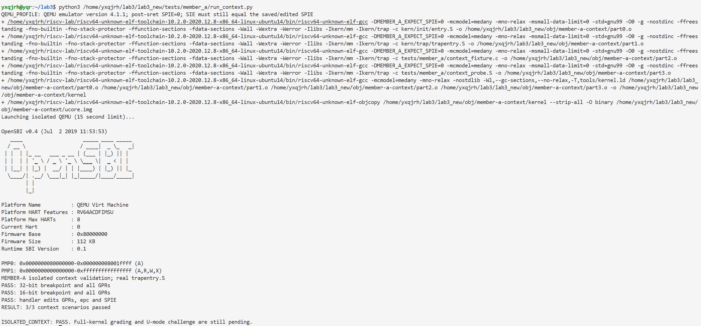

图：杨茜茹在 WSL 中的真实运行结果，四字节断点、两字节断点及处理后帧验证均通过。

### 5.3 完整内核测试与评分

先清理并构建完整内核，再运行课程原有评分：

```bash
make clean
make 
make grade
```

| 检查项目 | 本次结果 |
| --- | --- |
| 完整内核构建 | 编译、链接及镜像生成成功 |
| Trap 入口、寄存器恢复与断点 EPC | PASS，35/35 |
| 非法指令 EPC 调整与返回 | PASS，25/25 |
| 时钟重新设置与重复 Trap 返回 | PASS，40/40 |
| 正式评分总分 | **100/100** |

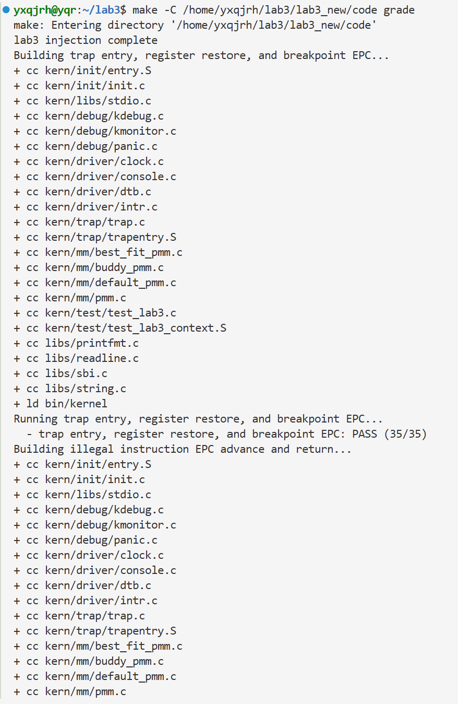

图：正式评分的构建过程及 Trap 入口、寄存器恢复和断点 EPC 检查通过。

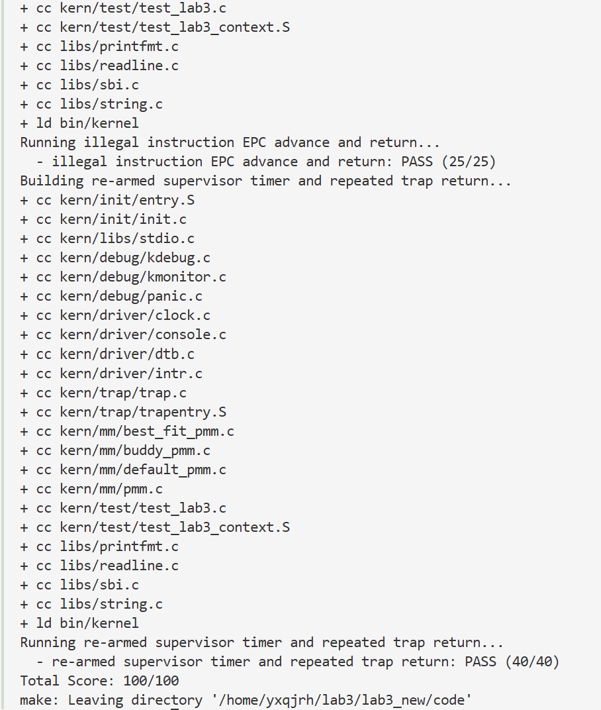

图：Illegal 25/25、Timer 40/40，总分 100/100。

评分结束后重新清理、构建并运行正常内核：

```bash
make -C /home/yxqjrh/lab3/lab3_new/code clean
make -C /home/yxqjrh/lab3/lab3_new/code qemu
```

正常内核使用 `best_fit_pmm_manager`，登记 31928 个空闲页，输出 `check_alloc_page() succeeded!`。时钟初始化后打印十次 `100 ticks`，最后输出 `Shutdown after 10 reports (ticks=1000)`，QEMU 退出并返回终端。

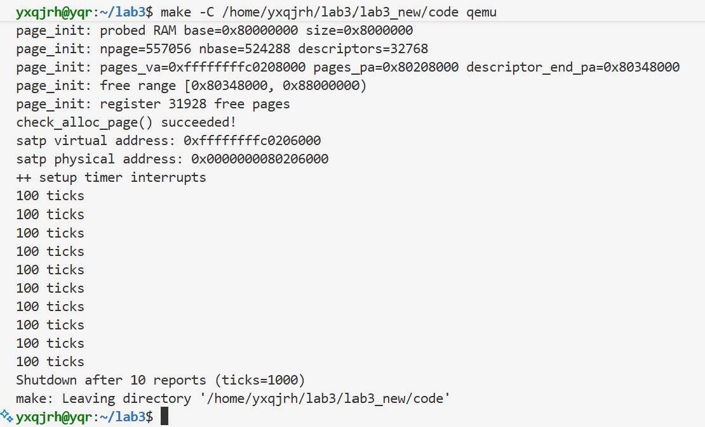

图：内存自检通过，持续处理时钟中断，累计 1000 ticks 后自动关机。

本次同时核对了汇编入口和恢复顺序：`a0` 指向栈上的完整 `trapframe`；返回前从处理后的帧恢复 `sstatus`、`sepc` 和通用寄存器，最后恢复 `sp`。汇编不固定增加 EPC；正式异常处理按指令长度调整返回位置，中断处理保留 EPC。集成时保存异常地址的 CSR 名称由 `sbadaddr` 改为 `stval`，对应帧槽及恢复布局没有改变。


#### 程子涵：完整测试与截图汇总

| 项目 | 实际结果 |
| --- | --- |
| 完整构建 | make 编译、链接成功 |
| Context | 35/35，正式上下文保存恢复、断点返回通过 |
| Illegal | 25/25，非法指令返回、软件/未知中断与未知异常兜底通过 |
| Timer | 40/40，时钟重新设定、重复返回，观察到 ticks=200 |
| 原完整评分 | **100/100**，未修改原评分条件 |
| 正常完整内核 | PMM 自检成功，十行 100 ticks，ticks=1000 自动关机并回到终端 |
| B 六组独立场景 | 分类与边界、默认阈值、自定义阈值、DEBUG_GRADE、临界区、stvec 全部通过；非正阈值被拒绝 |
| 正式 PMM 补充协验 | 临时副本中调用真实分配/释放/空闲计数：初始 SIE=0/1、嵌套与空闲页计数恢复通过 |
| 正式异常长度补充协验 | 临时副本中明确编码的 16/32 位非法指令、16/32 位断点均返回后续执行流 |


#### 正常运行与自动关机截图

依次显示 make qemu 与 OpenSBI、PMM 的 check_alloc_page() succeeded!、时钟初始化、十次统计及 ticks=1000 关机返回命令行。

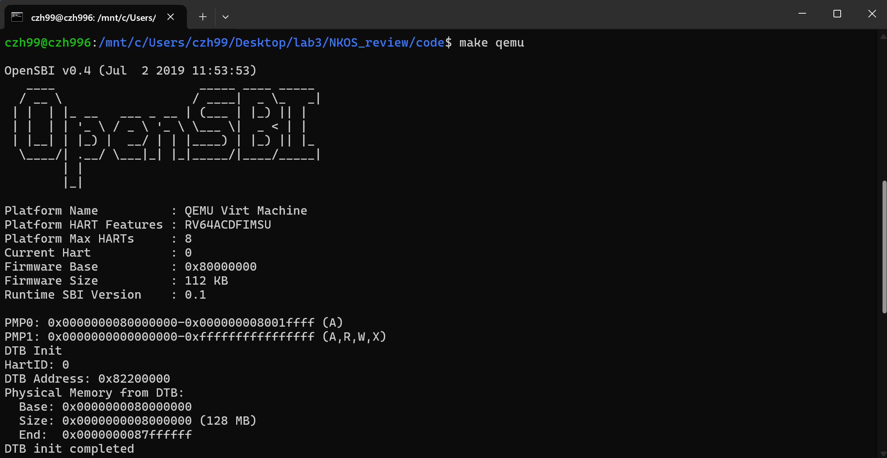

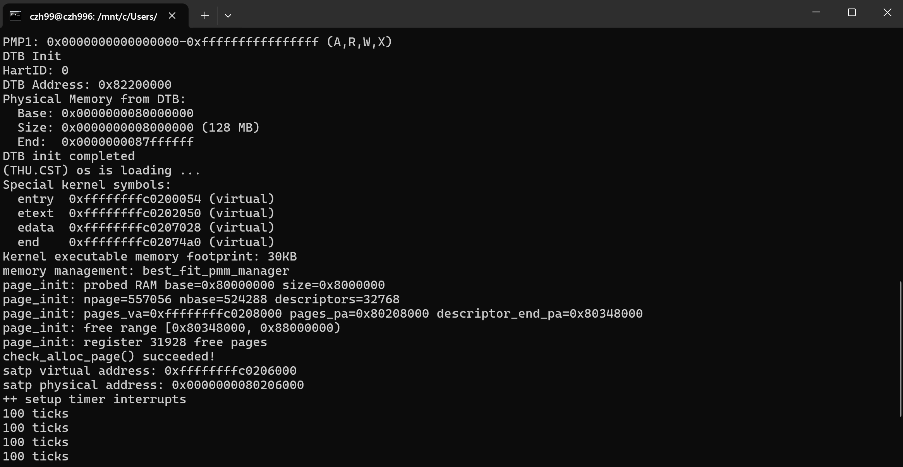

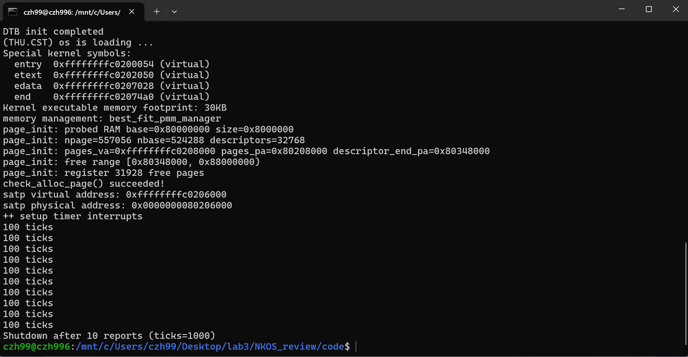

#### B 机制补充实验截图

本轮集成后重新运行六组亦全部通过。

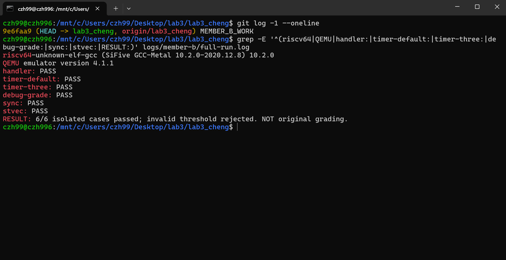

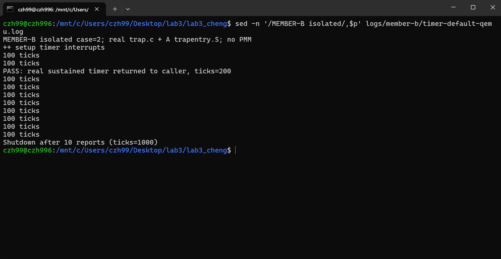

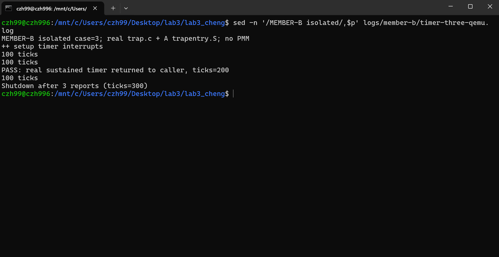

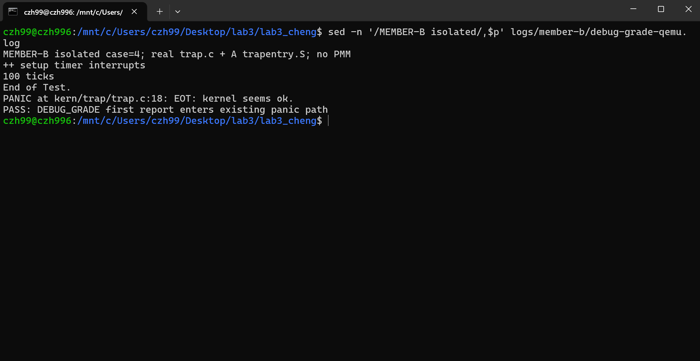

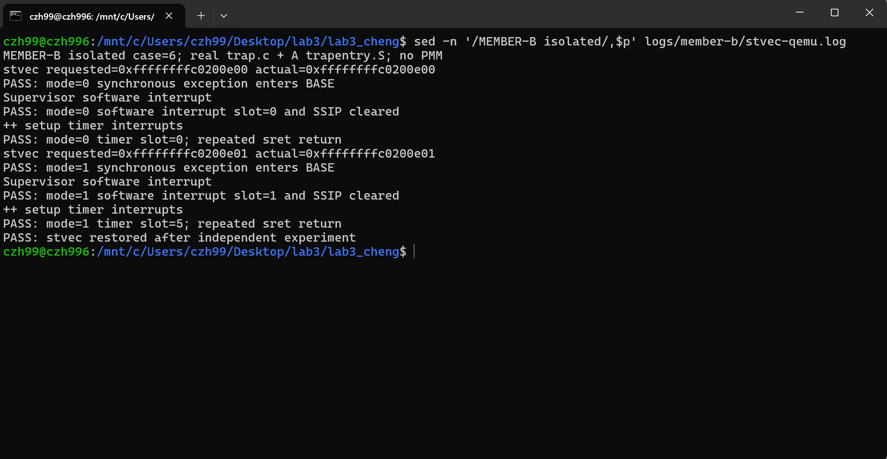

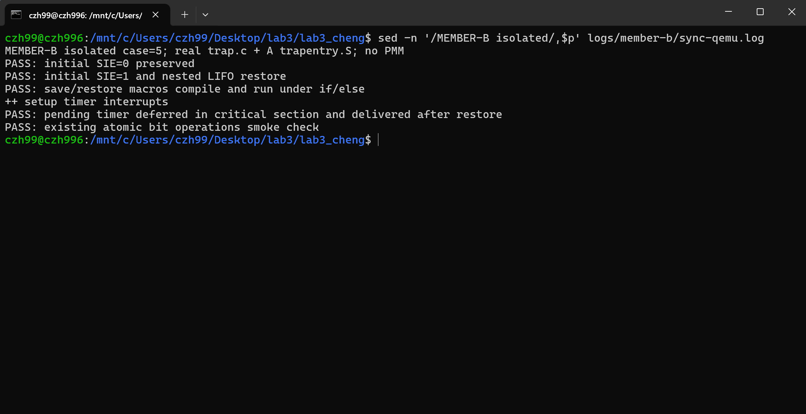

### 5.4 最终集成、复现与提交

| 项目 | 内容 |
| --- | --- |
| 集成版本 | 前置依赖来自 `origin/lab2`（合并提交，带入 Best-Fit 与 `pmm.c` 空闲页管理）。最终集成与报告整理统一在分支 `lab3`。 |
| 接口与冲突处理 | 合并后 `entry.S`、`memlayout.h`、`inject.py` 出现冲突标记。`entry.S` 保留 Lab3 的 Sv39 启动页表注释、去掉 Lab2 重复的段说明；`memlayout.h` 采用 Lab2 的 `PHYSICAL_MEMORY_END`、`KERNEL_BEGIN_PADDR`、`KERNEL_BEGIN_VADDR`、去掉重复的 `PHYSICAL_MEMORY_OFFSET`；`inject.py` 保留 Lab3 注入路径并补全参数检查、去掉 Lab2 注入逻辑。跨模块未新增接口：A 的 `trapentry.S`、B 的 `interrupt_handler()`、C 的 `exception_handler()` 经既有 `trapframe` 与 `trap_dispatch()` 衔接。 |
| 干净目录复现 | WSL 中从仓库根目录进入 `code/`，`make clean && make && make grade` 得 Context 35/35、Illegal 25/25、Timer 40/40、总分 100/100；再 `make && make qemu`，内核经 `best_fit_pmm_manager` 自检、十次 `100 ticks` 后在 `ticks=1000` 自动关机。证据与截图见 5.3。 |
| 提交材料检查 | `code/`、`report/`齐全；`lab3 function1/function2` 标记及三人学号署名在位，报告图片使用相对链接； |
| 最终提交 | 仓库 https://github.com/helloworld194910/NKOS.git，分支 `lab3`。 |


### 5.5 当前验证范围

原评分 100/100、正常关机、B 六组独立验证和正式 PMM/异常集成探针均已取得本轮结果。

## 六、实验总结与收获

### 对操作系统的理解

#### 上下文、Trap 返回与调度的关系

**1. Trap 上下文与函数调用约定。**

OS 原理中的上下文是恢复执行所需的状态。本实验把它具体落实为栈上的 trapframe。普通 C 函数只需按 ABI 保留约定的寄存器，但 Trap 可能发生在任意指令处，被打断程序并没有主动接受一次函数调用。因此进入 C 前必须保存它可能被破坏的状态，不能只依赖 callee-saved 规则。a0 用于传帧、ra 被 call 改写，都不影响从帧恢复其原值。

**2. Trap 返回与普通函数返回。**

普通 ret 主要根据 ra 继续执行；sret 则使用 sepc 和特权状态完成返回。handler 修改 tf->epc 后，恢复代码应采用新位置；status 的部分位还会在 sret 时发生体系结构规定的变化。实验中的 CSR、返回帧和指令使原理课上的“保存现场、恢复现场”有了可检查的对应物。旧版 QEMU 的 SPIE 行为还说明，分析实际运行必须注明模拟器版本。

**3. 上下文恢复与进程调度的区别。**

这次验证是在同一内核执行环境中保存并恢复 Trap 上下文，没有选择另一个进程，也没有更换进程地址空间。完整进程调度涉及就绪队列、任务选择及进程级状态切换，是重要 OS 知识，但本阶段没有对应实现。

#### 时钟、中断保护与机制边界

| 知识点 | OS 原理中的含义 | 本实验体现及边界 |
| --- | --- | --- |
| 时钟中断与调度 | 计时事件可以触发抢占、时间片检查及超时处理 | 已实现周期事件、计数和返回；尚未实现调度队列、进程切换或完整时间片调度 |
| 上下文与控制流 | 内核处理异步事件后应恢复被打断的计算 | 使用A的真实保存/恢复，B handler保持EPC；异常跳过指令由C负责，规则不同 |
| 临界区与互斥 | 共享状态修改须满足相应的并发约束 | 单hart关中断避免局部中断插入；多核仍需锁、原子操作及内存序 |
| 中断向量与分发 | 硬件可按事件选择入口，软件仍需处理其语义 | 实测Vectored入口偏移；不等于已有完整外设中断控制器驱动 |

重要但本实验未覆盖的原理包括：多核锁与死锁处理、完整进程调度、阻塞唤醒与睡眠队列、完整设备驱动和中断下半部、面向进程的虚拟内存保护。用户态切换 Challenge 已取消，不作为本次验收。

#### 异常返回语义、内存依赖与集成边界

**1. 同步异常与异步中断的返回语义不同。**

OS 原理中，中断是异步外部事件，异常是当前指令同步引起。本实验用 `tf->cause` 的最高位在 `trap_dispatch()` 里区分二者：异步中断不推进 `epc`，从被打断位置继续；非法指令和断点这类同步异常必须跳过出错指令，否则返回后会在同一条指令上反复触发。因此异常处理函数要按指令实际长度更新 `tf->epc`，不能与中断统一加固定偏移；这也解释了恢复逻辑（A 的汇编）只采用处理后的 `epc`，而不自己猜跳过量。

**2. 变长指令决定异常返回位置。**

RISC-V 指令可能是 16 位压缩指令或 32 位指令。仅凭助记符或统一加 4 字节，会在两字节断点上跳错。本实验通过读取起始 16 位的低两位（以及低五位）判断长度，分别推进 2 或 4 字节；无法确认时不做盲跳、只输出现场。异常返回位置由异常类型与指令编码共同决定。

**3. 物理内存管理是上层机制的前提。**

Trap 的进入、保存帧和 C 处理都依赖可用的内核栈与页表，前提是 `pmm_init()` 先建立物理内存管理。于蕾负责把 Lab2 的 Best-Fit 与空闲页管理迁入，使完整内核能先完成 `check_alloc_page()` 自检、再进入中断与异常测试。这体现了 OS 分层中“下层未就绪、上层无法验证”的依赖关系，也说明 Lab3 不能脱离 Lab2 单独成立。


### AI 协作开发的经验

#### 约束、验证和环境差异

本次先给出真实帧布局、允许修改范围和可验证行为，再让 AI 生成汇编。这样能够审查生成结果是否符合当前工程，而不只看代码能否编译。提示词保持模块粒度：一份负责基础实现，一份负责独立验证；各自都有明确交付和边界。

首次独立运行失败后，实际措施是查明状态位的预期依据。QEMU 已完成构建且正常退出，并不能说明断言通过；同样，一次断言失败也不能立即说明正式汇编有错。保留失败日志、核对对应版本源码，再修订测试，是这次可确认的迭代过程。


#### 规格、真实证据与集成路径

AI协作中的主要经验是先明确可观察验收条件，再编写代码；区分原代码缺陷、工具链兼容和缺失模块导致的失败；测试必须进入真实handler与汇编，不能只打印预设PASS；独立实验可以推动并行开发，但不能替代最终集成证据。源码哈希和原始日志使截图、结果与实现可以相互核对。

#### 迁移、异常处理与集成中的 AI 协作

异常处理部分先用四段式提示词把边界写死：只允许改 `code/kern/trap/trap.c` 的指定区域、保留前置声明、不改 B 的 `interrupt_handler()` 与 A 的恢复流程；规格用 Case 1～5 明确 4 字节非法指令、2/4 字节断点、未知异常（`epc=0` 不得取指）等可观察行为。这样 AI 生成的结果可以逐条对照真实 `trap.c` 审查，而不只看能否编译。

集成阶段的合并冲突更适合“AI 分析两侧语义 + 人工决策”。`entry.S`、`memlayout.h`、`inject.py` 里哪些是要保留的正式语义、哪些是重复或过期内容，需要结合三个模块的职责判断，不能交给 AI 自动选一侧。`inject.py` 的不完整参数检查块被提示词明确记录为“框架阻塞”，到集成时才补全，避免把范围外问题误判成异常处理未完成。


---
