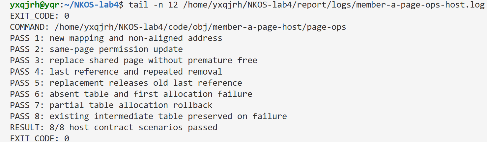
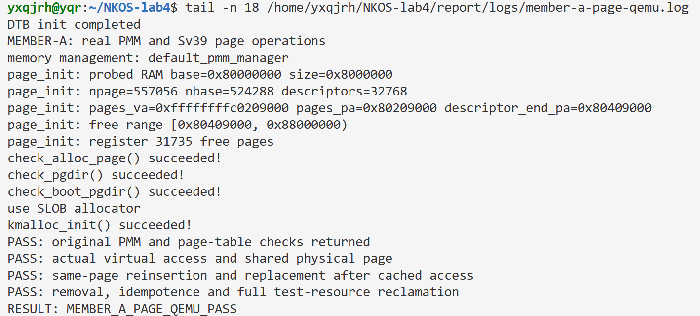
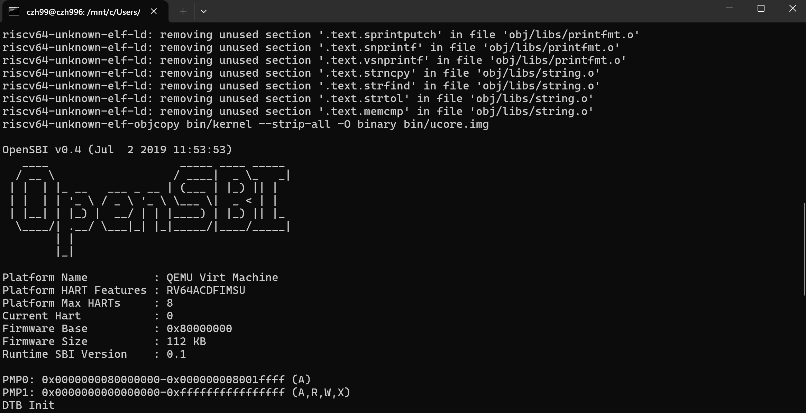
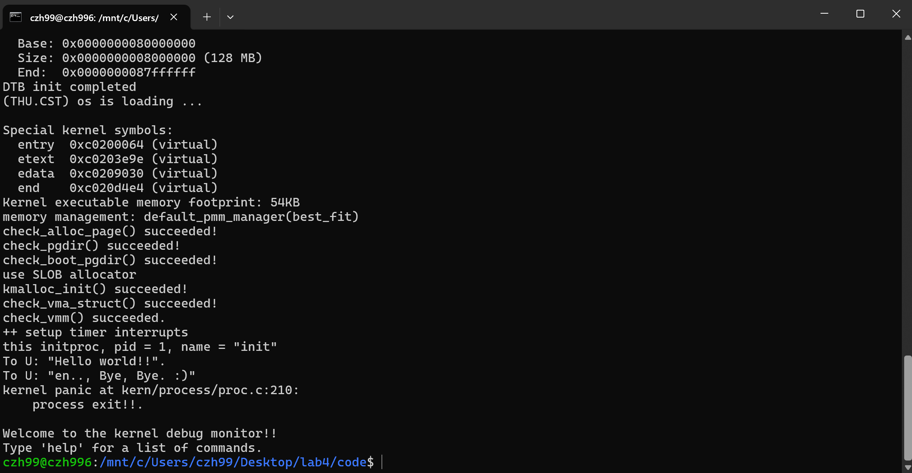
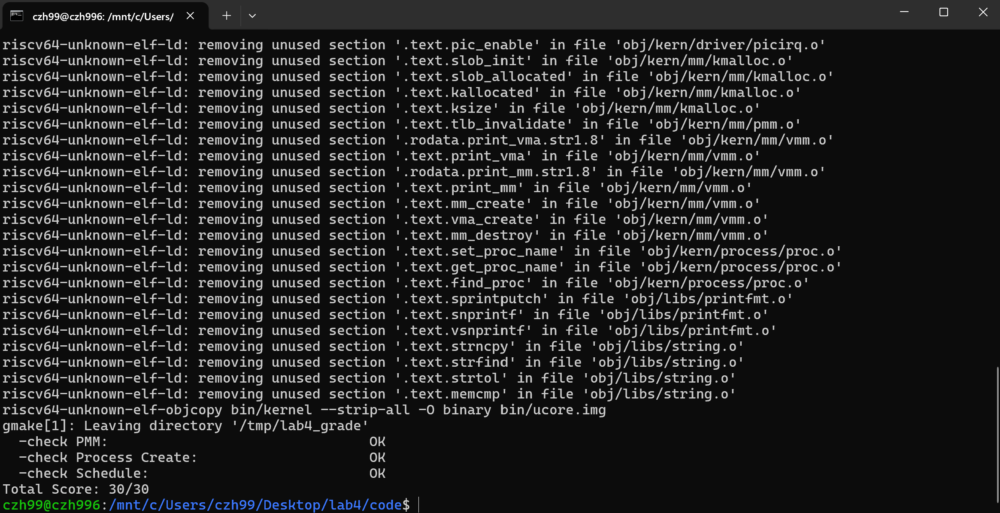
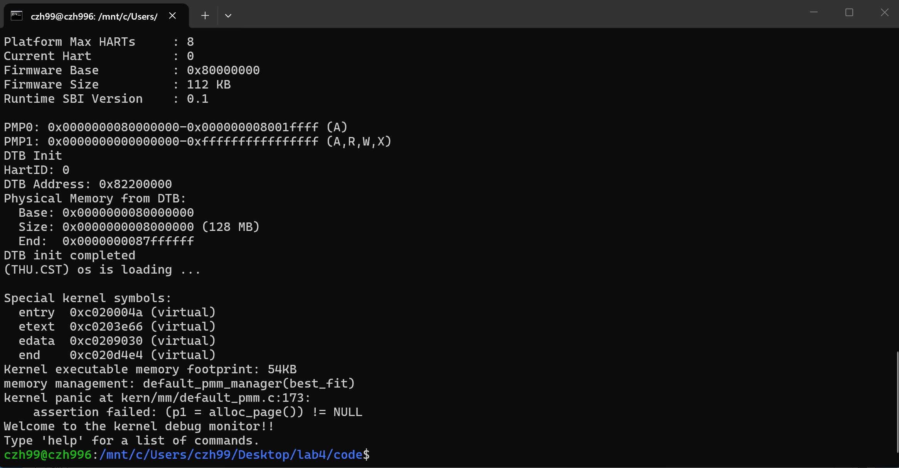
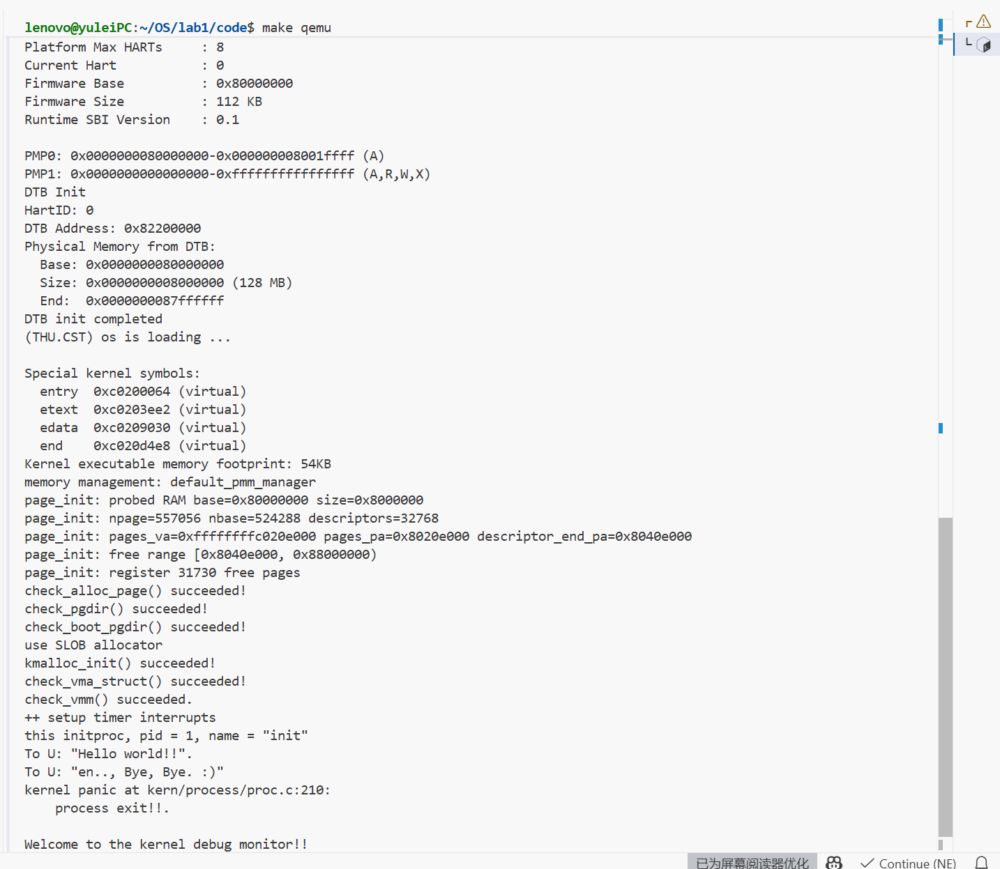
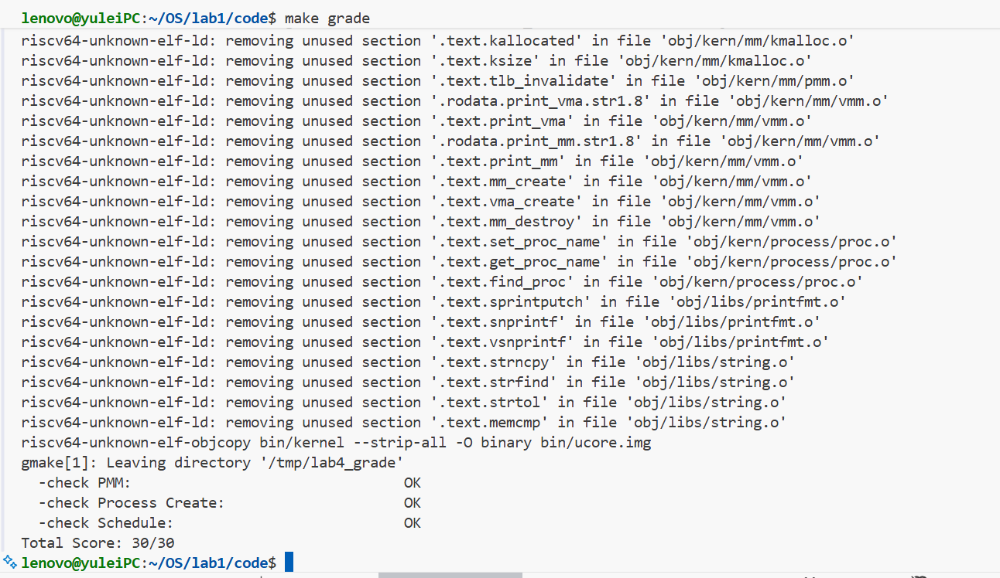

# 操作系统实验报告

## 实验基本信息

| 项目 | 内容 |
|------|------|
| **实验名称** | Lab4：进程管理 |
| **小组成员** | 2412790-杨茜茹、2413921-程子涵、2411824-于蕾 |
| **完成日期** | 2026-11-15 |

### 小组分工

| 成员 | 负责的练习/模块 |
|------|----------------|
| 2412790-杨茜茹（成员一 / A） | 迁移 Lab2/Lab3 前置代码；实现虚拟内存页操作；完成分页拓展、模块测试与交接 |
| 2413921-程子涵（成员二 / B） | 初始化 PCB；创建内核线程并构造首次现场；完成 PID 课堂拓展及创建失败路径验证 |
| 2411824-于蕾（成员三 / C） | 完成进程调度与上下文切换、中断拓展；组织联合调试、回归验证和报告汇总 |


- [一、实验目的](#purpose)
- [二、实验环境](#environment)
- [三、实验整体逻辑分析](#overview)
- [四、实验内容与实现](#implementation)：[成员一](#member-a) · [成员二](#member-b) · [成员三](#member-c)
- [五、测试与验证](#integration)
- [六、实验总结与收获](#summary)

---

<a name="purpose"></a>

## 一、实验目的

1. 理解物理页分配、VMA、页表映射与 TLB 之间的关系，正确维护页引用、映射权限和失败回收。
2. 掌握 PCB 初始化、内核线程创建、独立内核栈和首次运行现场的组织方式，完成资源申请、登记和就绪转换。
3. 按 RV64 调用约定保存与恢复上下文，通过调度器让 init 从 idle 手中获得 CPU，并跟踪首次运行链。
4. 理解 PID 回绕查重与跨时间身份的区别，掌握保存、恢复原中断状态及嵌套临界区的处理。
5. 使用明确的接口规格和提示词辅助实现，通过模块测试、整机启动、原版评分及调试检查实际行为。

---

<a name="environment"></a>

## 二、实验环境

工程面向 uCore、RISC-V RV64 和 Sv39 页表，整机在 Windows 的 WSL 环境中通过 QEMU virt 运行。

| 成员 | AI 编程工具 | 底层模型 | 备注 |
|------|------------|---------|------|
| 2412790-杨茜茹 | VS Code、Codex 桌面应用 | GPT-6.1 Sol | 在 WSL Ubuntu 中迁移基础代码，完成页操作和模块验证 |
| 2413921-程子涵 | ChatGPT Codex（Work 模式） | GPT-6 系列，具体版本未记录 | 核对进程创建接口、整理规格与测试用例 |
| 2411824-于蕾 | Codex | 具体版本未单独记录 | 完善调度代码，执行联调、补充检查与报告整理 |

杨茜茹阶段使用 `python3`、`make`、宿主 `gcc`、`riscv64-unknown-elf-gcc` 和 `qemu-system-riscv64`，交叉工具链目录为 `riscv64-unknown-elf-toolchain-10.2.0-2020.12.8-x86_64-linux-ubuntu14`；原记录没有单独采集编译器版本。程子涵阶段的整机记录使用 RISC-V GCC 14，原联调环境记录为 GCC 14.2.0、QEMU 4.1.1。OpenSBI v0.4 是启动固件版本，不是 QEMU 版本。

下表为 2026-11-15 最终回归时实际采集的环境，早期日志仍按各自工具版本解释。

| 项目 | 本次环境 |
|------|----------|
| 内核环境 | WSL2，Linux 6.6.87.2-microsoft-standard-WSL2，x86_64 |
| 内核交叉编译器 | riscv64-unknown-elf-gcc 15.1.0 |
| 整机模拟器 | qemu-system-riscv64 4.1.1 |
| 调试器 | riscv64-unknown-elf-gdb 16.3.90.20250610-git |
| 构建工具 | GNU Make 4.3 |
| 补充检查 | Python 3.10.12、宿主 GCC 11.4.0、riscv64-linux-gnu-gcc、qemu-riscv64 |

补充检查中的 `qemu-riscv64` 用于运行独立的寄存器切换程序；内核启动和评分使用 `qemu-system-riscv64`。两类测试验证的范围不同。

---

<a name="overview"></a>

## 三、实验整体逻辑分析

### 3.1 本章节的逻辑主线

本实验从 Lab2 的物理内存管理和 Lab3 的 Trap 处理出发，补齐页映射接口，再创建内核线程，最后让不同执行流轮流使用 CPU。VMA 描述地址区间，PTE 建立硬件映射；PCB 关联线程身份、栈和执行现场，调度器依据 PCB 状态选择下一线程。当前内核线程共享内核地址空间，创建线程并不意味着建立独立的用户地址空间。

整体调用关系为：

```text
kern_init → pmm_init → pic_init/idt_init → vmm_init → proc_init
          → clock_init → intr_enable → cpu_idle
          → schedule → proc_run → switch_to
          → forkret → forkrets → __trapret → kernel_thread_entry → init_main
```

### 3.2 功能的逐步实现

#### 1. 基础迁移与页操作（杨茜茹）

先恢复物理页分配、释放和 Trap 入口，再实现 `page_insert()`、`page_remove()`。这一阶段的独立测试只运行内存相关路径，为之后分配 PCB 和内核栈、恢复线程现场准备基础。

#### 2. 进程创建及初始化（程子涵）

成员 B 的实现按 `alloc_proc → copy_mm/copy_thread → do_fork → kernel_thread → proc_init` 组织。先约定单个 PCB 和寄存器现场的布局，再处理创建过程的资源所有权和错误回收，最后用统一的创建接口生成启动线程。

1. 先用 `alloc_proc()` 建立可安全填写或回收的 PCB 初态。
2. 用 `copy_mm()` 和 `copy_thread()` 准备共享内核映射及独立的执行现场。
3. 用 `do_fork()` 串起资源申请、失败回收、PID 分配、登记和就绪转换。
4. 用 `kernel_thread()` 构造入口模板，再由 `proc_init()` 建立 idle 与 init。

#### 3. 进程调度与首次运行（于蕾）

```text
kern_init
  → 内存、Trap 和 VMM 初始化
  → proc_init：建立 idle 和 init，current 指向 idle
  → clock_init、intr_enable
  → cpu_idle：发现 need_resched
  → schedule：选择下一个 runnable 线程
  → proc_run：更新 current、写 SATP、刷新 TLB
  → switch_to：保存旧 context、恢复目标 context
  → forkret → forkrets → __trapret
  → kernel_thread_entry → init_main
```

进程创建完成后，init 已经拥有 PCB、内核栈和首次现场，但它还没有获得 CPU。我先核对 `struct context` 与汇编偏移，再检查 `proc_run()` 的中断保护和页表切换，随后确认 `schedule()` 的选择顺序，最后通过 `cpu_idle()` 发起首次调度。

当前工程的四个函数已经有实现。我按照提示词逐项检查，保留了符合要求的 `switch_to()`、`schedule()` 和 `cpu_idle()`，实际修改集中在 `proc_run()`：把旧线程指针的读取放进临界区，并在加载 SATP 后补上 `flush_tlb()`。已有学号标记、注释和其他成员的代码均保留。

普通启动时，idle 不在 `proc_list` 中，init 在普通进程链表中。调度器从哨兵后继开始查找，就能选中 init。评分时还会创建两个测试线程，它们通过主动调用 `schedule()` 让出 CPU。当前时钟处理只重装定时器并计数，本次没有增加时间片或抢占调度。

---

<a name="implementation"></a>

## 四、实验内容与实现

<a name="member-a"></a>

### 前置任务：Lab2/Lab3 基础迁移

**负责人：** 2412790-杨茜茹。

#### 模块功能描述

**需要实现/修改的函数：**

```c
static void page_init(void);
static void best_init(void);
static void best_init_memmap(struct Page *base, size_t n);
static struct Page *best_alloc_pages(size_t n);
static void best_free_pages(struct Page *base, size_t n);
static size_t best_nr_free_pages(void);
static void best_insert_free_block(struct Page *base, size_t n);
void interrupt_handler(struct trapframe *tf);
static int exception_inst_length(uintptr_t epc);
void exception_handler(struct trapframe *tf);
// 汇编：RESTORE_ALL、__alltraps 中的传参和调用
```

**功能说明：**

在 `code/kern/mm/default_pmm.c`、`pmm.c`、`code/kern/trap/trap.c`、`trapentry.S` 的标记处迁移。

`page_init` 检查设备树 RAM，建立描述符并保留内核及数组占用页。Lab4 增加的 Page 字段也初始化。分配器保留 Best-Fit 算法，但使用 Lab4 已声明的 `default_pmm_manager` 名称。Trap 传入帧指针调用 C，再恢复返回 CSR 和通用寄存器，最后恢复 sp；保持原 SAVE_ALL 和 forkrets。

### 功能模块一：虚拟内存页操作

**负责人：** 2412790-杨茜茹。

#### 模块功能描述

**需要实现/修改的函数：**

```c
// code/kern/mm/pmm.c，LAB4 function1 2412790 标记
int page_insert(pde_t *pgdir, struct Page *page, uintptr_t la, uint32_t perm);
void page_remove(pde_t *pgdir, uintptr_t la);
```

**功能说明：**

`page_insert` 先保存原根项，再调用 get_pte 创建或查找末级 PTE。失败时，如果此次新增了中间表，就恢复原根项并释放该页；已有中间表不回收。成功后先取得新页引用：旧映射为同页则抵消本次增量，旧映射为其他页则调用 page_remove 撤销。最后通过 pte_create 写入页号、权限和 PTE_V，并刷新对应地址。

先加引用可以避免同页重插时把仍要使用的页降到零并释放。权限按调用者传入值更新，不根据文件名或旧权限自行补充。

`page_remove` 使用 get_pte(create=0)，缺少页表或有效 PTE 时直接返回。有映射时保存物理页指针，清 PTE、刷新 TLB，再递减引用；归零才 free_page。中间页表由地址空间拥有者管理，本函数不主动回收。

这两个函数沿用框架4KiB三级页表路径，不实现巨页拆分、并发页表锁或用户地址空间复制。失败回滚依赖当前 get_pte 最多两次中间表分配的实现，框架变化时应重新审查。

#### 最终提示词

页映射提示词见 [功能模块一：虚拟内存页操作](prompts.md#module-one)。任务全文如下，独立验证的测试规格保留在该章节的任务三中，属于测试后的整理。

````markdown
## 任务二：页映射插入与删除

负责人：2412790 杨茜茹。

[PROMPT]

在真实文件 `code/kern/mm/pmm.c` 的 LAB4 function1 标记处实现 page_insert 与 page_remove，将 YOUR CODE 换为2412790。插入建立或替换一个4KiB映射，删除撤销对应映射。维护 PTE、数据页引用计数及 TLB 一致性。修改真实文件，不只输出代码。

允许修改此标记内的实现，禁止修改 get_pte、tlb_invalidate、原有检查、公共头文件、进程和调度模块。输出具体差异与实际编译结果；完整运行和失败注入测试没有执行时不能宣称通过。

[RELY]

框架 pmm.h 提供以下签名：
```c
int page_insert(pde_t *pgdir, struct Page *page, uintptr_t la, uint32_t perm);
void page_remove(pde_t *pgdir, uintptr_t la);
pte_t *get_pte(pde_t *pgdir, uintptr_t la, bool create);
void tlb_invalidate(pde_t *pgdir, uintptr_t la);
```
使用现有 page_ref_inc/page_ref_dec、pte2page/pde2page、page2ppn、pte_create、free_page。当前 get_pte 按 PDX1、PDX0、PTX 访问三级页表；第二次分配失败不会回收第一次分配的页表。当前 tlb_invalidate 对地址执行 sfence.vma，不检查 pgdir 是否活跃。不得把其注释当作额外保证。

[GUARANTEE]

保留函数签名、原测试和页表布局；支持 la 含页内偏移。这里只处理框架管理的4KiB页表路径，不处理经过大页叶子的拆分。调用者提供有效页目录和物理页，保证没有并发修改同一路径。权限按调用者传入值构造，并加 PTE_V，不擅自增加 PTE_R 或改变测试使用的权限组合。

[SPECIFICATION]

### page_insert

**Pre-Condition：** pgdir、page 有效；页面尚未释放；页表路径符合上述约定。

**Post-Condition：** 成功返回0，目标页表项指向page，权限更新；新建映射或异页替换时新页引用增加一次，同页重插时净引用不变；失败返回-E_NO_MEM，不增加数据页引用，不留下本次创建的半成品页表。

**Case 1：** 无旧映射：定位/创建末级PTE，引用加一，写入映射并刷新对应TLB。

**Case 2：** 原映射为同一页：更新权限，但净引用计数不变，不调用free_page释放目标页。先加引用，再抵消这次增量。

**Case 3：** 原映射为其他页：取得新页引用，撤销旧映射、递减旧页引用；旧页仍有其他映射时不释放，归零才释放；最后安装新映射并刷新。

**Case 4：** 首个页表分配失败：返回错误，原状态不变。

**Case 5：** 新建第一个中间表后第二次分配失败：恢复调用前根项，刷新并释放本次创建的中间表；已有中间表不能回收。此回滚依据当前get_pte仅有两次分配的具体行为。

**Requirements：** 取得PTE成功后才变更数据页引用；不要复制整套get_pte；不把已有共享页表当作失败清理对象。

### page_remove

**Pre-Condition：** 页目录有效，路径符合4KiB框架约定，有效映射的引用计数正确。

**Post-Condition：** 对应映射消失，引用减一，只有归零才回收数据页；重复删除无额外影响。

**Case 1：** 中间页表不存在：get_pte(create=0)，直接返回，不分配。

**Case 2：** PTE存在但无效：直接返回，不减少引用。

**Case 3：** 有效且存在其他引用：清PTE、刷新、减引用，不释放。

**Case 4：** 最后引用：清PTE并刷新后减到零，释放数据页。

**Requirements：** 不自动回收空中间页表，原检查及地址空间拥有者负责其生命周期。此任务不改调度/关中断策略。

### 验收及输出

列出实际修改位置、成功和失败路径、执行的命令、退出码及未验证场景。提供可复现记录。

对象编译只是第一步。独立测试需覆盖新映射、同页更新权限、不同页替换、多地址共享、未对齐la、缺失/无效/重复删除、两级分配失败回滚和已有中间表的保留；之后运行原页表检查与集成评分。每项记录实际结果，不能以设计用例代替执行证据。
````

#### 实现迭代过程

**第一次实现：** 我阅读 get_pte 时发现第二次分配失败不会回收第一次分配的中间表，因此在实现规格中加入回滚要求。此项是实现前检查发现的问题，不是运行中已发生的故障。

**验证过程：** 对象编译通过后，我先运行宿主接口测试，再运行真实 PMM 和页表的独立 QEMU 测试；目前两轮测试均通过，没有因测试失败修改页操作实现。

**关键点：** 同页重插不改变净引用数；异页替换只释放旧页最后引用；删除幂等；失败不遗留本次新增页表；修改有效映射后刷新 TLB。

---

<a name="member-b"></a>

### 功能模块二：进程创建及初始化

**负责人：** 2413921 程子涵

#### 模块功能描述

**需要实现/修改的函数：**

```c
static struct proc_struct *alloc_proc(void);
static int copy_mm(uint32_t clone_flags, struct proc_struct *proc);
static void copy_thread(struct proc_struct *proc, uintptr_t esp, struct trapframe *tf);
int do_fork(uint32_t clone_flags, uintptr_t stack, struct trapframe *tf);
int kernel_thread(int (*fn)(void *), void *arg, uint32_t clone_flags);
void proc_init(void);
char *set_proc_name(struct proc_struct *proc, const char *name);
```

**功能说明：**

六个实现函数位于 `../code/kern/process/proc.c` 的 `LAB4 function2 2413921` 区域。已有的 `set_proc_name()` 为启动线程命名，本次修正了短字符串读取的边界。模块调用 PMM 申请内核栈，将就绪线程登记给调度器，并通过 `context` 和 `trapframe` 提供首次运行所需的寄存器状态。

| 函数 | 规格与实现 |
| --- | --- |
| `alloc_proc` | 申请 PCB，失败返回 `NULL`。初始状态为 `PROC_UNINIT`，PID 为 `-1`，`pgdir = boot_pgdir_pa`。其余普通字段清零，两个侵入式链表节点用 `list_init` 初始化为自环。 |
| `copy_mm` | 保留 `clone_flags` 接口，断言 `current->mm == NULL`，子线程的 `mm` 仍为 `NULL`，返回 0。内核线程通过 PCB 中的 `pgdir` 共享内核根页表。 |
| `copy_thread` | 在子线程内核栈高地址端放置一份独立的 `trapframe`。复制模板后令 `gpr.a0 = 0`，`gpr.sp` 使用传入栈地址，传入 0 时使用帧基址。将 `context.ra` 设为 `forkret`，`context.sp` 设为帧基址。 |
| `do_fork` | 检查数量上限，申请 PCB 和两页内核栈，记录父线程，处理 `mm` 并构造现场。进入关中断临界区后复查数量上限，再分配 PID、挂入哈希和进程链表、递增计数并唤醒。成功返回 PID。 |
| `kernel_thread` | 清零临时帧，`s0` 保存函数地址，`s1` 保存参数，`epc` 指向 `kernel_thread_entry`。置 `SPP`、`SPIE` 并清 `SIE`，然后用 `clone_flags \| CLONE_VM` 调用 `do_fork`。 |
| `proc_init` | 初始化进程链表和哈希桶。以启动栈和当前执行流建立 PID 0 的 `idle`，设置 `need_resched = 1`，计入进程数并令 `current = idleproc`。创建 PID 1 的子线程，按 PID 查回 PCB、校验后命名为 `init`。idle 由调度器直接保底，普通 PID 查询范围为 `1…8191`。 |

##### PCB 从分配到登记

`alloc_proc()` 将 PCB 建成一个可安全填写、可直接释放的对象。分配器可能交回曾用过的内存，所以必须给名字、计数、标志、指针和寄存器上下文明确赋初值。两个链表字段还需单独处理。空链表节点是前后指针均指向自己的自环，仅把指针置为零会违反 `list_empty()` 等操作依赖的约定。

普通进程用了两个侵入式节点。调度器通过 `list_link` 遍历进程集合，`find_proc(pid)` 则通过 `hash_link` 遍历对应的哈希桶。`le2proc` 根据成员偏移从节点还原 PCB。两个索引都指向同一块 PCB，这样查找和调度读到的是同一个状态和同一份执行现场。

##### 地址空间与启动身份

`copy_mm()` 断言父线程的 `mm` 为空并令子线程的 `mm` 为空。`mm` 用来描述将来的用户地址空间，`pgdir` 则给调度代码提供实际的根页表物理地址。即使 `mm` 为空，内核指令和线程栈仍通过共享的 Sv39 内核映射访问。线程各有执行现场和栈，因此切换执行流无需复制内核映射。

`kern_init()` 在启动栈上执行到 `proc_init()`。此时为现有执行流补一个 PCB 就能得到 idle，它的栈来自引导代码，第一次被切走前也没有需要恢复的 `trapframe`。init 走完整的 `kernel_thread()` 创建路径。先设置 `current = idleproc`，`do_fork()` 才能记录正确的父线程。启动时总链表为空，首次分配的正 PID 为 1。

idle 只由 `idleproc` 指针直接引用，两个链表节点保持自环，既不在 `proc_list` 也不在 PID 哈希桶中。因此 `find_proc(0)` 返回 `NULL`，`get_pid()` 的扫描范围也不包含编号 0，编号从 1 开始发放。调度器靠 `current == idleproc` 的比较识别它，不依赖链表位置。

| 初始化完成后的检查项 | idleproc | initproc |
| --- | --- | --- |
| PID 与名称 | 0，`idle` | 1，`init` |
| 状态与运行次数 | `PROC_RUNNABLE`，0 次 | `PROC_RUNNABLE`，0 次 |
| 父线程与用户地址空间 | `parent=NULL`，`mm=NULL` | `parent=idleproc`，`mm=NULL` |
| 内核栈 | `bootstack` | 由 `alloc_pages(KSTACKPAGE)` 分配的两页 |
| 初始现场 | `tf=NULL`，`context` 初始清零 | `tf` 位于栈高地址端，`context.ra=forkret` |
| 全局登记 | 计数并由 `idleproc` 直接引用 | 计数并登记到总链表和 PID 哈希 |
| 当前线程 | `current == idleproc` | 等待调度 |

##### 资源回收和发布顺序

| 失败位置 | 返回值 | 回收与登记状态 |
| --- | --- | --- |
| 初检已达进程上限 | `-E_NO_FREE_PROC` | 直接返回 |
| PCB 分配失败 | `-E_NO_MEM` | 无已申请的资源 |
| 内核栈分配失败 | `setup_kstack` 的错误码 | 回收 PCB |
| `copy_mm` 返回错误，或登记前复查达到上限 | 原错误码，或 `-E_NO_FREE_PROC` | 先释放内核栈，再释放 PCB。PID、哈希桶、进程链表和进程计数均尚未更新 |

当前 `copy_mm` 在内核线程契约下返回 0，其错误处理路径为后续扩展保留。所有可能返回错误的操作发生在登记之前。这里的中断保护面向本实验的单核执行模型。

把 `wakeup_proc()` 放到登记末尾，是因为它会把状态改为 `PROC_RUNNABLE`。这个状态一旦被调度器看见，PID、父进程、栈和执行现场就必须已经齐备。初次检查可以在明显达到上限时省去内存分配，第二次检查则把容量判断与登记放在同一临界区内。关中断前先记住原来的 `SIE`，提交或拒绝都按原状态恢复。

##### 首次运行与模块交接

RV64 下 `trapframe` 为 36 个 8 字节槽，共 288 字节。内核栈为两页，栈顶向下留出这 288 字节作为中断帧。以帧基址作为新线程的初始 `context.sp` 可以让 `forkret` 使用帧以下的栈空间，随后汇编恢复入口以帧基址读取保存的寄存器。

| 首次现场字段 | 创建时的值 | 读取位置 |
| --- | --- | --- |
| `proc->kstack` | 栈低地址，回收时换算回页描述符 | `copy_thread()`、`put_kstack()` |
| `context.ra`、`context.sp` | `forkret`、`proc->tf` | `switch_to` |
| `tf->gpr.sp` | 内核线程取帧基址，接口有非零栈参数时取该参数 | `__trapret` |
| `tf->status`、`tf->epc` | 保存其他状态位，设 `SPP`、`SPIE`，清 `SIE`，入口为 `kernel_thread_entry` | `__trapret` 与 `sret` |
| `tf->gpr.s0`、`tf->gpr.s1` | `init_main` 的地址与字符串实参的地址 | `kernel_thread_entry` |

1. `switch_to` 恢复新线程的 `context`，以 `ret` 进入 `forkret`。
2. `forkret` 把 `current->tf` 交给 `forkrets`。后者令 `sp` 指向该帧，并跳转到 `__trapret`。
3. `__trapret` 恢复 `sstatus`、`sepc` 和通用寄存器，再执行 `sret`。`SPP=1` 选择 S 态，`SPIE=1` 使返回后的 `SIE=1`。帧中的 `SIE=0` 约束的是恢复现场阶段。
4. `kernel_thread_entry` 执行 `a0 = s1`，然后通过 `jalr s0` 调用 `init_main`。子线程初始 `a0=0` 是 fork 返回现场的约定，入口汇编随后按 ABI 把它改成函数实参。

交给成员 C 的接口约定是 `proc->pgdir` 保存根页表**物理字节地址**，由 `lsatp` 转成 PPN 并编码为 RV64 Sv39 的 `satp` 值。切换到新线程前，`current` 必须指向它，因为 `forkret` 通过 `current->tf` 取帧。

#### 最终提示词

下面按六项代码任务列出最终提示词。含课堂拓展在内的九条独立提示词见 [功能模块二：进程创建及初始化](prompts.md#module-two)。

````markdown
## 01　初始化进程控制块

[PROMPT]:

**任务**: 在 `kern/process/proc.c` 的 `//LAB4 function2 2413921` 区域完善 `alloc_proc()`。PCB 由内核堆分配，随后可能被用作启动线程，也可能在普通线程创建失败时直接回收。需要为每个字段建立明确初值，并给两个侵入式链表节点建立尚未挂接时的自环状态。

**操作要求**: 必须修改项目中的真实文件。允许修改 `alloc_proc()` 函数体并补全该模块的学号标记。保留原有注释、头文件包含与函数签名。禁止改动 `proc.h`、分配器、链表库、其他进程函数及官方评分文件。

**输出要求**: 写入完整实现后，说明修改位置，逐组列出 PCB 初值，并给出分配成功与失败各自的验证结果或复测方法。

[RELY]

- `kern/process/proc.h` 的 `struct proc_struct` 含 `state`、`pid`、`runs`、`kstack`、`need_resched`、`parent`、`mm`、`context`、`tf`、`pgdir`、`flags`、`name[PROC_NAME_LEN + 1]`、`list_link` 和 `hash_link`。`PROC_NAME_LEN = 15`。
- `kern/mm/kmalloc.h` 提供 `void *kmalloc(size_t n)`，返回的存储必须由调用方初始化。`libs/string.h` 提供 `memset()`。`libs/list.h` 的 `list_init()` 将节点的前后指针指向节点本身。
- `kern/mm/pmm.h` 声明 `extern uintptr_t boot_pgdir_pa`，保存内核根页表物理字节地址。

[GUARANTEE]

~~~c
static struct proc_struct *alloc_proc(void);
~~~

成功返回 PCB 指针，失败返回 `NULL`。本函数只分配 PCB，内核栈、PID 和全局登记由后续步骤处理。

[SPECIFICATION]

- **Case 1：内存分配失败。** `kmalloc(sizeof(struct proc_struct))` 返回 `NULL` 时直接返回，进程链表、哈希和进程计数保持原值。
- **Case 2：从非零内存分配。** 设 `state=PROC_UNINIT`、`pid=-1`、`pgdir=boot_pgdir_pa`。将 `runs`、`kstack`、`need_resched`、`flags`、整个 `context` 和 `name` 清零，`parent`、`mm`、`tf` 设为 `NULL`。
- **Case 3：登记前检查节点。** 两个节点各自初始化为自环。此时对节点调用 `list_empty()` 应为真，总进程链表与哈希桶未新增成员。

## 02　保留内核线程的地址空间接口

[PROMPT]:

**任务**: 在 `kern/process/proc.c` 的 `LAB4 function2` 区域完善 `copy_mm()`。本阶段的父子线程都在内核态运行并共享内核映射，PCB 中的 `mm` 字段预留给后续的用户地址空间。该函数保留统一创建接口，明确当前阶段的前提。

**操作要求**: 必须修改项目中的真实文件。允许修改 `copy_mm()` 函数体。保留函数签名和原有注释。禁止修改 `do_fork()`、`kernel_thread()`、虚拟内存子系统、页表接口和官方测试。

**输出要求**: 写入实现后，说明 `mm` 与 `pgdir` 各自表示什么，指出内核线程调用成功的条件，并说明接口如何反馈前提被破坏。

[RELY]

- `kern/process/proc.h` 中 `current` 指向当前线程，`proc_struct.mm` 是 `struct mm_struct *`，`proc_struct.pgdir` 是 `uintptr_t`。
- `alloc_proc()` 已将子 PCB 的 `pgdir` 设为 `boot_pgdir_pa`。本模块的 `kernel_thread()` 通过 `do_fork()` 传入带 `CLONE_VM` 的标志。
- `CLONE_VM` 定义于 `kern/mm/pmm.h`。内核断言接口在 `kern/debug/assert.h`。

[GUARANTEE]

~~~c
static int copy_mm(uint32_t clone_flags, struct proc_struct *proc);
~~~

在当前内核线程契约下返回 0，保留 `clone_flags` 形参以及子线程的内核页表基址。

[SPECIFICATION]

- **Case 1：当前线程 `mm == NULL`。** 用断言明确前提，将 `proc->mm` 置为 `NULL`，返回 0。该步骤不申请页表或用户内存。
- **Case 2：传入带 `CLONE_VM` 或其他标志。** 当前实验的内核线程行为一致，保持子线程已有的 `pgdir`。
- **Case 3：当前线程的 `mm` 非空。** 按本实验契约触发断言。用户页表复制、引用计数、写时复制留给后续实验。

## 03　构造新线程的栈和首次恢复现场

[PROMPT]:

**任务**: 在 `kern/process/proc.c` 的 `LAB4 function2` 区域完善 `copy_thread()`。子线程此前没有被调度过，需要先在自己的内核栈中放好完整的中断返回帧，再用较小的 `context` 把第一次内核切换接到 `forkret()`。

**操作要求**: 必须修改项目中的真实文件。允许修改 `copy_thread()` 函数体。保留函数签名及注释。禁止修改 `struct context`、`struct trapframe`、`switch.S`、`trapentry.S`、已有 `forkret()` 和评分文件。

**输出要求**: 写入实现后，输出 `kstack`、帧基址、`context.sp` 和 `gpr.sp` 的对应关系，分别说明参数为 0 和非 0 时可观察到的字段值。

[RELY]

- `kern/mm/memlayout.h` 定义 `KSTACKPAGE = 2` 和 `KSTACKSIZE = KSTACKPAGE * PGSIZE`。`proc->kstack` 由 `setup_kstack()` 设为子线程栈的内核虚拟低地址。
- `kern/trap/trap.h` 的 `struct trapframe` 包含 `gpr`、`status`、`epc`、`badvaddr`、`cause`，`gpr` 中有 `a0` 与 `sp`。本包 RV64 布局对应 36 个 8 字节槽。
- `kern/process/proc.h` 的 `struct context` 包含 `ra`、`sp` 和 `s0–s11`。现有 `forkret()` 调 `forkrets(current->tf)`，恢复宏读取帧保存的寄存器。

[GUARANTEE]

~~~c
static void copy_thread(struct proc_struct *proc, uintptr_t esp, struct trapframe *tf);
~~~

调用方已分配有效内核栈并传入有效模板帧。子线程独立持有帧副本，初始 `context.ra` 指向 `forkret`，`context.sp` 指向帧基址。

[SPECIFICATION]

- **Case 1：`esp == 0`。** 从 `kstack + KSTACKSIZE` 向下预留 `sizeof(struct trapframe)`，复制模板。设置子帧 `a0=0`、`sp=帧基址`。
- **Case 2：`esp != 0`。** 子帧 `gpr.sp` 取 `esp`，`context.sp` 仍指向帧基址，`context.ra` 和子帧 `a0` 与 Case 1 相同。此 Case 验证接口字段约定，当前实验的内核线程入口实际传 0。
- **Case 3：检查帧独立性和对齐。** 源模板不被改写，模板离开调用者栈后子帧仍有效。帧落在已分配的栈区内，RV64 初始栈保持 16 字节对齐。除明确覆盖的 `a0` 和 `sp` 外，保留模板寄存器与控制字段。

## 04　实现创建、登记与失败回收

[PROMPT]:

**任务**: 在 `kern/process/proc.c` 的 `LAB4 function2` 区域完善 `do_fork()`。按依赖顺序申请 PCB、内核栈并构造现场。只有资源准备完毕后才允许新线程进入全局管理结构，确保调度器读到的线程已经具备运行所需字段。

**操作要求**: 必须修改项目中的真实文件。只允许修改 `do_fork()` 函数体。保留签名、已有注释和工具注入锚点。禁止重写 `get_pid()`、`hash_proc()`、`wakeup_proc()`、分配器、调度器、结构体及评分规则。临时失败注入仅用于隔离测试副本。

**输出要求**: 写入实现后，列出资源获取顺序、临界区覆盖的步骤、每条错误路径的返回值和回收内容。注明实测覆盖范围。

[RELY]

~~~c
static struct proc_struct *alloc_proc(void);
static int setup_kstack(struct proc_struct *proc);
static void put_kstack(struct proc_struct *proc);
static int copy_mm(uint32_t clone_flags, struct proc_struct *proc);
static void copy_thread(struct proc_struct *proc, uintptr_t esp, struct trapframe *tf);
static int get_pid(void);
static void hash_proc(struct proc_struct *proc);
void wakeup_proc(struct proc_struct *proc);
void kfree(void *objp);
~~~

- 前七个静态函数均在 `kern/process/proc.c`。`wakeup_proc()` 位于 `kern/schedule/sched.c`，要求进程尚未处于 RUNNABLE 或 ZOMBIE，成功后置 `PROC_RUNNABLE`。`kfree()` 声明在 `kern/mm/kmalloc.h`。
- `nr_process` 是本文件静态计数，包含 idle。上限 `MAX_PROCESS=4096` 定义于 `proc.h`。`-E_NO_MEM` 和 `-E_NO_FREE_PROC` 对应 `libs/error.h` 中的错误码。
- `libs/list.h` 的 `list_add()` 将节点插到给定节点之后。`kern/sync/sync.h` 提供 `local_intr_save(flag)` 与 `local_intr_restore(flag)`，用于本实验的单核中断保护。

[GUARANTEE]

~~~c
int do_fork(uint32_t clone_flags, uintptr_t stack, struct trapframe *tf);
~~~

成功返回正 PID。失败返回负错误码，调用所取得的资源按相反顺序回收。PID、哈希、进程链表、计数和就绪状态在同一临界区内完成发布。

[SPECIFICATION]

- **Case 1：正常创建。** 设置 `parent=current`，分配两页内核栈，完成 `copy_mm()` 和 `copy_thread()`。保存原中断状态、复查上限、分配 PID、插入哈希和进程链表、计数加一、调用 `wakeup_proc()`，最后恢复原中断状态并返回 PID。返回后 `find_proc(pid)` 应指向新 PCB。
- **Case 2：初检已满。** 返回 `-E_NO_FREE_PROC`，不调用分配器。
- **Case 3：PCB 分配失败。** 返回 `-E_NO_MEM`，无资源需要回收。
- **Case 4：栈分配失败。** 保留 `setup_kstack()` 的错误码，仅 `kfree(proc)`。
- **Case 5：`copy_mm()` 返回错误。** 保留其错误码，先 `put_kstack(proc)` 再 `kfree(proc)`。本实验正常的 `copy_mm()` 返回 0，此 Case 可在测试副本模拟。
- **Case 6：登记前复查达到上限。** 恢复原中断状态，先释放栈再释放 PCB，返回 `-E_NO_FREE_PROC`。所有失败 Case 都不产生新 PID、链表项、哈希项或计数增长。
- **Case 7：验证中断恢复。** 入口开中断则退出临界区后恢复为开，入口关中断则仍为关。

## 05　将普通 C 函数包装为内核线程

[PROMPT]:

**任务**: 在 `kern/process/proc.c` 的 `LAB4 function2` 区域完善 `kernel_thread()`。按照启动汇编的寄存器约定，把普通 C 函数和实参编码到临时 `trapframe`，再交给 `do_fork()` 生成可调度的内核线程。

**操作要求**: 必须修改项目中的真实文件。只允许修改 `kernel_thread()` 函数体。保留签名和原有注释。禁止修改 `do_fork()`、汇编入口、CSR 定义、结构体和评分脚本。

**输出要求**: 写入实现后，列出模板帧各字段、传给 `do_fork()` 的三个参数及返回值规则，解释帧内 `SIE` 与当前硬件 `sstatus.SIE` 的区别。

[RELY]

- `kern/process/entry.S` 的 `kernel_thread_entry` 执行 `move a0, s1`、`jalr s0`，线程函数返回后调用已有 `do_exit`。
- `kern/trap/trap.h` 定义 `struct trapframe`。恢复汇编在 `kern/trap/trapentry.S`，把帧中的 `status`、`epc` 写入 CSR，再执行 `sret`。
- `libs/riscv.h` 定义 `read_csr(sstatus)`、`SSTATUS_SPP=0x100`、`SSTATUS_SPIE=0x20`、`SSTATUS_SIE=0x2`。`kern/mm/pmm.h` 定义 `CLONE_VM`。
- `proc.h` 声明 `int do_fork(uint32_t clone_flags, uintptr_t stack, struct trapframe *tf)`。

[GUARANTEE]

~~~c
int kernel_thread(int (*fn)(void *), void *arg, uint32_t clone_flags);
~~~

将 `fn` 与 `arg` 放入启动约定的寄存器，保留调用方传入的标志，并原样返回 `do_fork()` 的结果。

[SPECIFICATION]

- **Case 1：传入有效线程函数。** 清零整个局部帧，将 `s0` 设为 `(uintptr_t)fn`、`s1` 设为 `(uintptr_t)arg`、`epc` 设为 `(uintptr_t)kernel_thread_entry`。`arg == NULL` 时应能原样传递。
- **Case 2：当前 SIE 开或关。** 都令模板帧的 `SPP=1`、`SPIE=1`、`SIE=0`，其余 `status` 位取自当前 CSR。构造模板时只读当前 CSR。首次恢复后 `sret` 返回 S 态并恢复 SIE。
- **Case 3：向 `do_fork()` 传递请求。** 调用 `do_fork(clone_flags | CLONE_VM, 0, &tf)`。正常返回子 PID，失败原样传回负错误码。模板帧由创建过程同步复制。

## 06　初始化 idleproc 与 initproc

[PROMPT]:

**任务**: 在 `kern/process/proc.c` 的 `LAB4 function2` 区域完善 `proc_init()`。启动期间已经有一条执行流与启动栈，先把它登记为调度器使用的 idle，再通过普通创建路径得到可查询的 init。同步检查本文件的 `set_proc_name()`，保证对短名字的读写有界。

**操作要求**: 必须修改项目中的真实文件。允许修改 `proc_init()` 和同文件内与命名边界直接相关的 `set_proc_name()`。保留函数签名、文件注释、`init_main()` 及评分注入入口。禁止改动 `find_proc()`、`get_pid()`、其他成员的代码、启动汇编及官方测试。

**输出要求**: 写入实现后，列出 idle 与 init 的 PID、名称、父线程、栈、状态和登记方式，说明命名函数的长度边界。给出 `make qemu`、`make grade` 和 GDB 的复测命令。

[RELY]

- `proc.c` 提供 `proc_list`、`hash_list[HASH_LIST_SIZE]`、`nr_process`、`alloc_proc()`、`init_main(void *arg)`、`find_proc(int pid)`。哈希桶数为 `1 << HASH_SHIFT`，本包 `HASH_SHIFT=10`。`find_proc()` 只接受 `0 < pid < MAX_PID`。
- `proc.h` 声明 `idleproc`、`initproc`、`current` 和 `kernel_thread()`。`pmm.h` 声明 `extern char bootstack[], bootstacktop[]`。
- `libs/string.h` 提供 `strnlen()`、`memmove()` 和 `memset()`。`proc_struct.name` 容量为 `PROC_NAME_LEN + 1`，最多存 15 个名字字节。
- `kern/init/init.c` 在 PMM、陷入入口与 VMM 初始化后调用 `proc_init()`，随后才初始化时钟、开中断并进入 `cpu_idle()`。评分器在 `proc_init()` 末尾注入 `test_lab4_process_create()`。

[GUARANTEE]

~~~c
void proc_init(void);
char *set_proc_name(struct proc_struct *proc, const char *name);
~~~

启动时完成一次初始化。命名函数返回 `proc->name`，保证以空字符终止。

[SPECIFICATION]

- **Case 1：建立全局结构和 idle。** 对总链表及每个哈希桶调用 `list_init()`。分配 idle PCB，设置 PID 0、`PROC_RUNNABLE`、`kstack=(uintptr_t)bootstack`、`need_resched=1` 和名称 `idle`。把 idle 计入总数并令 `current=idleproc`。idle 由调度器直接引用，两个节点保持自环。
- **Case 2：创建 init。** 调用 `kernel_thread(init_main, "Hello world!!", 0)`。以返回 PID 查找 PCB，验证指针和 PID 后命名为 `init`。完成时 `current` 仍为 idle，init 的 `parent` 指向 idle，init 在普通链表和哈希中可见且为 RUNNABLE。
- **Case 3：启动失败。** idle 分配失败、创建 init 得到非正 PID 或查不到合法的 PID 1 PCB 时立即报错或断言。对 init 命名前必须先通过查找结果检查。此处对 PID 1 的断言依赖「init 是本次启动创建的第一个普通线程」，若将来在 init 之前再创建线程，应改为比较查回的 PCB 与 `initproc`。（对应实现中 `assert(initproc != NULL && initproc->pid == 1)` 的写法。）
- **Case 4：命名边界。** 短字符串只复制有效字节，超长名字最多复制 15 字节，尾部始终有终止符。以短名字覆盖长名字时清除旧尾巴，输入与 PCB 名称缓冲区重叠时使用支持重叠的复制接口。
````

#### 实现迭代过程

本模块基于已有代码完成两轮工作。第一轮审查并修正实现，第二轮补充各函数的验收 Case 并整理验证证据。

##### 第一次迭代

**遇到的问题与修复**

| 问题 | 原因与修复 |
| --- | --- |
| PCB 中 `list_link`、`hash_link` 未初始化 | `kmalloc` 不保证内存已清零。普通线程登记时会写入节点指针，但尚未登记的 PCB（包括 idle）没有有效的节点初态。分配后对两个节点分别调用 `list_init`。 |
| `set_proc_name(proc, "idle")` 和 `set_proc_name(proc, "init")` 存在越界读取 | 公共命名函数原先固定读 15 字节，短字符串对象只有 5 字节。先用 `strnlen` 确定有界长度，再拷贝并清零末尾。将 `initproc` 的查询断言移到设置名称之前。 |
| `do_fork` 的错误码和就绪发布可更明确 | 原实现统一保留 `-E_NO_MEM`，在恢复中断后再置就绪。现传回栈和地址空间处理各自的错误码，并把 PID、哈希、链表、计数和就绪转换放入同一临界区。 |
| 注释将清除帧内 `SIE` 解释为构造期间关中断 | 修改内存里的模板帧不会改变当前 CPU 的 CSR。已改正注释，区分构造现场、恢复现场与 `sret` 返回三个阶段。 |

**问题解决策略**

这几个问题需要用不同的检查方法。链表节点初态不能只看线程能否成功登记，因为插入操作会覆盖旧指针。命名问题也不能只看输出里是否出现了 `init`，原代码已经可能读过字符串对象的末尾，但第一个空字符会让打印结果仍然正常。因此我在提示词里分别加了「从非零内存分配」「短名字覆盖长名字」「登记前已满」等 Case，并写明每种情况要观察的具体字段或副作用。

##### 第二次迭代

**最终结果**

整机在 WSL 中 `make` 编译链接通过，`make qemu` 运行到 `init_main()` 并输出 PID、名称与实参，`make grade` 三组检查全部 `OK`，总分 **30/30**。模块层面另做了 C 语法核对与原版评分注入器验证，结果与整机一致。

**关键改进点**

1. 在 `[RELY]` 中写明真实的头文件、字段和汇编入口，使 C 代码与首次恢复现场的约定一致。
2. 在 `[SPECIFICATION]` 中为各失败路径分别列出返回值、释放动作和全局登记状态。

---

<a name="member-c"></a>

### 功能模块三：进程调度

**负责人：** 2411824-于蕾。

#### 模块功能描述

**需要实现/修改的函数：**

```c
// code/kern/process/switch.S：汇编入口，对应以下 C 接口
void switch_to(struct context *from, struct context *to);

// code/kern/process/proc.c，LAB4 function3 2411824 区域
void proc_run(struct proc_struct *proc);
void cpu_idle(void);  // proc.h 中已有 noreturn 声明

// code/kern/schedule/sched.c，LAB4 function3 2411824 区域
void schedule(void);
```

**功能说明：**

| 函数 | 输入与前提 | 完成后的行为 |
|------|------------|--------------|
| `switch_to` | 两份有效 context，目标栈和现场已准备好，调用方已关中断 | 保存旧线程的 14 个寄存器，恢复目标寄存器，以目标 `ra` 继续执行 |
| `proc_run` | 当前 PCB 有效，目标可运行，根页表保存物理字节地址 | 同线程直接返回；异线程在中断保护内更新 current、页表、TLB 并切换 context |
| `schedule` | 进程链表已经初始化，普通当前线程仍在链表中，idle 有效 | 清除重调度请求，循环选取 runnable，失败则选 idle，统计运行次数并按需切换 |
| `cpu_idle` | 进程与中断初始化完成，普通启动时 current 为 idle | 永久循环读取重调度标志，有请求才调用 schedule，不返回 |

##### 1. switch_to：按 context 布局保存现场

我把 `proc.h` 中的字段与汇编逐项对照。RV64 下 `uintptr_t` 为 8 字节，`context` 共 112 字节。

| 寄存器 | context 字节偏移 | 汇编使用的槽位 |
|--------|------------------|----------------|
| `ra` | 0 | `0 * REGBYTES` |
| `sp` | 8 | `1 * REGBYTES` |
| `s0`、`s1` | 16、24 | `2`、`3` |
| `s2`～`s11` | 32～104，每项增加 8 | `4`～`13` |

`a0` 和 `a1` 分别作为旧、新 context 的基址。先执行全部 `STORE`，再执行全部 `LOAD`，最后 `ret`。`riscv.h` 在 RV64 下将它们展开为 `sd`、`ld`，不会截断寄存器的高 32 位。恢复 `sp` 后仍使用 `a1` 读取后续字段，因此不会把目标栈误当作 context 基址。

这里按 C 调用边界保存 `ra`、`sp` 和被调用者保存寄存器；调用者保存寄存器由编译器按调用约定处理。`switch_to()` 不处理 `sstatus` 和 `sepc`，也不负责选择线程或写页表。

##### 2. proc_run：让 current、页表和执行现场一起切换

最终切换的核心顺序如下，位于已有的 `if (proc != current)` 分支内：

```c
bool intr_flag;
struct proc_struct *prev, *next = proc;

local_intr_save(intr_flag);
{
    prev = current;
    current = proc;
    lsatp(next->pgdir);
    flush_tlb();
    switch_to(&(prev->context), &(next->context));
}
local_intr_restore(intr_flag);
```

`pgdir` 保存根页表的物理字节地址。`lsatp()` 内部右移 12 位形成 PPN，并将 Sv39 模式号 8 放入 SATP 的最高 4 位，所以传参时不能再次右移，也不能传 `boot_pgdir_va`。

我检查了现有 `lsatp()`，其中只有 SATP 写入，没有 `sfence.vma`。因此在它之后调用已有的 `flush_tlb()`，再切换寄存器现场。当前内核线程共享页表，仍保留这个统一切换路径。`proc == current` 时则完全跳过，不写 SATP、不刷新 TLB，也不调用汇编切换。

调用 `switch_to()` 后，CPU 已转入另一个线程。旧线程只有在以后被切回来时，才会从原调用点后继续执行，恢复自己保存的中断标志。第一次运行的 init 不会经过 idle 调用栈上的恢复语句；它通过 trapframe 和 `sret` 获得自己的中断状态。

##### 3. schedule：沿循环链表选择下一个线程

我保留现有的一轮扫描实现。当前是 idle 时以 `&proc_list` 为起点；当前是普通线程时以自己的 `list_link` 为起点。每轮先前进一步，再判断节点。遇到哨兵只跳过，不能将它转换成 PCB；普通线程返回起点时仍会检查自己。

这个结束条件对应两种容易漏掉的情况：当前线程位于链表尾时，要跨过哨兵继续检查头部；其他线程都不可运行而当前线程仍 runnable 时，要允许选回自己。空链表或整轮无候选时选择 idle，不使用未初始化指针。

选定 `next` 后先执行 `next->runs++`，再判断是否需要 `proc_run(next)`。因此“被选中一次”和“发生一次实际切换”并不等价。选回当前线程也计数，但不会写 SATP 或切换寄存器。查找过程不改变链表顺序和线程状态。

##### 4. cpu_idle：按请求发起调度

`cpu_idle()` 保持无限循环，每轮读取 `current->need_resched`，非零时调用 `schedule()`。标志的真实类型是 `volatile bool`，不能在循环外缓存。清除请求由 `schedule()` 完成，idle 不抢先清零，也不无条件调度。

我没有在循环中增加 `wfi` 或开关中断。当前实验没有与之配套的睡眠、唤醒协议，按已有循环就能完成首次让出 CPU。函数也不自行维护运行次数、线程状态或页表。

#### 最终提示词

四项任务的完整提示词见 [功能模块三：进程调度](prompts.md#module-three)，按 `switch_to → proc_run → schedule → cpu_idle` 排列。每项均列出 `[PROMPT]`、`[RELY]`、`[GUARANTEE]`、`[SPECIFICATION]`，明确真实文件修改要求、接口、允许修改的范围、前后置条件和 Case。

我以当前工程签名核对依赖，保留原版测试和评分规则。提示词中的 Case 用来确定检查范围，实际结果见第五章的日志。

````markdown
## 任务一：实现 RV64 线程上下文切换 switch_to

[PROMPT]:

**任务**: 在 `code/kern/process/switch.S` 的 `//LAB4 function3 2411824` 模块实现或完善 `switch_to`。线程在普通 C 函数调用处切换时，先把旧线程的返回地址、栈指针和被调用者保存寄存器写入旧 `context`，再从目标 `context` 恢复同一组寄存器，最后通过恢复后的 `ra` 转入目标执行流。已有线程恢复上次暂停的位置；首次运行的线程通过成员二预设的 `context.ra` 和 `context.sp` 进入 `forkret`。

**操作要求**: 你必须修改项目中的真实文件，而不是仅展示代码。只允许修改 `code/kern/process/switch.S` 内 `switch_to` 的实现，保留现有注释、头文件包含、`.text`、`.globl switch_to` 和学号标记。禁止修改 `proc.h`、`proc.c`、`entry.S`、`trapentry.S`、`riscv.h`、构建规则及官方测试；禁止改变 `struct context` 布局或增加跨文件接口。已有指令满足要求时保留，不能为了形成差异改写正确代码。

**输出要求**: 将完整实现直接写入目标文件，说明实际修改位置，列出保存、恢复的寄存器及偏移，说明 RV64 加载和存储宽度。给出实际编译结果；运行验证依赖其他模块时明确说明依赖，未执行的项目写“未验证”。不得凭静态阅读声称上下文往返测试已经通过。

[RELY]

`code/kern/process/proc.h` 已定义：

```c
struct context {
    uintptr_t ra;
    uintptr_t sp;
    uintptr_t s0;
    uintptr_t s1;
    uintptr_t s2;
    uintptr_t s3;
    uintptr_t s4;
    uintptr_t s5;
    uintptr_t s6;
    uintptr_t s7;
    uintptr_t s8;
    uintptr_t s9;
    uintptr_t s10;
    uintptr_t s11;
};
```

- 当前工程为 RV64，`uintptr_t` 占 8 字节，结构体共 14 个连续字段、112 字节。`ra`、`sp`、`s0` 到 `s11` 的偏移分别是 0、8、16 到 104 字节。
- `code/libs/riscv.h` 在 `__riscv_xlen == 64` 时定义 `STORE=sd`、`LOAD=ld`、`REGBYTES=8`，目标汇编已有该头文件包含。
- `code/kern/process/proc.c` 已声明 `void switch_to(struct context *from, struct context *to);`，调用时 `a0` 指向旧线程的 `context`，`a1` 指向目标线程的 `context`。
- `copy_thread()` 已令新线程的 `context.ra=(uintptr_t)forkret`、`context.sp=(uintptr_t)proc->tf`。已有首次运行链是 `forkret → forkrets → __trapret → kernel_thread_entry → init_main`。
- 调用者负责选择线程、关中断、更新 `current`、切换页表及处理 TLB；这些职责不属于本汇编函数。

[GUARANTEE]

必须提供且只保留一个同名全局汇编入口，对应接口为：

```c
void switch_to(struct context *from, struct context *to);
```

完整保存、恢复 `ra`、`sp`、`s0`～`s11` 共 14 个寄存器。允许使用文件已有的 `STORE`、`LOAD` 和 `REGBYTES` 宏，不新增公共接口或独立的上下文格式。

[SPECIFICATION]

### switch_to

**Pre-Condition**:

- `from`、`to` 指向有效、对齐的 `struct context`，位于切换前后均可访问的内核映射中。
- 目标栈有效；新线程初始栈符合 RV64 的 16 字节对齐约定，已有线程的栈来自此前保存的现场。
- 调用者已关闭中断并准备好目标地址空间；目标线程具备有效的运行现场。

**Post-Condition**:

- 旧线程在调用点需要保留的 14 个寄存器完整写入 `*from`；目标 14 个寄存器恢复到 CPU，执行转向目标 `ra`。
- 旧线程以后被切回时，原 `switch_to()` 调用才会返回，并继续执行旧线程调用点之后的代码。

**Case 1：切换到曾运行的线程。** 两个不同线程各自有独立栈和有效现场。先保存旧现场，再恢复目标现场并 `ret`；目标的 `sp`、返回位置和全部 `s` 寄存器与上次保存值一致。

**Case 2：首次运行新线程。** 目标 `ra` 指向 `forkret`、`sp` 指向预先构造的 trapframe。`ret` 后进入现有恢复链，使用目标线程的帧启动其入口，不能返回旧线程调用点或直接跳到 `init_main`。

**Case 3：64 位值与现场往返。** 在隔离调试环境中让被保存寄存器含非零高 32 位，并执行 A→B→A。恢复后各值完整保留，旧线程恢复自己的栈和返回地址；不得使用 `sw/lw` 截断数据。仅编译通过不足以判定此 Case 通过。

**Requirements**:

- 全部旧寄存器保存完成后再恢复目标寄存器，尤其不能提前覆盖旧 `sp` 或 `ra`。
- 基址 `a0/a1` 在各自访问结束前保持有效；不得通过额外压栈改变要保存的调用现场。
- 本函数保存的是 C 调用边界的 `context`；不复制 trapframe，不恢复 `sstatus/sepc`，不负责保存全部通用寄存器。
- 不修改 `current`、线程状态、`runs`、`need_resched`、SATP 或中断开关，不输出调试字符串。

## 任务二：实现安全的线程运行切换 proc_run

[PROMPT]:

**任务**: 在 `code/kern/process/proc.c` 的 `//LAB4 function3 2411824` 区域完善 `proc_run()`。该函数连接调度选择与底层汇编：在中断保护下记录旧线程、更新 `current`，加载目标根页表物理地址并刷新 TLB，然后调用 `switch_to()`。切换过程中不能让中断处理看到 `current`、页表和执行现场处于不一致状态。

**操作要求**: 你必须修改项目中的真实文件，而不是仅展示代码。只允许修改 `proc_run()` 函数体，保留签名、已有注释、包含和学号标记。禁止修改本文件的进程创建函数、`cpu_idle()`、`schedule()`、`switch_to()`、`sync.h`、`intr.c`、`riscv.h`、`pmm.h`、结构体及官方测试。当前 `lsatp()` 已采用正确的 RV64/Sv39 编码，不得重复修补该头文件；在本函数调用已有 TLB 刷新接口。

**输出要求**: 直接写入完整实现，说明切换步骤、页表参数的地址单位和刷新位置，解释中断保护嵌套时如何恢复。给出实际验证结果或复测方法；区分“切换时目标开始运行”与“旧线程恢复后本次调用返回”。

[RELY]

```c
// code/kern/process/proc.h
extern struct proc_struct *idleproc, *initproc, *current;
void proc_run(struct proc_struct *proc);

// code/kern/process/proc.c 中已有声明
void switch_to(struct context *from, struct context *to);

// code/libs/riscv.h
static inline void lsatp(unsigned long pgdir);

// code/kern/mm/pmm.h
static inline void flush_tlb();
```

- `proc_struct` 含 `struct context context` 和 `uintptr_t pgdir`。成员二的 `alloc_proc()` 将 `pgdir` 初始化为 `boot_pgdir_pa`，保存的是页对齐的根页表**物理字节地址**，不是内核虚拟地址、PPN 或已经编码的 SATP 值。
- 当前 `lsatp()` 写入 `((unsigned long)SATP_MODE_SV39 << 60) | (pgdir >> RISCV_PGSHIFT)`，不包含 TLB 刷新；`flush_tlb()` 执行 `sfence.vma`。
- `code/kern/sync/sync.h` 的 `local_intr_save(flag)` 把入口 `sstatus.SIE` 是否为 1 保存到 `bool` 并在需要时关闭中断；`local_intr_restore(flag)` 仅在 `flag` 为真时开中断。
- `code/kern/driver/intr.c` 的 `intr_enable()` 与 `intr_disable()` 分别置位、清除 `SSTATUS_SIE`。`flag` 不保存整个 `sstatus`。
- 当前内核线程共享内核映射；目标页表必须映射切换代码、PCB 和切换前后用到的栈。`schedule()` 本身也关中断，因此本函数必须允许嵌套保护。
- 当前 `proc_run()` 已调用 `lsatp()` 和 `switch_to()`，但没有显式调用 `flush_tlb()`。

[GUARANTEE]

必须实现：

```c
void proc_run(struct proc_struct *proc);
```

使用已有 `local_intr_save/local_intr_restore`、`lsatp`、`flush_tlb` 和 `switch_to` 完成切换，不新增接口。目标就是当前线程时直接返回；其他情况下严格按“保存旧指针→更新 current→加载 SATP→刷新 TLB→切换 context”的顺序执行，状态更新及切换位于中断保护内。

[SPECIFICATION]

### proc_run

**Pre-Condition**:

- `current`、`proc` 为有效 PCB；目标由调度器选为可运行线程，或为有效的 idle。
- 目标 `pgdir` 与 `context` 已初始化，相关代码和数据映射有效。本函数不承担空指针容错、资源创建或调度策略选择。

**Post-Condition**:

- 异线程切换时，目标线程以自己的上下文执行，`current` 指向目标，SATP 使用目标根页表，并已处理旧 TLB 翻译。
- 旧线程以后恢复并退出本次调用时，按旧线程此次调用保存的标志恢复中断使能状态。

**Case 1：`proc == current`。** 不写 SATP、不刷新 TLB、不调用 `switch_to()`，不改变中断状态和 PCB 字段。

**Case 2：从 idle 首次切到 init。** 保存 `prev=idleproc`，在关中断状态令 `current=initproc`，调用 `lsatp(initproc->pgdir)`、`flush_tlb()`，再调用 `switch_to(&prev->context, &initproc->context)`，目标沿现有首次恢复链执行。

**Case 3：不同线程共享同一页表。** 即使两者 `pgdir` 相同，也保留加载页表、刷新 TLB和切换现场的统一路径；不以共享地址空间为理由跳过线程切换。

**Case 4：入口 SIE=1。** 保存标志为真，切换前保持 SIE=0。旧线程恢复到本调用的后续位置后，通过对应恢复操作重新开中断。首次运行目标线程的中断状态由其 trapframe 与 `sret` 决定，不能立即把旧线程标志用于目标线程。

**Case 5：入口 SIE=0 或位于 schedule 的临界区。** 本层标志为假，本层恢复不打开中断；若外层原先开中断，由外层恢复自己的标志。若调用前就关中断，调用恢复后仍保持关闭。

**Requirements**:

- 每层临界区使用自己的局部 `bool intr_flag`，保存、恢复必须配对，不无条件调用 `intr_enable()`。
- 在更新 `current` 前保留旧 PCB 指针，向 `switch_to()` 传入两个 `context` 的地址，不能误传 PCB 或 trapframe 指针。
- 将物理字节地址直接传给 `lsatp()`，不重复右移，也不使用 RV32 的 SATP MODE 编码。
- 页表切换后、恢复目标现场前执行 TLB 刷新；不修改线程状态、运行计数、链表或重调度标志，这些由对应模块负责。

## 任务三：实现循环选择可运行线程的 schedule

[PROMPT]:

**任务**: 在 `code/kern/schedule/sched.c` 的 `//LAB4 function3 2411824` 区域实现或完善 `schedule()`。沿已有双向循环进程链表进行轮转选择：从当前普通线程的后继开始；当前为 idle 时从表头后继开始。跳过非 `PROC_RUNNABLE` 线程和哨兵，找不到候选时选择 idle。清除当前线程的重调度请求，增加被选线程的运行次数，必要时通过 `proc_run()` 切换。

**操作要求**: 你必须修改项目中的真实文件，而不是仅展示代码。只允许修改 `code/kern/schedule/sched.c` 的 `schedule()` 函数体，保留现有注释、头文件包含、函数签名及学号标记。禁止修改 `wakeup_proc()`、进程创建和切换函数、链表库、结构体、中断库、时钟和陷入逻辑、Makefile、评分脚本及官方测试。不增加优先级、时间片、独立就绪队列或多核调度机制。

**输出要求**: 写入完整实现，说明循环起点、结束条件、越过哨兵和回退 idle 的处理；逐项给出下面 Case 的结果或复测方法。说明选中当前线程时 `runs` 和 `proc_run()` 各自的行为，不能把官方基础评分当作所有边界 Case 均已覆盖。

[RELY]

```c
// code/kern/process/proc.h
extern list_entry_t proc_list;
extern struct proc_struct *idleproc, *initproc, *current;
void proc_run(struct proc_struct *proc);

// code/kern/schedule/sched.h
void schedule(void);
void wakeup_proc(struct proc_struct *proc);
```

- `proc_list` 是带哨兵的双向循环链表；`&proc_list` 不是 PCB 节点。`code/libs/list.h` 提供 `list_next()`；`le2proc(le, list_link)` 通过 `proc.h` 还原 PCB。
- 当前 `proc_init()` 不将 idle 挂入 `proc_list`；普通已登记线程通过 `list_link` 挂入该链表。idle 单独作为保底选择。
- `proc_struct` 的相关字段为 `enum proc_state state`、`int runs`、`volatile bool need_resched` 和 `list_entry_t list_link`。合法状态为 `PROC_UNINIT`、`PROC_SLEEPING`、`PROC_RUNNABLE`、`PROC_ZOMBIE`，当前正在执行的普通线程也可为 `PROC_RUNNABLE`。
- `local_intr_save/local_intr_restore` 定义于 `code/kern/sync/sync.h`，保存和恢复入口 SIE。`proc_run()` 内部也使用该保护，嵌套调用时内层不得提前开中断。
- `code/tools/test_lab4.c` 的 `test_lab4_schedule()` 创建两个测试线程，并通过主动调用 `schedule()` 验证它们都执行过。该测试不单独证明空链表、全部阻塞和 TLB 行为。
- 当前普通启动由 `cpu_idle()` 发起首次调度；评分线程也会主动调用 `schedule()`。本任务不要求修改时钟路径实现抢占。

[GUARANTEE]

必须实现：

```c
void schedule(void);
```

一次调用只完成一次选择。关中断后清除原 `current->need_resched`，在至多一轮链表扫描中找到首个符合条件的线程；无候选则使用 idle。对最终选择的线程执行 `runs++`；仅当它与 `current` 不同时调用 `proc_run()`，最后按本层保存标志恢复中断。

[SPECIFICATION]

### schedule

**Pre-Condition**:

- `current`、`idleproc` 有效，idle 能运行，链表已经初始化。
- 当前为普通线程时，其 `list_link` 仍在 `proc_list` 中。链表无损坏，所扫描 PCB 生命周期有效；本实验使用单核中断保护。

**Post-Condition**:

- 原调用线程的 `need_resched` 被清零；被选线程的 `runs` 恰加一。
- 选择顺序符合循环链表顺序，无候选时选择 idle；链表结构及所有线程状态保持不变。
- 需要切换则调用 `proc_run()`；原调用线程以后恢复并退出本次 `schedule()` 时，按入口标志恢复中断。

**Case 1：idle 发起调度，链表含多个 runnable 线程。** 从 `list_next(&proc_list)` 开始，选中链表中的第一个 runnable 线程，不依赖 PID 大小或创建时间重新排序。

**Case 2：普通线程有 runnable 后继。** 当前 A 后面依次为 B、C，B runnable，则选 B；A 的标志清零、B 的 `runs` 加一并切换。

**Case 3：跳过非 runnable 线程。** A 后继依次是 UNINIT、SLEEPING、ZOMBIE、RUNNABLE，依次跳过前三个，选择最后一个；不得修改被跳过线程的状态或计数。

**Case 4：从链表尾回绕。** 当前普通线程位于尾部，越过哨兵后继续检查头部线程，选中第一个 runnable；不能把哨兵传给 `le2proc()`，也不能在遇到哨兵时提前结束整轮搜索。

**Case 5：只有当前普通线程 runnable。** 检查完整一轮后允许选回当前线程，`current->need_resched=0`、其 `runs` 加一，不调用 `proc_run()`，不进行实际上下文切换。

**Case 6：没有普通 runnable 线程。** idle 面对空链表，或链表内所有普通线程都不可运行时，选择 idle。当前为非 runnable 的普通线程且没有其他候选时同样回退 idle。只增加 idle 的 `runs`，当前已为 idle 时不调用 `proc_run()`。

**Case 7：中断恢复与嵌套。** 入口 SIE=1，退出本次调用时恢复为 1；入口 SIE=0 则保持为 0。选择、计数和 `proc_run()` 调用均处于本层保护内，内层恢复不能打开外层关闭的中断。

**Requirements**:

- idle 以哨兵为搜索起点；普通线程以自己的 `list_link` 为起点，先前进再检查。以返回起点作为扫描结束条件，普通线程自身也应在整轮末尾得到检查机会。
- 候选指针必须初始化；空表或扫描失败时不得解引用未初始化的指针，循环必须终止。
- `next->runs++` 位于是否切换的判断之前；选回当前线程和 idle 保底也计数。
- 不删除或重排节点，不分配内存，不自行调用 `switch_to()`，不增加额外状态，不无条件开启中断。

## 任务四：实现空闲线程循环 cpu_idle

[PROMPT]:

**任务**: 在 `code/kern/process/proc.c` 的 `//LAB4 function3 2411824` 区域实现或完善 `cpu_idle()`。它是启动线程完成初始化后的永久空闲循环。持续读取当前线程的 `need_resched`，有请求时调用 `schedule()`，从而把 CPU 交给已创建的内核线程；暂时没有请求时继续等待，未来再次观察标志。

**操作要求**: 你必须修改项目中的真实文件，而不是仅展示代码。只允许修改 `cpu_idle()` 函数体，保留签名、原有注释、包含和学号标记，保持头文件中已有的 `noreturn` 契约。禁止修改 `proc_run()`、`proc_init()`、`schedule()`、时钟和陷入处理、`init_main()`、`do_exit()`、结构体、构建和官方测试。不引入 `wfi`、主动开关中断、新的唤醒协议或每轮无条件调度。

**输出要求**: 将完整实现直接写入目标文件，说明循环何时调用 `schedule()`、为何不会返回，以及标志的读取和清除分别属于哪个函数。三模块具备后，给出实际构建、启动与评分结果；只记录真实执行的命令和输出，不预填成功日志。

[RELY]

```c
// code/kern/process/proc.h
void cpu_idle(void) __attribute__((noreturn));
extern struct proc_struct *current;

// code/kern/schedule/sched.h
void schedule(void);
```

- `proc_struct.need_resched` 的真实类型是 `volatile bool`，应在循环中反复读取，不能在循环外缓存为普通局部变量。
- 当前 `proc_init()` 将 `current=idleproc` 并设置 `idleproc->need_resched=1`；init 已经创建为 runnable 并在普通进程链表中登记。
- `code/kern/init/init.c` 在 `proc_init()` 后调用 `clock_init()`、`intr_enable()`，随后进入 `cpu_idle()`。
- `schedule()` 清除原当前线程的重调度标志并完成选择；`proc_run()` 和 `switch_to()` 完成切换。本函数不直接操作它们的内部字段。
- 普通启动的预期输出包含 `this initproc, pid = 1, name = "init"`、`Hello world!!` 和告别消息。当前 `init_main()` 返回后，`kernel_thread_entry` 调用已有 `do_exit()`，后者仍以 `panic("process exit!!.\n")` 占位。
- 构建入口在 `code/Makefile`，命令应从 `code/` 执行。`make grade` 使用评分副本，`code/tools/inject.py` 在副本中注入原版测试调用，不应为评分把这些调用手动加到正式源码中。

[GUARANTEE]

必须实现：

```c
void cpu_idle(void);
```

保持无限循环，仅当本轮读到 `current->need_resched` 非零时调用 `schedule()`。不清除标志、不自行选择线程、不直接切换页表或寄存器，不从函数返回。

[SPECIFICATION]

### cpu_idle

**Pre-Condition**:

- 已完成内存、陷入、进程和时钟初始化，当前 PCB 有效，普通启动时为 idle。
- 其他三个调度函数及成员一、二模块已具备；普通启动由调用者在进入本函数前开启中断。

**Post-Condition**:

- 本函数不返回。标志为真时进入调度路径；被切回 idle 并从 `schedule()` 返回后继续检查。
- 无请求时继续空闲循环，不修改 PCB、链表、页表和中断状态。

**Case 1：首次进入 idle，标志为 1。** 调用 `schedule()`，由调度器选择 runnable 的 init，再通过 `proc_run → switch_to → forkret → forkrets → __trapret → kernel_thread_entry → init_main` 首次运行。应观察实际 init 输出，不能只凭非空 `context.ra` 判断成功。

**Case 2：标志为 0。** 当前循环不调用 `schedule()`，继续读取标志；不主动返回、睡眠、关机或修改中断开关。

**Case 3：标志从 0 变为 1。** 在隔离调试环境中改变标志，后续循环应观察到变化并调用调度器；不得使用循环外缓存值。该 Case 不要求修改正式时钟路径。

**Case 4：调度器仍选择 idle。** 没有普通 runnable 线程，`schedule()` 清除标志后返回；继续循环，不能递归调用 `cpu_idle()`，也不能因没有候选而直接退出。

**Case 5：恢复到 idle。** 在可返回的隔离线程场景中，其他线程以后切回 idle，先恢复原有调度调用栈，随后继续循环。本包普通 init 会进入 `do_exit()` 的 panic 占位，不能将普通启动描述为已验证此往返场景，也不能为此擅自实现退出回收。

**Requirements**:

- 每轮直接检查 `current->need_resched`，不无条件调用 `schedule()`，不在调用前抢先清零请求。
- 保留已有分层职责；不在本函数内维护 `runs`、重写 `current` 或强制唤醒线程。
- 普通启动与评分分开记录。完整验证可从仓库根目录执行：

```sh
cd code
make clean
make
make grade
make qemu
```

- 评分应核对 `[Test PMM] PASS`、`[Test Process Create] PASS`、`[Test Schedule] PASS` 和实际总分；预期总分为 30/30，必须以真实结果为准。普通启动应核对 init 的 PID、名称和消息，之后出现现有 `process exit!!` 占位需如实说明；缺失消息或提前异常应定位，不能改判分规则或伪造输出。
- 上述命令用于代码实现后的验证；本提示词文档的生成本身不代表已运行构建、评分或 QEMU。遇到其他成员模块问题，只报告具体位置及证据，修复仍须遵守本任务修改边界。
````

#### 实现迭代过程

##### 第一次核对：确认四个函数之间的约定

我先检查汇编偏移、成员二设置的 `context.ra/context.sp` 和页表地址单位，确认 `switch_to()` 可以沿现有恢复链进入新线程。随后检查调度循环，确认它能越过哨兵、跳过非 runnable 线程并在没有候选时回退 idle。已有这三处实现符合要求，未作重复改写。

##### 第二次完善：补齐 TLB 刷新并收拢临界区

本次发现的代码问题是 `proc_run()` 写入 SATP 后直接调用 `switch_to()`，缺少显式 TLB 刷新。此前的联调摘要写到了 TLB 刷新，但函数中实际缺少调用。我补上 `flush_tlb()`，并把 `prev=current` 移到关中断之后，使读取旧线程与后续状态更新处于同一保护区。

这个问题是在核对源码时发现的；本次运行没有复现旧翻译导致的访问错误。修正后，反汇编中依次出现 `csrw satp`、`sfence.vma` 和调用 `switch_to` 的指令，整机启动和评分均通过。

##### 第三次验证：分开检查调度逻辑与寄存器切换

原版评分可以证明两个测试线程确实运行过，但没有单独覆盖所有链表边界。我另在临时目录提取真实函数体，用宿主检查验证选择顺序和中断恢复；再将真实 `switch.S` 链接进独立 RV64 程序，检查带非零高 32 位的寄存器往返。测试脚本不向正式源码注入检查代码。

补充测试本身也做了两处修正：汇编输出消息长度改为生成时计算的常量；第二次 B→A 后，B 的保存返回地址应是第二次调用后的标签，不能继续拿第一次返回标签比较。这两处属于检查程序的问题，修正时没有改动内核汇编。

---

### 练习：检查 idle、init 与创建路径

**负责人：** 2413921 程子涵

初始化完成时，`current` 指向 idle，普通链表和 PID 1 对应的哈希桶均应能找到 init。可按第五节的 GDB 命令检查这些字段，再在 `kernel_thread_entry` 检查 `s0`、`s1` 和栈指针。创建失败的检查沿资源获取顺序逆向进行，并核对失败分支是否在登记前退出。

### Challenge：中断保存、页表切换与首次运行

**负责人：** 2411824-于蕾。

#### 1. local_intr_save 和 local_intr_restore 如何工作

我结合 `code/kern/sync/sync.h` 和 `code/kern/driver/intr.c` 检查了具体实现。`__intr_save()` 读取 `sstatus.SIE`：若原来为 1，调用 `intr_disable()` 清零并返回 1；原来为 0 就返回 0。`intr_flag` 是一个布尔值，只表示入口中断是否开启，不是整个 `sstatus` 的副本。

`__intr_restore(flag)` 只有在标志为真时才调用 `intr_enable()`。因此 `restore(false)` 的实际行为是不做开中断操作，它依赖临界区内没有擅自开启中断，不能理解成主动清 SIE。

| 进入前的 SIE | 保存的 intr_flag | 临界区中的 SIE | 恢复后的 SIE |
|--------------|------------------|----------------|--------------|
| 1 | 1 | 0 | 1 |
| 0 | 0 | 0 | 0 |

嵌套调用时，每层必须使用自己的局部标志。以外层入口 SIE=1 为例：

| 执行位置 | 外层标志 | 内层标志 | SIE |
|----------|----------|----------|-----|
| 进入外层前 | 尚未保存 | 尚未保存 | 1 |
| 外层保存后 | 1 | 尚未保存 | 0 |
| 内层保存后 | 1 | 0 | 0 |
| 内层恢复后 | 1 | 0 | 0 |
| 外层恢复后 | 1 | 0 | 1 |

若外层入口已经关中断，两层标志都为 0，最终仍为 0。`schedule()` 调用 `proc_run()` 正是这样的嵌套保护。若在内层结尾无条件开中断，就会提前结束外层的保护，暴露尚未完成的调度状态。

#### 2. context 与 trapframe 的区别

| 比较项 | context | trapframe |
|--------|---------|-----------|
| 主要用途 | 内核线程在 C 调用边界切换 | Trap 保存与返回，也用于构造线程首次现场 |
| 内容 | `ra`、`sp`、`s0`～`s11`，共 112 字节 | 通用寄存器及 `status`、`epc`、`badvaddr`、`cause`，共 36 个 8 字节槽 |
| 恢复方式 | `switch_to` 加载后执行 `ret` | `RESTORE_ALL` 恢复后执行 `sret` |
| 首次运行位置 | `ra` 指向 `forkret` | `epc` 指向 `kernel_thread_entry` |

新线程的 `context.sp` 和帧中的 `gpr.sp` 在当前内核线程场景中都指向帧基址，但读取它们的路径不同。前者先让 `forkret` 获得可用栈，后者在 Trap 返回时恢复。线程函数和实参则放在 trapframe 的 `s0`、`s1`，不能与 context 中同名字段混为一谈。

#### 3. SATP 与 TLB 的关系

SATP 指定地址翻译模式和根页表，TLB 缓存已有翻译。写 SATP 与清理旧翻译是两个动作，不能只看到页表寄存器改变就认为刷新已经完成。我在本次切换路径中使用 `lsatp(next->pgdir)` 后紧接 `flush_tlb()`。

现有 `lsatp()` 已按 RV64 把模式号 8 左移 60 位，物理根地址右移 12 位，符合本工程的 Sv39 使用方式。GDB 停在首次 `switch_to` 时确认模式字段为 8，低 44 位 PPN 还原后的物理地址与 `initproc->pgdir` 相等。本实验没有切换两个不同的用户地址空间，实际 TLB 失效效果没有通过不同页表的同虚拟地址访问单独验证。

#### 4. 首次运行链的逐站跟踪

我使用硬件断点依次停在以下位置，避免在正式代码中插入打印：

| 停止位置 | 本次核对的内容 |
|----------|----------------|
| `switch_to` | `current` 已是 PID 1；`a0` 指向 idle 的 context，`a1` 指向 init 的 context；SIE=0 |
| `forkret` | 目标线程开始执行，`current` 仍指向 init |
| `forkrets` | `a0 == current->tf` |
| `__trapret` | `sp == current->tf`，准备读取恢复帧 |
| `kernel_thread_entry` | `s0` 指向 `init_main`，`s1` 指向 `Hello world!!`，`sret` 后 SIE=1 |
| `init_main` | `current->pid == 1`，`a0` 指向传入的字符串实参 |

这条链说明首次切换不是直接跳到 `init_main`：`ret` 先进入 context 约定的入口，随后通过 Trap 恢复和入口汇编，把创建阶段放好的字段逐一交给 CPU。


### Challenge：分页结构、页表接口与内核映射

**负责人：** 2412790-杨茜茹。

#### 1. Sv32、Sv39、Sv48 与 `get_pte()`

| 模式 | 页表级数 | 虚拟地址拆分（从高到低） | PTE 大小 | 每张页表项数 | 叶项可映射的页大小 |
| --- | --- | --- | --- | --- | --- |
| Sv32 | 2 | 10 + 10 + 12 位 | 4 字节 | 1024 | 4 KiB、4 MiB |
| Sv39 | 3 | 9 + 9 + 9 + 12 位 | 8 字节 | 512 | 4 KiB、2 MiB、1 GiB |
| Sv48 | 4 | 9 + 9 + 9 + 9 + 12 位 | 8 字节 | 512 | 4 KiB、2 MiB、1 GiB、512 GiB |

三种模式都以 4 KiB 为基本页大小，低 12 位是页内偏移。RV64 下 Sv39 的 63–39 位须等于第 38 位，Sv48 的 63–48 位须等于第 47 位。硬件从 `satp` 给出的根页表物理页号开始，用对应层的 VPN 索引查项。合法的非叶项指向下一级表，合法叶项给出物理映射和权限。越靠上遇到叶项，一条映射覆盖的范围越大，同时要求相应的物理对齐。参见 [RISC-V 特权架构手册的 Supervisor-Level ISA](https://docs.riscv.org/reference/isa/v20260120/priv/supervisor.html)。

本实验 `code/kern/mm/pmm.c` 的 `get_pte()` 是软件侧的 4 KiB 查表接口。第一段用 `PDX1(la)` 找根项，第二段用 `PDX0(la)` 找中间项。两段都要检查 `PTE_V`。缺项且允许创建时，分配一页、设置引用、清零页表，再写入指向该页的非叶项。软件通过 `PDE_ADDR()` 取物理地址，再用 `KADDR()` 访问下一级表，最后用 `PTX(la)` 返回末级槽位。两段相似是因为跨过两条父子连接时执行的是同一种操作。仅考虑 4 KiB 映射时，Sv32 需要下降一次，Sv39 两次，Sv48 三次。当前函数假定路径上的上层有效项都是非叶项，所以不能直接拿它遍历启动巨页。

#### 2. 查找与分配是否应拆开

`get_pte(pgdir, la, create)` 让查询和创建共用遍历逻辑。删除时用 `create=0`，查不到就返回，不额外消耗物理页。插入时用 `create=1`，可以自动补齐中间表。缺点在于同一个接口的副作用随参数改变，而且返回 `NULL` 时可能已经分配过一张表。

如果继续扩展，可以对外提供只查找的 `lookup_pte()` 和允许创建的 `ensure_pte()`，内部共用逐级遍历。创建路径记录本次新建的表页与被改动的父项。中途失败时，逆序恢复父项，按需执行地址翻译同步，再释放本次申请的页。已有表页应继续保留。当前提交沿用原 `get_pte()`，在 `page_insert()` 中处理其两级分配的部分失败。上述接口拆分是设计方案。

#### 3. 启动映射与虚实地址

`code/kern/init/entry.S` 的 `boot_page_table_sv39` 在根表索引2处（索引从0开始）设置启动阶段的临时恒等映射，将虚拟地址 0x80000000 映射到同一物理地址；第511项用 `PPN=0x80000` 与 `0xcf` 建立 1 GiB 叶映射。高地址区间从 `0xffffffffc0000000` 开始，对应物理区间 `[0x80000000, 0xc0000000)`。启动代码将根页表虚址减去 `0xffffffff40000000` 得到物理地址，再把物理页号和 Sv39 模式写入 `satp`，执行 `sfence.vma`，经临时恒等映射跳到高地址标签 `.Lhigher_half`；随后清除根表第2项并再次刷新 TLB，再设置高地址栈并跳到 `kern_init`。`code/tools/kernel.ld` 的链接起点 `0xffffffffc0200000` 对应加载地址 `0x80200000`。启动映射覆盖 1 GiB，实际可分配 RAM 由设备树、内核管理上界和保留区共同决定。

#### 4. VMA 与实际页映射

`code/kern/mm/vmm.c` 的 `vma_create()` 建立区间与标志，`insert_vma_struct()` 登记区间并检查重叠，`find_vma()` 查询地址所属区间。VMA 表达操作系统如何管理一段虚拟地址。`page_insert()` 修改的 PTE 则描述硬件实际可用的物理页和权限。单独登记 VMA 不会分配数据页或创建映射，单独改 PTE 也不会更新 VMA 链表。本实验的预映射思路是在使用前显式建立所需映射。

#### 5. 内核各段权限与巨页细化

当前启动巨页标记 `V/R/W/X/A/D`，`U=0`，因此覆盖范围共享 S 态可读、可写、可执行的权限。链接脚本已区分 `.text`、`.rodata`、`.data`、`.sdata` 和 `.bss`。如果要设置分段权限，先让不同权限的边界按 4 KiB 对齐，例如当前 `.text` 和 `.rodata` 之间未显式按页分隔。再在独立页表中把代码映射为 `R|X`，只读数据映射为 `R`，可写数据、BSS 和内核栈映射为 `R|W`，内核页保持 `U=0`。同一物理页的其他映射也要检查，避免通过宽松的别名绕过预期权限。

切换前应确认当前执行地址、栈、页表及必要 RAM 仍可访问。确认新表完整后再切换 `satp` 并执行 `sfence.vma`。如果要原地把巨页叶项改为非叶项，须先解除旧映射并同步旧翻译，再安装下一级表并按规范同步，避免新旧翻译并存。此处是改造方案，当前提交保留启动巨页。

### 课堂拓展：PID 分配与复用

**负责人：** 2413921 程子涵

#### 1. uCore 如何在回绕时避开现存 PID

`last_pid` 是候选号的游标，通常在上次返回值基础上递增，到达 `MAX_PID = 8192` 时回到 1。扫描过程中，`next_safe` 记录候选号之后已遇到的最小占用 PID，若没有则使用 `MAX_PID`。下一次分配若还在这个边界之前，可直接返回候选值。回绕或到达该边界时会重扫 `proc_list`；遇到相同 PID 就递增。递增若到达已知边界，重扫可以重新检查此前已越过的节点。新 PID 的分配和登记在同一临界区完成。

两个静态变量初值都是 `MAX_PID`，首次调用会进入回绕分支。此时普通链表为空，故得到 PID 1。分配返回时，当前候选之后到 `next_safe` 之前的区间已知没有现存编号。后续分配可逐个消费这段区间，到达边界再更新。假设将来加入退出回收，边界所指的占用项有可能先消失，这只会使缓存变保守，重扫时会看到更新后的链表。

假定上次分配 8191，当前链表从头依次为 2、1、5。

| 执行位置 | `last_pid` 候选 | `next_safe` | 判断 |
| --- | ---: | ---: | --- |
| 递增后回绕 | 1 | 8192 | 从链表头扫描 |
| 第一次遇到 PID 2 | 1 | 2 | 记住比候选大的最近占用编号 |
| 第一次遇到 PID 1 | 2 | 8192 | 候选递增到已知边界，重置边界并重扫 |
| 第二次遇到 PID 2 | 3 | 8192 | 2 已占用，继续看 3 |
| 第二次遇到 PID 1、5 | 3 | 5 | 跳过较小的 1，更新上界，返回 3 |

若占用情况保持不变，下一次可以直接返回 4，再下一次遇到边界 5 时重扫。分配器从总链表判断占用，哈希查询用来取得已登记的 PCB。后者不会改变前者的分配次序。

#### 2. 现存唯一性与跨时间身份

现存唯一性解决同一时刻的编号冲突。假设模块保存了线程 A 的 PID 42，A 退出并被回收后，分配器回绕把 42 发给 B。此时全局表中的 42 仍然唯一，但持有旧整数的模块再次查找会得到 B。这是编号跨时间的 ABA 问题。可通过带代次的标识或带引用计数的进程句柄把“编号槽位”与“某次创建得到的进程实例”区分开。本实验的 `do_exit` 还是占位函数，因此这个复用过程属于机制推演。

| 时刻 | PID 42 的登记 | 旧引用再次使用时会发生什么 |
| --- | --- | --- |
| A 存活 | `42 → A` | 只按编号查找能得到 A |
| A 已回收，42 暂时空闲 | 无 | 只按编号查找会失败 |
| B 复用 42 | `42 → B` | 按旧整数查找会得到 B。带代次标识可检测旧代次，稳定句柄仍引用 A 对应的对象 |

带代次的方案可以在每次重用槽位时递增代次，查询时同时比较编号和代次。代次位宽和回绕条件影响它能提供多长时间的区分。稳定句柄可以借对象引用计数维护身份，即使进程已退出，持有者也能识别原对象已经失效。对象的生命期与可执行线程的生命期因此可以分开管理。

#### 3. 课堂源码核对：RISC-V uCore 的 PID 分配与回收

在 2026 年 11 月 10 日 Lab4 录制约 25:24 处，自动字幕把项目名识别为 `newcall`，共享画面展示的是 `get_pid(void)`，其中可见 `MAX_PID > MAX_PROCESS`、`last_pid`、`next_safe`，以及达到 `MAX_PID` 时回到 1 的代码。对照清华课程仓库 `oscourse-tsinghua/ucore-rv` 的固定提交 `79726a60baab6b66864f7f2e5e2c808b875c9634`，其中 Lab4 的 `get_pid()` 与本实验包的函数仅有格式差异。据此用 RISC-V uCore 的这份源码回答课堂题。该提交用于复核代码，录制画面没有给出课堂演示的精确提交。 [RISC-V uCore 项目说明](https://github.com/oscourse-tsinghua/ucore-rv/blob/79726a60baab6b66864f7f2e5e2c808b875c9634/README.md#bbl-ucore-ucore-os-labs-on-berkeley-boot-loader) · [Lab4 的 get_pid()](https://github.com/oscourse-tsinghua/ucore-rv/blob/79726a60baab6b66864f7f2e5e2c808b875c9634/labcodes/lab4/kern/process/proc.c#L136-L169)

| 阶段 | 源码行为 |
| --- | --- |
| 分配 | `MAX_PID = 2 × MAX_PROCESS = 8192`，普通 PID 范围为 1 至 8191。游标从上次发出的号码向后找，达到上界时回到 1。回绕或达到 `next_safe` 时扫描 `proc_list`，跳过所有已登记的冲突编号。释放操作不会重置游标，旧编号要等到游标再次到达时才可能分配，实际间隔取决于当时的占用情况。 [编号上限](https://github.com/oscourse-tsinghua/ucore-rv/blob/79726a60baab6b66864f7f2e5e2c808b875c9634/labcodes/lab4/kern/process/proc.h#L35-L39) · [本组分配与登记](../code/kern/process/proc.c#L379-L401) |
| 退出和回收 | 同一仓库的 Lab5 参考实现中，`do_exit()` 先将进程标为 `PROC_ZOMBIE`，其 PCB 仍留在进程表中。父进程调用 `do_wait()` 回收时，先由 `unhash_proc()` 和 `remove_links()` 从哈希及进程链表移除，再释放栈和 PCB。移除后，分配器再次扫到该编号便可使用它。 [标记退出](https://github.com/oscourse-tsinghua/ucore-rv/blob/79726a60baab6b66864f7f2e5e2c808b875c9634/labcodes_answer/lab5_result/kern/process/proc.c#L462-L489) · [移除与回收](https://github.com/oscourse-tsinghua/ucore-rv/blob/79726a60baab6b66864f7f2e5e2c808b875c9634/labcodes_answer/lab5_result/kern/process/proc.c#L752-L767) |
| 按 PID 查询 | `find_proc(pid)` 在哈希桶中按整数 PID 匹配。编号释放后，旧整数在空档期查不到对象。回绕并把该编号发给新进程后，同一个整数可查到新对象。 [Lab5 的 find_proc()](https://github.com/oscourse-tsinghua/ucore-rv/blob/79726a60baab6b66864f7f2e2c808b875c9634/labcodes_answer/lab5_result/kern/process/proc.c#L247-L266) |

因此，课堂代码采用的是顺序分配、回绕查重和回收前保留编号。它保证已登记进程的 PID 唯一，也允许已回收编号再次使用。跨越回收和再次分配的旧引用需要额外的身份机制。本组 Lab4 的 `do_exit()` 仍是骨架占位，完整回收路径的结论来自上述 Lab5 参考源码。课堂题要求源码分析，现有 Lab4 分配器已具备所讨论的机制。

#### 4. 对照案例：Linux v6.12 的 pidfd

| 文件与函数 | 源码依据 |
| --- | --- |
| `include/linux/pid.h`，`struct pid`、`get_pid` | 注释明确说明数值 PID 复用时会分配新 `struct pid`，旧对象由引用计数维护。 [Linux v6.12 源码](https://github.com/torvalds/linux/blob/v6.12/include/linux/pid.h#L13-L85) |
| `kernel/pid.c`，`alloc_pid`、`free_pid`、`pidfd_open` | 普通自动编号由命名空间的 `idr_alloc_cyclic` 分配，回收时 `idr_remove` 移除编号映射。`pidfd_open` 查得对象后创建 pidfd。 [分配与回收](https://github.com/torvalds/linux/blob/v6.12/kernel/pid.c#L112-L250) · [打开 pidfd](https://github.com/torvalds/linux/blob/v6.12/kernel/pid.c#L603-L659) |
| `fs/pidfs.c`，`pidfs_alloc_file`、`pidfd_pid` | 创建文件时通过 `get_pid` 保持对该对象的引用，`pidfd_pid` 从文件取回对象。 [创建文件](https://github.com/torvalds/linux/blob/v6.12/fs/pidfs.c#L396-L414) · [取回对象](https://github.com/torvalds/linux/blob/v6.12/fs/pidfs.c#L232-L240) |
| `kernel/signal.c`，`pidfd_send_signal`、`kill_pid_info_type` | 信号系统调用通过文件取回 `struct pid`，普通进程或线程发送路径据此查找目标。如果目标已退出并回收，返回 `ESRCH`。 [系统调用](https://github.com/torvalds/linux/blob/v6.12/kernel/signal.c#L3908-L3985) · [目标查找](https://github.com/torvalds/linux/blob/v6.12/kernel/signal.c#L1480-L1500) · [接口手册](https://man7.org/linux/man-pages/man2/pidfd_send_signal.2.html) |

因此，A 的数值 PID 可以在移除映射后重新发给 B，A 的旧 pidfd 仍引用 A 原来的 `struct pid`，不会把操作转给 B。句柄从获取时起提供这一保证；只持有一个过期整数、在编号复用之后才调用 `pidfd_open`，仍可能打开 B。创建时通过 `CLONE_PIDFD` 同步拿到句柄可避免这段查找窗口。

上表引用固定在 Linux v6.12，按文件路径和函数名可以核对对应实现。

从源码路径来看，`free_pid()` 撤销的是命名空间里由数字到对象的映射，而 pidfd 持有的是已解析出的对象引用。这解释了为什么这两个行为可以同时成立：新的 `find_vpid(42)` 能指向 B，旧 pidfd 解析出的仍是 A 的 `struct pid`。当 A 已被回收，`kill_pid_info_type()` 在旧对象上找不到相应任务，从而返回 `-ESRCH`。uCore 本包的哈希表只做数字到当前 PCB 的查找，若后续要提供异步操作所需的稳定身份，还要补对象生命周期管理。

---

<a name="integration"></a>

## 五、测试与验证

### 5.1 成员一：基础迁移与页操作的独立验证

| 验证 | 实际结果 | 范围 |
| --- | --- | --- |
| 四个基础对象及 pmm.o 编译 | 通过 | 编译不等于运行 |
| 宿主接口测试 | 8/8，退出码0 | 真实页操作函数体；get_pte、分配器与TLB由测试模拟 |
| 独立 QEMU | ISOLATED_QEMU: PASS | 真实PMM、get_pte、页操作及虚拟访存；临时测试入口 |
| 该阶段的完整内核与原评分 | 当时未执行 | 进程创建和调度完成后再进行，后续结果见下一章节|

宿主测试覆盖新映射、非页对齐地址、同页权限更新、共享页替换、最后引用释放、重复删除、首级分配失败、部分分配回滚和已有中间表保留，组织为8个场景。

QEMU 输出 check_alloc_page、check_pgdir、check_boot_pgdir 均 succeeded，新增四组检查通过，包括实际地址读写、共享页、同页重插、已访问地址替换后的读取和资源回收。清理测试独占的中间表后空闲页数恢复基线。

失败注入目前只在宿主测试中执行。这一阶段的 QEMU 测试没有动态检查权限故障、Trap 路径和线程调度，最终整机截图和评分见下一章节。




图 5-1　页操作宿主测试的 8 个场景全部通过。页表查询、分配和 TLB 接口由测试环境模拟。




图 5-2　独立 QEMU 中，原物理内存和页表自检通过。实际访存、共享页、映射替换、重复删除及资源回收检查均通过。


### 5.2 成员二：进程创建与早期整机联调

**记录人：** 2413921-程子涵

#### lab4_cheng 联调复测

WSL Ubuntu 上实际执行了 `make clean`、`make`、`make qemu` 及 `make grade DEFS=-Wno-error=incompatible-pointer-types`。PMM、Process Create 和 Schedule 均通过，合计 30/30。普通启动输出 PID 1、进程名 `init` 及 `Hello world!!`。本次结果见[构建与评分记录](results/cheng-grade.txt)及[启动串口记录](results/cheng-qemu.txt)。

合并前在 WSL 的干净副本中再次执行 `make clean`、`make`、`make qemu` 和 `make grade`，三组评分仍为 **30/30**。另在临时内核副本对 `do_fork()` 注入五种失败：入口处达到进程上限、PCB 申请失败、内核栈申请失败、`copy_mm()` 返回错误、登记前达到进程上限。五种情况的错误码和资源释放次数都符合预期，空闲页数与中断状态恢复，PID 分配次数、进程链表、哈希桶和进程计数均无意外变化。故障注入结束后，init 仍成功输出 `Hello world!!`。 [复测记录](results/cheng-grade.txt)

#### 本地初版的检查

整机验证在 WSL 中完成：在 `code` 目录执行 `make`、`make qemu` 和 `make grade`。`make qemu` 输出了 init 的 PID、名称和实参，`make grade` 得分为 **30/30**（见图 1、图 2）。图 3 记录的 Best-Fit 自检故障发生在成员 A 负责的物理内存模块，由联合调试定位并修复。

模块层面的补充检查：

- 用 C 语法解析器检查 `proc.c`，识别到六个模块函数定义。该检查使用必要的类型别名，只做语法核对，编译与链接结论以整机 `make` 为准。
- 在临时副本执行原版 `tools/inject.py`，确认 `proc_init` 和 `init_main` 分别只插入一个对应评分调用，原代码中没有插入评分钩子。
- 用 Python 按 `get_pid` 源码逻辑建模，与逐号找空闲 PID 的基准比较。50,000 次分配结果一致，覆盖 7 次回绕；释放编号由模型模拟。

| 验证点 | 操作与判据 | 本次证据 |
| --- | --- | --- |
| 六个接口与注入入口 | 解析 `proc.c`，在临时副本执行原版注入器，分别检查 `proc_init`、`init_main` 的注入次数 | 语法与注入检查通过 |
| 进程创建与初始上下文 | `make grade` 检查 idle 与 init 的 PID、状态、父线程、启动栈和初始上下文 | `check Process Create: OK` |
| 跨模块首次运行 | `make qemu` 观察 PID、名称和实参输出 | PID 为 1，名称为 `init`，输出了 `Hello world!!` |
| 失败回收 | 在临时内核副本中检查两处进程上限及 PCB、内核栈、`copy_mm` 失败路径 | 五种故障注入均通过，检查了错误码、资源释放和全局登记状态 |
| PID 回绕与查重 | 模型按本包扫描顺序分配，对照逐号查找空闲编号的基准 | 50,000 次分配、7 次回绕结果一致 |

#### 复测中的故障与修复

第一次整机评分编译和链接成功，三组串口标记均缺失，得到 `0/30`。检查发现，启动页表原先只有内核高地址映射，开启分页时低地址的下一条指令可能无法取出。启动入口现在通过临时恒等映射进入高地址，随后撤掉临时映射。QEMU 启动使用 `-kernel` 将镜像入口交给 OpenSBI。评分脚本直接运行 QEMU，并在失败时打印串口末尾。

第二次在 WSL 运行时，`default_pmm.c` 的 `basic_check()` 在释放三页后逐页申请，第二次申请得到 `NULL`（图 3）。本次修复在 `best_insert_free_block()` 尾插后退出循环，避免重复挂接同一节点。

`get_pte()` 创建两级非叶页表项时改用 `ptd_create()`，将保留的 `U` 位清零。`check_pgdir()` 相应检查非叶项标志，`check_boot_pgdir()` 按 Sv39 根表的 1 GiB 叶项验证启动直映。 [RISC-V 特权架构手册](https://docs.riscv.org/reference/isa/_attachments/riscv-privileged.pdf)

基于 `lab4` 提交 `d165b2e` 和上述修复，在 WSL 临时副本中执行 `make clean`、`make` 和 `make grade`，PMM、Process Create 和 Schedule 三项均为 `OK`，总分 `30/30`。图 1 和图 2 为此前本地联调的截图。

链表模型已验证三页逐次释放再分配、插到较高地址的块之前、双向合并，并将 20,000 次分配和释放与独立页位图对照。按串口日志的 128 MiB 内存范围检查了 32,768 个页地址的启动大页换算。

**测试截图：**

#### 图 1：编译和启动结果

在 WSL 终端中进入项目的 `code` 目录并执行以下命令。

```bash
cd code
make qemu
```



*图 1(a) 生成 `bin/ucore.img` 后，QEMU 启动 OpenSBI。*



*图 1(b) 内存自检通过，`init` 以 PID 1 运行并打印 `Hello world!!`。线程输出完成后，实验包现有的 `do_exit()` 占位实现打印 `process exit!!` 并进入调试监控器。*

#### 图 2：自动评分结果

退出 QEMU 后，在同一个 `code` 目录执行：

```bash
make grade
```

评分失败时，临时目录会保留。可用 `tail -n 60 /tmp/lab4_grade/.qemu.out` 查看启动输出及第一个内核错误。



*图 2 三组检查均为 `OK`，总分 `30/30`。*

其中 `check Process Create: OK` 对应串口输出中的 `[Test Process Create] PASS`。该组断言覆盖 `current == idleproc`、idle 的状态与启动栈、init 的 PID、状态、父线程、`mm` 和初始上下文。

本包的 `test_lab4_thread` 返回 `void`，而 `kernel_thread()` 的入口形参要求函数返回 `int`。首次用 GCC 14 复测时，评分命令额外传入了 `DEFS=-Wno-error=incompatible-pointer-types`。当前构建仅在评分副本编译注入的 `test_lab4.c` 时将这项诊断保留为警告，直接执行 `make grade` 即可复现。 [GCC 14 移植说明](https://gcc.gnu.org/gcc-14/porting_to.html)

#### 图 3：修复前的 Best-Fit 自检故障



*图 3 修复前，`default_pmm.c:173` 的断言记录了申请单页返回 `NULL`。该故障属成员 A 的物理内存模块，由联合调试定位后修复。*

#### 可选：进程字段与首次现场

终端 A 在 `code` 执行 `make debug`；终端 B 同目录执行 `make gdb`，再在 GDB 输入：

```text
hbreak *proc_init
continue
finish
p current == idleproc
p idleproc->pid
p idleproc->state
p idleproc->kstack == (uintptr_t)&bootstack[0]
p initproc->pid
p initproc->name
p initproc->state
p initproc->parent == idleproc
p initproc->mm == 0
p nr_process
p proc_list.next == &initproc->list_link
set $bucket = ((unsigned int)(initproc->pid * 0x9e370001UL)) >> 22
p hash_list[$bucket].next == &initproc->hash_link
p initproc->pgdir == boot_pgdir_pa
p initproc->context.ra == (uintptr_t)forkret
p initproc->context.sp == (uintptr_t)initproc->tf
p/x (initproc->tf->status & 0x122)
p initproc->tf->gpr.a0
hbreak *kernel_thread_entry
continue
info registers pc sp s0 s1 a0
x/s $s1
```

初始化后应看到 PID 0、1 和两个 `PROC_RUNNABLE`，init 的名称为 `init`，进程计数为 2，链表及哈希比较为真。哈希桶编号按 `libs/hash.c` 的 `hash32` 算法计算，即 32 位乘积的高 10 位。状态位掩码应为 `0x120`，帧中 `a0=0`。停在 `kernel_thread_entry` 第一条指令时，`s0` 指向线程函数，`s1` 指向 `Hello world!!`。五种创建失败场景的验证见本节联调记录。

### 5.3 成员三：调度复核与最终整机回归

**记录人：** 2411824-于蕾

#### 5.3.1 完整构建与普通启动

在仓库根目录进入 `code` 执行：

```bash
cd code
make clean
make
make qemu
```

`make clean` 和 `make` 均返回 0，生成内核及镜像。普通启动中，物理页、页表、VMA 和 VMM 自检通过，随后看到：

```text
this initproc, pid = 1, name = "init"
To U: "Hello world!!".
To U: "en.., Bye, Bye. :)"
```

这些输出确认 init 已真正执行。之后内核进入已有的 `do_exit()`，打印 `process exit!!` 并进入监控器；当前监控器会调用 `sbi_shutdown()`，本次 QEMU 正常结束。这个结尾是实验骨架的占位路径，不代表已经实现进程退出与资源回收。




*图 4　在 `code` 目录执行 `make qemu`。设备树识别出 128 MB 内存，物理页、页表、内核分配器、VMA 和 VMM 自检通过；随后 PID 为 1、名称为 `init` 的线程打印 `Hello world!!` 和告别消息。末尾保留了 `do_exit()` 的 `process exit!!` 占位输出。*

从这次输出可以看到，内核已完成初始化，调度路径也确实把 CPU 从 idle 交给了 init。镜像生成的命令还可在下节评分截图中核对，该图记录了评分副本的构建末尾。

#### 5.3.2 原版自动评分

```bash
# 在 code 目录执行
make grade
```

本次直接使用原评分命令，返回 0，结果为：

```text
  -check PMM:                                OK
  -check Process Create:                     OK
  -check Schedule:                           OK
Total Score: 30/30
```

三项评分分别检查 `[Test PMM] PASS`、`[Test Process Create] PASS`、`[Test Schedule] PASS` 串口标记。正式源码中没有手动加入测试入口，也没有修改判分条件。评分注入的 `test_lab4_thread` 返回 `void`，与 `kernel_thread()` 要求的 `int (*)(void *)` 不同，日志仍有对应类型警告；当前 Makefile 已对该测试文件保留警告，构建和评分正常完成。本次没有修改这项已有设置。



*图 5　在 `code` 目录执行 `make grade`。截图保留了生成 `bin/ucore.img` 的 `objcopy` 命令，以及 `check PMM`、`check Process Create`、`check Schedule` 三项 `OK`，总分为 `30/30`。命令完成后返回终端提示符。*

评分结果与图 4 的普通启动输出一致：页操作、线程创建和调度三部分通过原版检查，init 在线程切换后实际执行。图中的 `removing unused section` 是链接器清理未使用段的输出，未影响镜像生成和评分。


---

<a name="summary"></a>


## 六、实验总结与收获

### 对操作系统的理解

#### 杨茜茹：页映射与资源管理

做完页操作后，我对“删除映射”和“释放内存”的区别理解得更具体了。同一个物理页可以被多个虚拟地址引用，删掉其中一项，只是撤销这一处访问关系。`page_remove()` 还要递减引用计数，只有最后一个引用消失时才能释放物理页。同页重插也有类似的问题：虽然调用了插入函数，但最终仍然只有原来的映射，引用计数不应该多一次。实现中先增加新页引用，再处理旧映射，就能避免把仍要使用的同一页提前释放。

课上讲页表时，重点通常是虚拟页号怎样找到物理页号；写代码时还要同时考虑页表项、引用计数和 TLB。页表项已经改好，并不意味着 CPU 一定立即使用新的翻译结果，因此更新映射还需要处理 TLB 失效。VMA 和页表的职责也不同：VMA 记录一段地址的范围和用途，真正让地址能访问到物理页，还需要建立对应的页表映射。把这些结构分开看，再检查它们之间是否一致，比单独看某个函数更容易发现问题。

另外，失败路径让我认识到，资源管理不能只看正常返回时的结果。`get_pte()` 可能先申请一张中间页表，再在下一次申请时失败。此时既要收回本次新建的表，也不能误删调用前就存在的表。这个问题与 OS 原理中的资源分配和回收直接相关：函数返回错误后，调用者仍应能继续使用原有地址空间。

本次采用预映射方式，还没有实现缺页后按需分配、页面置换和换入换出。因此，页映射测试通过只能说明现有映射维护路径符合检查要求，不能说明已经具备完整的虚拟内存管理能力。后续若加入用户进程和多核，还要进一步处理地址空间隔离、并发修改页表以及其他 CPU 上的 TLB 失效。

#### 程子涵：线程创建与现场组织

我在这一部分花时间较多的是新线程第一次运行前的准备。一个线程还没有执行过，自然没有“上次保存的现场”可以恢复，所以需要在创建时把现场构造出来。`context.ra` 指向 `forkret`，`context.sp` 指向栈上的 `trapframe`，帧里再放好入口地址、函数和实参。顺着恢复代码看下来，才能把 `copy_thread()` 中的赋值和最后执行到 `init_main()` 的过程连起来。这里的 `trapframe` 虽然沿用了中断返回结构，内容却是创建时准备的，并非一次真实中断留下的现场。

idle 和 init 的区别也帮助我理解了线程与执行流的关系。idle 直接接着启动阶段的代码运行，使用已有的 `bootstack`；init 则申请自己的内核栈，等待调度器切换过去。它们的 `mm` 都为空，但仍然通过共享的内核页表访问代码和数据。可见，线程拥有独立的栈和执行现场，并不要求它拥有独立的地址空间。本实验完成的是内核线程创建，不能把这里的 `do_fork()` 等同于已经实现了用户进程的地址空间复制。

PCB 的状态变化也比课本上的状态图多了一些实现细节。课本常将就绪和运行分开，本实验用 `PROC_RUNNABLE` 同时表示这两种情况，再通过 `current` 判断谁正在运行。把状态设为可运行之前，栈、PID、父线程和初始现场都必须准备好，链表和哈希表也要登记完整。否则调度器可能选中一个尚未准备好的线程。反过来，如果创建中途失败，就应在登记之前按申请的逆序释放资源。这使我对临界区的理解从“给几行代码关中断”变成了检查哪些状态必须一起完成更新。

目前的代码还没有完成用户态 `fork/exec`、写时复制以及退出后的等待和回收。尤其是 init 输出结束后会进入 `do_exit()` 的占位路径，这不能算完整的线程生命周期已经跑通。PID 拓展中讨论的编号复用，也需要结合后续实际的回收机制来看；只保证当前进程的 PID 不重复，还不足以保证一个旧编号始终指向原来的对象。

#### 于蕾：调度与上下文切换

负责调度部分时，我把几个函数连起来看，才理解了“选中线程”和“让线程运行”之间还有哪些工作。`schedule()` 沿链表找可运行线程，`proc_run()` 更新 `current` 并处理页表切换，最后由 `switch_to()` 保存旧现场、恢复新现场。调度策略可以改变，但底层保存和恢复寄存器的工作相对独立，这就是课上所讲的策略与机制分离在本实验中的具体体现。

单步时，我重点看了 `switch_to()` 后面的 C 语句何时执行。切到 init 后，CPU 已经使用 init 的栈和返回地址，idle 原来的调用并没有立即返回；只有以后重新恢复 idle 的现场，才会继续执行它后面的语句。init 第一次运行则沿预先构造的恢复链进入入口。这样再看 `ra`、`sp` 和各个保存寄存器，就能理解线程是怎样从各自停下的位置继续执行的。`context` 只保存 C 调用约定下切换所需的寄存器，而中断返回使用的 `trapframe` 还承担另一套恢复工作，两者不能混用。

中断保护和页表切换也有容易忽略的地方。`schedule()` 内部还会调用带中断保护的 `proc_run()`，内层退出时不能无条件开中断，否则会提前破坏外层的保护。写入 SATP 后，也要核对是否进行了 TLB 刷新。本次补上 `flush_tlb()` 是源码检查发现的遗漏，普通启动中并没有复现旧翻译造成的访问错误；idle 和 init 又共享内核映射，所以仅凭它们成功切换，还不能验证不同用户地址空间之间的隔离效果。

本次调度器能够沿链表选择可运行线程，没有候选时回到 idle，但还没有实现优先级、时间片抢占和完整的阻塞唤醒机制。课上讨论的调度公平性、响应时间等问题，需要更多线程和相应的调度触发条件才能进一步观察。当前关本地中断的做法也只适用于本实验的单核场景，多核下其他 CPU 仍可能访问共享状态，还需要锁等同步手段。

### AI 协作开发的经验

#### 杨茜茹：先明确状态约定，再检查实现

页操作函数不长，但“实现插入和删除映射”这样的要求还不够具体。我在写 spec 时，把同页重插、异页替换、共享页删除和中间页表分配失败分开说明，并写清每种情况下引用计数应该怎样变化、哪些页允许释放。特别是 `get_pte()` 的部分分配问题，是阅读依赖代码时发现的，因此需要在提示词里补上它的实际行为，不能只写接口名称，让 AI 自行推断。

验证时，我先检查对象编译，再用宿主测试核对接口行为，最后在独立 QEMU 中检查真实访存和资源回收。宿主环境可以方便地注入分配失败，但页表查询和 TLB 接口是模拟的；QEMU 能检查实际映射后的读写，却没有在这一阶段覆盖所有异常和调度路径。两种结果要结合起来看。这次页操作没有出现因测试失败而返工的情况，也不需要为了写总结补出一次不存在的故障；真正有帮助的是在实现前把容易出错的状态变化列清楚，并检查生成代码是否遵守这些约定。

#### 程子涵：沿汇编确认字段的使用位置

检查首次现场时，我容易把 `context.sp`、帧中的 `gpr.sp` 和 PCB 的 `kstack` 混在一起。本实验中前两者对新内核线程恰好相等，但它们分别被 `switch_to` 和 `__trapret` 读取，`kstack` 则记录整块内核栈的低地址。因此，我在提示词的依赖部分写明真实字段和汇编入口，再按恢复顺序检查生成的 C 代码。把“这个字段由谁读取”说清楚后，才能判断赋值是否正确。

审查已有实现时，链表节点未初始化和短名称越界读取给我的提醒比较直接。线程成功登记后，链表插入会覆盖节点指针；打印 `init` 正常，也不能说明此前没有读过字符串末尾。只要求 AI 检查能否启动，很容易漏掉这些问题。后续我在 spec 中加入从非零内存分配 PCB、短名字覆盖长名字等情况，要求检查节点初态、拷贝长度和末尾清零，而不只是看输出是否正常。

`do_fork()` 的提示词则需要按失败位置分别说明错误码、回收动作和全局状态。补充故障注入时，检查的重点就是失败后栈和 PCB 是否释放、链表和计数是否变化。对我来说，AI 比较适合按明确约定补齐实现和检查路径，但这些约定仍要自己结合代码确认。尤其是“修改帧里的 SIE 位”和“关闭当前 CPU 的中断”这类说法，文字上相近，实际作用不同，不能直接沿用生成的注释。

#### 于蕾：按层次验证生成的实现

这次我先用提示词中的接口和 Case 核对已有代码，再决定具体改哪里。四个函数中，已有的调度循环、空闲循环和切换汇编符合要求，实际改动集中在 `proc_run()` 的临界区和 TLB 刷新。联调摘要里虽然提到了刷新，但函数中并没有相应调用，这让我更注意把文字说明与真实代码对照起来。提示词中明确修改范围，也有助于避免检查调度时顺带改动其他成员已经验证过的部分。

测试没有只停留在 `30/30`。原版评分能确认基本的创建和切换流程，链表边界还需要另外检查；RV64 寄存器恢复是否完整，则用带非零高 32 位的值做往返检查；首次运行的入口和实参再通过 GDB 核对。这样分开之后，某一项通过究竟说明了什么会更清楚，也更容易定位问题发生在哪一层。

补充检查程序本身也出现过问题：输出消息长度需要改成生成时计算的常量，第二次 B→A 切换后，B 保存的返回地址也应与第二次调用后的标签比较。修正这些检查时没有改内核汇编。这提醒我，AI 生成的测试同样需要审查，测试报错后应先核对预期和执行过程，再判断是不是被测代码有问题。最终整理报告时，也要把源码检查发现的遗漏、运行中出现的故障和测试程序自身的错误分别说明，才能准确反映这次实验完成到了哪一步。
