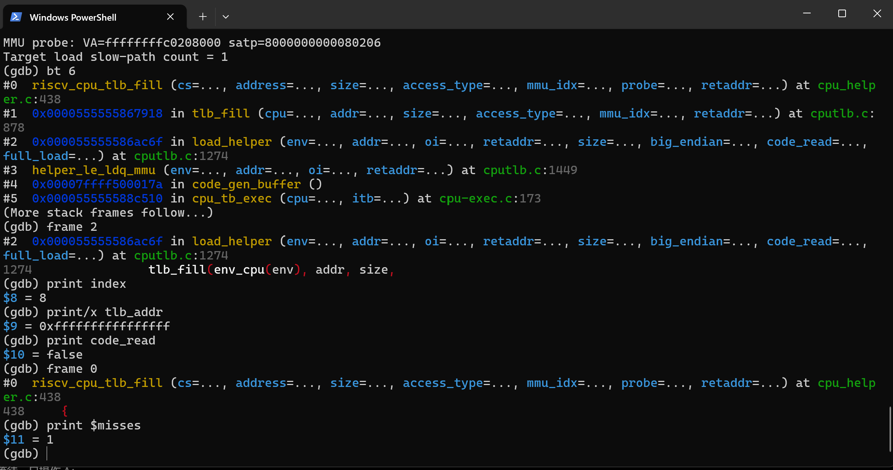
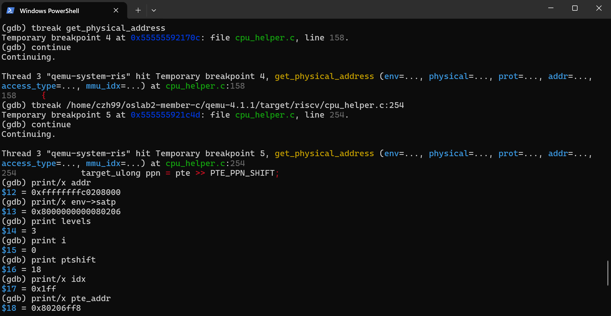
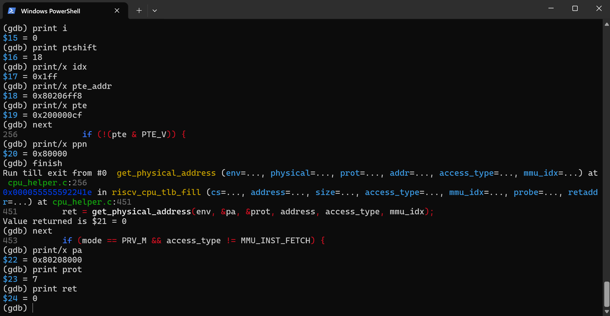
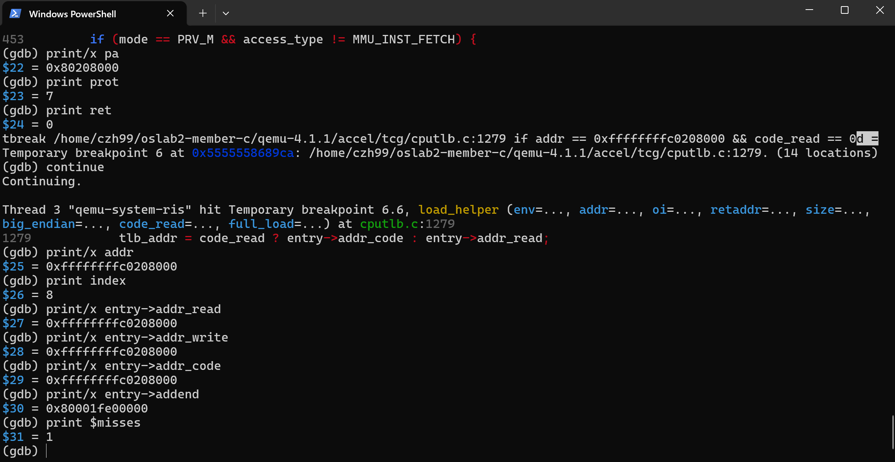
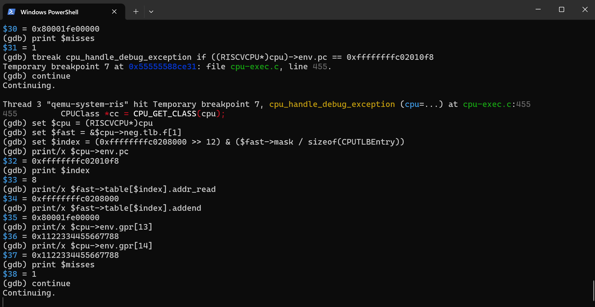
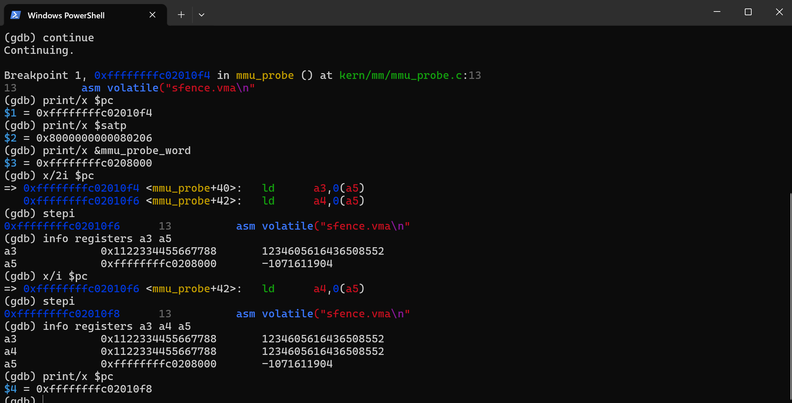
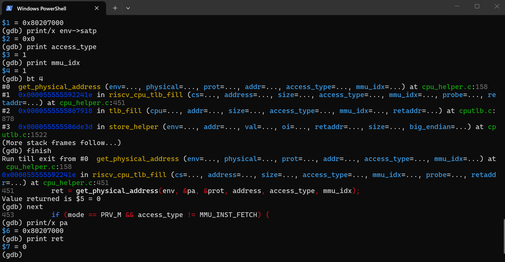
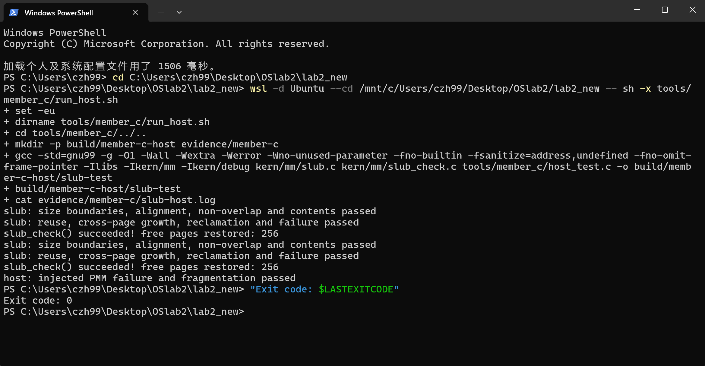

# 操作系统实验报告

## 实验基本信息

| 项目 | 内容 |
| --- | --- |
| **实验名称** | Lab2：物理内存和页表 |
| **小组成员** | 2411824 于蕾、2412790 杨茜茹、2413921 程子涵 |
| **本报告负责人** | 2413921 程子涵（成员 C） |
| **完成日期** | 2026-10-18 |
| **报告范围** | QEMU 六项调试、SLUB 拓展、最终联调及要求覆盖核对 |

### 小组分工

| 成员 | 负责的练习/模块 | 报告与公共职责 |
| --- | --- | --- |
| 2411824 于蕾（A） | page_init、First-Fit、Best-Fit、硬件内存探测思考题 | 物理内存初始化、Best-Fit 与内存探测思考题 |
| 2412790 杨茜茹（B） | Buddy 设计、实现与测试 | Buddy 设计、实现与测试；代码集成 |
| 2413921 程子涵（C） | QEMU 地址翻译/TLB 六项调试、SLUB 实现与测试 | 本报告、调试证据及 lab2-cheng 分支交付 |

本报告按照指定仓库的“实验基本信息—实验目的—实验环境—整体逻辑—实验内容与实现—测试与验证—总结”格式编排。A/B 的详细材料分别见 [A 报告](contributions/A/report.md)、[B 报告](buddy/lab2_B_Buddy实验报告.md)；A、B 的个人开发记录分别保存在对应材料中。

报告中的 8 张截图取自指定目录，保持原图。10 月 17 日截图记录宿主测试或 First-Fit 隔离内核；10 月 18 日的 Best-Fit/Buddy 集成结果由对应运行日志支持。

---

## 一、实验目的

1. 理解物理内存发现、Page 描述符、页级管理器与对象级分配器的分层关系。
2. 通过简化 SLUB 理解对象分类、内部碎片、复用、失败处理和空页回收。
3. 使用双 GDB 观察 QEMU 模拟的页表翻译和软件 TLB，核对 VA、PTE 与 PA。
4. 依据接口规格和实际验证记录完成实现，区分宿主测试、客体运行与源码分析的结论。

---

## 二、实验环境

### 2.1 AI 编程工具

| 成员 | AI 编程工具 | 底层模型 | 备注 |
| --- | --- | --- | --- |
| 2413921 程子涵 | Codex 桌面应用 | 未记录 | 用于代码辅助、调试和文档整理，关键结果均通过源码与运行记录核对 |

提示词依据最终源码和测试要求整理。A、B 的工具与开发记录以各自提交材料为准。

### 2.2 软硬件与调试环境

| 项目 | 实际环境 |
| --- | --- |
| 宿主 | Windows + WSL2，x86_64，Ubuntu 26.04.1 LTS |
| 交叉编译器 | riscv64-unknown-elf-gcc 14.2.0 |
| 内核架构 | rv64imac_zicsr_zifencei，lp64 |
| 模拟器 | 官方源码构建的 QEMU 4.1.1 调试版 |
| 宿主 / 客体 GDB | gdb 17.1 / gdb-multiarch 17.1（riscv:rv64） |
| 宿主测试 | 原生 GCC，ASan/UBSan |
| 调试目标 | 本目录最终集成 bin/kernel、bin/ucore.img |
| 地址与端口 | 双 GDB 使用 127.0.0.1:12349 |

QEMU 配置为：

```sh
./configure --target-list=riscv64-softmmu --enable-debug \
  --disable-werror --disable-docs --python=python3
make -j8
```

调试构建放在工程外的可配置目录，不要求 make install。实际路径、工具版本、源码及内核哈希见 [environment.json](evidence/member-c/environment.json)。源码版本以该记录为准，不把其他版本的函数名套入本次分析。

---

## 三、实验整体逻辑分析

### 3.1 本章节的逻辑主线

启动时 OpenSBI 将 hartid、设备树物理地址传给 `kern_entry`。入口保存这些信息，设置 satp 并通过 `sfence.vma` 使地址翻译状态一致，切换到高地址内核入口。`kern_init` 解析设备树后调用 `pmm_init`，由其选择页管理器、初始化 Page 描述符和空闲页区间，再运行页分配检查。SLUB 位于此页分配层之上，把页切分成适合小对象的槽；大对象则直接使用连续多页。

本人的 MMU 探针安排在 `pmm_init` 前，便于把页表翻译与页分配器分开观察；SLUB 检查安排在 `pmm_init` 后，因为它必须依赖有效的公共页接口。这两个位置都通过编译开关控制。

最终版本采用 A（于蕾，2411824）的 `page_init()` 与 Best-Fit，以及 B（杨茜茹，2412790）的 Buddy 接入。默认管理器为 Best-Fit，`BUDDY=1` 时切换 Buddy；C 的 `SLUB_CHECK=1`、`MMU_PROBE=1` 分别打开对象分配检查与 MMU 探针。SLUB 完成回收后再次运行当前 PMM 检查，检验底层结构是否仍有效。

A 的初始化按实际内核末端放置 Page 描述符，因此 B 的静态 Buddy 元数据和 C 的测试数组都会影响可用页数。不同构建的初始空闲页数不能直接当作算法损失来比较。最终默认启动、两种管理器上的 SLUB 均进行了干净构建与 QEMU 实跑；Best-Fit 的 `basic_check()` 和 `best_fit_check()` 与原始框架逐字核对，未修改。

### 3.2 功能的逐步实现

1. A 从设备树确定 RAM 范围，初始化描述符并排除保留区，建立公共页接口的有效初态。
2. A 的 Best-Fit 和 B 的 Buddy 提供不同页级策略；两者经 pmm_manager 接入，默认保持 Best-Fit。
3. C 在公共页接口上实现 SLUB，再用独立对象测试和可控宿主失败模型验证，不读取页管理器私有状态。
4. C 用两条真实 ld 与启动时 Bare sd 分开观察地址翻译和 SoftTLB；最终在完整集成内核重采双 GDB 证据。
5. 分别干净构建各配置，核查原评分、对象回收与底层不变量，整理报告、提示词和可追踪附件。

---

## 四、实验内容与实现

### 功能模块二拓展：任意大小内存单元 SLUB 分配

#### 任务一：模块设计、实现与内核接入

**负责人：** 2413921 程子涵。

##### 模块功能描述

需要实现的接口位于 `code/kern/mm/slub.c` 和 `code/kern/mm/slub.h`：

```c
void slub_init(void);
void *slub_alloc(size_t size);
int slub_free(void *ptr);
size_t slub_object_size(const void *ptr);
size_t slub_owned_pages(void);
```

`slub_check()` 由任务二实现，本任务保留声明和条件接入。共享文件为 `code/kern/init/init.c` 的 SLUB 条件调用和 Makefile 的显式开关；A/B 的 PMM 实现、Page 布局和原有测试不改变。

完整实现规格和独立测试要求见[综合提示词](prompt.md)的任务一、任务二。本实现保留简化 SLUB 的两层思想，不包含 Linux 的 per-CPU slab、NUMA、并发同步或调试红区。

`slub_alloc(size)` 首先拒绝 0，按最小适配类别选择对象大小。在对应链表中寻找未满 slab，通过 bitmap 找到空槽后置位、增加 used 并返回 16 字节对齐的槽地址。未满 slab 不存在时，`new_slab` 向公共 PMM 取一页并在页首建立元数据。RV64 下头部 sizeof=72，对齐后占 80 字节，例如 16 字节类别能放 251 个对象。

超过 2048 字节的请求由单独的连续多页块承载，页数为 `ceil((size+header)/PGSIZE)`；记录原始 page、npages 和对象长度。请求 4096 字节时头部也占空间，因此需要两页，不能只取一页。计算前检查加法溢出；PMM 返回 NULL 时不登记任何新 slab。

`slub_free(ptr)` 先遍历可信的活动 slab 元数据，找到范围后验证是否正好位于槽起始处以及该槽是否占用，避免先把任意地址当作 slab 头解引用。释放槽后若 used 归零，则先保存页描述符、请求页数和后继，摘链，再调用 free_pages。归还后不再访问该页。NULL 成功返回，内部指针、未重分配前的重复释放和未知地址返回 -1。

`slub_init` 是幂等初始化，重复调用不会清空正在使用的对象。`slub_owned_pages` 给出本模块尚未交还 PMM 的请求页数，`slub_object_size` 用于查询有效对象类别/请求长度。实现不改变 struct Page，不占用 First-Fit/Best-Fit/Buddy 的私有标志位。

与 B 的 Buddy 契约核对后，3 页请求实际占 4 页，但必须仍以 `free_pages(page, 3)` 释放。SLUB 的 `npages` 保存原始请求数，符合该契约。`slub_owned_pages()` 统计的是请求页数，不包含 Buddy 额外舍入占用；测试以释放后 `nr_free_pages()` 恢复和 Buddy 不变量检查共同验证无泄漏。8193 字节大对象加头部后请求 3 页，最终 Buddy＋SLUB 实跑覆盖了这一非二次幂路径。

当前遍历链表和 bitmap 的复杂度不要求常数；释放也会扫描活动 slab。可通过 partial/full 链表、页归属索引或 per-CPU cache 改善，但需要额外元数据和同步。即时回收空页减少长期占页，也会在频繁分配释放时增加页级操作。

##### 实现规格

全文见 [综合提示词任务一](prompt.md#task-1)，采用 `[PROMPT]`、`[RELY]`、`[GUARANTEE]`、`[SPECIFICATION]`。RELY 按真实 `pmm.h` 的 uintptr_t 签名和已注释的 KADDR 核对；GUARANTEE 列出五个实现接口、白名单和禁止改动项；SPECIFICATION 逐个规定初始化、分类、大对象、溢出、失败、非法释放、回收与查询的前后条件。明确要求修改真实文件，不仅展示代码。

##### 实现迭代过程

早期验证使用与原页接口兼容的隔离 First-Fit；用户提供 A/B 分支后，改为最终初始化和管理器联调。核对 B 的原始请求页数释放契约，保留 SLUB 的原始 npages；此处是集成约束核对，不声称发现并修复了不存在的 Buddy 算法错误。最终结果和可观察边界见第五章。

#### 任务二：独立测试与运行证据

**负责人：** 2413921 程子涵。

##### 模块功能描述

内核接口为 `void slub_check(void)`，实现位于 `code/kern/mm/slub_check.c`。宿主 `code/tools/member_c/host_test.c` 提供 main、PMM 模型、cprintf 和 __panic 的适配定义，直接链接真实 SLUB；这些定义不进入内核链接。run_host.sh 开启 ASan/UBSan，run_qemu.py 检查真实管理器与 PMM/SLUB 标记。

##### 实现规格

全文见 [综合提示词任务二](prompt.md#task-2)。按公开 API 独立验证类别、16 字节对齐、不重叠、逐字节内容、幂等初始化、槽复用、320 对象跨页、四轮回收、异常输入、底层失败和碎片化；分别规定内核和宿主 Case。禁止读取私有 bitmap 或改算法/原测试凑通过。

##### 实现迭代过程

分类判断从“容量大于请求”收紧为精确类别契约；保留 anchor 后复用 hole，排除底层 PMM 恰好重用同一页的干扰。最终分别切换 Best-Fit/Buddy，并在 SLUB 回收后再检查底层不变量。当前独立提示词属于规范化整理稿，实际结果来自已保存日志。

### 调试模块：QEMU 地址翻译与 TLB

#### 调试任务一：关键调用路径、分支与真实访存

**负责人：** 2413921 程子涵。

##### 模块功能描述与涉及接口

`void mmu_probe(void)`、探针数据和两个汇编标签；capture_debug.py / record_environment.py 的 CLI。QEMU 的 get_physical_address、riscv_cpu_tlb_fill 等均为只读观察目标，不修改接口。

本次确认的数据读取慢路径为：

```text
客体 ld → TCG 生成的 x86 代码
       → helper_le_ldq_mmu
       → load_helper
       → [主 SoftTLB 不命中，victim 也未命中]
       → tlb_fill → riscv_cpu_tlb_fill
       → get_physical_address
       → 权限/PMP 检查 → tlb_set_page
       → 对实际宿主内存完成读取
```

路径由 `qemu-host-trace.log` 的真实调用栈支撑。`load_helper` 在 `accel/tcg/cputlb.c:1248` 附近计算 mmu_idx、索引和按访问类型选择的 tag，1271 行附近判断主表是否命中，失败后检查 victim 表，再调用 tlb_fill。不能把所有读取都画成必然调用 C helper：正常 TCG 快路径直接执行生成的宿主指令，参见下文“调试任务三”。

`target/riscv/cpu_helper.c:155` 附近的 `get_physical_address` 依次处理以下分支：

1. M 模式数据访问可能因 MPRV 使用 MPP 指定的有效特权级；M 模式或没有 MMU 特性时走恒等映射。
2. 通过 satp.MODE 选择 Bare、Sv32、Sv39 等。Bare 返回同地址，Sv39 设置 levels=3、ptidxbits=9、ptesize=8。
3. 检查地址的高位是否符合 Sv39 符号扩展；不规范地址翻译失败。
4. 逐层取 PTE，V=0 失败，R/W/X 全 0 则将 PPN 当作下级页表基址；遇到叶子则进行非法权限组合、U/S、SUM/MXR、超级页对齐及访问权限检查。
5. 必要时更新 A/D。成功后计算物理页基址和权限，再由调用者检查 PMP 并安装 SoftTLB；失败则返回 probe 失败或注入访问/页异常。

这里描述的是 QEMU 4.1.1 的代码，不能直接套用更新版本的函数名或新特权规范分支。



图 1：10 月 17 日原始手工调试。调用栈包含 `load_helper → tlb_fill → riscv_cpu_tlb_fill`；index=8、tag 全 1、code_read=false，确认这是数据读取的首次未命中。目标地址条件和访问类型过滤避免将取指混入。

##### 实现规格

完整提示词见 [综合提示词任务三](prompt.md#task-3)。先校验源码与二进制，再用客体 ld 触发宿主条件断点。Case 区分真实数据读、取指、调试器旁路、环境失败和重新链接；禁止修改 QEMU 或生成替代 PMM。

##### 实现迭代过程

上述结论按源码分析与实际观察分别标注。最终内核重新链接后的 PC 从符号自动取得；历史截图保持原样，不把旧画面说成最终管理器集成结果。没有实际触发的分支或故障不写成已经动态验证；相关问题处理汇总于任务六。

#### 调试任务二：单步页表翻译与手工核算

**负责人：** 2413921 程子涵。

##### 模块功能描述与涉及接口

capture_debug.py 的 --step 入口。观察 get_physical_address 的 env、physical、prot、addr、access_type、mmu_idx，不修改 QEMU C 接口。

10 月 17 日原截图中第一条指令为 `0xffffffffc02010f4: ld a3,0(a5)`，下一条为 `0xffffffffc02010f6: ld a4,0(a5)`。10 月 18 日最终集成内核重新链接后，两条 PC 分别为 `0xffffffffc0200fcc`、`0xffffffffc0200fce`，执行后为 `0xffffffffc0200fd0`；a5 仍指向 `mmu_probe_word`，VA、satp、PTE 与下面手算值一致。自动脚本从当前内核符号取地址，不硬编码截图中的 PC。两条指令的访问类型均是 `MMU_DATA_LOAD=0`，有效特权模式为 S，mmu_idx=1。

| 变量 | 实测值 |
| --- | --- |
| VA | `0xffffffffc0208000` |
| satp | `0x8000000000080206` |
| MODE / ASID / 根 PPN | 8（Sv39）/ 0 / `0x80206` |
| 根页表 PA | `0x80206000` |
| VPN[2] / VPN[1] / VPN[0] / 页内偏移 | 511 / 1 / 8 / 0 |
| 实际 PTE 读取地址 | `0x80206ff8` |
| PTE | `0x200000cf` |
| PPN / ptshift / i | `0x80000` / 18 / 0 |
| 输出物理页基址 | `0x80208000` |
| prot / 返回状态 | 7（R/W/X）/ 0（成功） |
| 两次实际读取结果 | 均为 `0x1122334455667788` |

核算过程如下：

```text
root = (satp & ((1<<44)-1)) << 12 = 0x80206000
idx  = (VA >> 30) & 0x1ff = 511
PTE 地址 = root + 511*8 = 0x80206ff8
PTE PPN  = 0x200000cf >> 10 = 0x80000
PTE flags = 0xcf = V | R | W | X | A | D
```

根级 PTE 已含 R/X，是 1 GiB 超级页叶子，不是下级页表指针。PPN 的低 18 位为 0，满足超级页对齐；因此循环在 i=0 就成功返回，虽然 levels=3，也不会再取 VPN[1]、VPN[0] 对应的页表项。

QEMU 对超级页构造 4 KiB 粒度的结果：

```text
vpn = VA >> 12
physical_page = (PPN | (vpn & ((1<<18)-1))) << 12
              = (0x80000 | 0x208) << 12
              = 0x80208000
PA = physical_page | (VA & 0xfff) = 0x80208000
```

也可用映射起点交叉检查：该根项把 `0xffffffffc0000000` 起的 1 GiB 映射到 `0x80000000`，故 VA 的 `0x208000` 偏移得到同样结果。`get_physical_address` 在分页成功路径返回物理页基址；本次偏移恰为 0，不能据此声称该函数在所有输入下都会直接返回完整字节地址。

`qemu-host-step.log` 保存了宿主 next、局部变量、PTE 读取后分支和 finish 的真实输出。刚停在 `ppn = ...` 这一行时赋值尚未执行，ppn 显示的是未初始化值；next 后才成为 524288。finish 返回至调用表达式时 `ret` 的赋值同样可能尚未完成，应看返回值 0 和已写入的 pa/prot，或再单步至下一行。日志保留这些现象，没有将垃圾值当作算法结果。



图 2：levels=3，实际 i=0、ptshift=18，根索引为 `0x1ff`，PTE 地址为 `0x80206ff8`。尚未将“支持三级”误写为“实际遍历三级”。



图 3：单步后 PPN=`0x80000`，函数成功返回，下一行可见 PA=`0x80208000`、prot=7。图 2、图 3与手算共同构成完整转换证据。

##### 实现规格

完整提示词见 [综合提示词任务四](prompt.md#task-4)。Case 覆盖根表、真实 PTE、根级超级页、PA 组合、赋值时机和与预期不同的映射；单步与公式必须互相核对，不预设每次走满三级。

##### 实现迭代过程

上述结论按源码分析与实际观察分别标注。最终内核重新链接后的 PC 从符号自动取得；历史截图保持原样，不把旧画面说成最终管理器集成结果。没有实际触发的分支或故障不写成已经动态验证；相关问题处理汇总于任务六。

#### 调试任务三：TLB 查询、未命中、填充与命中

**负责人：** 2413921 程子涵。

##### 模块功能描述与涉及接口

capture_debug.py 中 Query.stop、Fill.stop、DebugStop.stop 和 trace CLI；只读 load_helper、tlb_hit、victim_tlb_hit、tlb_set_page、tcg_out_tlb_load。

QEMU 4.1.1 中可以找到 C 代码：`cputlb.c` 的 `load_helper` 计算索引并用 `tlb_hit` 比较 tag，`victim_tlb_hit` 检查被替换表项，`riscv_cpu_tlb_fill` 调用页表翻译，`tlb_set_page` 安装结果。表项按访问类型有 addr_read、addr_write、addr_code，以及宿主地址换算 addend。

本次 SoftTLB 的 fast.mask=2016，即 `63*32`，表项大小 32，故共有 64 个直接索引槽，当前访问的索引为 `(VA>>12)&63=8`。这是本次运行快照，不是 QEMU 所有配置固定为 64 项。

| 观察时刻 | 读 tag | 说明 |
| --- | --- | --- |
| 第一条 ld 前 | `0xffffffffffffffff` | 无效表项 |
| 第一次 C 查询 | 同上，code_read=false | 数据读取，主表未命中 |
| 第一次 ld 完成 | `0xffffffffc0208000` | 已填充，权限为 R/W/X |
| 第二次 ld 完成 | 同上 | 两次均读取正确值，未再次进入目标地址的 refill/walk |

第一次 ld 的真实调用栈包含 victim 检查后的 tlb_fill，说明本次 victim 也没有提供匹配项。日志只出现一次目标地址的真实数据页表遍历，而客体日志确认两条 ld 都执行结束。

第二次访问不一定再次进入 load_helper，所以只在 C helper 上打断点，不能观察每次命中。x86_64 的 `tcg/i386/tcg-target.inc.c:1699` 中 `tcg_out_tlb_load` 会生成取索引、比较 tag、`jne slow_path` 和加 addend 的宿主机器码。匹配时直接访问 `guest_VA + addend` 对应的宿主 RAM 地址。它缓存的不仅是客体 VA→PA 关系，还包含把访存快速导向宿主内存的资料。本次“第二次走快路径”的结论由已填充表项、两次完成值、仅一次慢路径记录及该源码共同支持，未声称测得真实硬件命中耗时。

自动脚本只把调用者为 `riscv_cpu_tlb_fill` 的 get_physical_address 记为 REAL_WALK，避免把客体 GDB 的 `x`、断点设置或源码读取造成的 `riscv_cpu_get_phys_page_debug` 路径混入。取指使用 addr_code / MMU_INST_FETCH，不能和数据 load 的 addr_read 混淆。



图 4：填充后 addr_read/write/code 均为目标虚拟页，addend 用于换算宿主地址，目标数据慢路径计数为 1。addend 不能解释为客体物理页号。



图 5：PC 前进到 `0xffffffffc02010f8`，gpr[13]/gpr[14] 都为 `0x1122334455667788`，目标慢路径计数仍为 1，说明第二次没有重新遍历页表。



图 6：客体视角确认两条 ld 分别执行，a3/a4 得到相同值。这与宿主 TLB 快照相互核对，避免仅凭“断点没触发”判断命中。

##### 实现规格

完整提示词见 [综合提示词任务五](prompt.md#task-5)。三次快照、两条指令和一次目标慢路径共同验证；Case 明确 miss/fill/hit、容量解释及证据缺失。禁止写表项制造命中，禁止把 addend 当客体 PA。

##### 实现迭代过程

上述结论按源码分析与实际观察分别标注。最终内核重新链接后的 PC 从符号自动取得；历史截图保持原样，不把旧画面说成最终管理器集成结果。没有实际触发的分支或故障不写成已经动态验证；相关问题处理汇总于任务六。

#### 调试任务四：Bare 模式与真实 CPU TLB 的逻辑区别

**负责人：** 2413921 程子涵。

##### 模块功能描述与涉及接口

capture_debug.py 的真实 Bare store 观察分支；entry.S 的 sd、store_helper 与翻译函数均只读，不新增 C API。

客体在 `0x80200008` 执行 `sd a0,0(t0)`，保存 hartid。此时 satp=0，t0=`0x80207000`。日志记录：

```text
REAL_WALK addr=0x80207000 satp=0 access=1 mmu_idx=1
WALK_RETURN result=0 physical_page=2149609472 prot=7
FILL addr=2149609472 pa=2149609472 ret=0 prot=7 access=MMU_DATA_STORE
```

即 Bare 数据存储仍通过软件慢路径完成恒等翻译并填入 QEMU SoftTLB，没有访问页表。另有 satp=0 时对 `0x80200000` 的真实取指记录，但数据存储更便于与 Sv39 数据加载比较。

真实 RISC-V 在 Bare 模式下对这些访问不做分页地址翻译，但仍受特权、PMP 等物理访问规则约束；硬件是否复用某种内部缓存结构属于微架构选择。QEMU SoftTLB 则是模拟器加速全部被模拟内存访问的软件缓存，即使客体关闭分页，也需要把客体地址导向宿主 RAM、MMIO 或其他 MemoryRegion。因此不能把“QEMU Bare 仍查询 SoftTLB”解释为“硬件 Bare 也必须走分页 TLB”，也不能把软件直接索引、victim 策略或当前容量当成真实 CPU 的结构。



图 7：satp=0、access_type=1，调用栈为 store_helper 的慢路径，返回 PA=`0x80207000` 与输入相同；支持“未启用分页时仍有 QEMU 软件地址缓存”这一比较。

##### 实现规格

完整提示词见 [综合提示词任务六](prompt.md#task-6)。Case 明确 Bare sd、恒等地址结果、Sv39 对照、保护约束和软件/硬件区别；不以入口取指替代数据存储，不手动改 satp 制造结果。

##### 实现迭代过程

上述结论按源码分析与实际观察分别标注。最终内核重新链接后的 PC 从符号自动取得；历史截图保持原样，不把旧画面说成最终管理器集成结果。没有实际触发的分支或故障不写成已经动态验证；相关问题处理汇总于任务六。

#### 调试任务五：实际观察与理解变化

**负责人：** 2413921 程子涵。

##### 模块功能描述与涉及接口

报告对应小节，无需新增 C/Python 接口。

首先，Sv39 有三个地址索引不意味着每次都读三个 PTE。本内核的汇编注释说“三级页表”，但实际只布置了根页表的第 511 项，一个叶子就覆盖 1 GiB。必须看叶子条件与实际循环次数。

其次，断在某个 C 赋值行不等于该行已经执行。单步日志中的 ppn 和 ret 一度显示旧值或垃圾值，结合当前源码行与 next 后结果，才能判断何时变量有效。

再次，第二条 ld 没有再次触发 load_helper 断点并不意味着没有访存；寄存器结果、SoftTLB 表项和 TCG 生成器共同解释了命中快路径。此前如果只跟踪 MMU 翻译函数，就只能看到未命中。

最后，客体暂停和 QEMU 进程暂停是不同状态。宿主 GDB 持有 QEMU 时，客体 GDB 等待 stub 应答属于预期配合。自动脚本用两个独立调试器复现这一关系，而不是把两个目标混在一个 GDB 架构里。

##### 实现规格

完整提示词见 [综合提示词任务七](prompt.md#task-7)。每个现象按观察、原理解、证据、修正展开；Case 包含三级与叶子、局部变量赋值、TCG 快路径、双 GDB 等待和地址版本，不编造趣事。

##### 实现迭代过程

上述结论按源码分析与实际观察分别标注。最终内核重新链接后的 PC 从符号自动取得；历史截图保持原样，不把旧画面说成最终管理器集成结果。没有实际触发的分支或故障不写成已经动态验证；相关问题处理汇总于任务六。

#### 调试任务六：问题定位与记录

**负责人：** 2413921 程子涵。

##### 模块功能描述

本任务不新增代码接口，修改报告中的真实问题记录。用户先要求结合指定 A/B 分支完成成员 C 的功能、选图和清理，再要求按照仓库标准格式和七项检查逐任务重写提示词。以下记录问题和处理意图，不伪装成历史逐字聊天。

| 问题情景 | 思路与提问意图 | 实际处理 | 验证依据 |
| --- | --- | --- | --- |
| 本地旧骨架缺少 A/B 交付，旧说明仍写等待 | 先核对用户给出的两个分支，确定哪个包含完整基础代码 | 以已包含 A 的 lab2-yang 为底座，接入 C 的 SLUB 与探针 | 来源提交、integration.json、最终三种配置日志 |
| 单看翻译函数不足以证明第二次 hit | 需要同时看到指令完成、TLB 状态与慢路径次数 | 使用三次快照、两条 ld 的值及 TCG 源码交叉核对 | host/guest trace 和原截图 |
| Bare 对照仅靠取指不充分 | 找启动阶段确定会执行的数据存储 | 观察保存 hartid 的真实 sd，过滤地址与访问类型 | satp=0、access=1 的 REAL_WALK/FILL |
| 切换宏可能复用旧对象 | 必须确认实际构建配置而非只看命令 | 各配置先 make clean，检查运行管理器名称 | 三份构建日志、默认/Best-Fit/Buddy 运行日志 |
| Buddy 请求 3 页实际占 4 页 | 核对释放应传实际占用还是原请求 | 按 B 契约保留原始 3 页，执行大对象及回收后的不变量检查 | Buddy＋SLUB 恢复 31792 页 |
| 首次 make grade 被 CRLF 阻断 | 区分 shell 解析错误和分配器错误 | 统一 LF 后重跑，保留评分规则 | grade.log，20/20 |
| 旧提示词过短且合并在单稿 | 逐任务核对接口、范围和 Case，避免套错示例路径/签名 | 新建八份标准提示词；删除被替代的 C 旧稿并修正引用 | README 提示词检查表、文档链接核查 |

##### 实现规格

全文见 [综合提示词任务八](prompt.md#task-8)。Case 明确历史与当前状态、提问意图和逐字原话、源码分析与实跑、代码 bug 与环境问题、没有实际 bug 时的表述，以及未知模型版本的处理。禁止编造 A/B 或本人经历。

##### 实现迭代过程

最初的短提示词按功能概述给出约束；本次对照标准文件补为八份独立任务。每份写明目标文件、必须修改真实文件、全部适用接口、真实 RELY、白名单/禁区、明确前后条件与 Case、系统限制。此次只调整文档，原有测试结果沿用真实日志；文档引用检查不被称为重新运行 QEMU。

没有将未出现的分配器越界、泄漏或重复发放写成“实际修复过的 bug”。B 的原稿已包含 A+B 联调，本次新增的是 C 的对象层与最终调试集成，不把 B 原稿误述为始终只有宿主测试。

---

## 五、测试与验证

### 5.1 SLUB 覆盖、结果与截图

| 测试 | 为什么有效 | 实际结果 |
| --- | --- | --- |
| 1、15、16、17 … 2048 及 2049/4095/4096/4097/8193 | 检查分类、对齐与大对象页数边界；比较精确预期类别 | 宿主、QEMU 均通过 |
| 多对象两两区间不重叠 | 发现重复发放或步长不足 | 均通过 |
| 所有对象写不同模式，再逐字节读取 | 发现后续分配、头部或槽写入破坏已存数据 | 均通过 |
| 保留 anchor，释放并重新申请 hole | 不靠 PMM 重新返回同一页，直接验证页内槽复用 | 均通过 |
| 320 个 16 字节对象、四轮交错释放 | 净对象数据已超过 4 KiB，保证跨页；核查计数恢复 | 均通过 |
| 0、SIZE_MAX、NULL、栈地址、内部地址、重复释放 | 验证非法请求无越界、无错误回收 | 均通过 |
| 请求页数超过当前可用总数 | 验证失败时统计不变 | 均通过 |
| 注入 PMM 返回 NULL，且已有对象仍存活 | 强制覆盖底层分配失败路径 | 宿主通过 |
| 所有页耗尽 | 确认无空闲页时无法创建新 slab | 宿主通过 |
| 128 个单页空洞、没有连续两页 | 总量充足仍失败，检查连续大对象处理 | 宿主通过 |

宿主测试编译真实的 `slub.c` 与 `slub_check.c`，只替换底层 PMM 为 256 页可控存储，开启 `-fsanitize=address,undefined`。测试包含两次完整 slub_check 和额外底层失败案例；无 sanitizer 报错，最终恢复 256 页。

2026-10-18，合并 A/B 后在 QEMU 4.1.1 中运行最终 Best-Fit＋SLUB，串口输出见 [最终日志](evidence/member-c/slub-qemu-final.log)：

```text
memory management: best_fit_pmm_manager
check_alloc_page() succeeded!
slub: size boundaries, alignment, non-overlap and contents passed
slub: reuse, cross-page growth, reclamation and failure passed
slub_check() succeeded! free pages restored: 31927
```

另外，默认 Best-Fit 启动恢复到无 C 测试开关的配置，初始空闲页为 31929；Best-Fit＋SLUB＋MMU 探针构建为 31927；Buddy＋SLUB 构建为 31792，全部回收到各自基线。Buddy 的 28/28 宿主场景也已在本次 WSL 中重跑。具体命令和证据映射见 [集成记录](docs/integration.md)。内核停在原有无限循环，运行器等待观察窗口结束后终止自己启动的 QEMU；日志尾部 SIGTERM 是测试结束方式。



图 8：选用 10 月 17 日的宿主测试截图，可见 ASan/UBSan 编译选项、两次 SLUB 检查、PMM 失败及碎片化验证和 Exit code: 0。最终集成不复用旧 First-Fit 启动截图作证明，而以本节新增日志为依据。

### 5.2 全工程回归与调试证据

| 验证项 | 已保存结果 | 证据 |
| --- | --- | --- |
| 默认 Best-Fit 启动 | PMM 成功，31929 初始空闲页 | [pmm-default.log](evidence/member-c/pmm-default.log) |
| Buddy 独立宿主 | 28/28，10 正常、18 预期拒绝 | [buddy-host.log](evidence/member-c/buddy-host.log) |
| 最终 Buddy＋SLUB | 恢复 31792 页，前后 Buddy 不变量通过 | [slub-qemu-buddy.log](evidence/member-c/slub-qemu-buddy.log) |
| 最终 Best-Fit＋SLUB＋探针 | 恢复 31927 页 | [slub-qemu-final.log](evidence/member-c/slub-qemu-final.log) |
| 原有评分 | Page Init / Best-Fit 均 OK，20/20 | [grade.log](evidence/member-c/grade.log) |
| 最终双 GDB | Bare sd、Sv39 两次 ld、一次目标 walk | [host trace](evidence/member-c/qemu-host-trace.log)、[guest trace](evidence/member-c/ucore-guest-trace.log) |
| 最终源级单步 | PTE、PPN、PA 与手算一致 | [host step](evidence/member-c/qemu-host-step.log) |

原有 basic_check / best_fit_check 未修改，规范化哈希记录在 integration.json。20/20 只覆盖原评分项，不等于对所有非法 DTB、并发或全部请求序列的证明。Buddy 的 28 个独立行为场景在宿主执行，不声称全部在真实客体中逐个执行。

指定原图中没有最终 make grade 画面，因此评分引用原始日志，不伪造评分截图。其他图均保持原始像素、在对应分析处配解释。

### 5.3 命令与附件

构建、自动双 GDB、三终端操作和清理命令见 [复现说明](reproduction.md)。当前文档格式调整没有修改源码或重跑内核，沿用上述真实实跑记录；执行证据检查脚本只表示核对已有材料。

代码位于 `../code/kern/mm/slub.c`、`slub.h`、`slub_check.c` 和 `mmu_probe.c`；共享接入由 `../code/Makefile` 与 `../code/kern/init/init.c` 控制。提示词见[综合提示词](prompt.md)，复现步骤见 [复现说明](reproduction.md)，集成记录见 [集成说明](docs/integration.md)，脚本位于 `../code/tools/member_c/`。

最终证据位于 `evidence/member-c/`：`slub-host.log`、`buddy-host.log`、三份 `build-*.log`、`pmm-default.log`、`slub-qemu-final.log`、`slub-qemu-buddy.log`、双 GDB trace/step 日志、`environment.json` 和 `qemu-source-excerpts.txt`。`historical/` 保存原截图对应的手工 GDB 日志及早期 First-Fit 结果。截图原文件名与 SHA256 见 [images/sources.json](images/sources.json)。

源码依据为官方 [QEMU 4.1.1 cpu_helper.c](https://github.com/qemu/qemu/blob/v4.1.1/target/riscv/cpu_helper.c)、[cputlb.c](https://github.com/qemu/qemu/blob/v4.1.1/accel/tcg/cputlb.c) 和 [x86 TCG 后端](https://github.com/qemu/qemu/blob/v4.1.1/tcg/i386/tcg-target.inc.c)。本轮直接读取下载归档中的对应文件并进行调试，源码定位以 environment.json 记录的实际版本为准。

成员 C 的代码、报告、综合提示词、截图和验证记录已整理到本仓库 `code/` 与 `report/` 目录，并按本次要求提交至 `lab2-cheng` 分支。A/B 原始成果作为集成来源保留。

仅使用用户指定目录内的 8 张原始 PowerShell/WSL 截图，分别覆盖宿主 SLUB、Bare 存储、数据读未命中、根 PTE 定位、页表单步返回、填充、第二次加载后的宿主状态和客体寄存器。未采用旧的自动 xterm 截图，也未放入只显示启动横幅、重复画面或尚在等待的截图。它们直接嵌入相关正文，图注写明原始版本；最终 Best-Fit/Buddy 运行结论以 10 月 18 日集成日志支撑。

---

## 六、实验总结与收获

### 6.1 对操作系统的理解

| 本实验知识点 | OS 原理对应与区别 |
| --- | --- |
| satp、VPN、PTE、叶子与权限 | 多级页表及地址空间保护；本次只有静态根级超级页，没有进程私有页表 |
| sfence.vma 与 SoftTLB | 地址翻译缓存及一致性；QEMU 实现包含宿主访存加速，不等同于硬件具体组织 |
| PMM 公共页接口 | 物理页分配、外部碎片；大对象是否成功还依赖连续空闲区 |
| SLUB 类别、bitmap 和 slab 回收 | 小对象分配与内部碎片；简化实现仍有头部和类别舍入成本 |
| 未命中与访问异常 | 翻译失败和保护检查；本次成功路径没有完整演示缺页异常处理 |

OS 原理中重要但本实验没有实现的内容包括：按需分页、缺页调入与磁盘交换、页面置换算法、写时复制、进程地址空间隔离、共享页和引用计数协议、多核 TLB shootdown、并发 slab 分配、NUMA 局部性，以及真实硬件页表遍历缓存和精确性能测量。不能从本次正确性结果推断这些能力已经具备。

### 6.2 实现与验证方法

实现前先核对接口、页面状态和所有权约定，再按边界条件设计测试。PMM 的原始请求长度、局部变量赋值时机、TCG 快路径和调试器旁路，均通过源码和执行记录确认。

报告中的工具版本、运行结果和问题处理均以保存的源码、命令输出和截图为依据；未记录的模型版本不作推测。
