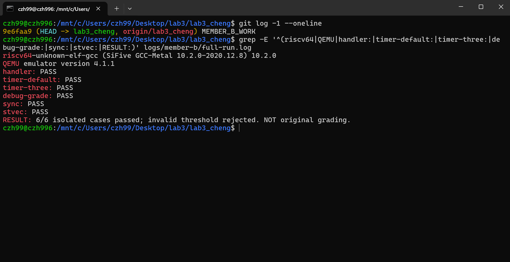
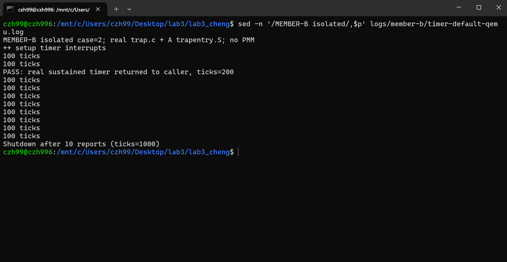
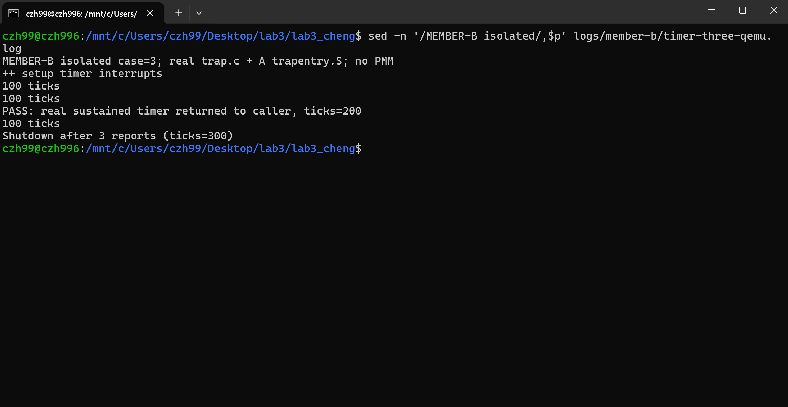
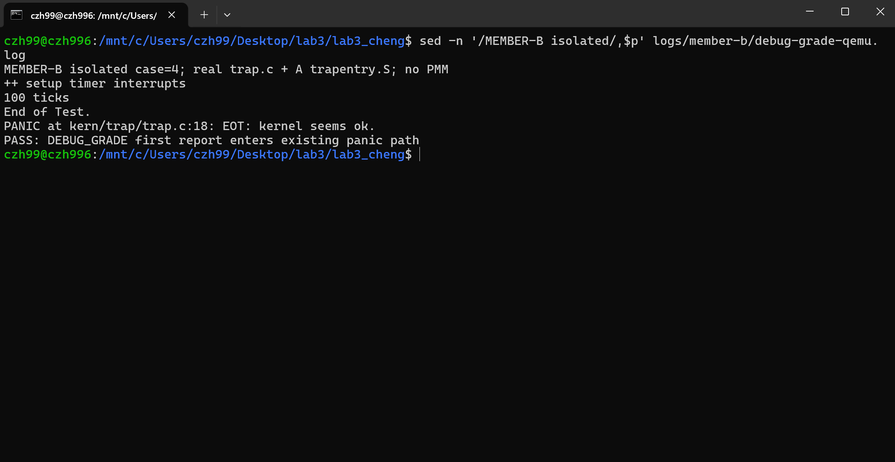
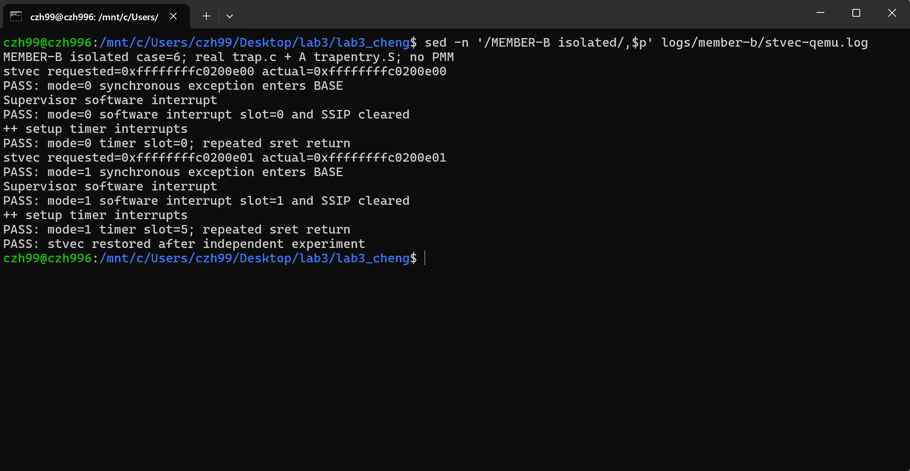
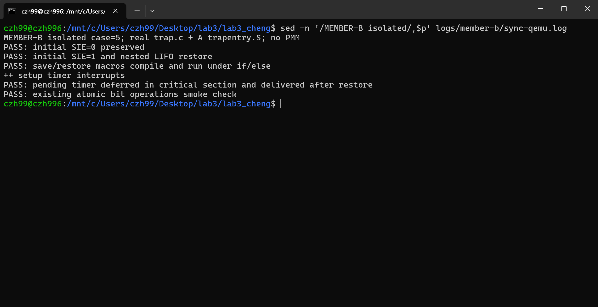

# 操作系统实验报告：Lab3（成员 B）

| 项目 | 内容 |
| --- | --- |
| 姓名、学号 | 程子涵，2413921 |
| 分工 | 中断、时钟、关机、stvec 扩展与临界区验证 |
| 日期 | 2026-10-28（Asia/Shanghai） |
| 完成范围 | 正式中断处理、独立时钟/关机验证、stvec 扩展、临界区/宏验证、提示词、测试组织材料 |
| 集成边界 | 未取得 C 的 PMM 和正式异常处理，完整内核与原评分尚未通过 |

## 一、实验目的

1. 在 A 已完成的 Trap 汇编入口和恢复流程上，实现 C 层中断分类。
2. 通过持续的 S 态时钟中断验证下一次事件设置、计数、统计输出、返回原执行流与关机。
3. 实测 `stvec` Direct/Vectored 的入口规则，并解释历史编码的兼容方式。
4. 理解中断状态的保存和恢复，验证临界区及宏的语句语义，区分局部关中断与多核同步。

## 二、实验环境

| 项目 | 实际环境 |
| --- | --- |
| 开发宿主 | Windows，Codex 桌面应用；通过 WSL Ubuntu 执行编译及 QEMU |
| AI 工具 | Codex 桌面应用 |
| 底层模型 | 会话系统标识为 GPT-6；更细型号未提供，不能推断 |
| 编译器 | SiFive GCC-Metal 10.2.0-2020.12.8；RISC-V GCC 14.2.0+19，分别验证 |
| 模拟器 | QEMU emulator version 4.1.1，virt，单 hart，128 MiB，默认 SBI 固件 |
| 独立构建 | 脚本实测探测 ISA 写法：新工具链为 rv64imac_zicsr_zifencei，旧工具链为 rv64imac；LP64，`-O2 -Wall -Werror` |
| 兼容参数 | `-Dsbadaddr=0x143`；将旧 CSR 名称映射到相同地址，不修改 A 的 SAVE_ALL |

环境与源码 SHA-256 可在运行扩展验证后生成的 `logs/member-b/result.json` 中查看。测试使用正式 `trap.c`、`clock.c`、`intr.c`、SBI 库及 A 的 `trapentry.S`；启动、控制台适配与有限的异常处理由测试夹具提供。没有把 PMM 或 C 的异常处理算作已验证。

## 三、实验整体逻辑分析（B 的补充）

时钟链路为：启动配置 `stvec` → `clock_init()` 设置 STIE 和第一次事件、清零 ticks → `intr_enable()` 设置 SIE → 固件递送 S 态时钟中断 → A 的入口保存 Trap frame → `trap()` 根据 cause 最高位分发 → B 的 handler 重设事件并计数 → A 的恢复流程执行 `sret` → 回到被打断的执行流。

硬件负责修改 EPC、cause 和状态位，软件负责保存通用寄存器、识别事件及完成处理。只安排第一次定时事件不能形成连续时钟；每次进入时钟分支都必须安排下一次事件。计数和每 100 次一次的统计是不同层次，关机阈值以统计输出次数为单位。

## 四、实验内容与实现

### 4.1 功能模块二：中断、时钟与关机

负责人：程子涵 2413921。正式改动位于 `kern/trap/trap.c` 的 `lab3 function2` 区域，保留 A 的汇编、结构体、`trap()` 和既有公共函数。

`interrupt_handler(struct trapframe *tf)` 的行为：

1. 用无符号掩码去掉 cause 的最高中断标志位，再按编号分类。保留框架 IRQ 宏，兼容原测试直接传入裸编号 15 的调用方式。
2. S 态软件中断输出 `Supervisor software interrupt`，并清除可写的 SSIP，避免真实软件中断持续挂起。
3. S 态时钟中断先调用 `clock_set_next_event()`，再令 `ticks` 恰好增加 1。仅在 `ticks % TICK_NUM == 0` 时调用原有 `print_ticks()`，输出 `100 ticks`。
4. 统计次数达到 `SHUTDOWN_AFTER` 后调用框架 `sbi_shutdown()`。默认值 10，可用 `-DSHUTDOWN_AFTER=N` 覆盖，非正值在编译时拒绝。材料未给出具体值，10 是本次实现选择，若课程补充要求不同应按其调整；它允许评分在关机前观察到 ticks=200。
5. 其他框架定义的中断输出类型；未知编号输出 `Unknown interrupt: cause N` 并调用原有 `print_trapframe(tf)`。这些类型提示不构成完整外设驱动、PLIC 应答或跨特权级中断支持。
6. handler 不修改 `tf->epc`、状态或通用寄存器；异步中断从保存的位置继续执行。返回交给 A 的统一恢复流程，不在 C handler 中执行 `sret`。

共享区域新增 `exception_handler()` 前置声明，定义仍由 C 提供。正式代码没有异常空桩；只有独立实验夹具处理明确编码的四字节断点，用于观察 stvec 路由，不能替代 C 的异常处理。

`TICK_NUM=100` 和原有 `print_ticks()` 未改。`DEBUG_GRADE` 会在第一次输出后执行原有 panic，因而到不了常规关机路径。原 `tools/grade.sh` 使用 `GRADE_LAB3_CONTEXT/ILLEGAL/TIMER`，没有启用 DEBUG_GRADE；两者不能混淆。独立 DEBUG 测试使用测试专用 panic 接收函数观察该调用，再退出 QEMU；没有声称正式 panic 本身会关机。

### 4.2 stvec 扩展及历史兼容

`stvec` 的低两位为 MODE，其余位编码 BASE 的高位；还原地址时低两位补零，因此 BASE 至少四字节对齐。不是把两个任意地址位丢掉，而是利用对齐约束。

| MODE | 同步异常 | 异步中断 |
| --- | --- | --- |
| 0，Direct | BASE | BASE |
| 1，Vectored | BASE | BASE + 4 × 原因编号 |
| 2、3 | 保留，不应当作有效模式请求 | 保留 |

例如 S 态时钟编号为 5，Vectored 下进入 BASE+0x14；这个乘数是 4，不是 RV64 指针宽度 8。向量表是可执行指令槽，本实验每槽一条四字节跳转，不能放一组八字节函数指针冒充向量入口。`.option norvc` 防止跳转变成两字节，`.option norelax` 保持布局；实验基址额外按 256 字节对齐，并检查真实符号差值与反汇编。

v1.9.1 §4.1.3 的 stvec 低两位为零，直接表示四字节对齐的入口。官方 v1.10 修订说明记载增加可选的向量中断支持。旧软件把同一个对齐地址写入新版寄存器时，MODE 自然为 00，仍按 Direct 进入同一地址。这是该字段编码的向后兼容，不表示 v1.9.1 和后续 ISA 的所有机制都完全兼容。

MODE 和可接受 BASE 受 WARL 约束；写入后必须读回核对。其他平台不保留 Vectored 请求时应记录受限/跳过，不能把 Direct 路由算作 Vectored 通过。QEMU 4.1.1 本次实际保留两种请求，均完成真实异常、软件中断和持续时钟入口验证。

实验代码在 [独立向量汇编](extensions/member_b/vector.S) 与 `extensions/member_b/fixture.c`；不纳入正式 Makefile，不修改基础 idt_init。跳板临时保存 t0/t1、记录实际槽号后恢复原栈和寄存器，再进入 A 的真实入口；完成后恢复 stvec。

官方依据（访问日期 2026-10-28）：

- [Privileged ISA v1.9.1](https://riscv.org/wp-content/uploads/2016/11/riscv-privileged-v1.9.1.pdf)，§4.1.3，印刷页 49：原 stvec 格式及四字节对齐。
- [官方历史修订说明](https://docs.riscv.org/reference/isa/v20260120/priv/priv-preface.html)，Preface to Version 1.10：增加可选向量支持。
- [Supervisor ISA 1.13，文档版本 20260120](https://docs.riscv.org/reference/isa/v20260120/priv/supervisor.html)，§11.1.1.2：模式、对齐及入口公式；§11.1.1.3：软件中断及 sip/sie。

### 4.3 临界区、do/while 宏和原子操作

`__intr_save()` 检查 SIE，原先开启时先关闭并返回 1，原先关闭时返回 0；`__intr_restore(flag)` 仅在保存值为 1 时重新开启。它恢复进入前的状态，不能用无条件 `intr_enable()` 替代。约定临界区内部不自行开启中断，嵌套时每层使用不同保存变量并按后进先出顺序恢复。

```c
bool outer, inner;
local_intr_save(outer);    // 原 SIE=1 时 outer=1，当前 SIE=0
local_intr_save(inner);    // inner=0
/* 修改受保护的数据 */
local_intr_restore(inner); // 仍然 SIE=0
local_intr_restore(outer); // 恢复原 SIE=1
```

`do { ... } while (0)` 把宏体包装成一条语句，作用域中的临时变量不外泄，循环体仅执行一次；调用者照常写末尾分号。裸多语句宏可能只有第一条受 if 控制，裸花括号宏加调用分号可能破坏 else 配对。原 `local_intr_restore(x)` 自带分号，即使只有一条调用也存在同样问题：

```c
if (condition)
    local_intr_restore(flag);
else
    fallback();
```

原宏展开后调用处出现两个分号，else 之前多出空语句，实际编译报 `else without a previous if`。本次将恢复宏也改为 `do { __intr_restore(x); } while (0)`，保持原保存/恢复函数的语义。该问题已在前期使用原始头文件重现；本分支的新宏已通过同类 if/else 用法及运行测试。

PMM 的 `alloc_pages()`、`free_pages()`、`nr_free_pages()` 都在调用管理器前保存并关闭中断，完成后按保存值恢复，保护空闲链表与计数等操作不被本 hart 的可屏蔽中断插入。本次已阅读该包装路径；管理器完整实现及路径运行验证仍需 C 补齐。

单核局部关中断不能阻止其他 hart 访问共享内存，不能消除同步异常或 M 态执行环境的活动，也不是内存屏障的通用替代。`libs/atomic.h` 用 AMO 完成单个内存字的原子读改写；它不依赖关闭 SIE。多个链表操作的整体互斥仍需锁和正确的内存顺序，不能因为用了一个 AMO 就宣称整个临界区具备多核互斥。本次只对现有常用位操作做了冒烟验证，没有扩展成完整原子库审计。

### 4.4 Spec 与提示词

以下为按本次实现整理的完整规格与提示词，包含输入依赖、实现边界和验收条件；实际发生的问题及修复记录见第五节。

#### 中断、时钟与关机

```text
[角色]
你是负责 RISC-V ucore Lab3 中断模块的成员 B，程子涵 2413921。

[输入与依赖]
基线为 NKOS 的 lab3_yang（17205d43fa49958bf965b046eb87d96c57bd36f9）。
读取 trap.c、trap.h、clock.c/h、intr.c/h、riscv.h、sbi.h、原评分脚本。
A 已实现 trapentry.S 的 SAVE_ALL→trap→RESTORE_ALL→sret 闭环。
C 的 PMM 和 exception_handler 尚未提供；不要用生产空桩假装已经集成。

[规格]
仅在 trap.c 的 lab3 function2 区域增加 interrupt_handler 及所需声明/宏。
保持原函数签名、SAVE_ALL、trapframe、trap_dispatch、trap、print_ticks 和
其他原公共函数不变；保留实验标记，署名2413921。
用无符号最高位掩码获取原因编号，允许原评分直接传入裸编号15。
软件/时钟/外部中断按现有 IRQ 宏分类；S态软件中断清除SSIP。
每次S态时钟：先重设下一次事件，再仅增加一次ticks。
每到TICK_NUM=100的整数倍调用原print_ticks。
统计输出计数达到SHUTDOWN_AFTER时调用原sbi_shutdown。
默认阈值10（材料未给数值，本次选择，须注明），支持编译参数覆盖，拒绝非正值。
保留 Supervisor software interrupt / Unknown interrupt: cause 15 / 100 ticks。
未知原因调用print_trapframe(tf)。不修改任何中断帧字段，尤其不推进异步中断EPC。
不要在C handler里直接执行sret，不修改评分脚本逻辑。

[验收]
真实trap.c与A汇编在QEMU中持续返回，主流程能观察ticks=200。
默认10次统计后在1000 ticks关机；阈值3时300 ticks关机。
边界99/100/101恰好计数、只在100输出；非时钟不改ticks。
带/不带中断标志的未知编号15均打印完整帧，handler不改EPC/status/GPR。
DEBUG_GRADE触发既有100 ticks处panic调用路径，区别于原GRADE_LAB3_*宏。
保留原始输出、编译参数、退出码和源码哈希，不能把独立测试算作原评分。
```

#### stvec 扩展

```text
[输入]
以B1和A真实trapentry.S为底层；查官方v1.9.1的stvec章节、v1.10修订说明、
现行Supervisor ISA的stvec模式和WARL规则，记录章节及链接。

[规格]
解释BASE低两位补零、MODE=00/01及保留编码，Direct所有Trap走BASE，
Vectored同步异常走BASE、异步中断走BASE+4*cause，RV64乘数仍是4。
解释旧版本低两位为零为何在新版本仍对应Direct，并限制兼容性结论范围。
独立扩展目录构建真实4字节跳转槽，关闭压缩/松弛并充分对齐。
跳板记录真实槽号，保存并恢复所用临时寄存器、原sp、sscratch约定，再进入A入口。
写stvec后读回；平台不支持时记录SKIP/受限，不伪报通过。
在两种模式中触发真实四字节断点、真实SSIP、真实连续时钟，检查槽号与返回；
断点处理仅属于实验夹具，不填入C的正式函数。
结束恢复stvec，不修改基础idt_init或正式Makefile，不把用户态切换测试算作时钟测试。

[验收]
检查timer槽符号相对BASE恰为20字节，并保存反汇编。
本平台支持时：Direct三个事件皆槽0；Vectored断点槽0、软件槽1、时钟槽5。
原始日志可复现，其他平台受限情况有明确分支。
```

#### 临界区与宏

```text
[输入]
阅读sync.h、intr.c、atomic.h及pmm.c的alloc/free/nr_free包装路径。

[规格]
解释do/while(0)的一条语句语义、调用方分号、if/else和局部作用域。
用基线头文件实际重现restore宏自带分号引发的else编译错误，保存日志；
将restore包装成do/while(0)，不改变原save/restore函数语义。
运行验证初始SIE=0和1、独立保存变量的LIFO嵌套、if/else的save/restore调用。
在真实时钟中断期间进入临界区，等待超过定时间隔，检查ticks不变且STIP挂起；
退出恢复后验证handler继续运行。
解释只屏蔽本hart可屏蔽中断的范围，以及与多核锁、AMO和内存序的区别。
对现有常用原子位操作做冒烟验证，完整PMM运行仍标记需C代码。

[验收]
不能无条件开中断，内层恢复不能提前开启，外层恢复回到原状态。
每种结果必须来自实际CSR/执行路径观察，不能只打印预设状态。
```


## 五、测试与验证

### 5.1 验证方法与结果

复现命令在工程根目录、已配置工具链的 WSL 执行：

```bash
python3 extensions/member_b/run.py
```

该命令运行 B 的六组独立 QEMU 场景，并检查非正关机阈值被编译器拒绝。测试直接使用正式中断处理、时钟代码和既有汇编入口；独立启动与断点处理仅属于实验夹具，不替代完整内核或 C 的正式异常处理。

| 场景 | 实际结果与证据 |
| --- | --- |
| 中断分类、未知中断 | 已通过；覆盖框架其余 11 种编号、带/不带标志位的未知编号15、完整帧不变 |
| 时钟边界 | 已通过；99/100/101 各增加一次，仅100处统计；EPC、状态和 GPR 不变 |
| 默认关机 | 已通过；主流程观察 ticks=200；10 行统计，ticks=1000 关机，QEMU退出0 |
| 自定义阈值3 | 已通过；主流程观察 ticks=200；3行统计，ticks=300关机，QEMU退出0 |
| DEBUG_GRADE | 已通过；100 ticks 后进入既有 panic 调用路径，没有常规阈值关机输出 |
| 临界区与宏 | 已通过；SIE=0/1、成对嵌套、if/else、计时器挂起期间不进入 handler、恢复后继续递送 |
| stvec | 已通过；Direct 全走槽0；Vectored 同步异常走槽0、软件中断走槽1、时钟走槽5；均实际返回 |
| 非正阈值 | 已通过；SHUTDOWN_AFTER=0 编译失败并包含规定错误说明 |
| 原完整 make | 失败；best_fit_pmm.c 中 free_list、nr_free 等尚未定义 |
| 原 make grade | 0/100，三组均在构建阶段失败；尚未取得 C 代码，不是运行判错结果 |

运行后会生成 `logs/member-b/result.json`、构建日志与串口输出，记录源码哈希、环境、退出码和统计行数；这些产物不随源码上传。原评分脚本的逻辑未修改；`.gitattributes` 要求 shell 脚本以 LF 检出，避免 CRLF 导致 Linux sh 无法执行。

### 5.2 运行截图

以下截图由程子涵于 2026-10-28 在本机 WSL 终端采集，源码版本为 `9e6faa9`（`MEMBER_B_WORK`）。本次报告与图片更新未修改内核实现或验证脚本。截图保留原始内容，不裁剪、不拼接；第 1 张展示日志摘要，其余展示脚本实际生成的对应串口日志。

#### 图 5-1：独立验证总览



截图同时显示源码提交、SiFive GCC 10.2.0、QEMU 4.1.1 和六组场景的 PASS。末行明确标注 `6/6 isolated cases passed` 与 `NOT original grading`，说明这是 B 的独立验证结果。

#### 图 5-2：持续时钟返回与默认关机



主流程在 `ticks=200` 时实际恢复执行；日志累计输出 10 行 `100 ticks`，最终在 `ticks=1000` 调用关机并返回终端，符合默认 `SHUTDOWN_AFTER=10` 的统计次数阈值。

#### 图 5-3：自定义关机阈值



将阈值设为 3 后，日志输出 3 行统计，保留 `ticks=200` 的返回观察，并在 `ticks=300` 关机，验证阈值可配置且统计次数准确。

#### 图 5-4：DEBUG_GRADE 行为



第一次 `100 ticks` 后输出 `End of Test.`，进入原有 `EOT: kernel seems ok.` 的 panic 调用路径，再由实验夹具确认该预期行为。此处 panic 属于 DEBUG_GRADE 验证场景，不代表原完整评分已经通过。

#### 图 5-5：stvec 模式及入口路由



两次 `stvec requested` 与 `actual` 一致。Direct 下同步异常、软件中断和时钟均进入 BASE；Vectored 下同步异常仍进入 BASE，软件中断为槽 1、时钟为槽 5。实验结束后确认 stvec 已恢复。

#### 图 5-6：临界区与中断状态恢复



验证初始 SIE=0 保持关闭、初始 SIE=1 及嵌套后进先出恢复、宏在 if/else 中正常使用；真实时钟在临界区内挂起，恢复后继续递送，常用原子位操作冒烟检查通过。

以上六图均来自独立验证，不替代老师模板要求的最终完整内核 `make qemu` 正常运行和 `make grade` 成功截图。这两类截图仍需在 C 的 PMM 与正式异常处理合入后，对最终小组版本补充。


### 5.3 实际迭代记录

1. 根据分工及 A 的接口，完成 handler、实验夹具与测试脚本。首次构建在 A 的旧 CSR 名称处失败。改用同编号兼容参数后六组独立测试通过，未修改 A 的汇编。
2. 阅读发现原恢复宏的分号问题，使用基线头文件实际重现编译失败；新宏通过 if/else 及运行验证。这是原有宏的语句展开缺陷。
3. 原评分首次因 CRLF 报 `set: Illegal option`。恢复仓库原有 LF 内容并固定 shell 换行后，评分流程正常启动，三组均因缺失 PMM 实现而构建失败。没有更改评分条件。
4. 填入用户提供的姓名、学号后重新生成最终验证证据。完整结果以最终 result.json 为准。

5. 用户交互式 WSL 优先使用 SiFive GCC 10.2，而此前非交互式环境使用 GCC 14.2。旧汇编器对显式 `zicsr/zifencei` 名称报“cannot find default versions”。验证脚本改为实际试编译所需 CSR、fence.i、AMO 指令，优先尝试新 ISA 写法，再尝试旧写法；两者均失败时才报告错误。所选写法、探测日志和编译器版本均记录，未修改内核实现或降低验收条件。

## 六、实验总结与收获

| 知识点 | OS 原理中的含义 | 本实验体现及边界 |
| --- | --- | --- |
| 时钟中断与调度 | 计时事件可以触发抢占、时间片检查及超时处理 | 已实现周期事件、计数和返回；尚未实现调度队列、进程切换或完整时间片调度 |
| 上下文与控制流 | 内核处理异步事件后应恢复被打断的计算 | 使用A的真实保存/恢复，B handler保持EPC；异常跳过指令由C负责，规则不同 |
| 临界区与互斥 | 共享状态修改须满足相应的并发约束 | 单hart关中断避免局部中断插入；多核仍需锁、原子操作及内存序 |
| 中断向量与分发 | 硬件可按事件选择入口，软件仍需处理其语义 | 实测Vectored入口偏移；不等于已有完整外设中断控制器驱动 |

重要但本实验未覆盖的原理包括：多核锁与死锁处理、完整进程调度、阻塞唤醒与睡眠队列、完整设备驱动和中断下半部、面向进程的虚拟内存保护。A/C的最小态切换扩展也不能代表实现了上述整套机制。

AI协作中的主要经验是先明确可观察验收条件，再编写代码；区分原代码缺陷、工具链兼容和缺失模块导致的失败；测试必须进入真实handler与汇编，不能只打印预设PASS；独立实验可以推动并行开发，但不能替代最终集成证据。源码哈希和原始日志使截图、结果与实现可以相互核对。

构建命令、目录说明与待合并事项见 [README](README.md)。
